# 简介

卡罗尔把命题和三段论放到分区棋盘上，用红、灰筹码表示某类事物存在或为空。书中从三个命题形式讲起，逐步进入中项、结论和谬误，再以分级练习、答案与对话检验推理；动物、食物与人物组成了这套逻辑训练的具体材料。

## 编者校勘

原印页66第12题的公式末项为y，紧接的文字却写“瘦男孩都懒惰”；页79关于松饼与小圆面包的第二前提印作“All y are m”，与题干及原图不一致。正文与译文保留原印读法。1887年原印扫描是本次符号、编号与页界校勘的依据；现代电子转录附记与作者原注分开处理。

# 正文

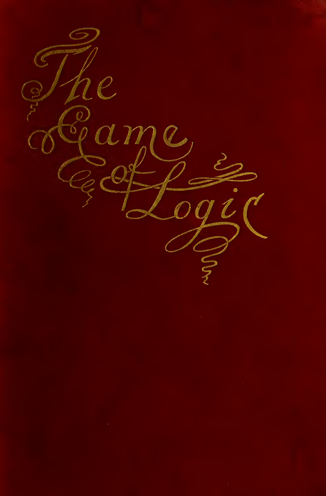

<!-- pair:en:GL00001:frontmatter -->
THE GAME OF "LOGIC."

<!-- translation -->
“逻辑”棋戏。

<!-- endpair -->

<!-- pair:en:GL00002:source_figure -->
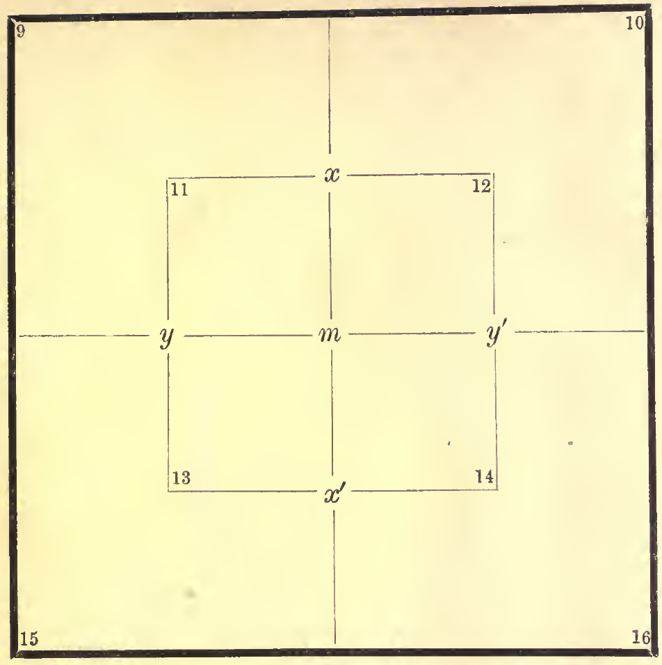

<!-- translation -->

<!-- endpair -->

<!-- pair:en:GL00003:source_figure -->
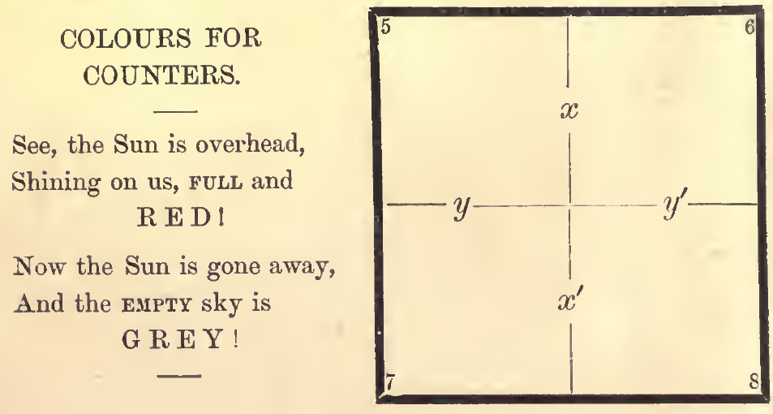

COLOURS FOR
COUNTERS
See the Sun is overhead,
Shining on us, FULL and
RED!
Now the Sun is gone away,
And the EMPTY sky is
GREY!

<!-- translation -->
筹码的颜色
看，太阳正在头顶，
照着我们，满盈而
鲜红！
如今太阳已经离去，
空空的天空一片
灰色！

<!-- endpair -->

<!-- pair:en:GL00004:frontmatter -->
THE GAME OF LOGIC

<!-- translation -->
逻辑游戏

<!-- endpair -->

<!-- pair:en:GL00005:frontmatter -->
BY LEWIS CARROLL

<!-- translation -->
刘易斯·卡罗尔著

<!-- endpair -->

<!-- pair:en:GL00006:frontmatter -->
PRICE THREE SHILLINGS
London
MACMILLAN AND CO.
AND NEW YORK
1887
[All Rights reserved.]

<!-- translation -->
售价三先令  
伦敦  
麦克米伦公司  
以及纽约  
1887  
【版权所有。】

<!-- endpair -->

<!-- pair:en:GL00007:frontmatter -->
RICHARD CLAY AND SONS,
LONDON AND BUNGAY.

<!-- translation -->
理查德·克雷及其子，
伦敦和邦盖。

<!-- endpair -->

<!-- pair:en:GL00008:poem -->
To my Child-friend.

<!-- translation -->
致我孩童挚友。

<!-- endpair -->

<!-- pair:en:GL00009:poem -->
I charm in vain; for never again,
All keenly as my glance I bend,
    Will Memory, goddess coy,
    Embody for my joy
Departed days, nor let me gaze
    On thee, my fairy friend!

<!-- translation -->
我徒然念咒；因为无论我怎样
凝神注视，今后那羞怯的记忆女神
也不会再为我欢欣
重现逝去的时光，
更不会让我再望见
你，我仙子般的朋友！

<!-- endpair -->

<!-- pair:en:GL00010:poem -->
Yet could thy face, in mystic grace,
A moment smile on me, 'twould send
    Far-darting rays of light
    From Heaven athwart the night,
By which to read in very deed
    Thy spirit, sweetest friend!

<!-- translation -->
然而，若你那面容能以神秘恩宠，
片刻间对我展露微笑，便会使
   远射的光线
   自天穹穿越黑夜，
借此方能真切地读解
   你这位最亲爱的朋友的精神！

<!-- endpair -->

<!-- pair:en:GL00011:poem -->
So may the stream of Life's long dream
Flow gently onward to its end,
    With many a floweret gay,
    Adown its willowy way:
May no sigh vex, no care perplex,
    My loving little friend!

<!-- translation -->
愿人生长梦的溪流，
缓缓流向它的尽头，
一路伴着缤纷的小花，
沿着垂柳依依的河道；
愿无叹息烦扰，无忧虑困惑
我亲爱的小友！

<!-- endpair -->

<!-- pair:en:GL00012:chapter -->
NOTA BENE.

<!-- translation -->
附注。

<!-- endpair -->

<!-- pair:en:GL00013:paragraph -->
With each copy of this Book is given an Envelope, containing a Diagram (similar to the frontispiece) on card, and nine Counters, four red and five grey.

<!-- translation -->
随本书每本附有一个信封，内含一张卡片图式（与扉页插图相似）以及九个筹码：其中四个为红色，五个为灰色。

<!-- endpair -->

<!-- pair:en:GL00014:paragraph -->
The Envelope, &c. can be had separately, at 3d. each.

<!-- translation -->
信封等可单独购得，价格为每份 3d。

<!-- endpair -->

<!-- pair:en:GL00015:paragraph -->
The Author will be very grateful for suggestions, especially from beginners in Logic, of any alterations, or further explanations, that may seem desirable. Letters should be addressed to him at "29, Bedford Street, Covent Garden, London."

<!-- translation -->
作者对于任何似乎值得采纳的改动或进一步说明，尤其是来自逻辑初学者的建议，将不胜感激。信件请寄往伦敦科文特加登贝多福街的"29"处。

<!-- endpair -->

<!-- pair:en:GL00016:chapter -->
PREFACE

<!-- translation -->
序言

<!-- endpair -->

<!-- pair:en:GL00017:poem -->
"There foam'd rebellious Logic, gagg'd and bound."

<!-- translation -->
“那里，叛逆的逻辑被堵住嘴、捆绑着，愤怒得口吐白沫。”

<!-- endpair -->

<!-- pair:en:GL00018:paragraph -->
This Game requires nine Counters--four of one colour and five of another: say four red and five grey.

<!-- translation -->
本游戏需要九个筹码——其中四个是一种颜色，另五个是另一种颜色：比方说四个红色和五个灰色。

<!-- endpair -->

<!-- pair:en:GL00019:paragraph -->
Besides the nine Counters, it also requires one Player, AT LEAST. I am not aware of any Game that can be played with LESS than this number: while there are several that require MORE: take Cricket, for instance, which requires twenty-two. How much easier it is, when you want to play a Game, to find ONE Player than twenty-two. At the same time, though one Player is enough, a good deal more amusement may be got by two working at it together, and correcting each other's mistakes.

<!-- translation -->
除了九个筹码外，还至少需要一名玩家。据我所知，没有任何游戏可以用少于这个人数来玩：虽然有许多游戏需要更多人数，例如板球就需要二十二名玩家。当你想要进行一场游戏时，找到一名玩家显然比找到二十二名玩家容易得多。同时，尽管一名玩家已足够，但若两人共同操作并相互纠正彼此的错误，则能获得更多的乐趣。

<!-- endpair -->

<!-- pair:en:GL00020:paragraph -->
A second advantage, possessed by this Game, is that, besides being an endless source of amusement (the number of arguments, that may be worked by it, being infinite), it will give the Players a little instruction as well. But is there any great harm in THAT, so long as you get plenty of amusement?

<!-- translation -->
该棋戏的第二个优势在于，它不仅是一个无穷无尽的娱乐源泉（其可推演的论证数量是无限的），还能给予玩家些许教益。然而，只要你能获得充分的娱乐，那么这一点教益又有什么大害呢？

<!-- endpair -->

<!-- pair:en:GL00021:chapter -->
CONTENTS.

<!-- translation -->
目录。

<!-- endpair -->

<!-- pair:en:GL00022:toc -->
CHAPTER PAGE

<!-- translation -->
章　页

<!-- endpair -->

<!-- pair:en:GL00023:toc -->
I. NEW LAMPS FOR OLD.

<!-- translation -->
一、以新灯换旧灯。

<!-- endpair -->

<!-- pair:en:GL00024:toc -->
1. Propositions . . . . . . . 1

<!-- translation -->
1. 命题……1

<!-- endpair -->

<!-- pair:en:GL00025:toc -->
2. Syllogisms . . . . . . . . 20

<!-- translation -->
2. 三段论……20

<!-- endpair -->

<!-- pair:en:GL00026:toc -->
3. Fallacies . . . . . . . . 32

<!-- translation -->
3. 谬误 . . . . . . . . 32

<!-- endpair -->

<!-- pair:en:GL00027:toc -->
II. CROSS QUESTIONS.

<!-- translation -->
二、交叉问句。

<!-- endpair -->

<!-- pair:en:GL00028:toc -->
1. Elementary . . . . . . . . 37

<!-- translation -->
1. 初等……37

<!-- endpair -->

<!-- pair:en:GL00029:toc -->
2. Half of Smaller Diagram. Propositions to be represented . . . . . 40

<!-- translation -->
2. 较小图式的一半。待表述的命题…… 40

<!-- endpair -->

<!-- pair:en:GL00030:toc -->
3. Do. Symbols to be interpreted. . 42

<!-- translation -->
3. 同上。待解释的符号。42

<!-- endpair -->

<!-- pair:en:GL00031:toc -->
4. Smaller Diagram. Propositions to be represented . . . . . . . 44

<!-- translation -->
4. 较小图式。待表述的命题……44

<!-- endpair -->

<!-- pair:en:GL00032:toc -->
5. Do. Symbols to be interpreted. . 46

<!-- translation -->
5. 同上。待解释的符号。46

<!-- endpair -->

<!-- pair:en:GL00033:toc -->
6. Larger Diagram. Propositions to be represented . . . . . . . 48

<!-- translation -->
6. 较大图式。待表述的命题……48

<!-- endpair -->

<!-- pair:en:GL00034:toc -->
7. Both Diagrams to be employed . . 51

<!-- translation -->
7. 两图皆须采用……51

<!-- endpair -->

<!-- pair:en:GL00035:toc -->
III. CROOKED ANSWERS.

<!-- translation -->
三、歪曲的答案。

<!-- endpair -->

<!-- pair:en:GL00036:toc -->
1. Elementary . . . . . . . . 55

<!-- translation -->
1. 初等……55

<!-- endpair -->

<!-- pair:en:GL00037:toc -->
2. Half of Smaller Diagram. Propositions represented . . . . . . . 59

<!-- translation -->
2. 较小图式的一半。所表示的命题……… 59

<!-- endpair -->

<!-- pair:en:GL00038:toc -->
3. Do. Symbols interpreted . . . 61

<!-- translation -->
3. 同上。符号被诠释……61

<!-- endpair -->

<!-- pair:en:GL00039:toc -->
4. Smaller Diagram. Propositions represented. 62

<!-- translation -->
4. 较小图式。所表示的命题。62

<!-- endpair -->

<!-- pair:en:GL00040:toc -->
5. Do. Symbols interpreted . . . 65

<!-- translation -->
5. 同上。符号被诠释……65

<!-- endpair -->

<!-- pair:en:GL00041:toc -->
6. Larger Diagram. Propositions represented. 67

<!-- translation -->
6. 较大图式。所表示的命题。67

<!-- endpair -->

<!-- pair:en:GL00042:toc -->
7. Both Diagrams employed . . . . 72

<!-- translation -->
7. 两图皆用……72

<!-- endpair -->

<!-- pair:en:GL00043:toc -->
IV. HIT OR MISS . . . . . . . . . 85

<!-- translation -->
四、中或不中……85

<!-- endpair -->

<!-- pair:en:GL00044:chapter -->
[turn to page 1]CHAPTER I.

<!-- translation -->
[turn to page 1]第一章。

<!-- endpair -->

<!-- pair:en:GL00045:heading -->
NEW LAMPS FOR OLD.

<!-- translation -->
以新灯换旧灯。

<!-- endpair -->

<!-- pair:en:GL00046:poem -->
"Light come, light go."

<!-- translation -->
“光来，光去。”

<!-- endpair -->

       _________

<!-- pair:en:GL00048:heading -->
1. Propositions.

<!-- translation -->
1. 命题。

<!-- endpair -->

<!-- pair:en:GL00049:poem -->
"Some new Cakes are nice."
"No new Cakes are nice."
"All new cakes are nice."

<!-- translation -->
“有些新蛋糕是美味的。”
“没有新蛋糕是美味的。”
“所有新蛋糕都是美味的。”

<!-- endpair -->

<!-- pair:en:GL00050:paragraph -->
There are three 'PROPOSITIONS' for you--the only three kinds we are going to use in this Game: and the first thing to be done is to learn how to express them on the Board.

<!-- translation -->
此处有三类“命题”供你使用——本游戏将仅采用这三种类型；首要任务便是学会如何在棋盘上表达它们。

<!-- endpair -->

<!-- pair:en:GL00051:paragraph -->
Let us begin with

<!-- translation -->
让我们从

<!-- endpair -->

<!-- pair:en:GL00052:paragraph -->
"Some new Cakes are nice."

<!-- translation -->
“有些新蛋糕是美味的。”

<!-- endpair -->

<!-- pair:en:GL00053:paragraph -->
But before doing so, a remark has to be made--one that is rather important, and by no means easy to understand all in a moment: so please to read this VERY carefully.

<!-- translation -->
但在着手之前，必须提出一个注记——这一注记颇为重要，且绝不容易一下子就完全理解：因此请务必极其仔细地阅读此段。

<!-- endpair -->

<!-- pair:en:GL00054:paragraph -->
[turn to page 2]The world contains many THINGS (such as "Buns", "Babies", "Beetles". "Battledores". &c.); and these Things possess many ATTRIBUTES (such as "baked", "beautiful", "black", "broken", &c.: in fact, whatever can be "attributed to", that is "said to belong to", any Thing, is an Attribute). Whenever we wish to mention a Thing, we use a SUBSTANTIVE: when we wish to mention an Attribute, we use an ADJECTIVE. People have asked the question "Can a Thing exist without any Attributes belonging to it?" It is a very puzzling question, and I'm not going to try to answer it: let us turn up our noses, and treat it with contemptuous silence, as if it really wasn't worth noticing. But, if they put it the other way, and ask "Can an Attribute exist without any Thing for it to belong to?", we may say at once "No: no more than a Baby could go a railway-journey with no one to take care of it!" You never saw "beautiful" floating about in the air, or littered about on the floor, without any Thing to BE beautiful, now did you?

<!-- translation -->
[turn to page 2]世界包含许多事物（如“面包”、“婴儿”、“甲虫”、“羽毛球拍”等）；这些事物拥有许多属性（如“烤过的”、“美丽的”、“黑色的”、“破碎的”等：事实上，任何能够被“归之于”某事物的东西，即所谓“属于”某事物的东西，皆是一种属性）。每当我们要提及某事物时，我们使用一个名词；每当我们要提及一种属性时，我们使用一个形容词。人们曾提出这样的问题：“能否存在没有任何属性归属于它的事物？”这是一个令人困惑的问题，我不愿尝试回答它：让我们耸起鼻子，以轻蔑的沉默对待它，仿佛这真的不值得注意一样。但是，如果他们换一种方式提问，问道：“能否存在没有任何事物可供其归属的属性？”，我们可以立即回答说：“不行，正如婴儿不能无人照料就去乘火车旅行一样！”你从未见过“美丽”在空气中漂浮，或散落在地板上，而没有某事物去“是美丽的”，难道不是吗？

<!-- endpair -->

<!-- pair:en:GL00055:paragraph -->
And now what am I driving at, in all this long rigmarole? It is this. You may put "is" or "are" between the names of two THINGS (for example, "some Pigs are fat Animals"), or between the names of two ATTRIBUTES (for example, "pink is light-red"), and in each case it will make good sense. But, if you put "is" or "are" between the name of a THING and the name of an ATTRIBUTE (for example, "some Pigs are [turn to page 3]pink"), you do NOT make good sense (for how can a Thing BE an Attribute?) unless you have an understanding with the person to whom you are speaking. And the simplest understanding would, I think, be this--that the Substantive shall be supposed to be repeated at the end of the sentence, so that the sentence, if written out in full, would be "some Pigs are pink (Pigs)". And now the word "are" makes quite good sense.

<!-- translation -->
那么，我这番冗长的絮叨究竟要说明什么呢？要点是这样的。你可以在两个事物的名称之间放入 is 或 are（例如，“有些猪是肥胖的动物”），也可以在两个属性的名称之间放入 is 或 are（例如，“粉红是浅红”），这两种情况都讲得通。但如果你在一个事物的名称与一个属性的名称之间放入 is 或 are（例如，“有些猪是[turn to page 3]粉红的”），除非你和听话的人已有某种默契，否则就讲不通了（因为事物怎么能是一个属性呢？）。我想，最简单的默契是：假定名词在句末重复出现。这样，句子完整写出来就是“有些猪是粉红的（猪）”。现在，are 这个词便完全讲得通了。

<!-- endpair -->

<!-- pair:en:GL00056:paragraph -->
Thus, in order to make good sense of the Proposition "some new Cakes are nice", we must suppose it to be written out in full, in the form "some new Cakes are nice (Cakes)". Now this contains two 'TERMS'--"new Cakes" being one of them, and "nice (Cakes)" the other. "New Cakes," being the one we are talking about, is called the 'SUBJECT' of the Proposition, and "nice (Cakes)" the 'PREDICATE'. Also this Proposition is said to be a 'PARTICULAR' one, since it does not speak of the WHOLE of its Subject, but only of a PART of it. The other two kinds are said to be 'UNIVERSAL', because they speak of the WHOLE of their Subjects--the one denying niceness, and the other asserting it, of the WHOLE class of "new Cakes". Lastly, if you would like to have a definition of the word 'PROPOSITION' itself, you may take this:--"a sentence stating that some, or none, or all, of the Things belonging to a certain class, called its 'Subject', are also Things belonging to a certain other class, called its 'Predicate'".

<!-- translation -->
因此，为了使命题“有些新蛋糕是美味的”具有明确意义，我们必须将其完整写出，形式为“有些新蛋糕是美味的（蛋糕）”。现在，该命题包含两个‘项’——其中一个是“新蛋糕”，另一个是“美味的（蛋糕）”。由于我们谈论的是“新蛋糕”，它被称为该命题的‘主词’；而“美味的（蛋糕）”则被称为‘谓词’。此外，该命题被称为‘特称’命题，因为它并非论及其主词的全体，而仅涉及其中的一部分。另外两种类型被称为‘全称’命题，因为它们论及其主词的全体——一个否定美味性，另一个则断言美味性，针对的是“新蛋糕”这一整个类别。最后，如果您希望获得‘命题’一词的定义，可参考如下表述：“陈述属于某一特定类别（称为其‘主词’）的某些事物、无一事物或所有事物，同时也属于另一特定类别（称为其‘谓词’）的句子”。

<!-- endpair -->

<!-- pair:en:GL00057:paragraph -->
[turn to page 4]You will find these seven words--PROPOSITION, ATTRIBUTE, TERM, SUBJECT, PREDICATE, PARTICULAR, UNIVERSAL--charmingly useful, if any friend should happen to ask if you have ever studied Logic. Mind you bring all seven words into your answer, and your friend will go away deeply impressed--'a sadder and a wiser man'.

<!-- translation -->
[turn to page 4]你将会发现这七个词语——命题、属性、项、主词、谓词、特称、全称——妙用无穷，倘若有任何朋友偶然询问你是否曾研习过逻辑。务必将这七个词语全部纳入你的回答之中，你的朋友便会离去时深受触动——“一个更悲伤也更智慧的人”。

<!-- endpair -->

<!-- pair:en:GL00058:paragraph -->
Now please to look at the smaller Diagram on the Board, and suppose it to be a cupboard, intended for all the Cakes in the world (it would have to be a good large one, of course). And let us suppose all the new ones to be put into the upper half (marked 'x'), and all the rest (that is, the NOT-new ones) into the lower half (marked 'x''). Thus the lower half would contain ELDERLY Cakes, AGED Cakes, ANTE-DILUVIAN Cakes--if there are any: I haven't seen many, myself--and so on. Let us also suppose all the nice Cakes to be put into the left-hand half (marked 'y'), and all the rest (that is, the not-nice ones) into the right-hand half (marked 'y''). At present, then, we must understand x to mean "new", x' "not-new", y "nice", and y' "not-nice."

<!-- translation -->
现在请看棋盘上的较小图式，并假设它是一个橱柜，专为世间所有的蛋糕而设（当然，它必须是一个相当大的）。让我们假设所有新的都被放入上半部分（标记为'x'），而其余的（即非新的）则放入下半部分（标记为'x''）。因此，下半部分将包含年长的蛋糕、老化的蛋糕、大洪水前的蛋糕——如果有的话：我自己也没见过多少——等等。让我们也假设所有美味的蛋糕都被放入左半部分（标记为'y'），而其余的（即不美味的）则放入右半部分（标记为'y''）。因此，目前我们必须将 x 理解为“新的”，x' 理解为“非新的”，y 理解为“美味的”，y' 理解为“不美味的”。

<!-- endpair -->

<!-- pair:en:GL00059:paragraph -->
And now what kind of Cakes would you expect to find in compartment No. 5?

<!-- translation -->
那么，你现在会期望在 5 号隔间里找到什么样的蛋糕呢？

<!-- endpair -->

<!-- pair:en:GL00060:paragraph -->
It is part of the upper half, you see; so that, if it has any Cakes in it, they must be NEW: and it is part [turn to page 5]of the left-hand half; so that they must be NICE. Hence if there are any Cakes in this compartment, they must have the double 'ATTRIBUTE' "new and nice": or, if we use letters, they must be "x y."

<!-- translation -->
你瞧，它属于上半部分；因此，如果其中有任何蛋糕，它们必须是新的：而且它属于[turn to page 5]左半部分；因此它们必须是美味的。所以，如果这个隔间中有任何蛋糕，它们必须具有双重“属性”——“新且美味”；或者，如果我们用字母表示，它们必须是"x y"。

<!-- endpair -->

<!-- pair:en:GL00061:paragraph -->
Observe that the letters x, y are written on two of the edges of this compartment. This you will find a very convenient rule for knowing what Attributes belong to the Things in any compartment. Take No. 7, for instance. If there are any Cakes there, they must be "x' y", that is, they must be "not-new and nice."

<!-- translation -->
请注意，字母"x"和"y"写在这个格子的两条边上。你会发现这是一条非常方便的规则，用于知晓任何格子中属于事物的属性。以编号为"7"的格子为例：如果那里有蛋糕，它们必须是"x' y"，也就是说，它们必须是“非新的且美味的”。

<!-- endpair -->

<!-- pair:en:GL00062:paragraph -->
Now let us make another agreement--that a red counter in a compartment shall mean that it is 'OCCUPIED', that is, that there are SOME Cakes in it. (The word 'some,' in Logic, means 'one or more' so that a single Cake in a compartment would be quite enough reason for saying "there are SOME Cakes here"). Also let us agree that a grey counter in a compartment shall mean that it is 'EMPTY', that is that there are NO Cakes in it. In the following Diagrams, I shall put '1' (meaning 'one or more') where you are to put a RED counter, and '0' (meaning 'none') where you are to put a GREY one.

<!-- translation -->
现在让我们达成另一项约定：隔间内的红色筹码表示该处为“被占据”，即其中含有“有些”蛋糕。（在逻辑学中，“有些”一词意指“一个或多个”，因此隔间内仅有一块蛋糕便已足以作为断言“此处有‘有些’蛋糕”的理由）。同时，我们也约定：隔间内的灰色筹码表示该处为“空”，即其中不含任何蛋糕。在下述图式中，凡需放置红色筹码之处，我将标以"1"（意指“一个或多个”）；凡需放置灰色筹码之处，我将标以"0"（意指“无”）。

<!-- endpair -->

<!-- pair:en:GL00063:paragraph -->
As the Subject of our Proposition is to be "new Cakes", we are only concerned, at present, with the UPPER half of the cupboard, where all the Cakes have the attribute x, that is, "new."

<!-- translation -->
既然我们命题的主项是“新蛋糕”，那么目前我们只关心橱柜的上半部分，那里的所有蛋糕都具有属性 x，即“新的”。

<!-- endpair -->

<!-- pair:en:GL00064:paragraph -->
[turn to page 6]Now, fixing our attention on this upper half, suppose we found it marked like this,

<!-- translation -->
[turn to page 6]现在，将注意力固定在这一上半部分，假设我们发现它被标记如下，

<!-- endpair -->

<!-- pair:en:GL00065:source_figure -->
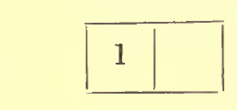

<!-- translation -->

<!-- endpair -->

<!-- pair:en:GL00066:paragraph -->
that is, with a red counter in No. 5. What would this tell us, with regard to the class of "new Cakes"?

<!-- translation -->
也就是说，在编号为 5 的格中放置一枚红色筹码。这关于“新蛋糕”这一类事物会告诉我们什么呢？

<!-- endpair -->

<!-- pair:en:GL00067:paragraph -->
Would it not tell us that there are SOME of them in the x y-compartment? That is, that some of them (besides having the Attribute x, which belongs to both compartments) have the Attribute y (that is, "nice"). This we might express by saying "some x-Cakes are y-(Cakes)", or, putting words instead of letters,

<!-- translation -->
这难道不是在告诉我们，在 x y 格室中存在着一些它们吗？也就是说，其中的一些（除了拥有同时属于两个格室的属性 x 之外）还拥有属性 y（即“好”）。我们可以用这样的话来表达：“有些 x-蛋糕是 y-(蛋糕)”，或者，用词语代替字母，

<!-- endpair -->

<!-- pair:en:GL00068:paragraph -->
"Some new Cakes are nice (Cakes)",

<!-- translation -->
“有些新的蛋糕是美味的（蛋糕）”，

<!-- endpair -->

<!-- pair:en:GL00069:paragraph -->
or, in a shorter form,

<!-- translation -->
或者，用更简短的形式表述，

<!-- endpair -->

<!-- pair:en:GL00070:paragraph -->
"Some new Cakes are nice".

<!-- translation -->
“有些新蛋糕是美味的。”

<!-- endpair -->

<!-- pair:en:GL00071:paragraph -->
At last we have found out how to represent the first Proposition of this Section. If you have not CLEARLY understood all I have said, go no further, but read it over and over again, till you DO understand it. After that is once mastered, you will find all the rest quite easy.

<!-- translation -->
终于，我们找到了表示本节第一个命题的方法。如果你尚未清晰地理解我所说的一切，请勿继续往下读，而应反复阅读，直到你真正理解为止。一旦这一点被掌握，你会发现其余部分都相当容易。

<!-- endpair -->

<!-- pair:en:GL00072:paragraph -->
It will save a little trouble, in doing the other Propositions, if we agree to leave out the word "Cakes" altogether. I find it convenient to call the whole class of Things, for which the cupboard is intended, the 'UNIVERSE.' Thus we might have begun this business by saying "Let us take a Universe of Cakes." (Sounds nice, doesn't it?)

<!-- translation -->
在推导其余命题时，若我们约定彻底略去“蛋糕”一词，便可省去些许麻烦。我发现将橱柜所容纳的整个事物类别称为‘宇宙’颇为便利。因此，我们本可如此开启此项工作：“让我们取一个由蛋糕构成的宇宙。”（听起来不错，不是吗？）

<!-- endpair -->

<!-- pair:en:GL00073:paragraph -->
[turn to page 7]Of course any other Things would have done just as well as Cakes. We might make Propositions about "a Universe of Lizards", or even "a Universe of Hornets". (Wouldn't THAT be a charming Universe to live in?)

<!-- translation -->
[turn to page 7]当然，其他任何东西也会像蛋糕一样同样有效。我们可以就“蜥蜴论域”或甚至“黄蜂论域”作出命题。（住在这样的论域里，岂不妙极了？）

<!-- endpair -->

<!-- pair:en:GL00074:paragraph -->
So far, then, we have learned that

<!-- translation -->
至此，我们已了解到

<!-- endpair -->

<!-- pair:en:GL00075:source_figure -->
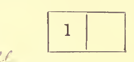

<!-- translation -->

<!-- endpair -->

<!-- pair:en:GL00076:paragraph -->
means "some x and y," i.e. "some new are nice."

<!-- translation -->
表示“有些既是 x 又是 y”，即“有些新的是美味的”。

<!-- endpair -->

<!-- pair:en:GL00077:paragraph -->
I think you will see without further explanation, that

<!-- translation -->
我想您无需进一步解释便能明白，

<!-- endpair -->

<!-- pair:en:GL00078:source_figure -->
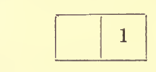

<!-- translation -->

<!-- endpair -->

<!-- pair:en:GL00079:paragraph -->
means "some x are y'," i.e. "some new are not-nice."

<!-- translation -->
意指"x 中有些是 y'"，即“有些新的并非好的”。

<!-- endpair -->

<!-- pair:en:GL00080:paragraph -->
Now let us put a GREY counter into No. 5, and ask ourselves the meaning of

<!-- translation -->
现在，让我们将一个灰色的筹码放入编号为 5 的格子中，并问自己其含义为何。

<!-- endpair -->

<!-- pair:en:GL00081:source_figure -->
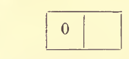

<!-- translation -->

<!-- endpair -->

<!-- pair:en:GL00082:paragraph -->
This tells us that the x y-compartment is EMPTY, which we may express by "no x are y", or, "no new Cakes are nice". This is the second of the three Propositions at the head of this Section.

<!-- translation -->
这表明 x y 隔间是空的，我们可以将其表述为"x 都不是 y"，或“没有新的蛋糕是美味的”。这是本节开头的三个命题中的第二个。

<!-- endpair -->

<!-- pair:en:GL00083:paragraph -->
In the same way,

<!-- translation -->
同样地，

<!-- endpair -->

<!-- pair:en:GL00084:source_figure -->
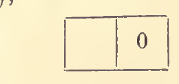

<!-- translation -->

<!-- endpair -->

<!-- pair:en:GL00085:paragraph -->
would mean "no x are y'," or, "no new Cakes are not-nice."

<!-- translation -->
表示“没有 x 是 y′”，也就是说，“没有新蛋糕是不美味的”。

<!-- endpair -->

<!-- pair:en:GL00086:paragraph -->
[turn to page 8]What would you make of this, I wonder?

<!-- translation -->
[turn to page 8]我不禁想问，你会如何解读这一情形？

<!-- endpair -->

<!-- pair:en:GL00087:source_figure -->
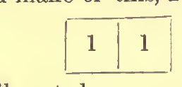

<!-- translation -->

<!-- endpair -->

<!-- pair:en:GL00088:paragraph -->
I hope you will not have much trouble in making out that this represents a DOUBLE Proposition: namely, "some x are y, AND some are y'," i.e. "some new are nice, and some are not-nice."

<!-- translation -->
我希望您不会在辨认出这代表一个双重命题时遇到太多困难：即"x 中有些是 y，且有些是 y'"，换言之，“有些新的是美味的，也有些新的是不美味的”。

<!-- endpair -->

<!-- pair:en:GL00089:paragraph -->
The following is a little harder, perhaps:

<!-- translation -->
以下这道题或许更难一些：

<!-- endpair -->

<!-- pair:en:GL00090:source_figure -->
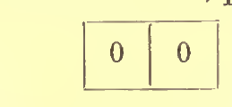

<!-- translation -->

<!-- endpair -->

<!-- pair:en:GL00091:paragraph -->
This means "no x are y, AND none are y'," i.e. "no new are nice, AND none are not-nice": which leads to the rather curious result that "no new exist," i.e. "no Cakes are new." This is because "nice" and "not-nice" make what we call an 'EXHAUSTIVE' division of the class "new Cakes": i.e. between them, they EXHAUST the whole class, so that all the new Cakes, that exist, must be found in one or the other of them.

<!-- translation -->
这表示“没有 x 是 y，也没有 x 是 y′”，即“没有新的是美味的，也没有新的是不美味的”；这得出一个颇为奇特的结果：“不存在新者”，也就是“没有蛋糕是新的”。这是因为“美味的”和“不美味的”对“新蛋糕”这一类构成了我们所谓的“穷尽性”划分：也就是说，二者合起来穷尽整个类，因此所有实际存在的新蛋糕，都必定落在其中一类之中。

<!-- endpair -->

<!-- pair:en:GL00092:paragraph -->
And now suppose you had to represent, with counters the contradictory to "no Cakes are new", which would be "some Cakes are new", or, putting letters for words, "some Cakes are x", how would you do it?

<!-- translation -->
现在假设你需用筹码来表示“没有蛋糕是新的”这一命题的矛盾命题，即“有些蛋糕是新的”，或者用字母代指词语，表述为“有些蛋糕是 x"，你将如何操作？

<!-- endpair -->

<!-- pair:en:GL00093:paragraph -->
This will puzzle you a little, I expect. Evidently you must put a red counter SOMEWHERE in the x-half of the cupboard, since you know there are SOME new Cakes. But you must not put it into the LEFT-HAND compartment, since you do not know them to be NICE: nor may you put it into the RIGHT-HAND one, since you do not know them to be NOT-NICE.

<!-- translation -->
这恐怕会让你感到有些困惑。显然，你必须将一枚红色筹码放在柜子的 x 半区中的某个地方，因为你已知有一些新的蛋糕。但你不能把它放进左边的隔间，因为你不知道它们是美味的；你也绝不能把它放进右边的隔间，因为你不知道它们是不美味的。

<!-- endpair -->

<!-- pair:en:GL00094:paragraph -->
[turn to page 9]What, then, are you to do? I think the best way out of the difficulty is to place the red counter ON THE DIVISION-LINE between the xy-compartment and the xy'-compartment. This I shall represent (as I always put '1' where you are to put a red counter) by the diagram

<!-- translation -->
[turn to page 9]那么，你该怎么做呢？我认为摆脱这一困境的最佳办法是将红色筹码置于 xy 格室与 xy′格室之间的分界线上。我将用图式来表示这一点（正如我始终在应放置红色筹码处标注'1'一样）：

<!-- endpair -->

<!-- pair:en:GL00095:source_figure -->
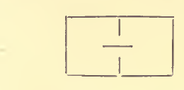

<!-- translation -->

<!-- endpair -->

<!-- pair:en:GL00096:paragraph -->
Our ingenious American cousins have invented a phrase to express the position of a man who wants to join one or other of two parties--such as their two parties 'Democrats' and 'Republicans'--but ca'n't make up his mind WHICH. Such a man is said to be "sitting on the fence." Now that is exactly the position of the red counter you have just placed on the division-line. He likes the look of No. 5, and he likes the look of No. 6, and he doesn't know WHICH to jump down into. So there he sits astride, silly fellow, dangling his legs, one on each side of the fence!

<!-- translation -->
我们天资聪颖的美国表亲们发明了一个短语，用来形容那种想要加入两个政党之一（例如他们的民主党与共和党），却拿不定主意究竟该选哪一个的人。这样的人被称为“骑在篱笆上”。现在，你刚刚放置在分界线上的那个红色筹码所处的位置正是如此。它既喜欢 No. 5 的样子，也喜欢 No. 6 的样子，却不知道应该跳进哪一个。于是它就那样跨坐在篱笆上，这个傻瓜，双腿悬空，一边在篱笆的这一侧，一边在那一侧！

<!-- endpair -->

<!-- pair:en:GL00097:paragraph -->
Now I am going to give you a much harder one to make out. What does this mean?

<!-- translation -->
现在我要给你们出一道更难理解的题目。这究竟是什么意思？

<!-- endpair -->

<!-- pair:en:GL00098:source_figure -->
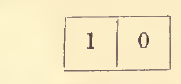

<!-- translation -->

<!-- endpair -->

<!-- pair:en:GL00099:paragraph -->
This is clearly a DOUBLE Proposition. It tells us not only that "some x are y," but also that "no x are NOT y." Hence the result is "ALL x are y," i.e. "all new Cakes are nice", which is the last of the three Propositions at the head of this Section.

<!-- translation -->
这显然是一个双重命题。它不仅告诉我们"x 中有些是 y"，还表明"x 中没有一个是非 y"。因此得出的结论是"x 都是 y"，即“所有新的蛋糕都是美味的”，这正是本节开头三个命题中的最后一个。

<!-- endpair -->

<!-- pair:en:GL00100:paragraph -->
[turn to page 10]We see, then, that the Universal Proposition

<!-- translation -->
[turn to page 10]由此可见，全称命题

<!-- endpair -->

<!-- pair:en:GL00101:paragraph -->
"All new Cakes are nice"

<!-- translation -->
“所有新的蛋糕都是美味的。”

<!-- endpair -->

<!-- pair:en:GL00102:paragraph -->
consists of TWO Propositions taken together, namely,

<!-- translation -->
由两个命题共同构成，即，

<!-- endpair -->

<!-- pair:en:GL00103:poem -->
"Some new Cakes are nice,"
and "No new Cakes are not-nice."

<!-- translation -->
“有些新蛋糕是美味的，”以及“没有新蛋糕是不美味的。”

<!-- endpair -->

<!-- pair:en:GL00104:paragraph -->
In the same way

<!-- translation -->
同样地

<!-- endpair -->

<!-- pair:en:GL00105:source_figure -->
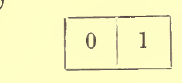

<!-- translation -->

<!-- endpair -->

<!-- pair:en:GL00106:paragraph -->
would mean "all x are y' ", that is,

<!-- translation -->
将意味着"x 所有都是 y'"，即，

<!-- endpair -->

<!-- pair:en:GL00107:paragraph -->
"All new Cakes are not-nice."

<!-- translation -->
“所有新的蛋糕都不是美味的。”

<!-- endpair -->

<!-- pair:en:GL00108:paragraph -->
Now what would you make of such a Proposition as "The Cake you have given me is nice"? Is it Particular or Universal?

<!-- translation -->
那么，对于这样一个命题“你给我的蛋糕很好吃”，你会作何感想？它是特称的还是全称的？

<!-- endpair -->

<!-- pair:en:GL00109:paragraph -->
"Particular, of course," you readily reply. "One single Cake is hardly worth calling 'some,' even."

<!-- translation -->
“特称，当然，”你爽快地回答，“哪怕‘有些’也几乎不值得用来称呼‘一块蛋糕’。”

<!-- endpair -->

<!-- pair:en:GL00110:paragraph -->
No, my dear impulsive Reader, it is 'Universal'. Remember that, few as they are (and I grant you they couldn't well be fewer), they are (or rather 'it is') ALL that you have given me! Thus, if (leaving 'red' out of the question) I divide my Universe of Cakes into two classes--the Cakes you have given me (to which I assign the upper half of the cupboard), and those you HAVEN'T given me (which are to go below)--I find the lower half fairly full, and the upper one as nearly as possible empty. And then, when I am told to put an upright division into each half, keeping the NICE Cakes to the left, and the NOT-NICE ones to [turn to page 11]the right, I begin by carefully collecting ALL the Cakes you have given me (saying to myself, from time to time, "Generous creature! How shall I ever repay such kindness?"), and piling them up in the left-hand compartment. AND IT DOESN'T TAKE LONG TO DO IT!

<!-- translation -->
不，我亲爱的冲动读者，这是“全称”的。请记住，它们虽少（我承认不可能再少了），但它们（或者更确切地说，“它是”）就是你所给我的全部！因此，如果（暂且不论“红色”）我将我的蛋糕论域分为两类——你给我的蛋糕（我将其分配在橱柜的上半部分），以及你**没有**给我的蛋糕（这些将放在下面）——我发现下半部分相当满，而上半部分几乎空无一物。然后，当被告知在每个半部分中放入一个垂直划分，将“美味”的蛋糕留在左边，将“不美味”的蛋糕放在[turn to page 11]右边时，我首先仔细收集**所有**你给我的蛋糕（时不时对自己说：“慷慨的人！我将如何报答这样的好意？”），并将它们堆在左边的隔间里。**这做起来并不花多长时间！**

<!-- endpair -->

<!-- pair:en:GL00111:paragraph -->
Here is another Universal Proposition for you. "Barzillai Beckalegg is an honest man." That means "ALL the Barzillai Beckaleggs, that I am now considering, are honest men." (You think I invented that name, now don't you? But I didn't. It's on a carrier's cart, somewhere down in Cornwall.)

<!-- translation -->
这是又一个供你思考的全称命题：“巴兹莱·贝克阿利格是个诚实的人。”其含义是：“我此刻所考虑的所有巴兹莱·贝克阿利格都是诚实的人。”（你以为这个名字是我编造的，对吗？其实不是。它写在康沃尔某处的一辆运货马车上。）

<!-- endpair -->

<!-- pair:en:GL00112:paragraph -->
This kind of Universal Proposition (where the Subject is a single Thing) is called an 'INDIVIDUAL' Proposition.

<!-- translation -->
这种全称命题（其中主项是单一事物）被称为“个别”命题。

<!-- endpair -->

<!-- pair:en:GL00113:paragraph -->
Now let us take "NICE Cakes" as the Subject of our Proposition: that is, let us fix our thoughts on the LEFT-HAND half of the cupboard, where all the Cakes have the attribute y, that is, "nice."

<!-- translation -->
现在让我们以“美味的蛋糕”作为我们的命题的主项：也就是说，让我们将思绪固定在橱柜的左半部分，那里的所有蛋糕都具有属性 y，即“美味”。

<!-- endpair -->

<!-- pair:en:GL00114:source_figure -->
Suppose we find it marked like this:--

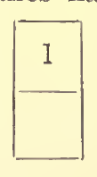

What would that tell us?

<!-- translation -->
假设我们发现它被标记如下：
那会告诉我们什么呢？

<!-- endpair -->

<!-- pair:en:GL00115:paragraph -->
I hope that it is not necessary, after explaining the HORIZONTAL oblong so fully, to spend much time over the UPRIGHT one. I hope you will see, for yourself, that this means "some y are x", that is,

<!-- translation -->
我希望在如此详尽地解释了水平长方形之后，不必再花费太多时间去阐述垂直长方形。我希望你们能自行看出，这意指"y 中有些是 x"，即，

<!-- endpair -->

<!-- pair:en:GL00116:paragraph -->
"Some nice Cakes are new."

<!-- translation -->
“有些不错的蛋糕是新的。”

<!-- endpair -->

<!-- pair:en:GL00117:paragraph -->
"But," you will say, "we have had this case before. You put a red counter into No. 5, and you told us it meant [turn to page 12]'some new Cakes are nice'; and NOW you tell us that it means 'some NICE Cakes are NEW'! Can it mean BOTH?"

<!-- translation -->
“但是，”你会说，“我们以前遇到过这种情况。你把一枚红色筹码放入第 5 号格中，并告诉我们它意味着[turn to page 12]‘有些新蛋糕是好吃的’；而现在你又告诉我们它意味着‘有些好吃的蛋糕是新的’！它能同时表示这两者吗？”

<!-- endpair -->

<!-- pair:en:GL00118:paragraph -->
The question is a very thoughtful one, and does you GREAT credit, dear Reader! It DOES mean both. If you choose to take x (that is, "new Cakes") as your Subject, and to regard No. 5 as part of a HORIZONTAL oblong, you may read it "some x are y", that is, "some new Cakes are nice": but, if you choose to take y (that is, "nice Cakes") as your Subject, and to regard No. 5 as part of an UPRIGHT oblong, THEN you may read it "some y are x", that is, "some nice Cakes are new". They are merely two different ways of expressing the very same truth.

<!-- translation -->
这是一个非常深思熟虑的问题，亲爱的读者，您问得极好！它确实同时意味着两者。如果您选择将 x（即“新蛋糕”）作为主项，并将第 5 号视为一个横向长方形的部分，那么您可以将其读作"x 有些是 y"，也就是说，“有些新蛋糕是美味的”；但是，如果您选择将 y（即“美味的蛋糕”）作为主项，并将第 5 号视为一个纵向长方形的部分，那么您就可以将其读作"y 有些是 x"，也就是说，“有些美味的蛋糕是新的”。它们仅仅是表达同一真理的两种不同方式。

<!-- endpair -->

<!-- pair:en:GL00119:paragraph -->
Without more words, I will simply set down the other ways in which this upright oblong might be marked, adding the meaning in each case. By comparing them with the various cases of the horizontal oblong, you will, I hope, be able to understand them clearly.

<!-- translation -->
不再赘言，我将直接列出这种直立长方形可标记的其他方法，并逐一说明其含义。希望通过与水平长方形的各种情形加以比较，您便能清晰地理解它们。

<!-- endpair -->

<!-- pair:en:GL00120:paragraph -->
You will find it a good plan to examine yourself on this table, by covering up first one column and then the other, and 'dodging about', as the children say.

<!-- translation -->
你会发现，按照此表自我检验是个好办法：先遮住一列，再遮住另一列，就像孩子们所说的“躲来躲去”那样。

<!-- endpair -->

<!-- pair:en:GL00121:paragraph -->
Also you will do well to write out for yourself two other tables--one for the LOWER half of the cupboard, and the other for its RIGHT-HAND half.

<!-- translation -->
此外，你最好为自己另外写出两张表格——一张用于橱柜的下半部分，另一张用于其右半部分。

<!-- endpair -->

<!-- pair:en:GL00122:paragraph -->
And now I think we have said all we need to say about the smaller Diagram, and may go on to the larger one.

<!-- translation -->
至此，我想我们已把关于较小图式所需说的话说完了，可以继续探讨较大的那个了。

<!-- endpair -->

<!-- pair:en:GL00123:source_figure -->
[turn to page 13]

Symbols. Meanings.

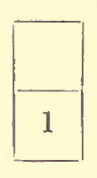

Some y are x'; i.e. Some nice are not-new.

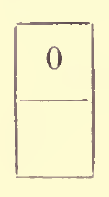

No y are x; i.e. No nice are new. [Observe that this is merely another way of expressing "No new are nice."]

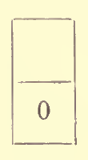

No y are x'; i.e. No nice are not-new.

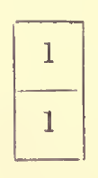

Some y are x, and some are x'; i.e. Some nice are new, and some are not-new.

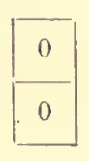

No y are x, and none are x'; i.e. No y exist; i.e. No Cakes are nice.

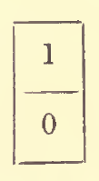

All y are x; i.e. All nice are new.

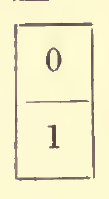

All y are x'; i.e. All nice are not-new.

<!-- translation -->
[turn to page 13]符号。含义。
有些 y 是 x′；
即：有些美味的不是新的。
没有 y 是 x；
即：没有美味的是新的。
[注意，这只是“没有新的是美味的”的另一种表达方式。]
没有 y 是 x′；
即：没有美味的是非新的。
有些 y 是 x，而且有些是 x′；
即：有些美味的是新的，有些不是新的。
没有 y 是 x，而且没有 y 是 x′；即：不存在 y；
即：没有蛋糕是美味的。
所有 y 都是 x；
即：所有美味的都是新的。
所有 y 都是 x′；
即：所有美味的都不是新的。

<!-- endpair -->

<!-- pair:en:GL00124:paragraph -->
[turn to page 14]This may be taken to be a cupboard divided in the same way as the last, but ALSO divided into two portions, for the Attribute m. Let us give to m the meaning "wholesome": and let us suppose that all WHOLESOME Cakes are placed INSIDE the central Square, and all the UNWHOLESOME ones OUTSIDE it, that is, in one or other of the four queer-shaped OUTER compartments.

<!-- translation -->
[turn to page 14]这可以看作一个与上一个按相同方式划分的橱柜，不过还按属性 m 另外分成两部分。让 m 表示“有益健康的”；并假设所有有益健康的蛋糕都放在中央方格内部，所有无益健康的蛋糕都放在外部，也就是那四个形状奇特的外侧隔间里。

<!-- endpair -->

<!-- pair:en:GL00125:paragraph -->
We see that, just as, in the smaller Diagram, the Cakes in each compartment had TWO Attributes, so, here, the Cakes in each compartment have THREE Attributes: and, just as the letters, representing the TWO Attributes, were written on the EDGES of the compartment, so, here, they are written at the CORNERS. (Observe that m' is supposed to be written at each of the four outer corners.) So that we can tell in a moment, by looking at a compartment, what three Attributes belong to the Things in it. For instance, take No. 12. Here we find x, y', m, at the corners: so we know that the Cakes in it, if there are any, have the triple Attribute, 'xy'm', that is, "new, not-nice, and wholesome." Again, take No. 16. Here we find, at the corners, x', y', m': so the Cakes in it are "not-new, not-nice, and unwholesome." (Remarkably untempting Cakes!)

<!-- translation -->
我们看到，正如在小图式中，每个隔间里的蛋糕具有两个属性一样，在这里，每个隔间里的蛋糕具有三个属性；并且，正如代表那两个属性的字母写在隔间的边上一样，在这里，它们写在角上。（请注意，m' 被假定写在四个外角的每一个处。）因此，我们只需看一眼一个隔间，便能立刻知道其中事物所具有的三个属性。例如，取编号 12。在此我们发现 x、y'、m 位于角上；因此我们知道，其中的蛋糕（如果有的话）具有三重属性 'xy'm'，即“新的、不美味的且健康的”。再取编号 16。在此我们发现，在角上有 x'、y'、m'；因此其中的蛋糕是“非新的、不美味的且不健康的。”（真是格外不诱人的蛋糕！）

<!-- endpair -->

<!-- pair:en:GL00126:paragraph -->
It would take far too long to go through all the Propositions, containing x and y, x and m, and y and m which can be represented on this diagram (there are ninety-six altogether, so I am sure you will excuse me!) [turn to page 15]and I must content myself with doing two or three, as specimens. You will do well to work out a lot more for yourself.

<!-- translation -->
要逐一讲解这个图式所能表示的、包含 x 与 y、x 与 m 以及 y 与 m 的所有命题，实在太费时间了（总共有九十六个，所以我相信你一定会原谅我！）[turn to page 15]因此我只好选两三个作为范例。你最好自己再多演算一些。

<!-- endpair -->

<!-- pair:en:GL00127:paragraph -->
Taking the upper half by itself, so that our Subject is "new Cakes", how are we to represent "no new Cakes are wholesome"?

<!-- translation -->
若单独取上半部分，使我们的主项为“新蛋糕”，该如何表示“没有新蛋糕是健康的”？

<!-- endpair -->

<!-- pair:en:GL00128:paragraph -->
This is, writing letters for words, "no x are m." Now this tells us that none of the Cakes, belonging to the upper half of the cupboard, are to be found INSIDE the central Square: that is, the two compartments, No. 11 and No. 12, are EMPTY. And this, of course, is represented by

<!-- translation -->
把词换成字母，这就是“没有 x 是 m”。它告诉我们，属于橱柜上半部分的蛋糕，没有一块位于中央方格内部；也就是说，11号与12号这两个隔间都是空的。这自然表示为

<!-- endpair -->

<!-- pair:en:GL00129:source_figure -->
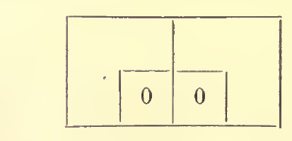

<!-- translation -->

<!-- endpair -->

<!-- pair:en:GL00130:paragraph -->
And now how are we to represent the contradictory Proposition "SOME x are m"? This is a difficulty I have already considered. I think the best way is to place a red counter ON THE DIVISION-LINE between No. 11 and No. 12, and to understand this to mean that ONE of the two compartments is 'occupied,' but that we do not at present know WHICH. This I shall represent thus:--

<!-- translation -->
那么，我们该如何表示矛盾命题“有些 x 是 m"呢？这已是一个我曾考虑过的难题。我认为最好的办法是在编号为 11 与编号为 12 的格之间的划分线上放置一枚红色筹码，并以此表示这两个格中有一个被“占据”，但我们目前尚不知是哪一个。我将如此表示如下：--

<!-- endpair -->

<!-- pair:en:GL00131:source_figure -->
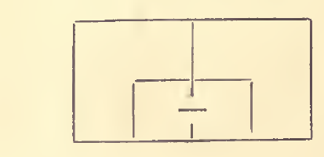

<!-- translation -->

<!-- endpair -->

<!-- pair:en:GL00132:paragraph -->
[turn to page 16]Now let us express "all x are m."

<!-- translation -->
[turn to page 16]现在让我们将"x 所有的都是 m"表达出来。

<!-- endpair -->

<!-- pair:en:GL00133:paragraph -->
This consists, we know, of TWO Propositions,

<!-- translation -->
这由我们已知是两个命题组成，

<!-- endpair -->

<!-- pair:en:GL00134:poem -->
"Some x are m,"
and "No x are m'."

<!-- translation -->
"有些 x 是 m，"且"没有 x 是 m'。"

<!-- endpair -->

<!-- pair:en:GL00135:paragraph -->
Let us express the negative part first. This tells us that none of the Cakes, belonging to the upper half of the cupboard, are to be found OUTSIDE the central Square: that is, the two compartments, No. 9 and No. 10, are EMPTY. This, of course, is represented by

<!-- translation -->
让我们先表述其否定部分。这告诉我们，属于橱柜上半部分的任何一块蛋糕都不在中央方格之外：也就是说，第 9 号和第 10 号两个隔间是空的。当然，这一点由下式表示

<!-- endpair -->

<!-- pair:en:GL00136:source_figure -->
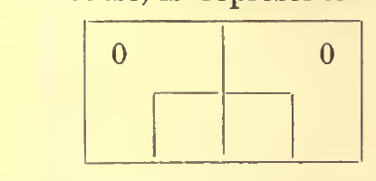

<!-- translation -->

<!-- endpair -->

<!-- pair:en:GL00137:paragraph -->
But we have yet to represent "Some x are m." This tells us that there are SOME Cakes in the oblong consisting of No. 11 and No. 12: so we place our red counter, as in the previous example, on the division-line between No. 11 and No. 12, and the result is

<!-- translation -->
但我们尚未表述“有些 x 是 m"。这告诉我们，在由编号 11 和编号 12 构成的长方形中，存在一些蛋糕；因此，如同前例所示，我们将红色筹码置于编号 11 与编号 12 之间的分界线上，结果如下：

<!-- endpair -->

<!-- pair:en:GL00138:source_figure -->
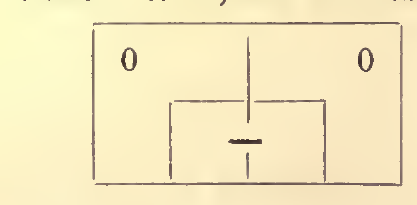

<!-- translation -->

<!-- endpair -->

<!-- pair:en:GL00139:paragraph -->
Now let us try one or two interpretations.

<!-- translation -->
现在让我们尝试一两种解释。

<!-- endpair -->

<!-- pair:en:GL00140:paragraph -->
What are we to make of this, with regard to x and y?

<!-- translation -->
我们该如何看待这一点，关于 x 和 y？

<!-- endpair -->

<!-- pair:en:GL00141:source_figure -->
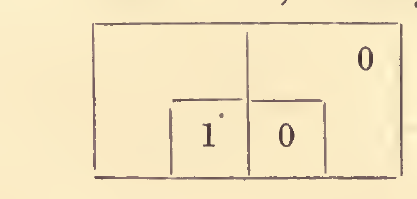

<!-- translation -->

<!-- endpair -->

<!-- pair:en:GL00142:paragraph -->
[turn to page 17]This tells us, with regard to the xy'-Square, that it is wholly 'empty', since BOTH compartments are so marked. With regard to the xy-Square, it tells us that it is 'occupied'. True, it is only ONE compartment of it that is so marked; but that is quite enough, whether the other be 'occupied' or 'empty', to settle the fact that there is SOMETHING in the Square.

<!-- translation -->
[turn to page 17]这告诉我们，关于 xy'-方格而言，它是完全“空”的，因为两个隔间都标有此记号。关于 xy-方格而言，它告诉我们该方格是“被占据”的。诚然，只有其中一个隔间标有此记号；但无论另一个隔间是“被占据”还是“空”，这都已足以确定方格中确实有东西这一事实。

<!-- endpair -->

<!-- pair:en:GL00143:paragraph -->
If, then, we transfer our marks to the smaller Diagram, so as to get rid of the m-subdivisions, we have a right to mark it

<!-- translation -->
那么，若我们将记号移至较小的图式中，以消除 m 细分，我们就有权将其标记如下：

<!-- endpair -->

<!-- pair:en:GL00144:source_figure -->
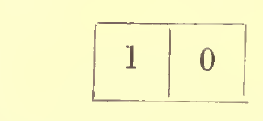

<!-- translation -->

<!-- endpair -->

<!-- pair:en:GL00145:paragraph -->
which means, you know, "all x are y."

<!-- translation -->
也就是说，你知道，“所有的 x 都是 y"。

<!-- endpair -->

<!-- pair:en:GL00146:paragraph -->
The result would have been exactly the same, if the given oblong had been marked thus:--

<!-- translation -->
若所给矩形以此标记，结果将完全相同：——

<!-- endpair -->

<!-- pair:en:GL00147:source_figure -->
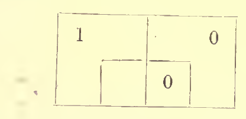

<!-- translation -->

<!-- endpair -->

<!-- pair:en:GL00148:paragraph -->
Once more: how shall we interpret this, with regard to x and y?

<!-- translation -->
再次：我们应如何就 x 与 y 来解释这一情况？

<!-- endpair -->

<!-- pair:en:GL00149:source_figure -->
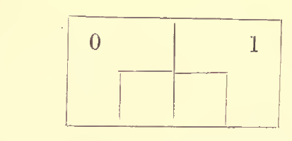

<!-- translation -->

<!-- endpair -->

<!-- pair:en:GL00150:paragraph -->
This tells us, as to the xy-Square, that ONE of its compartments is 'empty'. But this information is [turn to page 18]quite useless, as there is no mark in the OTHER compartment. If the other compartment happened to be 'empty' too, the Square would be 'empty': and, if it happened to be 'occupied', the Square would be 'occupied'. So, as we do not know WHICH is the case, we can say nothing about THIS Square.

<!-- translation -->
这告诉我们，关于 xy-方格而言，其其中一个格子是“空的”。但这一信息[turn to page 18]毫无用处，因为另一个格子里没有任何标记。如果另一个格子碰巧也是“空的”，那么该方格就是“空的”；而如果它碰巧是“被占据的”，那么该方格就是“被占据的”。因此，既然我们不知道究竟是哪一种情况，我们就无法对该方格作出任何断言。

<!-- endpair -->

<!-- pair:en:GL00151:paragraph -->
The other Square, the xy'-Square, we know (as in the previous example) to be 'occupied'.

<!-- translation -->
另一个方格，即 xy' 方格，我们已知（如同在前一例中那样）是“被占据”的。

<!-- endpair -->

<!-- pair:en:GL00152:paragraph -->
If, then, we transfer our marks to the smaller Diagram, we get merely this:--

<!-- translation -->
那么，若我们将记号移至较小的图式中，我们得到的仅仅是如下内容：——

<!-- endpair -->

<!-- pair:en:GL00153:source_figure -->
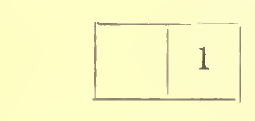

<!-- translation -->

<!-- endpair -->

<!-- pair:en:GL00154:paragraph -->
which means, you know, "some x are y'."

<!-- translation -->
也就是说，你知道，“有些 x 是 y'"。

<!-- endpair -->

<!-- pair:en:GL00155:source_figure -->
These principles may be applied to all the other oblongs. For instance, to represent "all y' are m'" we should mark the RIGHT-HAND UPRIGHT OBLONG (the one that has the attribute y') thus:--

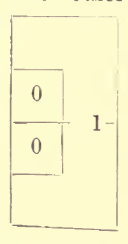

<!-- translation -->
这些原则可应用于其余所有长方形。例如，要表示“所有的 y' 都是 m'"，我们应如下标记右侧的直立长方形（即具有属性 y' 的那个）：

<!-- endpair -->

<!-- pair:en:GL00156:paragraph -->
and, if we were told to interpret the lower half of the cupboard, marked as follows, with regard to x and y,

<!-- translation -->
并且，若被告知要解读如下标记的橱柜下半部分，关于 x 与 y，

<!-- endpair -->

<!-- pair:en:GL00157:source_figure -->
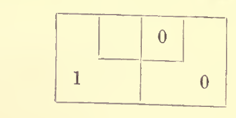

<!-- translation -->

<!-- endpair -->

<!-- pair:en:GL00158:paragraph -->
[turn to page 19]we should transfer it to the smaller Diagram thus,

<!-- translation -->
[turn to page 19]我们应将其转移至较小的图式如下，

<!-- endpair -->

<!-- pair:en:GL00159:source_figure -->
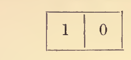

<!-- translation -->

<!-- endpair -->

<!-- pair:en:GL00160:paragraph -->
and read it "all x' are y."

<!-- translation -->
并读作“所有 x' 都是 y"。

<!-- endpair -->

<!-- pair:en:GL00161:paragraph -->
Two more remarks about Propositions need to be made.

<!-- translation -->
关于命题还有两点需要说明。

<!-- endpair -->

<!-- pair:en:GL00162:paragraph -->
One is that, in every Proposition beginning with "some" or "all", the ACTUAL EXISTENCE of the 'Subject' is asserted. If, for instance, I say "all misers are selfish," I mean that misers ACTUALLY EXIST. If I wished to avoid making this assertion, and merely to state the LAW that miserliness necessarily involves selfishness, I should say "no misers are unselfish" which does not assert that any misers exist at all, but merely that, if any DID exist, they WOULD be selfish.

<!-- translation -->
其一，凡以"some"或"all"开头的每一个命题，都断言了“主项”的**实际存在**。例如，若我说“所有吝啬鬼都是自私的”，我的意思是吝啬鬼**确实存在**。倘若我欲避免作出此项断言，而仅陈述吝啬必然涉及自私这一法则，我便应说“没有吝啬鬼是不自私的”。此句并不断言有任何吝啬鬼存在，而仅仅表明：倘若真有吝啬鬼存在，他们便会是自私的。

<!-- endpair -->

<!-- pair:en:GL00163:paragraph -->
The other is that, when a Proposition begins with "some" or "no", and contains more than two Attributes, these Attributes may be re-arranged, and shifted from one Term to the other, "ad libitum." For example, "some abc are def" may be re-arranged as "some bf are acde," each being equivalent to "some Things are abcdef". Again "No wise old men are rash and reckless gamblers" may be re-arranged as "No rash old gamblers are wise and reckless," each being equivalent to "No men are wise old rash reckless gamblers."

<!-- translation -->
另一种情况是，当一个命题以“有些”或“没有”开头，且包含超过两个属性时，这些属性可以重新排列，并随意从一个项移至另一个项。例如，“有些 abc 是 def"可重新排列为“有些 bf 是 acde"，二者均等价于“有些事物是 abcdef"。又如，“没有明智的老者是鲁莽且轻率的赌徒”可重新排列为“没有鲁莽的老赌徒是明智且轻率的”，二者均等价于“没有人是明智的、老的、鲁莽的、轻率的赌徒”。

<!-- endpair -->

<!-- pair:en:GL00164:list_item -->
[turn to page 20]2. Syllogisms

<!-- translation -->
[turn to page 20]2. 三段论

<!-- endpair -->

<!-- pair:en:GL00165:paragraph -->
Now suppose we divide our Universe of Things in three ways, with regard to three different Attributes. Out of these three Attributes, we may make up three different couples (for instance, if they were a, b, c, we might make up the three couples ab, ac, bc). Also suppose we have two Propositions given us, containing two of these three couples, and that from them we can prove a third Proposition containing the third couple. (For example, if we divide our Universe for m, x, and y; and if we have the two Propositions given us, "no m are x'" and "all m' are y", containing the two couples mx and my, it might be possible to prove from them a third Proposition, containing x and y.)

<!-- translation -->
现在假设，我们按照三种不同的属性，以三种方式分别划分我们的事物宇宙。由这三种属性可以组成三对不同的组合（例如，若它们是 a、b、c，便可组成 ab、ac、bc 这三对）。又假设给定两个命题，涉及这三对中的两对，并且可以从它们证明一个涉及第三对的第三个命题。（例如，若我们按 m、x、y 这三种属性划分事物宇宙，又给定“没有 m 是 x′”与“所有 m′ 都是 y”这两个命题，涉及 mx 与 my 这两对，那么有可能从中证明一个涉及 x 与 y 的第三个命题。）

<!-- endpair -->

<!-- pair:en:GL00166:paragraph -->
In such a case we call the given Propositions 'THE PREMISSES', the third one 'THE CONCLUSION' and the whole set 'A SYLLOGISM'.

<!-- translation -->
在这种情况下，我们将给定的命题称为“前提”，第三个称为“结论”，而整个集合则称为“三段论”。

<!-- endpair -->

<!-- pair:en:GL00167:paragraph -->
Evidently, ONE of the Attributes must occur in both Premisses; or else one must occur in ONE Premiss, and its CONTRADICTORY in the other.

<!-- translation -->
显然，必须有同一个属性在两个前提中都出现；或者，一个属性出现在一个前提中，而它的矛盾属性出现在另一个前提中。

<!-- endpair -->

<!-- pair:en:GL00168:paragraph -->
[turn to page 21]In the first case (when, for example, the Premisses are "some m are x" and "no m are y'") the Term, which occurs twice, is called 'THE MIDDLE TERM', because it serves as a sort of link between the other two Terms.

<!-- translation -->
[turn to page 21]在第一种情况（例如，前提是“有些 m 是 x”和“没有 m 是 y′”）下，出现两次的项被称为“中项”，因为它充当了另外两个项之间的一种联结。

<!-- endpair -->

<!-- pair:en:GL00169:paragraph -->
In the second case (when, for example, the Premisses are "no m are x'" and "all m' are y") the two Terms, which contain these contradictory Attributes, may be called 'THE MIDDLE TERMS'.

<!-- translation -->
在第二种情形下（例如，前提是“没有 m 是 x'"和“所有 m' 都是 y"）这两个包含这些矛盾属性的项可称为‘中项’。

<!-- endpair -->

<!-- pair:en:GL00170:paragraph -->
Thus, in the first case, the class of "m-Things" is the Middle Term; and, in the second case, the two classes of "m-Things" and "m'-Things" are the Middle Terms.

<!-- translation -->
因此，在第一种情形中，"m-事物”这一类是中项；而在第二种情形中，"m-事物”与"m'-事物”这两类则是中项。

<!-- endpair -->

<!-- pair:en:GL00171:paragraph -->
The Attribute, which occurs in the Middle Term or Terms, disappears in the Conclusion, and is said to be "eliminated", which literally means "turned out of doors".

<!-- translation -->
出现在一个或两个中项中的属性，会在结论中消失，这称为“被消去”，字面意思是“被赶出门外”。

<!-- endpair -->

<!-- pair:en:GL00172:paragraph -->
Now let us try to draw a Conclusion from the two Premisses--

<!-- translation -->
现在让我们尝试从两个前提中得出一个结论——

<!-- endpair -->

<!-- pair:en:GL00173:poem -->
"Some new Cakes are unwholesome;
 No nice Cakes are unwholesome."

<!-- translation -->
有些新蛋糕是不健康的；  
没有美味的蛋糕是不健康的。

<!-- endpair -->

<!-- pair:en:GL00174:paragraph -->
In order to express them with counters, we need to divide Cakes in THREE different ways, with regard to newness, to niceness, and to wholesomeness. For this we must use the larger Diagram, making x mean "new", y "nice", and m "wholesome". (Everything [turn to page 22]INSIDE the central Square is supposed to have the attribute m, and everything OUTSIDE it the attribute m', i.e. "not-m".)

<!-- translation -->
为了用筹码表示它们，我们需要按三种不同的属性分别划分蛋糕：是否是新的、是否美味、是否有益健康。为此，必须使用较大的图式，使 x 表示“新的”，y 表示“美味的”，m 表示“有益健康的”。（假定中央方格[turn to page 22]内的所有事物都具有属性 m，方格外的所有事物都具有属性 m′，即“非 m”。）

<!-- endpair -->

<!-- pair:en:GL00175:paragraph -->
You had better adopt the rule to make m mean the Attribute which occurs in the MIDDLE Term or Terms. (I have chosen m as the symbol, because 'middle' begins with 'm'.)

<!-- translation -->
你最好采用这条规则：让 m 表示出现在一个或两个中项中的属性。（我选用 m 作符号，是因为英语 middle（中间的）以 m 开头。）

<!-- endpair -->

<!-- pair:en:GL00176:paragraph -->
Now, in representing the two Premisses, I prefer to begin with the NEGATIVE one (the one beginning with "no"), because GREY counters can always be placed with CERTAINTY, and will then help to fix the position of the red counters, which are sometimes a little uncertain where they will be most welcome.

<!-- translation -->
现在，在表述两个前提时，我倾向于从否定命题（即以“没有”开头的那个）开始，因为灰色筹码总能被确定地放置，随后它们将有助于固定红色筹码的位置，而后者有时对于其最适宜安放之处尚存些许不确定。

<!-- endpair -->

<!-- pair:en:GL00177:paragraph -->
Let us express, then, "no nice Cakes are unwholesome (Cakes)", i.e. "no y-Cakes are m'-(Cakes)". This tells us that none of the Cakes belonging to the y-half of the cupboard are in its m'-compartments (i.e. the ones outside the central Square). Hence the two compartments, No. 9 and No. 15, are both 'EMPTY'; and we must place a grey counter in EACH of them, thus:--

<!-- translation -->
那么，让我们表示“没有美味的蛋糕是无益健康的（蛋糕）”，即“没有 y-蛋糕是 m′-（蛋糕）”。这告诉我们，属于橱柜 y 半边的蛋糕，没有一块位于它的 m′ 隔间（即中央方格外的那些隔间）。因此，第9号与第15号这两个隔间都是“空”的；我们必须在每一个里面都放入一枚灰筹码，如下：

<!-- endpair -->

<!-- pair:en:GL00178:source_figure -->
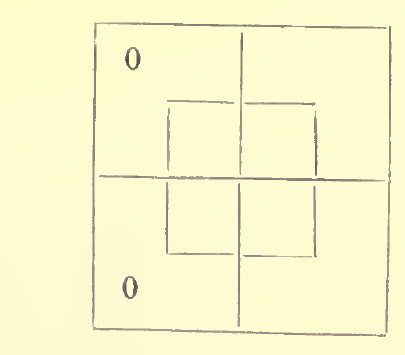

<!-- translation -->

<!-- endpair -->

<!-- pair:en:GL00179:paragraph -->
[turn to page 23]We have now to express the other Premiss, namely, "some new Cakes are unwholesome (Cakes)", i.e. "some x-Cakes are m'-(Cakes)". This tells us that some of the Cakes in the x-half of the cupboard are in its m'-compartments. Hence ONE of the two compartments, No. 9 and No. 10, is 'occupied': and, as we are not told in WHICH of these two compartments to place the red counter, the usual rule would be to lay it on the division-line between them: but, in this case, the other Premiss has settled the matter for us, by declaring No. 9 to be EMPTY. Hence the red counter has no choice, and MUST go into No. 10, thus:--

<!-- translation -->
[turn to page 23]我们现须表述另一前提，即“有些新的蛋糕是不健康的（蛋糕）”，亦即“有些 x-蛋糕是 m'-(蛋糕)"。这告诉我们，在柜子的 x-半侧中，有些蛋糕位于其 m'-格内。因此，两个格子中的其中一个，编号为 9 和编号为 10 的格子，是“被占用的”；由于我们未被告知应将红色筹码置于这两个格子中的哪一个，通常的规则是将它放在它们之间的分界线上：但在此情形下，另一前提已为我们决定了此事，它声明编号为 9 的格子是空的。因此，红色筹码别无选择，必须放入编号为 10 的格子中，如下所示：--

<!-- endpair -->

<!-- pair:en:GL00180:source_figure -->
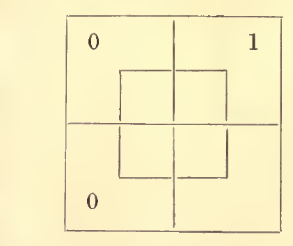

<!-- translation -->

<!-- endpair -->

<!-- pair:en:GL00181:paragraph -->
And now what counters will this information enable us to place in the SMALLER Diagram, so as to get some Proposition involving x and y only, leaving out m? Let us take its four compartments, one by one.

<!-- translation -->
那么，这些信息将使我们能够在较小的图式中放置哪些筹码，以便得出仅涉及 x 和 y 的某个命题，而排除 m？让我们逐一考察它的四个部分。

<!-- endpair -->

<!-- pair:en:GL00182:paragraph -->
First, No. 5. All we know about THIS is that its OUTER portion is empty: but we know nothing about its inner portion. Thus the Square MAY be empty, or it MAY have something in it. Who can tell? So we dare not place ANY counter in this Square.

<!-- translation -->
首先，关于 5 号。我们已知的是其外部部分是空的：但我们对其内部部分一无所知。因此，方格可能是空的，也可能含有某物。谁能说得清？所以，我们不敢在此方格中放置任何筹码。

<!-- endpair -->

<!-- pair:en:GL00183:paragraph -->
[turn to page 24]Secondly, what of No. 6? Here we are a little better off. We know that there is SOMETHING in it, for there is a red counter in its outer portion. It is true we do not know whether its inner portion is empty or occupied: but what does THAT matter? One solitary Cake, in one corner of the Square, is quite sufficient excuse for saying "THIS SQUARE IS OCCUPIED", and for marking it with a red counter.

<!-- translation -->
[turn to page 24]其次，关于第 6 号又如何？在此我们稍好一些。我们知道其中必有某物，因为其外部区域有一枚红色筹码。诚然，我们尚不知其内部区域是空着还是被占据：但这又有什么关系呢？在方格的一个角落里仅有一枚孤立的蛋糕，就足以作为宣称“此方格已被占据”的理由，并为其标记上一枚红色筹码。

<!-- endpair -->

<!-- pair:en:GL00184:paragraph -->
As to No. 7, we are in the same condition as with No. 5--we find it PARTLY 'empty', but we do not know whether the other part is empty or occupied: so we dare not mark this Square.

<!-- translation -->
至于编号 7，我们处于与编号 5 相同的境地——我们发现它部分为“空”，但我们不知道其余部分是空还是被占据：因此我们不敢标记这个方格。

<!-- endpair -->

<!-- pair:en:GL00185:paragraph -->
And as to No. 8, we have simply no information at all.

<!-- translation -->
至于第 8 号，我们完全没有任何信息。

<!-- endpair -->

<!-- pair:en:GL00186:paragraph -->
The result is

<!-- translation -->
结果是

<!-- endpair -->

<!-- pair:en:GL00187:source_figure -->
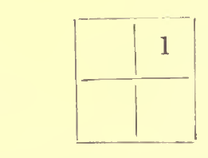

<!-- translation -->

<!-- endpair -->

<!-- pair:en:GL00188:paragraph -->
Our 'Conclusion', then, must be got out of the rather meagre piece of information that there is a red counter in the xy'-Square. Hence our Conclusion is "some x are y' ", i.e. "some new Cakes are not-nice (Cakes)": or, if you prefer to take y' as your Subject, "some not-nice Cakes are new (Cakes)"; but the other looks neatest.

<!-- translation -->
因此，我们的“结论”必须从这一点相当贫乏的信息中得出：xy′ 方格中有一枚红筹码。所以结论是“有些 x 是 y′”，即“有些新蛋糕是不美味的（蛋糕）”；或者，如果你愿意以 y′ 为主项，也可以说“有些不美味的蛋糕是新的（蛋糕）”。不过，前一种说法最简洁。

<!-- endpair -->

<!-- pair:en:GL00189:paragraph -->
We will now write out the whole Syllogism, putting the symbol ∴ for "therefore", and omitting "Cakes", for the sake of brevity, at the end of each Proposition.

<!-- translation -->
我们现在将写出完整的三段论，用符号∴表示“因此”，为求简略起见，在每个命题的末尾省略“蛋糕”一词。

<!-- endpair -->

<!-- pair:en:GL00191:poem -->
[turn to page 25]"Some new Cakes are unwholesome;
 No nice Cakes are unwholesome
 ∴ Some new Cakes are not-nice."

<!-- translation -->
[turn to page 25]“有些新蛋糕是不健康的；  
没有好吃的蛋糕是不健康的；  
∴ 有些新蛋糕不是好吃的。”

<!-- endpair -->

<!-- pair:en:GL00192:paragraph -->
And you have now worked out, successfully, your first 'SYLLOGISM'. Permit me to congratulate you, and to express the hope that it is but the beginning of a long and glorious series of similar victories!

<!-- translation -->
至此，您已成功推导出第一个“三段论”。请允许我向您表示祝贺，并期望这只是漫长而辉煌的一系列类似胜利的开始！

<!-- endpair -->

<!-- pair:en:GL00193:paragraph -->
We will work out one other Syllogism--a rather harder one than the last--and then, I think, you may be safely left to play the Game by yourself, or (better) with any friend whom you can find, that is able and willing to take a share in the sport.

<!-- translation -->
我们将再推演一个三段论——其难度较前一个更大一些——然后，我想，你就可以放心地独自玩这个游戏了，或者（更佳）与任何你能找到的、且有能力并愿意参与这项运动的友人一同游戏。

<!-- endpair -->

<!-- pair:en:GL00194:paragraph -->
Let us see what we can make of the two Premisses--

<!-- translation -->
让我们看看能从这两个前提中得出什么结论——

<!-- endpair -->

<!-- pair:en:GL00195:poem -->
"All Dragons are uncanny;
 All Scotchmen are canny."

<!-- translation -->
“所有龙都是非 canny 的（uncanny）；
所有苏格兰人都是 canny 的（精明的）。”

<!-- endpair -->

<!-- pair:en:GL00196:paragraph -->
Remember, I don't guarantee the Premisses to be FACTS. In the first place, I never even saw a Dragon: and, in the second place, it isn't of the slightest consequence to us, as LOGICIANS, whether our Premisses are true or false: all WE have to do is to make out whether they LEAD LOGICALLY TO THE CONCLUSION, so that, if THEY were true, IT would be true also.

<!-- translation -->
请记住，我并未保证前提为事实。首先，我从未见过龙；其次，对我们逻辑学家而言，前提是真还是假都无关紧要：我们只需阐明它们是否合乎逻辑地推导出结论，使得若它们为真，则结论亦为真。

<!-- endpair -->

<!-- pair:en:GL00197:paragraph -->
You see, we must give up the "Cakes" now, or our cupboards will be of no use to us. We must take, as our 'Universe', some class of things which will include Dragons and Scotchmen: shall we say 'Animals'? And, as "canny" is evidently the At[turn to page 26]tribute belonging to the 'Middle Terms', we will let m stand for "canny", x for "Dragons", and y for "Scotchmen". So that our two Premisses are, in full,

<!-- translation -->
你看，我们现在必须放下“蛋糕”，否则这些橱柜就对我们毫无用处了。我们必须选取一类包含龙与苏格兰人的事物作为“论域”：就说“动物”，如何？而“精明的”（canny）显然是属于“中项”的属[turn to page 26]性，因此我们让 m 表示“精明的”（canny），x 表示“龙”，y 表示“苏格兰人”。这样，我们的两个前提完整写出就是：

<!-- endpair -->

<!-- pair:en:GL00198:poem -->
"All Dragon-Animals are uncanny (Animals);
All Scotchman-Animals are canny (Animals)."

<!-- translation -->
“所有龙类动物都是非 canny 的（uncanny，动物）；
所有苏格兰人类动物都是 canny 的（精明的，动物）。”

<!-- endpair -->

<!-- pair:en:GL00199:paragraph -->
And these may be expressed, using letters for words, thus:--

<!-- translation -->
这些可用字母代表词语，表述如下：——

<!-- endpair -->

<!-- pair:en:GL00200:poem -->
"All x are m';
 All y are m."

<!-- translation -->
所有的 x 都是 m'；  
所有的 y 都是 m。

<!-- endpair -->

<!-- pair:en:GL00201:paragraph -->
The first Premiss consists, as you already know, of two parts:--

<!-- translation -->
第一个前提正如你已所知，由两部分组成：——

<!-- endpair -->

<!-- pair:en:GL00202:poem -->
"Some x are m',"
and "No x are m."

<!-- translation -->
"有些 x 是 m'，"且"没有 x 是 m。"

<!-- endpair -->

<!-- pair:en:GL00203:paragraph -->
And the second also consists of two parts:--

<!-- translation -->
第二个前提也由两部分组成：——

<!-- endpair -->

<!-- pair:en:GL00204:poem -->
"Some y are m,"
and "No y are m'."

<!-- translation -->
"有些 y 是 m，"且"没有 y 是 m'。"

<!-- endpair -->

<!-- pair:en:GL00205:paragraph -->
Let us take the negative portions first.

<!-- translation -->
让我们先来看否定部分。

<!-- endpair -->

<!-- pair:en:GL00206:paragraph -->
We have, then, to mark, on the larger Diagram, first, "no x are m", and secondly, "no y are m'". I think you will see, without further explanation, that the two results, separately, are

<!-- translation -->
因此，我们须在较大的图式上首先标出"x 皆非 m"，其次标出"y 皆非 m'"。我想您无需进一步解释便能明白，这两个结果各自是

<!-- endpair -->

<!-- pair:en:GL00207:source_figure -->
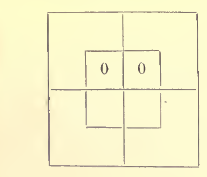

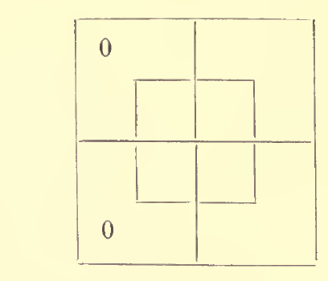

<!-- translation -->

<!-- endpair -->

<!-- pair:en:GL00208:paragraph -->
[turn to page 27]and that these two, when combined, give us

<!-- translation -->
[turn to page 27]而这两者结合，便为我们提供了

<!-- endpair -->

<!-- pair:en:GL00209:source_figure -->
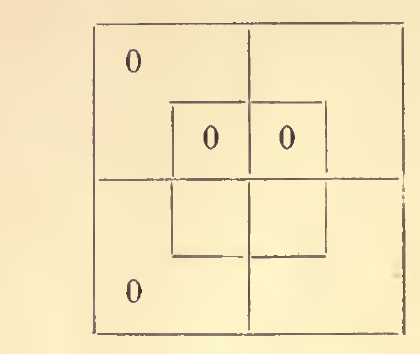

<!-- translation -->

<!-- endpair -->

<!-- pair:en:GL00210:paragraph -->
We have now to mark the two positive portions, "some x are m'" and "some y are m".

<!-- translation -->
我们现在要标出两个肯定部分，即"x 有些是 m'"和"y 有些是 m"。

<!-- endpair -->

<!-- pair:en:GL00211:paragraph -->
The only two compartments, available for Things which are xm', are No. 9 and No. 10. Of these, No. 9 is already marked as 'empty'; so our red counter must go into No. 10.

<!-- translation -->
仅有的两个可用于存放"xm'"之物的隔间是编号为 9 和 10 的隔间。其中，编号为 9 的隔间已被标记为“空”；因此，我们的红色筹码必须放入编号为 10 的隔间中。

<!-- endpair -->

<!-- pair:en:GL00212:paragraph -->
Similarly, the only two, available for ym, are No. 11 and No. 13. Of these, No. 11 is already marked as 'empty'; so our red counter MUST go into No. 13.

<!-- translation -->
同样地，对于 ym 而言，仅有的两个可用选项是编号为 11 和编号为 13 的格子。其中，编号为 11 的格子已被标记为“空”；因此，我们的红色筹码必须放入编号为 13 的格子中。

<!-- endpair -->

<!-- pair:en:GL00213:paragraph -->
The final result is

<!-- translation -->
最终结果是

<!-- endpair -->

<!-- pair:en:GL00214:source_figure -->
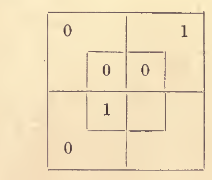

<!-- translation -->

<!-- endpair -->

<!-- pair:en:GL00215:paragraph -->
[turn to page 28]And now how much of this information can usefully be transferred to the smaller Diagram?

<!-- translation -->
[turn to page 28]那么，这些信息中有多少可以有益地转移到较小的图式中呢？

<!-- endpair -->

<!-- pair:en:GL00216:paragraph -->
Let us take its four compartments, one by one.

<!-- translation -->
让我们逐一取它的四个隔间。

<!-- endpair -->

<!-- pair:en:GL00217:paragraph -->
As to No. 5? This, we see, is wholly 'empty'. (So mark it with a grey counter.)

<!-- translation -->
至于编号 5？我们看，这完全是“空的”。（所以用一枚灰色筹码标记它。）

<!-- endpair -->

<!-- pair:en:GL00218:paragraph -->
As to No. 6? This, we see, is 'occupied'. (So mark it with a red counter.)

<!-- translation -->
至于编号 6？我们看见，它是“被占用的”。（所以用一枚红色筹码标记它。）

<!-- endpair -->

<!-- pair:en:GL00219:paragraph -->
As to No. 7? Ditto, ditto.

<!-- translation -->
至于第 7 号？同上，同上。

<!-- endpair -->

<!-- pair:en:GL00220:paragraph -->
As to No. 8? No information.

<!-- translation -->
至于编号 8？无相关信息。

<!-- endpair -->

<!-- pair:en:GL00221:paragraph -->
The smaller Diagram is now pretty liberally marked:--

<!-- translation -->
较小的图式现已相当充分地作了标记：--

<!-- endpair -->

<!-- pair:en:GL00222:source_figure -->
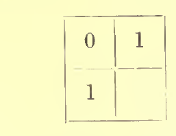

<!-- translation -->

<!-- endpair -->

<!-- pair:en:GL00223:paragraph -->
And now what Conclusion can we read off from this? Well, it is impossible to pack such abundant information into ONE Proposition: we shall have to indulge in TWO, this time.

<!-- translation -->
那么，我们又能从这得出什么结论呢？嗯，不可能将如此丰富的信息塞进一个命题中；这次我们将不得不使用两个命题。

<!-- endpair -->

<!-- pair:en:GL00224:paragraph -->
First, by taking x as Subject, we get "all x are y'", that is,

<!-- translation -->
首先，以 x 为主语，我们得到"x 都是 y'"，即，

<!-- endpair -->

<!-- pair:en:GL00225:paragraph -->
"All Dragons are not-Scotchmen":

<!-- translation -->
“所有龙皆非苏格兰人”：

<!-- endpair -->

<!-- pair:en:GL00226:paragraph -->
secondly, by taking y as Subject, we get "all y are x'", that is,

<!-- translation -->
其次，以 y 为主语，我们得到"y 都是 x'"，即，

<!-- endpair -->

<!-- pair:en:GL00227:paragraph -->
"All Scotchmen are not-Dragons".

<!-- translation -->
“所有苏格兰人皆非龙。”

<!-- endpair -->

<!-- pair:en:GL00228:paragraph -->
Let us now write out, all together, our two Premisses and our brace of Conclusions.

<!-- translation -->
让我们现在将我们的两个前提和一对结论全部写出来。

<!-- endpair -->

<!-- pair:en:GL00229:poem -->
[turn to page 29]"All Dragons are uncanny;
 All Scotchmen are canny.
 ∴  All Dragons are not-Scotchmen;
          All Scotchmen are not-Dragons."

<!-- translation -->
[turn to page 29]“所有龙都是非 canny 的（uncanny）；
所有苏格兰人都是 canny 的（精明的）。
∴ 所有龙都不是苏格兰人；
所有苏格兰人都不是龙。”

<!-- endpair -->

<!-- pair:en:GL00230:paragraph -->
Let me mention, in conclusion, that you may perhaps meet with logical treatises in which it is not assumed that any Thing EXISTS at all, but "some x are y" is understood to mean "the Attributes x, y are COMPATIBLE, so that a Thing can have both at once", and "no x are y" to mean "the Attributes x, y are INCOMPATIBLE, so that nothing can have both at once".

<!-- translation -->
最后再提一点：你或许会遇到一些逻辑著作，其中并不预设有任何事物实际存在，而把“有些 x 是 y”理解为“属性 x、y 是相容的，因此一个事物能够同时具有这两种属性”，把“没有 x 是 y”理解为“属性 x、y 是不相容的，因此没有任何事物能够同时具有这两种属性”。

<!-- endpair -->

<!-- pair:en:GL00231:paragraph -->
In such treatises, Propositions have quite different meanings from what they have in our 'Game of Logic', and it will be well to understand exactly what the difference is.

<!-- translation -->
在诸如此类的论著中，命题的含义与我们《逻辑游戏》中的含义截然不同，因此最好确切地理解二者之间的差异。

<!-- endpair -->

<!-- pair:en:GL00232:paragraph -->
First take "some x are y". Here WE understand "are" to mean "are, as an actual FACT"--which of course implies that some x-Things EXIST. But THEY (the writers of these other treatises) only understand "are" to mean "CAN be", which does not at all imply that any EXIST. So they mean LESS than we do: our meaning includes theirs (for of course "some x ARE y" includes "some x CAN BE y"), but theirs does NOT include ours. For example, "some Welsh hippopotami are heavy" would be TRUE, according to these writers (since the [turn to page 30]Attributes "Welsh" and "heavy" are quite COMPATIBLE in a hippopotamus), but it would be FALSE in our Game (since there are no Welsh hippopotami to BE heavy).

<!-- translation -->
首先取“有些 x 是 y"。在此，我们理解“是”意味着“作为实际事实‘是’"——这当然蕴含有些 x-事物存在。但那些作者（撰写其他论著者）仅将“是”理解为“可以是”，这并不意味任何事物存在。因此他们的含义少于我们的：我们的含义包含他们的（因为当然“有些 x 是 y"包含“有些 x 可以是 y"），但他们的含义不包含我们的。例如，根据这些作者，“有些威尔士河马是重的”为真（因为[turn to page 30]属性“威尔士的”与“重的”在河马身上完全兼容），但在我们的游戏中则为假（因为根本没有威尔士河马，因而无从说它们是重的）。

<!-- endpair -->

<!-- pair:en:GL00233:paragraph -->
Secondly, take "no x are y". Here WE only understand "are" to mean "are, as an actual FACT"--which does not at all imply that no x CAN be y. But THEY understand the Proposition to mean, not only that none ARE y, but that none CAN POSSIBLY be y. So they mean more than we do: their meaning includes ours (for of course "no x CAN be y" includes "no x ARE y"), but ours does NOT include theirs. For example, "no Policemen are eight feet high" would be TRUE in our Game (since, as an actual fact, no such splendid specimens are ever found), but it would be FALSE, according to these writers (since the Attributes "belonging to the Police Force" and "eight feet high" are quite COMPATIBLE: there is nothing to PREVENT a Policeman from growing to that height, if sufficiently rubbed with Rowland's Macassar Oil--which is said to make HAIR grow, when rubbed on hair, and so of course will make a POLICEMAN grow, when rubbed on a Policeman).

<!-- translation -->
第二，取“没有 x 是 y”。这里，我们只是把“是”理解为“作为实际事实是”——这丝毫不能推出“没有 x 能够是 y”。但他们把这个命题理解为：不但没有 x 实际上是 y，而且没有 x 可能是 y。因此，他们表达的比我们多：他们的含义包含我们的含义（因为“没有 x 能够是 y”当然包含“没有 x 实际上是 y”），但我们的含义不包含他们的。例如，“没有警察身高八英尺”，在我们的游戏中为真（因为就实际事实而言，从未发现过如此出色的标本）；但按照那些作者的理解，它却是假（因为“属于警察队伍”与“八英尺高”这两个属性完全相容：如果在警察身上充分涂擦 Rowland's Macassar Oil，没有什么能阻止他长到那样高——据说这油抹在头发上能让头发生长，因此当然，抹在警察身上就能让警察长高）。

<!-- endpair -->

<!-- pair:en:GL00234:paragraph -->
Thirdly, take "all x are y", which consists of the two partial Propositions "some x are y" and "no x are y'". Here, of course, the treatises mean LESS than we do in the FIRST part, and more than we do in the SECOND. But the two operations don't balance each other--[turn to page 31]any more than you can console a man, for having knocked down one of his chimneys, by giving him an extra door-step.

<!-- translation -->
第三，取“所有 x 都是 y”，它由“有些 x 是 y”和“没有 x 是 y′”这两个部分命题组成。这里，当然，在第一个部分，那些论著表达的比我们少；在第二个部分，它们表达的又比我们多。但这两种变化并不会相互抵消——[turn to page 31]就像你推倒了一个人的一座烟囱，不能靠再给他一层门阶就使他得到安慰一样。

<!-- endpair -->

<!-- pair:en:GL00235:paragraph -->
If you meet with Syllogisms of this kind, you may work them, quite easily, by the system I have given you: you have only to make 'are' mean 'are CAPABLE of being', and all will go smoothly. For "some x are y" will become "some x are capable of being y", that is, "the Attributes x, y are COMPATIBLE". And "no x are y" will become "no x are capable of being y", that is, "the Attributes x, y are INCOMPATIBLE". And, of course, "all x are y" will become "some x are capable of being y, and none are capable of being y'", that is, "the Attributes x, y are COMPATIBLE, and the Attributes x, y' are INCOMPATIBLE." In using the Diagrams for this system, you must understand a red counter to mean "there may POSSIBLY be something in this compartment," and a grey one to mean "there cannot POSSIBLY be anything in this compartment."

<!-- translation -->
若遇到这种三段论，你可以用我给出的系统轻易演算：只需让“是”表示“能够是”，一切就会顺利进行。“有些 x 是 y”就会变成“有些 x 能够是 y”，即“属性 x、y 是相容的”。“没有 x 是 y”会变成“没有 x 能够是 y”，即“属性 x、y 是不相容的”。当然，“所有 x 都是 y”会变成“有些 x 能够是 y，而且没有 x 能够是 y′”，即“属性 x、y 是相容的，而且属性 x、y′ 是不相容的”。将图式用于这种系统时，必须把红色筹码理解为“这个隔间里可能有某物”，把灰色筹码理解为“这个隔间里不可能有任何东西”。

<!-- endpair -->

<!-- pair:en:GL00236:list_item -->
[turn to page 32]3. Fallacies.

<!-- translation -->
[turn to page 32]3. 谬误。

<!-- endpair -->

<!-- pair:en:GL00237:paragraph -->
And so you think, do you, that the chief use of Logic, in real life, is to deduce Conclusions from workable Premisses, and to satisfy yourself that the Conclusions, deduced by other people, are correct? I only wish it were! Society would be much less liable to panics and other delusions, and POLITICAL life, especially, would be a totally different thing, if even a majority of the arguments, that are scattered broadcast over the world, were correct! But it is all the other way, I fear. For ONE workable Pair of Premisses (I mean a Pair that lead to a logical Conclusion) that you meet with in reading your newspaper or magazine, you will probably find FIVE that lead to no Conclusion at all: and, even when the Premisses ARE workable, for ONE instance, where the writer draws a correct Conclusion, there are probably TEN where he draws an incorrect one.

<!-- translation -->
因此，您想必也认为，逻辑在现实生活中的主要用途，是从可操作的前提推导出结论，并确信他人得出的结论是正确的？我多么希望事实果真如此！倘若散布于世界各地的论点中，即便有半数以上是正确的，那么社会将少得多恐慌及其他妄想，尤其是政治生活，也将全然不同。但恐怕恰恰相反。每遇到一个在报刊杂志阅读中能导向逻辑结论的可操作前提对（此处指能推导出逻辑结论的前提对），您大概会发现五个根本无法导向任何结论的前提对；而且，即便前提确实是可操作的，每有一例作者得出正确结论的情况，恐怕就有十例得出错误结论的情况。

<!-- endpair -->

<!-- pair:en:GL00238:paragraph -->
In the first case, you may say "the PREMISSES are fallacious": in the second, "the CONCLUSION is fallacious."

<!-- translation -->
在第一种情形下，你可以说“前提是谬误”；在第二种情形下，则说“结论是谬误”。

<!-- endpair -->

<!-- pair:en:GL00239:paragraph -->
[turn to page 33]The chief use you will find, in such Logical skill as this Game may teach you, will be in detecting 'FALLACIES' of these two kinds.

<!-- translation -->
[turn to page 33]你将在本游戏所能教授的这种逻辑技巧中找到的主要用途，在于识别这两类“谬误”。

<!-- endpair -->

<!-- pair:en:GL00240:paragraph -->
The first kind of Fallacy--'Fallacious Premisses'--you will detect when, after marking them on the larger Diagram, you try to transfer the marks to the smaller. You will take its four compartments, one by one, and ask, for each in turn, "What mark can I place HERE?"; and in EVERY one the answer will be "No information!", showing that there is NO CONCLUSION AT ALL. For instance,

<!-- translation -->
第一类谬误——“谬误前提”——当你在大图式上标出标记后，试图将这些标记转移到小图式时，便会察觉出来。你将依次取它的四个部分，对每一个分别发问：“我在此处能放置什么标记？”；而在每一个部分，答案都是“没有信息！”，这表明根本没有任何结论。例如，

<!-- endpair -->

<!-- pair:en:GL00241:poem -->
"All soldiers are brave;
 Some Englishmen are brave.
  ∴ Some Englishmen are soldiers."

<!-- translation -->
“所有士兵都是勇敢的；
有些英国人是勇敢的。
∴有些英国人是士兵。”

<!-- endpair -->

<!-- pair:en:GL00242:paragraph -->
looks uncommonly LIKE a Syllogism, and might easily take in a less experienced Logician. But YOU are not to be caught by such a trick! You would simply set out the Premisses, and would then calmly remark "Fallacious PREMISSES!": you wouldn't condescend to ask what CONCLUSION the writer professed to draw--knowing that, WHATEVER it is, it MUST be wrong. You would be just as safe as that wise mother was, who said "Mary, just go up to the nursery, and see what Baby's doing, AND TELL HIM NOT TO DO IT!"

<!-- translation -->
看上去极像是一个三段论，很容易诱使经验不足的逻辑学家上当。但你不会被这种诡计所蒙蔽！你只需列出前提，然后平静地指出“前提谬误！”；你不会屈尊去询问作者声称推导出了什么结论——因为你知道，无论它是什么，必定是错误的。你将像那位明智的母亲一样安全，她说：“玛丽，到楼上的育儿室去，看看宝宝在做什么，叫他别做！”

<!-- endpair -->

<!-- pair:en:GL00243:paragraph -->
The other kind of Fallacy--'Fallacious Conclusion'--you will not detect till you have marked BOTH Diagrams, and have read off the correct Conclusion, and have compared it with the Conclusion which the writer has drawn.

<!-- translation -->
另一种谬误——“错误的结论”——你只有在标记了**两个图式**、读出了正确的结论，并将其与作者所推导出的结论加以比较之后，才能察觉。

<!-- endpair -->

<!-- pair:en:GL00244:paragraph -->
[turn to page 34]But mind, you mustn't say "FALLACIOUS Conclusion," simply because it is not IDENTICAL with the correct one: it may be a PART of the correct Conclusion, and so be quite correct, AS FAR AS IT GOES. In this case you would merely remark, with a pitying smile, "DEFECTIVE Conclusion!" Suppose, for example, you were to meet with this Syllogism:--

<!-- translation -->
[turn to page 34]但请注意，切勿仅因其不与正确答案完全相同便断言其为“谬误结论”：它可能是正确结论的一部分，因此在其所及范围内是完全正确的。在这种情况下，你只需带着怜悯的微笑评道：“有缺陷的结论！”举例来说，假如你遇到如下这个三段论：

<!-- endpair -->

<!-- pair:en:GL00245:poem -->
"All unselfish people are generous;
 No misers are generous.
      ∴ No misers are unselfish."

<!-- translation -->
“所有无私的人都是慷慨的；  
没有吝啬鬼是慷慨的。  
∴ 没有吝啬鬼是无私的。”

<!-- endpair -->

<!-- pair:en:GL00246:paragraph -->
the Premisses of which might be thus expressed in letters:--

<!-- translation -->
其前提可如此用字母表述如下：——

<!-- endpair -->

<!-- pair:en:GL00247:poem -->
"All x' are m;
 No y are m."

<!-- translation -->
"所有的 x' 都是 m；
没有任何一个 y 是 m。"

<!-- endpair -->

<!-- pair:en:GL00248:paragraph -->
Here the correct Conclusion would be "All x' are y'" (that is, "All unselfish people are not misers"), while the Conclusion, drawn by the writer, is "No y are x'," (which is the same as "No x' are y," and so is PART of "All x' are y'.") Here you would simply say "DEFECTIVE Conclusion!" The same thing would happen, if you were in a confectioner's shop, and if a little boy were to come in, put down twopence, and march off triumphantly with a single penny-bun. You would shake your head mournfully, and would remark "Defective Conclusion! Poor little chap!" And perhaps you would ask the young lady behind the counter whether she would let YOU eat the bun, which the little boy had paid for and left behind him: and perhaps SHE would reply "Sha'n't!"

<!-- translation -->
此处正确的结论应为“所有 x' 都是 y'"（即，“所有不自私的人都不是吝啬鬼”），而作者得出的结论却是"y 没有一个是 x'"（这与"x' 没有一个是 y"相同，并且只是"x' 都是 y'"的一部分）。在此情况下，你只需说“结论有缺陷！”同样的事情也会发生：如果你身处一家糖果店，一个小男孩走进来，放下两便士，然后得意洋洋地拿着一个售价一便士的小圆面包离开。你会悲哀地摇摇头，并评论道：“结论有缺陷！可怜的小家伙！”也许你会询问柜台后面的那位年轻女士，是否允许你吃掉那个小男孩付过钱并遗留下的圆面包；而她或许会回答：“不行！”

<!-- endpair -->

<!-- pair:en:GL00249:paragraph -->
[turn to page 35]But if, in the above example, the writer had drawn the Conclusion "All misers are selfish" (that is, "All y are x"), this would be going BEYOND his legitimate rights (since it would assert the EXISTENCE of y, which is not contained in the Premisses), and you would very properly say "Fallacious Conclusion!"

<!-- translation -->
[turn to page 35]但是，如果在上述例子中，作者得出的结论是“所有吝啬鬼都是自私的”（即，“所有 y 都是 x"），这就超出了他的合法权利（因为它断言了 y 的存在，而这一存在并不包含在前提之中），那么您完全有理由说：“谬误性的结论！”

<!-- endpair -->

<!-- pair:en:GL00250:paragraph -->
Now, when you read other treatises on Logic, you will meet with various kinds of (so-called) 'Fallacies' which are by no means ALWAYS so. For example, if you were to put before one of these Logicians the Pair of Premisses

<!-- translation -->
现在，当你阅读其他逻辑学论著时，你会遇到各种各样的（所谓的）“谬误”，它们绝非总是如此。例如，如果你将这些前提对中的一对摆在这些逻辑学家面前，

<!-- endpair -->

<!-- pair:en:GL00251:poem -->
"No honest men cheat;
 No dishonest men are trustworthy."

<!-- translation -->
“诚实的人从不欺诈；  
不诚实的人不可信赖。”

<!-- endpair -->

<!-- pair:en:GL00252:paragraph -->
and were to ask him what Conclusion followed, he would probably say "None at all! Your Premisses offend against TWO distinct Rules, and are as fallacious as they can well be!" Then suppose you were bold enough to say "The Conclusion is 'No men who cheat are trustworthy'," I fear your Logical friend would turn away hastily--perhaps angry, perhaps only scornful: in any case, the result would be unpleasant. I ADVISE YOU NOT TO TRY THE EXPERIMENT!

<!-- translation -->
若有人问他由此得出的结论为何，他大概会回答：“毫无结论！你的前提违背了两条截然不同的规则，且谬误之甚已达极致！”再假设你胆大妄为地宣称“结论是‘没有欺诈的人是可信赖的’"，我恐怕你那位逻辑学朋友会仓促转身离去——或许带着怒气，或许仅含轻蔑；无论如何，结果都将令人不快。我劝你不要尝试这项实验！

<!-- endpair -->

<!-- pair:en:GL00253:paragraph -->
"But why is this?" you will say. "Do you mean to tell us that all these Logicians are wrong?" Far from it, dear Reader! From THEIR point of view, they are perfectly right. But they do not include, in their system, anything like ALL the possible forms of Syllogisms.

<!-- translation -->
“可是，这又是为什么呢？”你会说，“难道你是想告诉我们，所有这些逻辑学家都错了吗？”恰恰相反，亲爱的读者！从他们自己的观点来看，他们是完全正确的。但是，在他们的体系中，并未包含所有可能的三段论形式。

<!-- endpair -->

<!-- pair:en:GL00254:paragraph -->
[turn to page 36]They have a sort of nervous dread of Attributes beginning with a negative particle. For example, such Propositions as "All not-x are y," "No x are not-y," are quite outside their system. And thus, having (from sheer nervousness) excluded a quantity of very useful forms, they have made rules which, though quite applicable to the few forms which they allow of, are no use at all when you consider all possible forms.

<!-- translation -->
[turn to page 36]他们对于以否定词开头的属性怀有一种神经质的恐惧。例如，诸如"所有非 x 都是 y"、"没有 x 是非 y"这样的命题，完全超出了他们的体系。因此，由于纯粹的神经质而排除了大量非常有用的形式后，他们制定了一些规则；这些规则虽然完全适用于他们所允许的少数形式，但当你考虑到所有可能的形式时，却毫无用处。

<!-- endpair -->

<!-- pair:en:GL00255:paragraph -->
Let us not quarrel with them, dear Reader! There is room enough in the world for both of us. Let us quietly take our broader system: and, if they choose to shut their eyes to all these useful forms, and to say "They are not Syllogisms at all!" we can but stand aside, and let them Rush upon their Fate! There is scarcely anything of yours, upon which it is so dangerous to Rush, as your Fate. You may Rush upon your Potato-beds, or your Strawberry-beds, without doing much harm: you may even Rush upon your Balcony (unless it is a new house, built by contract, and with no clerk of the works) and may survive the foolhardy enterprise: but if you once Rush upon your FATE--why, you must take the consequences!

<!-- translation -->
亲爱的读者，让我们不要与他们争吵！世界上有足够的空间容纳我们双方。让我们平静地采纳我们的更广泛的体系：倘若他们执意闭目无视所有这些有用的形式，并声称“它们根本不是三段论！”那我们只能退立一旁，听任他们冲向他们的命运！在你的一切事物中，几乎没有比冲向你的命运更为危险的了。你可以冲向你的土豆田或草莓田而不至于造成多大伤害；你甚至可能冲向你的阳台（除非那是一座新盖的、凭合同建造且没有工地监工的房屋），而且可能在这场鲁莽的冒险后仍然生还：但一旦你冲向你的命运——那么，你就必须承担后果！

<!-- endpair -->

<!-- pair:en:GL00256:chapter -->
[turn to page 37]CHAPTER II.

<!-- translation -->
[turn to page 37]第二章

<!-- endpair -->

<!-- pair:en:GL00257:heading -->
CROSS QUESTIONS.

<!-- translation -->
交叉提问。

<!-- endpair -->

<!-- pair:en:GL00258:poem -->
"The Man in the Wilderness asked of me
 'How many strawberries grow in the sea?'"

<!-- translation -->
“荒野中的人问我：‘海中有几颗草莓？’"

<!-- endpair -->

              __________

<!-- pair:en:GL00260:heading -->
1. Elementary.

<!-- translation -->
1. 基础篇。

<!-- endpair -->

<!-- pair:en:GL00261:list_item -->
1. What is an 'Attribute'? Give examples.

<!-- translation -->
1. 什么是“属性”？举例说明。

<!-- endpair -->

<!-- pair:en:GL00262:list_item -->
2. When is it good sense to put "is" or "are" between two names? Give examples.

<!-- translation -->
2. 在什么情况下，将"is"或"are"置于两个名称之间是合乎逻辑的？请举例说明。

<!-- endpair -->

<!-- pair:en:GL00263:list_item -->
3. When is it NOT good sense? Give examples.

<!-- translation -->
3. 在什么时候，这种说法不成其为有意义的话？请举例说明。

<!-- endpair -->

<!-- pair:en:GL00264:list_item -->
4. When it is NOT good sense, what is the simplest agreement to make, in order to make good sense?

<!-- translation -->
4. 当这种说法没有意义时，为使它有意义，最简单应作什么约定？

<!-- endpair -->

<!-- pair:en:GL00265:list_item -->
5. Explain 'Proposition', 'Term', 'Subject', and 'Predicate'. Give examples.

<!-- translation -->
5. 解释“命题”、“词项”、“主项”和“谓项”。举例说明。

<!-- endpair -->

<!-- pair:en:GL00266:list_item -->
6. What are 'Particular' and 'Universal' Propositions? Give examples.

<!-- translation -->
6. 什么是“特称”命题和“全称”命题？请举例说明。

<!-- endpair -->

<!-- pair:en:GL00267:list_item -->
7. Give a rule for knowing, when we look at the smaller Diagram, what Attributes belong to the things in each compartment.

<!-- translation -->
7. 给出一条规则，以便当我们观察较小的图式时，能够知晓每个格子里的事物具有哪些属性。

<!-- endpair -->

<!-- pair:en:GL00268:list_item -->
8. What does "some" mean in Logic? [See pp. 55, 6]

<!-- translation -->
8. 逻辑中的“有些”是什么意思？[见第55、56页]

<!-- endpair -->

<!-- pair:en:GL00269:list_item -->
[turn to page 38]9. In what sense do we use the word 'Universe' in this Game?

<!-- translation -->
[turn to page 38]9. 在本游戏中，我们在何种意义上使用“论域”一词？

<!-- endpair -->

<!-- pair:en:GL00270:list_item -->
10. What is a 'Double' Proposition? Give examples.

<!-- translation -->
10. 什么是“双重”命题？请举例说明。

<!-- endpair -->

<!-- pair:en:GL00271:list_item -->
11. When is a class of Things said to be 'exhaustively' divided? Give examples.

<!-- translation -->
11. 何时说一类事物被“穷尽地”划分？请举例说明。

<!-- endpair -->

<!-- pair:en:GL00272:list_item -->
12. Explain the phrase "sitting on the fence."

<!-- translation -->
12. 解释“骑墙”这一短语的含义。

<!-- endpair -->

<!-- pair:en:GL00273:list_item -->
13. What two partial Propositions make up, when taken together, "all x are y"?

<!-- translation -->
13。当二者合取时，哪两个部分命题构成了"x 都是 y"？

<!-- endpair -->

<!-- pair:en:GL00274:list_item -->
14. What are 'Individual' Propositions? Give examples.

<!-- translation -->
14. 什么是“个别”命题？请举例说明。

<!-- endpair -->

<!-- pair:en:GL00275:list_item -->
15. What kinds of Propositions imply, in this Game, the EXISTENCE of their Subjects?

<!-- translation -->
15. 在本游戏中，哪些命题蕴含其主项的“存在”？

<!-- endpair -->

<!-- pair:en:GL00276:list_item -->
16. When a Proposition contains more than two Attributes, these Attributes may in some cases be re-arranged, and shifted from one Term to the other. In what cases may this be done? Give examples.

<!-- translation -->
16. 当一个命题包含多于两个属性时，这些属性在某些情况下可以重新排列，并从一项转移到另一项。在哪些情况下可以进行这种操作？请举例说明。

<!-- endpair -->

__________

<!-- pair:en:GL00278:paragraph -->
Break up each of the following into two partial Propositions:

<!-- translation -->
将下列每一项拆分为两个部分命题：

<!-- endpair -->

<!-- pair:en:GL00279:list_item -->
17. All tigers are fierce.

<!-- translation -->
17. 所有的老虎都是凶猛的。

<!-- endpair -->

<!-- pair:en:GL00280:list_item -->
18. All hard-boiled eggs are unwholesome.

<!-- translation -->
18. 所有煮硬的鸡蛋都是不健康的。

<!-- endpair -->

<!-- pair:en:GL00281:list_item -->
19. I am happy.

<!-- translation -->
19. 我很快乐。

<!-- endpair -->

<!-- pair:en:GL00282:list_item -->
20. John is not at home.

<!-- translation -->
20. 约翰不在家。

<!-- endpair -->

__________

<!-- pair:en:GL00284:paragraph -->
[See pp. 56, 7]

<!-- translation -->
[参见第56、57页]

<!-- endpair -->

<!-- pair:en:GL00285:list_item -->
[turn to page 39]21. Give a rule for knowing, when we look at the larger Diagram, what Attributes belong to the Things contained in each compartment.

<!-- translation -->
[turn to page 39]21. 给出一条规则，以便当我们观察较大的图式时，能够知晓属于每个格中所包含的事物的属性。

<!-- endpair -->

<!-- pair:en:GL00286:list_item -->
22. Explain 'Premisses', 'Conclusion', and 'Syllogism'. Give examples.

<!-- translation -->
22. 解释“前提”、“结论”与“三段论”。举例说明。

<!-- endpair -->

<!-- pair:en:GL00287:list_item -->
23. Explain the phrases 'Middle Term' and 'Middle Terms'.

<!-- translation -->
23. 解释“中项”（Middle Term，单数）与“中项”（Middle Terms，复数）这两个说法。

<!-- endpair -->

<!-- pair:en:GL00288:list_item -->
24. In marking a pair of Premisses on the larger Diagram, why is it best to mark NEGATIVE Propositions before AFFIRMATIVE ones?

<!-- translation -->
24. 在较大的图式上标记一对前提时，为何最好先标记否定命题，再标记肯定命题？

<!-- endpair -->

<!-- pair:en:GL00289:list_item -->
25. Why is it of no consequence to us, as Logicians, whether the Premisses are true or false?

<!-- translation -->
25. 作为逻辑学家，前提是真还是假对我们而言为何无关紧要？

<!-- endpair -->

<!-- pair:en:GL00290:list_item -->
26. How can we work Syllogisms in which we are told that "some x are y" is to be understood to mean "the Attributes x, y are COMPATIBLE", and "no x are y" to mean "the Attributes x, y are INCOMPATIBLE"?

<!-- translation -->
26. 我们如何演绎那些被告知“有些 x 是 y"应理解为"x、y 这两个属性是相容的”，而“没有 x 是 y"应理解为"x、y 这两个属性是不相容的”的三段论？

<!-- endpair -->

<!-- pair:en:GL00291:list_item -->
27. What are the two kinds of 'Fallacies'?

<!-- translation -->
27. 谬误有哪两种？

<!-- endpair -->

<!-- pair:en:GL00292:list_item -->
28. How may we detect 'Fallacious Premisses'?

<!-- translation -->
28. 我们如何察觉“谬误的前提”？

<!-- endpair -->

<!-- pair:en:GL00293:list_item -->
29. How may we detect a 'Fallacious Conclusion'?

<!-- translation -->
29. 我们如何察觉一个“谬误的结论”？

<!-- endpair -->

<!-- pair:en:GL00294:list_item -->
30. Sometimes the Conclusion, offered to us, is not identical with the correct Conclusion, and yet cannot be fairly called 'Fallacious'. When does this happen? And what name may we give to such a Conclusion?

<!-- translation -->
30. 有时向我们提出的结论与正确结论并不相同，却又不能公正地称之为“谬误”。这种情况何时发生？我们应给这类结论冠以何名？

<!-- endpair -->

<!-- pair:en:GL00295:paragraph -->
[See pp. 57-59]

<!-- translation -->
[参见第 57-59 页]

<!-- endpair -->

<!-- pair:en:GL00296:heading -->
[turn to page 40]2. Half of Smaller Diagram.

<!-- translation -->
[turn to page 40]2. 较小图式的一半。

<!-- endpair -->

<!-- pair:en:GL00297:paragraph -->
Propositions to be represented.

<!-- translation -->
待表述的命题。

<!-- endpair -->

<!-- pair:en:GL00298:source_figure -->
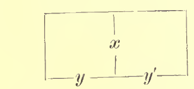

<!-- translation -->

<!-- endpair -->

__________

<!-- pair:en:GL00300:list_item -->
1. Some x are not-y.

<!-- translation -->
1. 有些 x 不是 y。

<!-- endpair -->

<!-- pair:en:GL00301:list_item -->
2. All x are not-y.

<!-- translation -->
2.所有 x 都不是 y。

<!-- endpair -->

<!-- pair:en:GL00302:list_item -->
3. Some x are y, and some are not-y.

<!-- translation -->
3.有些 x 是 y，有些则不是 y。

<!-- endpair -->

<!-- pair:en:GL00303:list_item -->
4. No x exist.

<!-- translation -->
4.不存在 x。

<!-- endpair -->

<!-- pair:en:GL00304:list_item -->
5. Some x exist.

<!-- translation -->
5. 有些 x 存在。

<!-- endpair -->

<!-- pair:en:GL00305:list_item -->
6. No x are not-y.

<!-- translation -->
6.没有 x 是非 y。

<!-- endpair -->

<!-- pair:en:GL00306:list_item -->
7. Some x are not-y, and some x exist.

<!-- translation -->
7.有些 x 不是 y，且有些 x 存在。

<!-- endpair -->

__________

<!-- pair:en:GL00308:paragraph -->
Taking x="judges"; y="just";

<!-- translation -->
取 x="法官"；y="公正的"；

<!-- endpair -->

<!-- pair:en:GL00309:list_item -->
8. No judges are just.

<!-- translation -->
8. 没有法官是公正的。

<!-- endpair -->

<!-- pair:en:GL00310:list_item -->
9. Some judges are unjust.

<!-- translation -->
9. 有些法官是不公正的。

<!-- endpair -->

<!-- pair:en:GL00311:list_item -->
10. All judges are just.

<!-- translation -->
10. 所有法官都是公正的。

<!-- endpair -->

__________

<!-- pair:en:GL00313:paragraph -->
Taking x="plums"; y="wholesome";

<!-- translation -->
取 x=“李子”；y=“有益健康的”；

<!-- endpair -->

<!-- pair:en:GL00314:list_item -->
11. Some plums are wholesome.

<!-- translation -->
11. 有些李子是有益健康的。

<!-- endpair -->

<!-- pair:en:GL00315:list_item -->
12. There are no wholesome plums.

<!-- translation -->
12. 没有有益健康的李子。

<!-- endpair -->

<!-- pair:en:GL00316:list_item -->
13. Plums are some of them wholesome, and some not.

<!-- translation -->
13. 李子中有些有益健康，有些则不然。

<!-- endpair -->

<!-- pair:en:GL00317:list_item -->
14. All plums are unwholesome.

<!-- translation -->
14. 所有李子都有害健康。

<!-- endpair -->

<!-- pair:en:GL00318:paragraph -->
[See pp. 59, 60]

<!-- translation -->
[参见第 59 页、60 页]

<!-- endpair -->

<!-- pair:en:GL00319:source_figure -->
[turn to page 41]

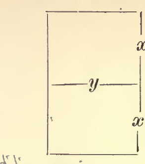

<!-- translation -->

<!-- endpair -->

__________

<!-- pair:en:GL00321:paragraph -->
Taking y="diligent students"; x="successful";

<!-- translation -->
令 y 表示“勤奋的学生”，x 表示“成功的”；

<!-- endpair -->

<!-- pair:en:GL00322:list_item -->
15. No diligent students are unsuccessful.

<!-- translation -->
15. 没有勤奋的学生是不成功的。

<!-- endpair -->

<!-- pair:en:GL00323:list_item -->
16. All diligent students are successful.

<!-- translation -->
16. 所有勤奋的学生都是成功的。

<!-- endpair -->

<!-- pair:en:GL00324:list_item -->
17. No students are diligent.

<!-- translation -->
17. 没有学生是勤奋的。

<!-- endpair -->

<!-- pair:en:GL00325:list_item -->
18. There are some diligent, but unsuccessful, students.

<!-- translation -->
18. 有些学生勤奋，但未能成功。

<!-- endpair -->

<!-- pair:en:GL00326:list_item -->
19. Some students are diligent.

<!-- translation -->
19. 有些学生是勤奋的。

<!-- endpair -->

<!-- pair:en:GL00327:paragraph -->
[See pp. 60, 1]

<!-- translation -->
[参见第60、61页]

<!-- endpair -->

<!-- pair:en:GL00328:heading -->
[turn to page 42]3. Half of Smaller Diagram.

<!-- translation -->
[turn to page 42]3. 较小图式的一半。

<!-- endpair -->

<!-- pair:en:GL00329:paragraph -->
Symbols to be interpreted.

<!-- translation -->
待解释的符号。

<!-- endpair -->

__________

<!-- pair:en:GL00331:source_figure -->
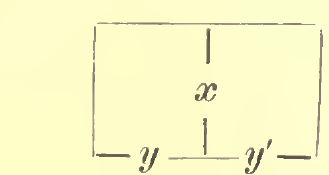

<!-- translation -->

<!-- endpair -->

__________

<!-- pair:en:GL00333:source_figure -->
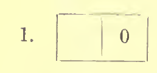

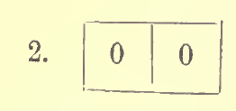

<!-- translation -->

<!-- endpair -->

<!-- pair:en:GL00334:source_figure -->
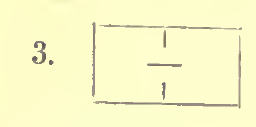

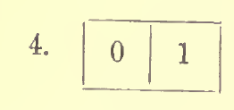

<!-- translation -->

<!-- endpair -->

__________

<!-- pair:en:GL00336:paragraph -->
Taking x="good riddles"; y="hard";

<!-- translation -->
取 x="好谜题"；y="难"；

<!-- endpair -->

<!-- pair:en:GL00337:source_figure -->
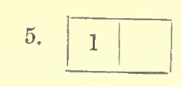

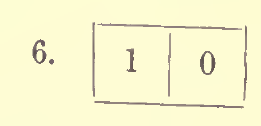

<!-- translation -->

<!-- endpair -->

<!-- pair:en:GL00338:source_figure -->

<!-- translation -->

<!-- endpair -->

__________

<!-- pair:en:GL00340:paragraph -->
[See pp. 61, 2]

<!-- translation -->
[参见第61、62页]

<!-- endpair -->

<!-- pair:en:GL00341:paragraph -->
[turn to page 43]Taking x="lobsters"; y="selfish";

<!-- translation -->
[turn to page 43]取 x="龙虾"；y="自私的"；

<!-- endpair -->

<!-- pair:en:GL00342:source_figure -->

<!-- translation -->

<!-- endpair -->

<!-- pair:en:GL00343:source_figure -->

<!-- translation -->

<!-- endpair -->

__________

<!-- pair:en:GL00345:source_figure -->

<!-- translation -->

<!-- endpair -->

<!-- pair:en:GL00346:paragraph -->
Taking y="healthy people"; x="happy";

<!-- translation -->
取 y="健康的人"；x="快乐"；

<!-- endpair -->

<!-- pair:en:GL00347:source_figure -->

<!-- translation -->

<!-- endpair -->

<!-- pair:en:GL00348:paragraph -->
[See p. 62]

<!-- translation -->
[参见第62页]

<!-- endpair -->

<!-- pair:en:GL00349:heading -->
[turn to page 44]4. Smaller Diagram.

<!-- translation -->
[turn to page 44]4. 较小图式。

<!-- endpair -->

<!-- pair:en:GL00350:paragraph -->
Propositions to be represented.

<!-- translation -->
待表述的命题。

<!-- endpair -->

<!-- pair:en:GL00351:source_figure -->

<!-- translation -->

<!-- endpair -->

__________

<!-- pair:en:GL00353:list_item -->
1. All y are x.

<!-- translation -->
1.所有 y 都是 x。

<!-- endpair -->

<!-- pair:en:GL00354:list_item -->
2. Some y are not-x.

<!-- translation -->
2. 有些 y 不是 x。

<!-- endpair -->

<!-- pair:en:GL00355:list_item -->
3. No not-x are not-y.

<!-- translation -->
3.没有非 x 是非 y。

<!-- endpair -->

<!-- pair:en:GL00356:list_item -->
4. Some x are not-y.

<!-- translation -->
4. 有些 x 不是 y。

<!-- endpair -->

<!-- pair:en:GL00357:list_item -->
5. Some not-y are x.

<!-- translation -->
5. 有些非 y 是 x。

<!-- endpair -->

<!-- pair:en:GL00358:list_item -->
6. No not-x are y.

<!-- translation -->
6.没有非 x 是 y。

<!-- endpair -->

<!-- pair:en:GL00359:list_item -->
7. Some not-x are not-y.

<!-- translation -->
7. 有些非 x 是非 y。

<!-- endpair -->

<!-- pair:en:GL00360:list_item -->
8. All not-x are not-y.

<!-- translation -->
8. 所有非 x 者皆非 y。

<!-- endpair -->

<!-- pair:en:GL00361:list_item -->
9. Some not-y exist.

<!-- translation -->
9. 有些非 y 存在。

<!-- endpair -->

<!-- pair:en:GL00362:list_item -->
10. No not-x exist.

<!-- translation -->
10. 没有非 x 存在。

<!-- endpair -->

<!-- pair:en:GL00363:list_item -->
11. Some y are x, and some are not-x.

<!-- translation -->
11.有些 y 是 x，有些则不是 x。

<!-- endpair -->

<!-- pair:en:GL00364:list_item -->
12. All x are y, and all not-y are not-x.

<!-- translation -->
12.所有 x 都是 y，且所有非 y 都是非 x。

<!-- endpair -->

<!-- pair:en:GL00365:paragraph -->
[See pp. 62, 3]

<!-- translation -->
[参见第62、63页]

<!-- endpair -->

<!-- pair:en:GL00366:paragraph -->
[turn to page 45]Taking "nations" as Universe; x="civilised"; y="warlike";

<!-- translation -->
[turn to page 45]以“国家”为论域；x=“文明的”；y=“好战的”；

<!-- endpair -->

<!-- pair:en:GL00367:list_item -->
13. No uncivilised nation is warlike.

<!-- translation -->
13. 没有未开化的国家是好战的。

<!-- endpair -->

<!-- pair:en:GL00368:list_item -->
14. All unwarlike nations are uncivilised.

<!-- translation -->
14. 所有不好战的国家都是未开化的。

<!-- endpair -->

<!-- pair:en:GL00369:list_item -->
15. Some nations are unwarlike.

<!-- translation -->
15. 有些国家不好战。

<!-- endpair -->

<!-- pair:en:GL00370:list_item -->
16. All warlike nations are civilised, and all civilised nations are warlike.

<!-- translation -->
16. 所有好战的国家都是文明的，而所有文明的国家也都是好战的。

<!-- endpair -->

<!-- pair:en:GL00371:list_item -->
17. No nation is uncivilised.

<!-- translation -->
17. 没有任何国家是未开化的。

<!-- endpair -->

__________

<!-- pair:en:GL00373:paragraph -->
Taking "crocodiles" as Universe; x="hungry"; and y="amiable";

<!-- translation -->
以“鳄鱼”为论域；x=“饥饿的”；y=“友善的”；

<!-- endpair -->

<!-- pair:en:GL00374:list_item -->
18. All hungry crocodiles are unamiable.

<!-- translation -->
18. 所有饥饿的鳄鱼都是不友善的。

<!-- endpair -->

<!-- pair:en:GL00375:list_item -->
19. No crocodiles are amiable when hungry.

<!-- translation -->
19. 饥饿时的鳄鱼都不友善。

<!-- endpair -->

<!-- pair:en:GL00376:list_item -->
20. Some crocodiles, when not hungry, are amiable; but some are not.

<!-- translation -->
20. 有些鳄鱼在不饥饿时是友善的；但也有些不是。

<!-- endpair -->

<!-- pair:en:GL00377:list_item -->
21. No crocodiles are amiable, and some are hungry.

<!-- translation -->
21. 没有鳄鱼是友善的，有些则是饥饿的。

<!-- endpair -->

<!-- pair:en:GL00378:list_item -->
22. All crocodiles, when not hungry, are amiable; and all unamiable crocodiles are hungry.

<!-- translation -->
22. 所有不饥饿的鳄鱼都是友善的；所有不友善的鳄鱼都是饥饿的。

<!-- endpair -->

<!-- pair:en:GL00379:list_item -->
23. Some hungry crocodiles are amiable, and some that are not hungry are unamiable.

<!-- translation -->
23. 有些饥饿的鳄鱼是友善的，而有些不饥饿的则是不友善的。

<!-- endpair -->

<!-- pair:en:GL00380:paragraph -->
[See pp. 63, 4]

<!-- translation -->
[参见第63、64页]

<!-- endpair -->

<!-- pair:en:GL00381:heading -->
[turn to page 46]5. Smaller Diagram.

<!-- translation -->
[turn to page 46]5. 较小图式。

<!-- endpair -->

<!-- pair:en:GL00382:paragraph -->
Symbols to be interpreted.

<!-- translation -->
待解释的符号。

<!-- endpair -->

__________

<!-- pair:en:GL00384:source_figure -->

<!-- translation -->

<!-- endpair -->

__________

<!-- pair:en:GL00386:source_figure -->

<!-- translation -->

<!-- endpair -->

<!-- pair:en:GL00387:source_figure -->

<!-- translation -->

<!-- endpair -->

__________

<!-- pair:en:GL00389:paragraph -->
Taking "houses" as Universe; x="built of brick"; and y="two-storied"; interpret

<!-- translation -->
以“房屋”为论域；x=“砖砌的”；y=“两层的”；解释下列图式：

<!-- endpair -->

<!-- pair:en:GL00390:source_figure -->

<!-- translation -->

<!-- endpair -->

<!-- pair:en:GL00391:source_figure -->

<!-- translation -->

<!-- endpair -->

<!-- pair:en:GL00392:paragraph -->
[See p. 65]

<!-- translation -->
[参见第65页]

<!-- endpair -->

<!-- pair:en:GL00393:paragraph -->
[turn to page 47]Taking "boys" as Universe; x="fat"; and y="active"; interpret

<!-- translation -->
[turn to page 47]以“男孩”为论域；x=“胖的”；y=“活跃的”；解释下列图式：

<!-- endpair -->

<!-- pair:en:GL00394:source_figure -->

<!-- translation -->

<!-- endpair -->

<!-- pair:en:GL00395:source_figure -->

<!-- translation -->

<!-- endpair -->

__________

<!-- pair:en:GL00397:paragraph -->
Taking "cats" as Universe; x="green-eyed"; and y="good-tempered"; interpret

<!-- translation -->
以“猫”为论域；x=“绿眼睛的”；y=“脾气好的”；解释下列图式：

<!-- endpair -->

<!-- pair:en:GL00398:source_figure -->

<!-- translation -->

<!-- endpair -->

<!-- pair:en:GL00399:source_figure -->

<!-- translation -->

<!-- endpair -->

<!-- pair:en:GL00400:paragraph -->
[See pp. 65, 6]

<!-- translation -->
[参见第65、66页]

<!-- endpair -->

<!-- pair:en:GL00401:heading -->
[turn to page 48]6. Larger Diagram.

<!-- translation -->
[turn to page 48]6. 较大图式。

<!-- endpair -->

<!-- pair:en:GL00402:paragraph -->
Propositions to be represented.

<!-- translation -->
待表述的命题。

<!-- endpair -->

__________

<!-- pair:en:GL00404:source_figure -->

<!-- translation -->

<!-- endpair -->

__________

<!-- pair:en:GL00406:list_item -->
1. No x are m.

<!-- translation -->
1.没有 x 是 m。

<!-- endpair -->

<!-- pair:en:GL00407:list_item -->
2. Some y are m'.

<!-- translation -->
2. 有些 y 是 m'。

<!-- endpair -->

<!-- pair:en:GL00408:list_item -->
3. All m are x'.

<!-- translation -->
3.所有 m 都是 x'。

<!-- endpair -->

<!-- pair:en:GL00409:list_item -->
4. No m' are y'.

<!-- translation -->
4.没有 m' 是 y'。

<!-- endpair -->

<!-- pair:en:GL00410:list_item -->
5. No m are x; All y are m.

<!-- translation -->
5.没有 m 是 x；所有 y 都是 m。

<!-- endpair -->

<!-- pair:en:GL00411:list_item -->
6. Some x are m; No y are m.

<!-- translation -->
6.有些 x 是 m；没有 y 是 m。

<!-- endpair -->

<!-- pair:en:GL00412:list_item -->
7. All m are x'; No m are y.

<!-- translation -->
7.所有 m 都是 x'；没有任何 m 是 y。

<!-- endpair -->

<!-- pair:en:GL00413:list_item -->
8. No x' are m; No y' are m'.

<!-- translation -->
8.没有 x' 是 m；没有 y' 是 m'。

<!-- endpair -->

<!-- pair:en:GL00414:paragraph -->
[See pp. 67,8]

<!-- translation -->
[参见第67、68页]

<!-- endpair -->

<!-- pair:en:GL00415:paragraph -->
[turn to page 49]Taking "rabbits" as Universe; m="greedy"; x="old"; and y="black"; represent

<!-- translation -->
[turn to page 49]以“兔子”为论域；m=“贪婪的”；x=“年老的”；y=“黑色的”；用图式表示下列命题：

<!-- endpair -->

<!-- pair:en:GL00416:list_item -->
9. No old rabbits are greedy.

<!-- translation -->
9. 没有老兔子是贪婪的。

<!-- endpair -->

<!-- pair:en:GL00417:list_item -->
10. Some not-greedy rabbits are black.

<!-- translation -->
10. 有些非贪婪的兔子是黑色的。

<!-- endpair -->

<!-- pair:en:GL00418:list_item -->
11. All white rabbits are free from greediness.

<!-- translation -->
11. 所有白兔皆无贪婪之心。

<!-- endpair -->

<!-- pair:en:GL00419:list_item -->
12. All greedy rabbits are young.

<!-- translation -->
12. 所有贪婪的兔子都是年轻的。

<!-- endpair -->

<!-- pair:en:GL00420:list_item -->
13. No old rabbits are greedy; All black rabbits are greedy.

<!-- translation -->
13. 没有老兔子是贪婪的；所有黑兔子都是贪婪的。

<!-- endpair -->

<!-- pair:en:GL00421:list_item -->
14. All rabbits, that are not greedy, are black; No old rabbits are free from greediness.

<!-- translation -->
14. 所有不贪婪的兔子都是黑色的；没有老兔子能免于贪婪。

<!-- endpair -->

__________

<!-- pair:en:GL00423:paragraph -->
Taking "birds" as Universe; m="that sing loud"; x="well-fed"; and y="happy"; represent

<!-- translation -->
以“鸟”为论域；m=“鸣声洪亮的”；x=“吃饱的”；y=“快乐的”；用图式表示下列命题：

<!-- endpair -->

<!-- pair:en:GL00424:list_item -->
15. All well-fed birds sing loud; No birds, that sing loud, are unhappy.

<!-- translation -->
15. 所有吃饱的鸟都大声歌唱；没有那些大声歌唱的鸟是不快乐的。

<!-- endpair -->

<!-- pair:en:GL00425:list_item -->
16. All birds, that do not sing loud, are unhappy; No well-fed birds fail to sing loud.

<!-- translation -->
16. 所有不响亮歌唱的鸟都是不快乐的；所有喂得饱的鸟都不会不响亮地歌唱。

<!-- endpair -->

__________

<!-- pair:en:GL00427:paragraph -->
Taking "persons" as Universe; m="in the house"; x="John"; and y="having a tooth-ache"; represent

<!-- translation -->
以“人”为论域；m=“在屋里的”；x=“约翰”；y=“牙痛的”；用图式表示下列命题：

<!-- endpair -->

<!-- pair:en:GL00428:list_item -->
17. John is in the house; Everybody in the house is suffering from tooth-ache.

<!-- translation -->
17. 约翰在屋里；屋里的每个人都患有牙痛。

<!-- endpair -->

<!-- pair:en:GL00429:list_item -->
18. There is no one in the house but John; Nobody, out of the house, has a tooth-ache.

<!-- translation -->
18. 房子里除了约翰之外无人；房外之人，无人牙痛。

<!-- endpair -->

__________

<!-- pair:en:GL00431:paragraph -->
[See pp. 68-70]

<!-- translation -->
[参见第 68-70 页]

<!-- endpair -->

<!-- pair:en:GL00432:paragraph -->
[turn to page 50]Taking "persons" as Universe; m="I"; x="that has taken a walk"; y="that feels better"; represent

<!-- translation -->
[turn to page 50]以“人”为论域；m=“我”；x=“散过步的”；y=“感觉好些的”；用图式表示下列命题：

<!-- endpair -->

<!-- pair:en:GL00433:list_item -->
19. I have been out for a walk; I feel much better.

<!-- translation -->
19. 我出去散步了，感觉好多了。

<!-- endpair -->

__________

<!-- pair:en:GL00435:paragraph -->
Choosing your own 'Universe' &c., represent

<!-- translation -->
自行选择“论域”等，用图式表示下列命题：

<!-- endpair -->

<!-- pair:en:GL00436:list_item -->
20. I sent him to bring me a kitten; He brought me a kettle by mistake.

<!-- translation -->
20. 我派他去给我带一只小猫；他却误带了一只水壶来。

<!-- endpair -->

<!-- pair:en:GL00437:paragraph -->
[See pp. 70, 1]

<!-- translation -->
[参见第70、71页]

<!-- endpair -->

<!-- pair:en:GL00438:heading -->
[turn to page 51]7. Both Diagrams to be employed.

<!-- translation -->
[turn to page 51]7. 须同时采用两个图式。

<!-- endpair -->

__________

<!-- pair:en:GL00440:source_figure -->

<!-- translation -->

<!-- endpair -->

__________

<!-- pair:en:GL00442:paragraph -->
N.B. In each Question, a small Diagram should be drawn, for x and y only, and marked in accordance with the given large Diagram: and then as many Propositions as possible, for x and y, should be read off from this small Diagram.

<!-- translation -->
注：在每一题中，仅针对 x 和 y 应绘制一个小图式，并按所给大图的标记方式加以标注；随后，尽可能多地从该小图式中读出关于 x 和 y 的命题。

<!-- endpair -->

<!-- pair:en:GL00443:source_figure -->

<!-- translation -->

<!-- endpair -->

<!-- pair:en:GL00444:paragraph -->
[See p. 72]

<!-- translation -->
[参见第72页]

<!-- endpair -->

<!-- pair:en:GL00445:source_figure -->
[turn to page 52]

<!-- translation -->

<!-- endpair -->

__________

<!-- pair:en:GL00447:paragraph -->
Mark, in a large Diagram, the following pairs of Propositions from the preceding Section: then mark a small Diagram in accordance with it, &c.

<!-- translation -->
在大型图式中，标出前一节中的下列命题对；然后据此标出一个小型图式，等等。

<!-- endpair -->

<!-- pair:en:GL00448:list_item -->
5.  No. 13. [see p. 49]    9.  No. 17.
6.  No. 14.               10.  No. 18.
7.  No. 15.               11.  No. 19. [see p. 50]
8.  No. 16.               12.  No. 20.

<!-- translation -->
5. 第13题。[参见第49页]    9. 第17题。
6. 第14题。                 10. 第18题。
7. 第15题。                 11. 第19题。[参见第50页]
8. 第16题。                 12. 第20题。

<!-- endpair -->

__________

<!-- pair:en:GL00450:paragraph -->
Mark, on a large Diagram, the following Pairs of Propositions: then mark a small Diagram, &c. These are, in fact, Pairs of PREMISSES for Syllogisms: and the results, read off from the small Diagram, are the CONCLUSIONS.

<!-- translation -->
在大图式上标出下列命题对，然后在小图式上作相应标记，等等。这些实际上是三段论的成对前提；从小图式中读出的结果就是结论。

<!-- endpair -->

<!-- pair:en:GL00451:list_item -->
13. No exciting books suit feverish patients; Unexciting books make one drowsy.

<!-- translation -->
13. 令人兴奋的书不适合发烧的病人；不令人兴奋的书则使人昏昏欲睡。

<!-- endpair -->

<!-- pair:en:GL00452:list_item -->
14. Some, who deserve the fair, get their deserts; None but the brave deserve the fair.

<!-- translation -->
14. 有些配得上美人的人得到了应得之物；只有勇者才配得上美人。

<!-- endpair -->

<!-- pair:en:GL00453:list_item -->
15. No children are patient; No impatient person can sit still.

<!-- translation -->
15. 没有孩子是耐心的；没有急躁的人能安坐不动。

<!-- endpair -->

<!-- pair:en:GL00454:paragraph -->
[See pp. 72-5]

<!-- translation -->
[参见第72—75页]

<!-- endpair -->

<!-- pair:en:GL00455:list_item -->
[turn to page 53]16. All pigs are fat; No skeletons are fat.

<!-- translation -->
[turn to page 53]16. 所有猪都是肥的；没有骨架是肥的。

<!-- endpair -->

<!-- pair:en:GL00456:list_item -->
17. No monkeys are soldiers; All monkeys are mischievous.

<!-- translation -->
17. 没有猴子是士兵；所有猴子都是顽皮的。

<!-- endpair -->

<!-- pair:en:GL00457:list_item -->
18. None of my cousins are just; No judges are unjust.

<!-- translation -->
18. 我的表亲中没有一个是公正的；没有法官是不公正的。

<!-- endpair -->

<!-- pair:en:GL00458:list_item -->
19. Some days are rainy; Rainy days are tiresome.

<!-- translation -->
19. 有些日子是下雨的；下雨的日子令人厌倦。

<!-- endpair -->

<!-- pair:en:GL00459:list_item -->
20. All medicine is nasty; Senna is a medicine.

<!-- translation -->
20. 所有药物都是难吃的；番泻叶是一种药物。

<!-- endpair -->

<!-- pair:en:GL00460:list_item -->
21. Some Jews are rich; All Patagonians are Gentiles.

<!-- translation -->
21. 有些犹太人是富人；所有巴塔哥尼亚人都是非犹太人。

<!-- endpair -->

<!-- pair:en:GL00461:list_item -->
22. All teetotalers like sugar; No nightingale drinks wine.

<!-- translation -->
22. 所有戒酒者都喜欢糖；没有夜莺饮酒。

<!-- endpair -->

<!-- pair:en:GL00462:list_item -->
23. No muffins are wholesome; All buns are unwholesome.

<!-- translation -->
23. 没有松饼有益健康；所有小圆面包都有害健康。

<!-- endpair -->

<!-- pair:en:GL00463:list_item -->
24. No fat creatures run well; Some greyhounds run well.

<!-- translation -->
24. 没有肥胖的生物善跑；有些灵缇犬善跑。

<!-- endpair -->

<!-- pair:en:GL00464:list_item -->
25. All soldiers march; Some youths are not soldiers.

<!-- translation -->
25. 所有士兵都行军；有些年轻人不是士兵。

<!-- endpair -->

<!-- pair:en:GL00465:list_item -->
26. Sugar is sweet; Salt is not sweet.

<!-- translation -->
26. 糖是甜的；盐不是甜的。

<!-- endpair -->

<!-- pair:en:GL00466:list_item -->
27. Some eggs are hard-boiled; No eggs are uncrackable.

<!-- translation -->
27. 有些鸡蛋是煮老的；没有鸡蛋是敲不破的。

<!-- endpair -->

<!-- pair:en:GL00467:list_item -->
28. There are no Jews in the house; There are no Gentiles in the garden.

<!-- translation -->
28. 屋里没有犹太人；花园里没有非犹太人。

<!-- endpair -->

<!-- pair:en:GL00468:paragraph -->
[See pp. 75-82]

<!-- translation -->
[参见第75—82页]

<!-- endpair -->

<!-- pair:en:GL00469:list_item -->
[turn to page 54]29. All battles are noisy; What makes no noise may escape notice.

<!-- translation -->
[turn to page 54]29. 所有战斗都是喧闹的；不发出声音的东西可能不被注意到。

<!-- endpair -->

<!-- pair:en:GL00470:list_item -->
30. No Jews are mad; All Rabbis are Jews.

<!-- translation -->
30. 没有犹太人是疯的；所有拉比都是犹太人。

<!-- endpair -->

<!-- pair:en:GL00471:list_item -->
31. There are no fish that cannot swim; Some skates are fish.

<!-- translation -->
31. 没有鱼是不会游泳的；有些鳐是鱼。

<!-- endpair -->

<!-- pair:en:GL00472:list_item -->
32. All passionate people are unreasonable; Some orators are passionate.

<!-- translation -->
32. 所有易怒的人都不讲理；有些演说家易怒。

<!-- endpair -->

<!-- pair:en:GL00473:paragraph -->
[See pp. 82-84]

<!-- translation -->
[参见第82—84页]

<!-- endpair -->

<!-- pair:en:GL00474:chapter -->
[turn to page 55]CHAPTER III.

<!-- translation -->
[turn to page 55]第三章

<!-- endpair -->

<!-- pair:en:GL00475:heading -->
CROOKED ANSWERS.

<!-- translation -->
曲折的答案

<!-- endpair -->

<!-- pair:en:GL00476:poem -->
"I answered him, as I thought good,
 'As many as red-herrings grow in the wood'."

<!-- translation -->
“我自以为答得恰当，对他说：
‘就和树林里长出的熏鲱鱼一样多。’”

<!-- endpair -->

__________

<!-- pair:en:GL00478:heading -->
1. Elementary.

<!-- translation -->
1. 基础问题。

<!-- endpair -->

<!-- pair:en:GL00479:list_item -->
1. Whatever can be "attributed to", that is "said to belong to", a Thing, is called an 'Attribute'. For example, "baked", which can (frequently) be attributed to "Buns", and "beautiful", which can (seldom) be attributed to "Babies".

<!-- translation -->
1. 凡能“归属于”某物，也就是“说成属于”某物的，便称为“属性”。例如，“烤熟的”这个属性（常常）可以归给“小圆面包”；“美丽的”这个属性（很少）可以归给“婴儿”。

<!-- endpair -->

<!-- pair:en:GL00480:list_item -->
2. When they are the Names of two Things (for example, "these Pigs are fat Animals"), or of two Attributes (for example, "pink is light red").

<!-- translation -->
2. 当它们是两种事物的名称时（例如，“这些猪是肥胖的动物”），或是两种属性的名称时（例如，“粉红色是浅红色”）。

<!-- endpair -->

<!-- pair:en:GL00481:list_item -->
3. When one is the Name of a Thing, and the other the Name of an Attribute (for example, "these Pigs are pink"), since a Thing cannot actually BE an Attribute.

<!-- translation -->
3. 当一个是事物的名称，另一个是属性的名称时（例如，“这些猪是粉红色的”），因为事物实际上不可能是属性。

<!-- endpair -->

<!-- pair:en:GL00482:list_item -->
4. That the Substantive shall be supposed to be repeated at the end of the sentence (for example, "these Pigs are pink (Pigs)").

<!-- translation -->
4. 应当认为句末重复了一次那个名词（例如，“这些猪是粉红色的〔猪〕”）。

<!-- endpair -->

<!-- pair:en:GL00483:list_item -->
5. A 'Proposition' is a sentence stating that some, or none, or all, of the Things belonging to a certain class, [turn to page 56]called the 'Subject', are also Things belonging to a certain other class, called the 'Predicate'. For example, "some new Cakes are not nice", that is (written in full) "some new Cakes are not nice Cakes"; where the class "new Cakes" is the Subject, and the class "not-nice Cakes" is the Predicate.

<!-- translation -->
5. “命题”是这样一种句子：它陈述属于某个类（[turn to page 56]称为“主项”）的事物中，有些、没有一个或所有，也属于另一个类（称为“谓项”）。例如，“有些新蛋糕不好吃”，完整写出就是“有些新蛋糕是不好吃的蛋糕”；其中，“新蛋糕”这个类是主项，“不好吃的蛋糕”这个类是谓项。

<!-- endpair -->

<!-- pair:en:GLN00001:note -->
[See p. 37]

<!-- translation -->
[参见第37页]

<!-- endpair -->

<!-- pair:en:GL00484:list_item -->
6. A Proposition, stating that SOME of the Things belonging to its Subject are so-and-so, is called 'Particular'. For example, "some new Cakes are nice", "some new Cakes are not nice."

<!-- translation -->
6. 陈述其主项所属事物中“有些”是如此这般的命题，称为“特称命题”。例如，“有些新蛋糕好吃”，“有些新蛋糕不好吃”。

<!-- endpair -->

<!-- pair:en:GL00485:paragraph -->
A Proposition, stating that NONE of the Things belonging to its Subject, or that ALL of them, are so-and-so, is called 'Universal'. For example, "no new Cakes are nice", "all new Cakes are not nice".

<!-- translation -->
陈述其主项所属事物中“没有一个”或“所有”是如此这般的命题，称为“全称命题”。例如，“没有新蛋糕是好吃的”，“所有新蛋糕都不好吃”。

<!-- endpair -->

<!-- pair:en:GL00486:list_item -->
7. The Things in each compartment possess TWO Attributes, whose symbols will be found written on two of the EDGES of that compartment.

<!-- translation -->
7. 每一格中的事物具有两个属性；这两个属性的符号写在该格的两条边上。

<!-- endpair -->

<!-- pair:en:GL00487:list_item -->
8. "One or more."

<!-- translation -->
8. “一个或多个。”

<!-- endpair -->

<!-- pair:en:GL00488:list_item -->
9. As a name of the class of Things to which the whole Diagram is assigned.

<!-- translation -->
9. 作为分配给整个图式的那一类事物的名称。

<!-- endpair -->

<!-- pair:en:GL00489:list_item -->
10. A Proposition containing two statements. For example, "some new Cakes are nice and some are not-nice."

<!-- translation -->
10. 含有两个陈述的命题。例如，“有些新蛋糕好吃，有些不好吃”。

<!-- endpair -->

<!-- pair:en:GL00490:list_item -->
11. When the whole class, thus divided, is "exhausted" among the sets into which it is divided, there being no member of it which does not belong to some one of them. For example, the class "new Cakes" is "exhaustively" [turn to page 57]divided into "nice" and "not-nice" since EVERY new Cake must be one or the other.

<!-- translation -->
11. 当划分后的各组“穷尽”了被划分的整个类，其中没有任何成员不属于某一组时。例如，将“新蛋糕”分为“好吃的”和“不好吃的”，就是“穷尽的”[turn to page 57]划分，因为每一块新蛋糕都必然属于二者之一。

<!-- endpair -->

<!-- pair:en:GLN00002:note -->
[See pp. 37, 8]

<!-- translation -->
[参见第37、38页]

<!-- endpair -->

<!-- pair:en:GL00491:list_item -->
12. When a man cannot make up his mind which of two parties he will join, he is said to be "sitting on the fence"--not being able to decide on which side he will jump down.

<!-- translation -->
12. 当一个人无法决定加入两派中的哪一派时，就说他“骑在篱笆上”：他决定不了该从哪一侧跳下去。

<!-- endpair -->

<!-- pair:en:GL00492:list_item -->
13. "Some x are y" and "no x are y'".

<!-- translation -->
13. “有些 x 是 y”和“没有 x 是 y′”。

<!-- endpair -->

<!-- pair:en:GL00493:list_item -->
14. A Proposition, whose Subject is a single Thing, is called 'Individual'. For example, "I am happy", "John is not at home". These are Universal Propositions, being the same as "all the I's that exist are happy", "ALL the Johns, that I am now considering, are not at home".

<!-- translation -->
14. 主项为单个事物的命题称为“单称命题”。例如，“我是快乐的”，“约翰不在家”。它们都是全称命题，等同于“所有存在的我都是快乐的”，“我此刻所考虑的所有约翰都不在家”。

<!-- endpair -->

<!-- pair:en:GL00494:list_item -->
15. Propositions beginning with "some" or "all".

<!-- translation -->
15. 以“有些”或“所有”开头的命题。

<!-- endpair -->

<!-- pair:en:GL00495:list_item -->
16. When they begin with "some" or "no". For example, "some abc are def" may be re-arranged as "some bf are acde", each being equivalent to "some abcdef exist".

<!-- translation -->
16. 当它们以“有些”或“没有”开头时。例如，“有些 abc 是 def”可以重新安排为“有些 bf 是 acde”，因为二者都等同于“有些 abcdef 存在”。

<!-- endpair -->

<!-- pair:en:GL00496:list_item -->
17. Some tigers are fierce, No tigers are not-fierce.

<!-- translation -->
17. 有些老虎是凶猛的；没有老虎是不凶猛的。

<!-- endpair -->

<!-- pair:en:GL00497:list_item -->
18. Some hard-boiled eggs are unwholesome, No hard-boiled eggs are wholesome.

<!-- translation -->
18. 有些煮老的鸡蛋有害健康；没有煮老的鸡蛋有益健康。

<!-- endpair -->

<!-- pair:en:GL00498:list_item -->
19. Some I's are happy, No I's are unhappy.

<!-- translation -->
19. 有些我是快乐的；没有我是不快乐的。

<!-- endpair -->

<!-- pair:en:GL00499:list_item -->
20. Some Johns are not at home, No Johns are at home.

<!-- translation -->
20. 有些约翰不在家；没有约翰在家。

<!-- endpair -->

<!-- pair:en:GL00500:list_item -->
21. The Things, in each compartment of the larger Diagram, possess THREE Attributes, whose symbols will be [turn to page 58]found written at three of the CORNERS of the compartment (except in the case of m', which is not actually inserted in the Diagram, but is SUPPOSED to stand at each of its four outer corners).

<!-- translation -->
21. 大图式每一格中的事物具有三个属性；这三个属性的符号[turn to page 58]写在该格的三个角上（m′除外，它实际上没有标在图式中，但应当认为它出现在图式外侧的四个角上）。

<!-- endpair -->

<!-- pair:en:GLN00003:note -->
[See pp. 38, 9]

<!-- translation -->
[参见第38、39页]

<!-- endpair -->

<!-- pair:en:GL00501:list_item -->
22. If the Universe of Things be divided with regard to three different Attributes; and if two Propositions be given, containing two different couples of these Attributes; and if from these we can prove a third Proposition, containing the two Attributes that have not yet occurred together; the given Propositions are called 'the Premisses', the third one 'the Conclusion', and the whole set 'a Syllogism'. For example, the Premisses might be "no m are x'" and "all m' are y"; and it might be possible to prove from them a Conclusion containing x and y.

<!-- translation -->
22. 如果把事物的论域按三个不同属性划分，给定两个命题，各包含这些属性中不同的一对；又能由此证明第三个命题，包含此前未曾一起出现的两个属性，那么，给定的命题称为“前提”，第三个命题称为“结论”，这一整组称为“三段论”。例如，前提可以是“没有 m 是 x′”与“所有 m′ 都是 y”；由此也许能够证明一个包含 x 和 y 的结论。

<!-- endpair -->

<!-- pair:en:GL00502:list_item -->
23. If an Attribute occurs in both Premisses, the Term containing it is called 'the Middle Term'. For example, if the Premisses are "some m are x" and "no m are y'", the class of "m-Things" is 'the Middle Term.'

<!-- translation -->
23. 如果某个属性在两个前提中都出现，包含它的项称为“中项”。例如，若前提是“有些 m 是 x”和“没有 m 是 y′”，那么“m类事物”这个类就是“中项”。

<!-- endpair -->

<!-- pair:en:GL00503:paragraph -->
If an Attribute occurs in one Premiss, and its contradictory in the other, the Terms containing them may be called 'the Middle Terms'. For example, if the Premisses are "no m are x'" and "all m' are y", the two classes of "m-Things" and "m'-Things" may be called 'the Middle Terms'.

<!-- translation -->
如果某个属性出现在一个前提中，它的矛盾属性出现在另一个前提中，包含二者的项便可称为“中项”。例如，若前提是“没有 m 是 x′”和“所有 m′ 都是 y”，那么“m类事物”和“m′类事物”这两个类便可称为“中项”。

<!-- endpair -->

<!-- pair:en:GL00504:list_item -->
24. Because they can be marked with CERTAINTY: whereas AFFIRMATIVE Propositions (that is, those that begin with "some" or "all") sometimes require us to place a red counter 'sitting on a fence'.

<!-- translation -->
24. 因为它们可以确定无疑地标出；而肯定命题（即以“有些”或“所有”开头的命题）有时要求我们把一枚红筹码放在分界线上，像“骑在篱笆上”。

<!-- endpair -->

<!-- pair:en:GLN00004:note -->
[See p. 39]

<!-- translation -->
[参见第39页]

<!-- endpair -->

<!-- pair:en:GL00505:list_item -->
[turn to page 59]25. Because the only question we are concerned with is whether the Conclusion FOLLOWS LOGICALLY from the Premisses, so that, if THEY were true, IT also would be true.

<!-- translation -->
[turn to page 59]25. 因为我们关心的唯一问题是：结论是否从前提中合乎逻辑地得出，也就是说，如果前提为真，结论是否也必定为真。

<!-- endpair -->

<!-- pair:en:GL00506:list_item -->
26. By understanding a red counter to mean "this compartment CAN be occupied", and a grey one to mean "this compartment CANNOT be occupied" or "this compartment MUST be empty".

<!-- translation -->
26. 把红筹码理解为“这一格可以有东西占据”；把灰筹码理解为“这一格不可能有东西占据”，或“这一格必定为空”。

<!-- endpair -->

<!-- pair:en:GL00507:list_item -->
27. 'Fallacious Premisses' and 'Fallacious Conclusion'.

<!-- translation -->
27. “谬误的前提”与“谬误的结论”。

<!-- endpair -->

<!-- pair:en:GL00508:list_item -->
28. By finding, when we try to transfer marks from the larger Diagram to the smaller, that there is 'no information' for any of its four compartments.

<!-- translation -->
28. 当我们试图把标记从大图式移到小图式时，发现小图式四格中的每一格都“没有信息”。

<!-- endpair -->

<!-- pair:en:GL00509:list_item -->
29. By finding the correct Conclusion, and then observing that the Conclusion, offered to us, is neither identical with it nor a part of it.

<!-- translation -->
29. 先找出正确的结论，再观察给出的结论既不与它相同，也不是它的一部分。

<!-- endpair -->

<!-- pair:en:GL00510:list_item -->
30. When the offered Conclusion is PART of the correct Conclusion. In this case, we may call it a 'Defective Conclusion'.

<!-- translation -->
30. 当给出的结论是正确结论的一部分时。这种情形下，可以称它为“不完整的结论”。

<!-- endpair -->

<!-- pair:en:GL00511:heading -->
2. Half of Smaller Diagram.

<!-- translation -->
2. 小图式的一半。

<!-- endpair -->

<!-- pair:en:GL00512:paragraph -->
Propositions represented.

<!-- translation -->
已表示出的命题。

<!-- endpair -->

__________

<!-- pair:en:GL00514:source_figure -->

<!-- translation -->

<!-- endpair -->

<!-- pair:en:GL00515:source_figure -->

<!-- translation -->

<!-- endpair -->

<!-- pair:en:GLN00005:note -->
[See pp. 39, 40]

<!-- translation -->
[参见第39、40页]

<!-- endpair -->

<!-- pair:en:GL00516:source_figure -->
[turn to page 60]

<!-- translation -->

<!-- endpair -->

<!-- pair:en:GL00517:source_figure -->
7.

It might be thought that the proper Diagram would be

, in order to express "some x exist": but this is really contained in "some x are y'." To put a red counter on the division-line would only tell us "ONE OF THE compartments is occupied", which we know already, in knowing that ONE is occupied.

8. No x are y. i.e.

<!-- translation -->
7.
也许有人会认为，为了表达“有些 x 存在”，合适的图式应当如下；但这实际上已经包含在“有些 x 是 y′”之中了。把一枚红筹码放在分界线上，只会告诉我们“这两格中有一格被占据”；既然已经知道其中一格被占据，我们便已知道这一点。
8. 没有 x 是 y。即：

<!-- endpair -->

<!-- pair:en:GL00518:source_figure -->
9.  Some x are y'.  i.e.

<!-- translation -->
9. 有些 x 是 y′。即：

<!-- endpair -->

<!-- pair:en:GL00519:source_figure -->
10.  All x are y.  i.e.

<!-- translation -->
10. 所有 x 都是 y。即：

<!-- endpair -->

<!-- pair:en:GL00520:source_figure -->
11.  Some x are y.  i.e.

<!-- translation -->
11. 有些 x 是 y。即：

<!-- endpair -->

<!-- pair:en:GL00521:source_figure -->
12.  No x are y.  i.e.

<!-- translation -->
12. 没有 x 是 y。即：

<!-- endpair -->

<!-- pair:en:GL00522:source_figure -->
13.  Some x are y, and some are y'.  i.e.

<!-- translation -->
13. 有些 x 是 y，有些是 y′。即：

<!-- endpair -->

<!-- pair:en:GL00523:source_figure -->
14.  All x are y'.  i.e.

<!-- translation -->
14. 所有 x 都是 y′。即：

<!-- endpair -->

<!-- pair:en:GL00524:source_figure -->
15. No y are x'.  i.e.

<!-- translation -->
15. 没有 y 是 x′。即：

<!-- endpair -->

<!-- pair:en:GLN00006:note -->
[See pp. 40, 1]

<!-- translation -->
[参见第40、41页]

<!-- endpair -->

<!-- pair:en:GL00525:source_figure -->
[turn to page 61]

16. All y are x.  i.e.

<!-- translation -->
[turn to page 61]16. 所有 y 都是 x。即：

<!-- endpair -->

<!-- pair:en:GL00526:source_figure -->
17. No y exist.  i.e.

<!-- translation -->
17. 没有 y 存在。即：

<!-- endpair -->

<!-- pair:en:GL00527:source_figure -->
18. Some y are x'.  i.e.

<!-- translation -->
18. 有些 y 是 x′。即：

<!-- endpair -->

<!-- pair:en:GL00528:source_figure -->
19. Some y exist.  i.e.

<!-- translation -->
19. 有些 y 存在。即：

<!-- endpair -->

<!-- pair:en:GL00529:heading -->
3. Half of Smaller Diagram.

<!-- translation -->
3. 小图式的一半。

<!-- endpair -->

<!-- pair:en:GL00530:paragraph -->
Symbols interpreted.

<!-- translation -->
图中符号的解释。

<!-- endpair -->

__________

<!-- pair:en:GL00532:list_item -->
1. No x are y'.

<!-- translation -->
1. 没有 x 是 y′。

<!-- endpair -->

<!-- pair:en:GL00533:list_item -->
2. No x exist.

<!-- translation -->
2. 没有 x 存在。

<!-- endpair -->

<!-- pair:en:GL00534:list_item -->
3. Some x exist.

<!-- translation -->
3. 有些 x 存在。

<!-- endpair -->

<!-- pair:en:GL00535:list_item -->
4. All x are y'.

<!-- translation -->
4. 所有 x 都是 y′。

<!-- endpair -->

<!-- pair:en:GL00536:list_item -->
5. Some x are y. i.e. Some good riddles are hard.

<!-- translation -->
5. 有些 x 是 y。即：有些好谜题是难的。

<!-- endpair -->

<!-- pair:en:GL00537:list_item -->
6. All x are y. i.e. All good riddles are hard.

<!-- translation -->
6. 所有 x 都是 y。即：所有好谜题都是难的。

<!-- endpair -->

<!-- pair:en:GL00538:list_item -->
7. No x exist. i.e. No riddles are good.

<!-- translation -->
7. 没有 x 存在。即：没有好谜题。

<!-- endpair -->

<!-- pair:en:GLN00007:note -->
[See pp. 41, 2]

<!-- translation -->
[参见第41、42页]

<!-- endpair -->

<!-- pair:en:GL00539:list_item -->
[turn to page 62]8. No x are y. i.e. No good riddles are hard.

<!-- translation -->
[turn to page 62]8. 没有 x 是 y。即：没有好谜题是难的。

<!-- endpair -->

<!-- pair:en:GL00540:list_item -->
9. Some x are y'. i.e. Some lobsters are unselfish.

<!-- translation -->
9. 有些 x 是 y′。即：有些龙虾不自私。

<!-- endpair -->

<!-- pair:en:GL00541:list_item -->
10. No x are y. i.e. No lobsters are selfish.

<!-- translation -->
10. 没有 x 是 y。即：没有龙虾是自私的。

<!-- endpair -->

<!-- pair:en:GL00542:list_item -->
11. All x are y'. i.e. All lobsters are unselfish.

<!-- translation -->
11. 所有 x 都是 y′。即：所有龙虾都不自私。

<!-- endpair -->

<!-- pair:en:GL00543:list_item -->
12. Some x are y, and some are y'. i.e. Some lobsters are selfish, and some are unselfish.

<!-- translation -->
12. 有些 x 是 y，有些是 y′。即：有些龙虾自私，有些不自私。

<!-- endpair -->

<!-- pair:en:GL00544:list_item -->
13. All y' are x'. i.e. All invalids are unhappy.

<!-- translation -->
13. 所有 y′ 都是 x′。即：所有病弱者都不快乐。

<!-- endpair -->

<!-- pair:en:GL00545:list_item -->
14. Some y' exist. i.e. Some people are unhealthy.

<!-- translation -->
14. 有些 y′ 存在。即：有些人不健康。

<!-- endpair -->

<!-- pair:en:GL00546:list_item -->
15. Some y' are x, and some are x'. i.e. Some invalids are happy, and some are unhappy.

<!-- translation -->
15. 有些 y′ 是 x，有些是 x′。即：有些病弱者快乐，有些不快乐。

<!-- endpair -->

<!-- pair:en:GL00547:list_item -->
16. No y' exist. i.e. Nobody is unhealthy.

<!-- translation -->
16. 没有 y′ 存在。即：没有人不健康。

<!-- endpair -->

<!-- pair:en:GL00548:heading -->
4. Smaller Diagram.

<!-- translation -->
4. 小图式。

<!-- endpair -->

<!-- pair:en:GL00549:paragraph -->
Propositions represented.

<!-- translation -->
已表示出的命题。

<!-- endpair -->

__________

<!-- pair:en:GL00551:source_figure -->

<!-- translation -->

<!-- endpair -->

<!-- pair:en:GL00552:source_figure -->

<!-- translation -->

<!-- endpair -->

<!-- pair:en:GLN00008:note -->
[See pp. 42–4]

<!-- translation -->
[参见第42—44页]

<!-- endpair -->

<!-- pair:en:GL00553:source_figure -->
[turn to page 63]

<!-- translation -->

<!-- endpair -->

<!-- pair:en:GL00554:source_figure -->

<!-- translation -->

<!-- endpair -->

<!-- pair:en:GL00555:source_figure -->

<!-- translation -->

<!-- endpair -->

<!-- pair:en:GL00556:source_figure -->

<!-- translation -->

<!-- endpair -->

<!-- pair:en:GL00557:source_figure -->
13.  No x' are y.  i.e.

<!-- translation -->
13. 没有 x′ 是 y。即：

<!-- endpair -->

<!-- pair:en:GL00558:source_figure -->
14.  All y' are x'.  i.e.

<!-- translation -->
14. 所有 y′ 都是 x′。即：

<!-- endpair -->

<!-- pair:en:GL00559:source_figure -->
15.  Some y' exist.  i.e.

<!-- translation -->
15. 有些 y′ 存在。即：

<!-- endpair -->

<!-- pair:en:GLN00009:note -->
[See pp. 44, 5]

<!-- translation -->
[参见第44、45页]

<!-- endpair -->

<!-- pair:en:GL00560:source_figure -->
[turn to page 64]

16.  All y are x, and all x are y.  i.e.

<!-- translation -->
[turn to page 64]16. 所有 y 都是 x，所有 x 都是 y。即：

<!-- endpair -->

<!-- pair:en:GL00561:source_figure -->
17.  No x' exist.  i.e.

<!-- translation -->
17. 没有 x′ 存在。即：

<!-- endpair -->

<!-- pair:en:GL00562:source_figure -->
18.  All x are y'.  i.e.

<!-- translation -->
18. 所有 x 都是 y′。即：

<!-- endpair -->

<!-- pair:en:GL00563:source_figure -->
19.  No x are y.  i.e.

<!-- translation -->
19. 没有 x 是 y。即：

<!-- endpair -->

<!-- pair:en:GL00564:source_figure -->
20.  Some x' are y, and some are y'.  i.e.

<!-- translation -->
20. 有些 x′ 是 y，有些是 y′。即：

<!-- endpair -->

<!-- pair:en:GL00565:source_figure -->
21.  No y exist, and some x exist.  i.e.

<!-- translation -->
21. 没有 y 存在，有些 x 存在。即：

<!-- endpair -->

<!-- pair:en:GL00566:source_figure -->
22.  All x' are y, and all y' are x.  i.e.

<!-- translation -->
22. 所有 x′ 都是 y，所有 y′ 都是 x。即：

<!-- endpair -->

<!-- pair:en:GL00567:source_figure -->
23.  Some x are y, and some x' are y'.  i.e.

<!-- translation -->
23. 有些 x 是 y，而且有些 x′ 是 y′。即：

<!-- endpair -->

<!-- pair:en:GLN00010:note -->
[See p. 45]

<!-- translation -->
[参见第45页]

<!-- endpair -->

<!-- pair:en:GL00568:heading -->
[turn to page 65]5. Smaller Diagram.

<!-- translation -->
[turn to page 65]5. 小图式。

<!-- endpair -->

<!-- pair:en:GL00569:paragraph -->
Symbols interpreted.

<!-- translation -->
图中符号的解释。

<!-- endpair -->

__________

<!-- pair:en:GL00571:list_item -->
1. Some y are not-x, or, Some not-x are y.

<!-- translation -->
1. 有些 y 是非 x；或者说，有些非 x 是 y。

<!-- endpair -->

<!-- pair:en:GL00572:list_item -->
2. No not-x are not-y, or, No not-y are not-x.

<!-- translation -->
2. 没有非 x 是非 y；或者说，没有非 y 是非 x。

<!-- endpair -->

<!-- pair:en:GL00573:list_item -->
3. No not-y are x.

<!-- translation -->
3. 没有非 y 是 x。

<!-- endpair -->

<!-- pair:en:GL00574:list_item -->
4. No not-x exist. i.e. No Things are not-x.

<!-- translation -->
4. 没有非 x 存在。即：没有事物是非 x。

<!-- endpair -->

<!-- pair:en:GL00575:list_item -->
5. No y exist. i.e. No houses are two-storied.

<!-- translation -->
5. 没有 y 存在。即：没有房屋是两层的。

<!-- endpair -->

<!-- pair:en:GL00576:list_item -->
6. Some x' exist. i.e. Some houses are not built of brick.

<!-- translation -->
6. 有些 x′ 存在。即：有些房屋不是砖砌的。

<!-- endpair -->

<!-- pair:en:GL00577:list_item -->
7. No x are y'. Or, no y' are x. i.e. No houses, built of brick, are other than two-storied. Or, no houses, that are not two-storied, are built of brick.

<!-- translation -->
7. 没有 x 是 y′。或者说，没有 y′ 是 x。即：没有砖砌的房屋不是两层的。或者说，没有不是两层的房屋是砖砌的。

<!-- endpair -->

<!-- pair:en:GL00578:list_item -->
8. All x' are y'. i.e. All houses, that are not built of brick, are not two-storied.

<!-- translation -->
8. 所有 x′ 都是 y′。即：所有不是砖砌的房屋都不是两层的。

<!-- endpair -->

<!-- pair:en:GL00579:list_item -->
9. Some x are y, and some are y'. i.e. Some fat boys are active, and some are not.

<!-- translation -->
9. 有些 x 是 y，有些是 y′。即：有些胖男孩活跃，有些不活跃。

<!-- endpair -->

<!-- pair:en:GL00580:list_item -->
10. All y' are x'. i.e. All lazy boys are thin.

<!-- translation -->
10. 所有 y′ 都是 x′。即：所有懒惰的男孩都瘦。

<!-- endpair -->

<!-- pair:en:GL00581:list_item -->
11. All x are y', and all y' are x. i.e. All fat boys are lazy, and all lazy ones are fat.

<!-- translation -->
11. 所有 x 都是 y′，所有 y′ 都是 x。即：所有胖男孩都懒惰，所有懒惰的男孩都胖。

<!-- endpair -->

<!-- pair:en:GLN00011:note -->
[See pp. 46, 7]

<!-- translation -->
[参见第46、47页]

<!-- endpair -->

<!-- pair:en:GL00582:list_item -->
[turn to page 66]12. All y are x, and all x' are y. i.e. All active boys are fat, and all thin ones are lazy.

<!-- translation -->
[turn to page 66]12. 所有 y 都是 x，所有 x′ 都是 y。即：所有活跃的男孩都胖，所有瘦男孩都懒惰。

<!-- endpair -->

<!-- pair:en:GL00583:list_item -->
13. No x exist, and no y' exist. i.e. No cats have green eyes, and none have bad tempers.

<!-- translation -->
13. 没有 x 存在，也没有 y′ 存在。即：没有猫长着绿眼睛，也没有猫脾气坏。

<!-- endpair -->

<!-- pair:en:GL00584:list_item -->
14. Some x are y', and some x' are y. Or some y are x', and some y' are x. i.e. Some green-eyed cats are bad-tempered, and some, that have not green eyes, are good-tempered. Or, some good-tempered cats have not green eyes, and some bad-tempered ones have green eyes.

<!-- translation -->
14. 有些 x 是 y′，有些 x′ 是 y。或者说，有些 y 是 x′，有些 y′ 是 x。即：有些绿眼睛的猫脾气坏，有些不是绿眼睛的猫脾气好。或者说，有些脾气好的猫不是绿眼睛，有些脾气坏的猫长着绿眼睛。

<!-- endpair -->

<!-- pair:en:GL00585:list_item -->
15. Some x are y, and no x' are y'. Or, some y are x, and no y' are x'. i.e. Some green-eyed cats are good-tempered, and none, that are not green-eyed, are bad-tempered. Or, some good-tempered cats have green eyes, and none, that are bad-tempered, have not green eyes.

<!-- translation -->
15. 有些 x 是 y，没有 x′ 是 y′。或者说，有些 y 是 x，没有 y′ 是 x′。即：有些绿眼睛的猫脾气好，没有不是绿眼睛的猫脾气坏。或者说，有些脾气好的猫长着绿眼睛，没有脾气坏的猫不是绿眼睛。

<!-- endpair -->

<!-- pair:en:GL00586:list_item -->
16. All x are y', and all x' are y. Or, all y are x', and all y' are x. i.e. All green-eyed cats are bad-tempered and all, that have not green eyes, are good-tempered. Or, all good-tempered ones have eyes that are not green, and all bad-tempered ones have green eyes.

<!-- translation -->
16. 所有 x 都是 y′，所有 x′ 都是 y。或者说，所有 y 都是 x′，所有 y′ 都是 x。即：所有绿眼睛的猫脾气坏，所有不是绿眼睛的猫脾气好。或者说，所有脾气好的猫眼睛都不是绿色的，所有脾气坏的猫眼睛都是绿色的。

<!-- endpair -->

<!-- pair:en:GLN00012:note -->
[See p. 47]

<!-- translation -->
[参见第47页]

<!-- endpair -->

<!-- pair:en:GL00587:heading -->
[turn to page 67]6. Larger Diagram.

<!-- translation -->
[turn to page 67]6. 大图式。

<!-- endpair -->

<!-- pair:en:GL00588:paragraph -->
Propositions represented.

<!-- translation -->
已表示出的命题。

<!-- endpair -->

__________

<!-- pair:en:GL00590:source_figure -->

<!-- translation -->

<!-- endpair -->

<!-- pair:en:GL00591:source_figure -->

<!-- translation -->

<!-- endpair -->

<!-- pair:en:GL00592:source_figure -->

<!-- translation -->

<!-- endpair -->

<!-- pair:en:GLN00013:note -->
[See p. 48]

<!-- translation -->
[参见第48页]

<!-- endpair -->

<!-- pair:en:GL00593:source_figure -->
[turn to page 68]

<!-- translation -->

<!-- endpair -->

<!-- pair:en:GL00594:source_figure -->
9.  No x are m.  i.e.

<!-- translation -->
9. 没有 x 是 m。即：

<!-- endpair -->

<!-- pair:en:GL00595:source_figure -->
10.  Some m' are y.  i.e.

<!-- translation -->
10. 有些 m′ 是 y。即：

<!-- endpair -->

<!-- pair:en:GL00596:source_figure -->
11.  All y' are m'.  i.e.

<!-- translation -->
11. 所有 y′ 都是 m′。即：

<!-- endpair -->

<!-- pair:en:GLN00014:note -->
[See pp. 48, 9]

<!-- translation -->
[参见第48、49页]

<!-- endpair -->

<!-- pair:en:GL00597:source_figure -->
[turn to page 69]

12.  All m are x'.  i.e.

<!-- translation -->
[turn to page 69]12. 所有 m 都是 x′。即：

<!-- endpair -->

<!-- pair:en:GL00598:source_figure -->
13. No x are m; All y are m. i.e.

<!-- translation -->
13. 没有 x 是 m；
所有 y 都是 m。即：

<!-- endpair -->

<!-- pair:en:GL00599:source_figure -->
14. All m' are y; No x are m'. i.e.

<!-- translation -->
14. 所有 m′ 都是 y；
没有 x 是 m′。即：

<!-- endpair -->

<!-- pair:en:GL00600:source_figure -->
15. All x are m; No m are y'. i.e.

<!-- translation -->
15. 所有 x 都是 m；
没有 m 是 y′。即：

<!-- endpair -->

<!-- pair:en:GLN00015:note -->
[See p. 49]

<!-- translation -->
[参见第49页]

<!-- endpair -->

<!-- pair:en:GL00601:source_figure -->
[turn to page 70]

16. All m' are y'; No x are m'. i.e.

<!-- translation -->
[turn to page 70]16. 所有 m′ 都是 y′；
没有 x 是 m′。即：

<!-- endpair -->

<!-- pair:en:GL00602:source_figure -->
17. All x are m; All m are y. i.e.

[See remarks on No. 7, p. 60.]

<!-- translation -->
17. 所有 x 都是 m；
所有 m 都是 y。即：
[参见第60页关于第7题的说明。]

<!-- endpair -->

<!-- pair:en:GL00603:source_figure -->
18. No x' are m; No m' are y. i.e.

<!-- translation -->
18. 没有 x′ 是 m；
没有 m′ 是 y。即：

<!-- endpair -->

<!-- pair:en:GL00604:source_figure -->
19. All m are x; All m are y. i.e.

<!-- translation -->
19. 所有 m 都是 x；
所有 m 都是 y。即：

<!-- endpair -->

<!-- pair:en:GLN00016:note -->
[See pp. 49, 50]

<!-- translation -->
[参见第49、50页]

<!-- endpair -->

<!-- pair:en:GL00605:list_item -->
[turn to page 71]20. We had better take "persons" as Universe. We may choose "myself" as 'Middle Term', in which case the Premisses will take the form

<!-- translation -->
[turn to page 71]20. 最好以“人”为论域。我们可以选择“我自己”作为“中项”，这样前提就成为：

<!-- endpair -->

<!-- pair:en:GL00606:poem -->
I am a-person-who-sent-him-to-bring-a-kitten;
I am a-person-to-whom-he-brought-a-kettle-by-mistake.

<!-- translation -->
我是派他去取小猫的人；
我是他误送水壶给的那个人。

<!-- endpair -->

<!-- pair:en:GL00607:paragraph -->
Or we may choose "he" as 'Middle Term', in which case the Premisses will take the form

<!-- translation -->
也可以选择“他”作为“中项”，这样前提就成为：

<!-- endpair -->

<!-- pair:en:GL00608:poem -->
He is a-person-whom-I-sent-to-bring-me-a-kitten;
He is a-person-who-brought-me-a-kettle-by-mistake.

<!-- translation -->
他是我派去给我取小猫的人；
他是误把水壶拿给我的人。

<!-- endpair -->

<!-- pair:en:GL00609:paragraph -->
The latter form seems best, as the interest of the anecdote clearly depends on HIS stupidity--not on what happened to ME. Let us then make m = "he"; x = "persons whom I sent, &c."; and y = "persons who brought, &c."

<!-- translation -->
后一种形式似乎更好，因为这则逸事的趣味显然取决于他的愚蠢，而非我遭遇了什么。于是，令 m=“他”；x=“我派去等等的人”；y=“拿来等等的人”。

<!-- endpair -->

<!-- pair:en:GL00610:poem -->
Hence, All m are x;
       All m are y.    and the required Diagram is

<!-- translation -->
于是，所有 m 都是 x；
      所有 m 都是 y。所求图式为：

<!-- endpair -->

<!-- pair:en:GL00611:source_figure -->

<!-- translation -->

<!-- endpair -->

<!-- pair:en:GLN00017:note -->
[See p. 50]

<!-- translation -->
[参见第50页]

<!-- endpair -->

<!-- pair:en:GL00612:heading -->
[turn to page 72]7. Both Diagrams employed.

<!-- translation -->
[turn to page 72]7. 使用两个图式。

<!-- endpair -->

<!-- pair:en:GL00613:source_figure -->
1.

i.e.  All y are x'.

<!-- translation -->
1. 即：所有 y 都是 x′。

<!-- endpair -->

<!-- pair:en:GL00614:source_figure -->
2.

i.e.  Some x are y'; or, Some y' are x.

<!-- translation -->
2. 即：有些 x 是 y′；或者说，有些 y′ 是 x。

<!-- endpair -->

<!-- pair:en:GL00615:source_figure -->
3.

i.e.  Some y are x'; or, Some x' are y.

<!-- translation -->
3. 即：有些 y 是 x′；或者说，有些 x′ 是 y。

<!-- endpair -->

<!-- pair:en:GL00616:source_figure -->
4.

i.e.  No x' are y'; or, No y' are x'.

<!-- translation -->
4. 即：没有 x′ 是 y′；或者说，没有 y′ 是 x′。

<!-- endpair -->

<!-- pair:en:GL00617:source_figure -->
5.

i.e.  All y are x'.  i.e.  All black rabbits are young.

<!-- translation -->
5. 即：所有 y 都是 x′。即：所有黑兔子都年轻。

<!-- endpair -->

<!-- pair:en:GL00618:source_figure -->
6.

i.e.  Some y are x'.  i.e. Some black rabbits are young.

<!-- translation -->
6. 即：有些 y 是 x′。即：有些黑兔子年轻。

<!-- endpair -->

<!-- pair:en:GLN00018:note -->
[See pp. 51, 2]

<!-- translation -->
[参见第51、52页]

<!-- endpair -->

<!-- pair:en:GL00619:source_figure -->
[turn to page 73]

7.

i.e.  All x are y.  i.e. All well-fed birds are happy.

<!-- translation -->
[turn to page 73]7. 即：所有 x 都是 y。即：所有吃饱的鸟都快乐。

<!-- endpair -->

<!-- pair:en:GL00620:source_figure -->
8.

i.e.  Some x' are y'.  i.e.  Some birds, that are not well-fed, are unhappy; or, Some unhappy birds are not well-fed.

<!-- translation -->
8. 即：有些 x′ 是 y′。即：有些没吃饱的鸟不快乐；或者说，有些不快乐的鸟没吃饱。

<!-- endpair -->

<!-- pair:en:GL00621:source_figure -->
9.

i.e.  All x are y.  i.e.  John has got a tooth-ache.

<!-- translation -->
9. 即：所有 x 都是 y。即：约翰牙痛。

<!-- endpair -->

<!-- pair:en:GL00622:source_figure -->
10.

i.e.  No x' are y.  i.e.  No one, but John, has got a tooth-ache.

<!-- translation -->
10. 即：没有 x′ 是 y。即：除了约翰以外，没有人牙痛。

<!-- endpair -->

<!-- pair:en:GL00623:source_figure -->
11.

i.e.  Some x are y.  i.e. Some one, who has taken a walk, feels better.

<!-- translation -->
11. 即：有些 x 是 y。即：有个散过步的人感觉好些了。

<!-- endpair -->

<!-- pair:en:GL00624:source_figure -->
12.

i.e.  Some x are y.  i.e.  Some one, whom I sent to bring me a kitten, brought me a kettle by mistake.

<!-- translation -->
12. 即：有些 x 是 y。即：我派去给我取一只小猫的某个人，却误拿了一把水壶来。

<!-- endpair -->

<!-- pair:en:GLN00019:note -->
[See p. 52]

<!-- translation -->
[参见第52页]

<!-- endpair -->

<!-- pair:en:GL00625:source_figure -->
[turn to page 74]

<!-- translation -->

<!-- endpair -->

<!-- pair:en:GL00626:poem -->
Let "books" be Universe; m="exciting",
x="that suit feverish patients"; y="that make
                 one drowsy".

<!-- translation -->
以“书”为论域；m=“令人兴奋的”；x=“适合发烧病人的”；y=“令人昏昏欲睡的”。

<!-- endpair -->

<!-- pair:en:GL00627:poem -->
No m are x;
All m' are y.
∴ No y' are x.

<!-- translation -->
没有 m 是 x；
所有 m′ 都是 y。
∴ 没有 y′ 是 x。

<!-- endpair -->

<!-- pair:en:GL00628:poem -->
i.e.  No books suit feverish patients, except such as make
      one drowsy.

<!-- translation -->
即：除了令人昏昏欲睡的书以外，没有书适合发烧的病人。

<!-- endpair -->

<!-- pair:en:GL00629:source_figure -->

<!-- translation -->

<!-- endpair -->

<!-- pair:en:GL00630:poem -->
Let "persons" be Universe; m="that deserve the fair";
      x="that get their deserts"; y="brave".

<!-- translation -->
以“人”为论域；m=“配得上美人的”；x=“得到应得之物的”；y=“勇敢的”。

<!-- endpair -->

<!-- pair:en:GL00631:poem -->
Some m are x;
No y' are m.
∴ Some y are x.

<!-- translation -->
有些 m 是 x；
没有 y′ 是 m。
∴ 有些 y 是 x。

<!-- endpair -->

<!-- pair:en:GL00632:poem -->
i.e. Some brave persons get their deserts.

<!-- translation -->
即：有些勇敢的人得到了应得之物。

<!-- endpair -->

<!-- pair:en:GLN00020:note -->
[See p. 52]

<!-- translation -->
[参见第52页]

<!-- endpair -->

<!-- pair:en:GL00633:source_figure -->
[turn to page 75]

<!-- translation -->

<!-- endpair -->

<!-- pair:en:GL00634:poem -->
Let "persons" be Universe; m="patient";
 x="children"; y="that can sit still".

<!-- translation -->
以“人”为论域；m=“有耐心的”；x=“儿童”；y=“能安坐不动的”。

<!-- endpair -->

<!-- pair:en:GL00635:poem -->
No x are m;
No m' are y.
∴ No x are y.

<!-- translation -->
没有 x 是 m；
没有 m′ 是 y。
∴ 没有 x 是 y。

<!-- endpair -->

<!-- pair:en:GL00636:poem -->
i.e.  No children can sit still.

<!-- translation -->
即：没有儿童能安坐不动。

<!-- endpair -->

<!-- pair:en:GL00637:source_figure -->

<!-- translation -->

<!-- endpair -->

<!-- pair:en:GL00638:poem -->
Let "things" be Universe; m="fat"; x="pigs";
    y="skeletons".

<!-- translation -->
以“事物”为论域；m=“肥胖的”；x=“猪”；y=“骨架”。

<!-- endpair -->

<!-- pair:en:GL00639:poem -->
All x are m;
No y are m.
∴ All x are y'.

<!-- translation -->
所有 x 都是 m；
没有 y 是 m。
∴ 所有 x 都是 y′。

<!-- endpair -->

<!-- pair:en:GL00640:poem -->
i.e.  All pigs are not-skeletons.

<!-- translation -->
即：所有猪都是非骨架。

<!-- endpair -->

<!-- pair:en:GLN00021:note -->
[See pp. 52, 3]

<!-- translation -->
[参见第52、53页]

<!-- endpair -->

<!-- pair:en:GL00641:source_figure -->
[turn to page 76]

<!-- translation -->

<!-- endpair -->

<!-- pair:en:GL00642:poem -->
Let "creatures" be Universe; m="monkeys";
    x="soldiers"; y="mischievous".

<!-- translation -->
以“生物”为论域；m=“猴子”；x=“士兵”；y=“顽皮的”。

<!-- endpair -->

<!-- pair:en:GL00643:poem -->
No m are x;
All m are y.
∴ Some y are x'.

<!-- translation -->
没有 m 是 x；
所有 m 都是 y。
∴ 有些 y 是 x′。

<!-- endpair -->

<!-- pair:en:GL00644:poem -->
i.e.  Some mischievous creatures are not soldiers.

<!-- translation -->
即：有些顽皮的生物不是士兵。

<!-- endpair -->

<!-- pair:en:GL00645:source_figure -->

<!-- translation -->

<!-- endpair -->

<!-- pair:en:GL00646:poem -->
Let "persons" be Universe; m="just";
  x="my cousins"; y="judges".

<!-- translation -->
以“人”为论域；m=“公正的”；x=“我的表亲”；y=“法官”。

<!-- endpair -->

<!-- pair:en:GL00647:poem -->
No x are m;
No y are m'.
∴ No x are y.

<!-- translation -->
没有 x 是 m；
没有 y 是 m′。
∴ 没有 x 是 y。

<!-- endpair -->

<!-- pair:en:GL00648:poem -->
i.e.  None of my cousins are judges.

<!-- translation -->
即：我的表亲中没有一个是法官。

<!-- endpair -->

<!-- pair:en:GLN00022:note -->
[See p. 53]

<!-- translation -->
[参见第53页]

<!-- endpair -->

<!-- pair:en:GL00649:source_figure -->
[turn to page 77]

<!-- translation -->

<!-- endpair -->

<!-- pair:en:GL00650:poem -->
Let "periods" be Universe; m="days";
     x="rainy"; y="tiresome".

<!-- translation -->
以“时段”为论域；m=“日子”；x=“下雨的”；y=“令人厌倦的”。

<!-- endpair -->

<!-- pair:en:GL00651:poem -->
Some m are x;
All xm are y.
∴ Some x are y.

<!-- translation -->
有些 m 是 x；
所有 xm 都是 y。
∴ 有些 x 是 y。

<!-- endpair -->

<!-- pair:en:GL00652:poem -->
i.e.  Some rainy periods are tiresome.

<!-- translation -->
即：有些下雨的时段令人厌倦。

<!-- endpair -->

<!-- pair:en:GL00653:paragraph -->
N.B. These are not legitimate Premisses, since the Conclusion is really part of the second Premiss, so that the first Premiss is superfluous. This may be shown, in letters, thus:--

<!-- translation -->
注意：这不是合格的前提，因为结论实际上已经是第二个前提的一部分，第一个前提因而是多余的。用字母可以这样表示：

<!-- endpair -->

<!-- pair:en:GL00654:paragraph -->
"All xm are y" contains "Some xm are y", which contains "Some x are y". Or, in words, "All rainy days are tiresome" contains "Some rainy days are tiresome", which contains "Some rainy periods are tiresome".

<!-- translation -->
“所有 xm 都是 y”包含“有些 xm 是 y”，后者又包含“有些 x 是 y”。或者用文字说，“所有下雨的日子都令人厌倦”包含“有些下雨的日子令人厌倦”，后者又包含“有些下雨的时段令人厌倦”。

<!-- endpair -->

<!-- pair:en:GL00655:paragraph -->
Moreover, the first Premiss, besides being superfluous, is actually contained in the second; since it is equivalent to "Some rainy days exist", which, as we know, is implied in the Proposition "All rainy days are tiresome".

<!-- translation -->
此外，第一个前提不但多余，实际上还包含在第二个前提中；因为它等同于“有些下雨的日子存在”，而我们知道，这已经蕴含在“所有下雨的日子都令人厌倦”这个命题之中。

<!-- endpair -->

<!-- pair:en:GL00656:paragraph -->
Altogether, a most unsatisfactory Pair of Premisses!

<!-- translation -->
总而言之，这是极不令人满意的一对前提！

<!-- endpair -->

<!-- pair:en:GLN00023:note -->
[See p. 53]

<!-- translation -->
[参见第53页]

<!-- endpair -->

<!-- pair:en:GL00657:source_figure -->
[turn to page 78]

<!-- translation -->

<!-- endpair -->

<!-- pair:en:GL00658:poem -->
Let "things" be Universe; m="medicine";
         x="nasty"; y="senna".

<!-- translation -->
以“事物”为论域；m=“药物”；x=“难吃的”；y=“番泻叶”。

<!-- endpair -->

<!-- pair:en:GL00659:poem -->
All m are x;
All y are m.
∴ All y are x.

<!-- translation -->
所有 m 都是 x；
所有 y 都是 m。
∴ 所有 y 都是 x。

<!-- endpair -->

<!-- pair:en:GL00660:poem -->
i.e.  Senna is nasty.

<!-- translation -->
即：番泻叶是难吃的。

<!-- endpair -->

<!-- pair:en:GL00661:paragraph -->
[See remarks on No. 7, p 60.]

<!-- translation -->
[参见第60页关于第7题的说明。]

<!-- endpair -->

<!-- pair:en:GL00662:source_figure -->

<!-- translation -->

<!-- endpair -->

<!-- pair:en:GL00663:poem -->
Let "persons" be Universe; m="Jews";
     x="rich"; y="Patagonians".

<!-- translation -->
以“人”为论域；m=“犹太人”；x=“富有的”；y=“巴塔哥尼亚人”。

<!-- endpair -->

<!-- pair:en:GL00664:poem -->
Some m are x;
All y are m'.
∴ Some x are y'.

<!-- translation -->
有些 m 是 x；
所有 y 都是 m′。
∴ 有些 x 是 y′。

<!-- endpair -->

<!-- pair:en:GL00665:poem -->
i.e.  Some rich persons are not Patagonians.

<!-- translation -->
即：有些富人不是巴塔哥尼亚人。

<!-- endpair -->

<!-- pair:en:GLN00024:note -->
[See p. 53]

<!-- translation -->
[参见第53页]

<!-- endpair -->

<!-- pair:en:GL00666:source_figure -->
[turn to page 79]

<!-- translation -->

<!-- endpair -->

<!-- pair:en:GL00667:poem -->
Let "creatures" be Universe; m="teetotalers";
    x="that like sugar"; y="nightingales".

<!-- translation -->
以“生物”为论域；m=“滴酒不沾的”；x=“喜欢糖的”；y=“夜莺”。

<!-- endpair -->

<!-- pair:en:GL00668:poem -->
All m are x;
No y are m'.
∴ No y are x'.

<!-- translation -->
所有 m 都是 x；
没有 y 是 m′。
∴ 没有 y 是 x′。

<!-- endpair -->

<!-- pair:en:GL00669:poem -->
i.e.  No nightingales dislike sugar.

<!-- translation -->
即：没有夜莺不喜欢糖。

<!-- endpair -->

<!-- pair:en:GL00670:source_figure -->

<!-- translation -->

<!-- endpair -->

<!-- pair:en:GL00671:poem -->
Let "food" be Universe; m="wholesome";
         x="muffins"; y="buns".

<!-- translation -->
以“食物”为论域；m=“有益健康的”；x=“松饼”；y=“小圆面包”。

<!-- endpair -->

<!-- pair:en:GL00672:poem -->
No x are m;
All y are m.

<!-- translation -->
没有 x 是 m；
所有 y 都是 m。

<!-- endpair -->

<!-- pair:en:GL00673:paragraph -->
There is 'no information' for the smaller Diagram; so no Conclusion can be drawn.

<!-- translation -->
小图式“没有信息”，所以推不出结论。

<!-- endpair -->

<!-- pair:en:GLN00025:note -->
[See p. 53]

<!-- translation -->
[参见第53页]

<!-- endpair -->

<!-- pair:en:GL00674:source_figure -->
[turn to page 80]

<!-- translation -->

<!-- endpair -->

<!-- pair:en:GL00675:poem -->
Let "creatures" be Universe; m="that run well";
            x="fat"; y="greyhounds".

<!-- translation -->
以“生物”为论域；m=“善跑的”；x=“肥胖的”；y=“灵缇犬”。

<!-- endpair -->

<!-- pair:en:GL00676:poem -->
No x are m;
Some y are m.
∴ Some y are x'.

<!-- translation -->
没有 x 是 m；
有些 y 是 m。
∴ 有些 y 是 x′。

<!-- endpair -->

<!-- pair:en:GL00677:poem -->
i.e.  Some greyhounds are not fat.

<!-- translation -->
即：有些灵缇犬不胖。

<!-- endpair -->

<!-- pair:en:GL00678:source_figure -->

<!-- translation -->

<!-- endpair -->

<!-- pair:en:GL00679:poem -->
Let "persons" be Universe; m="soldiers";
      x="that march"; y="youths".

<!-- translation -->
以“人”为论域；m=“士兵”；x=“行军的”；y=“年轻人”。

<!-- endpair -->

<!-- pair:en:GL00680:poem -->
All m are x;
Some y are m'.

<!-- translation -->
所有 m 都是 x；
有些 y 是 m′。

<!-- endpair -->

<!-- pair:en:GL00681:paragraph -->
There is 'no information' for the smaller Diagram; so no Conclusion can be drawn.

<!-- translation -->
小图式“没有信息”，所以推不出结论。

<!-- endpair -->

<!-- pair:en:GLN00026:note -->
[See p. 53]

<!-- translation -->
[参见第53页]

<!-- endpair -->

<!-- pair:en:GL00682:source_figure -->
[turn to page 81]

<!-- translation -->

<!-- endpair -->

<!-- pair:en:GL00683:poem -->
Let "food" be Universe; m="sweet";
     x="sugar"; y="salt".

<!-- translation -->
以“食物”为论域；m=“甜的”；x=“糖”；y=“盐”。

<!-- endpair -->

<!-- pair:en:GL00684:poem -->
All x are m;
All y are m'.
∴ All x are y'; All y are x'.

<!-- translation -->
所有 x 都是 m；
所有 y 都是 m′。
∴ 所有 x 都是 y′；所有 y 都是 x′。

<!-- endpair -->

<!-- pair:en:GL00685:poem -->
i.e.   Sugar is not salt.
       Salt is not sugar.

<!-- translation -->
即：糖不是盐。
盐不是糖。

<!-- endpair -->

<!-- pair:en:GL00686:source_figure -->

<!-- translation -->

<!-- endpair -->

<!-- pair:en:GL00687:poem -->
Let "Things" be Universe; m="eggs";
  x="hard-boiled"; y="crackable".

<!-- translation -->
以“事物”为论域；m=“鸡蛋”；x=“煮老的”；y=“可敲破的”。

<!-- endpair -->

<!-- pair:en:GL00688:poem -->
Some m are x;
No m are y'.
∴ Some x are y.

<!-- translation -->
有些 m 是 x；
没有 m 是 y′。
∴ 有些 x 是 y。

<!-- endpair -->

<!-- pair:en:GL00689:poem -->
i.e.  Some hard-boiled things can be cracked.

<!-- translation -->
即：有些煮老的东西可以敲破。

<!-- endpair -->

<!-- pair:en:GLN00027:note -->
[See p. 53]

<!-- translation -->
[参见第53页]

<!-- endpair -->

<!-- pair:en:GL00690:source_figure -->
[turn to page 82]

<!-- translation -->

<!-- endpair -->

<!-- pair:en:GL00691:poem -->
Let "persons" be Universe; m="Jews"; x="that
  are in the house"; y="that are in the garden".

<!-- translation -->
以“人”为论域；m=“犹太人”；x=“在屋里的”；y=“在花园里的”。

<!-- endpair -->

<!-- pair:en:GL00692:poem -->
No m are x;
No m' are y.
∴ No x are y.

<!-- translation -->
没有 m 是 x；
没有 m′ 是 y。
∴ 没有 x 是 y。

<!-- endpair -->

<!-- pair:en:GL00693:poem -->
i.e.  No persons, that are in the house, are also in
                    the garden.

<!-- translation -->
即：没有在屋里的人同时也在花园里。

<!-- endpair -->

<!-- pair:en:GL00694:source_figure -->

<!-- translation -->

<!-- endpair -->

<!-- pair:en:GL00695:poem -->
Let "Things" be Universe; m="noisy";
x="battles"; y="that may escape notice".

<!-- translation -->
以“事物”为论域；m=“喧闹的”；x=“战斗”；y=“可能不被注意到的”。

<!-- endpair -->

<!-- pair:en:GL00696:poem -->
All x are m;
All m' are y.
∴ Some x' are y.

<!-- translation -->
所有 x 都是 m；
所有 m′ 都是 y。
∴ 有些 x′ 是 y。

<!-- endpair -->

<!-- pair:en:GL00697:paragraph -->
i.e. Some things, that are not battles, may escape notice.

<!-- translation -->
即：有些不是战斗的事物可能不被注意到。

<!-- endpair -->

<!-- pair:en:GLN00028:note -->
[See pp. 53, 54]

<!-- translation -->
[参见第53、54页]

<!-- endpair -->

<!-- pair:en:GL00698:source_figure -->
[turn to page 83]

<!-- translation -->

<!-- endpair -->

<!-- pair:en:GL00699:poem -->
Let "persons" be Universe; m="Jews";
      x="mad"; y="Rabbis".

<!-- translation -->
以“人”为论域；m=“犹太人”；x=“疯的”；y=“拉比”。

<!-- endpair -->

<!-- pair:en:GL00700:poem -->
No m are x;
All y are m.
∴ All y are x'.

<!-- translation -->
没有 m 是 x；
所有 y 都是 m。
∴ 所有 y 都是 x′。

<!-- endpair -->

<!-- pair:en:GL00701:poem -->
i.e.  All Rabbis are sane.

<!-- translation -->
即：所有拉比都是神智正常的。

<!-- endpair -->

<!-- pair:en:GL00702:source_figure -->

<!-- translation -->

<!-- endpair -->

<!-- pair:en:GL00703:poem -->
Let "Things" be Universe; m="fish";
  x="that can swim"; y="skates".

<!-- translation -->
以“事物”为论域；m=“鱼”；x=“会游泳的”；y=“鳐”。

<!-- endpair -->

<!-- pair:en:GL00704:poem -->
No m are x';
Some y are m.
∴ Some y are x.

<!-- translation -->
没有 m 是 x′；
有些 y 是 m。
∴ 有些 y 是 x。

<!-- endpair -->

<!-- pair:en:GL00705:poem -->
i.e.  Some skates can swim.

<!-- translation -->
即：有些鳐会游泳。

<!-- endpair -->

<!-- pair:en:GLN00029:note -->
[See p. 54]

<!-- translation -->
[参见第54页]

<!-- endpair -->

<!-- pair:en:GL00706:source_figure -->
[turn to page 84]

<!-- translation -->

<!-- endpair -->

<!-- pair:en:GL00707:poem -->
Let "people" be Universe; m="passionate";
      x="reasonable"; y="orators".

<!-- translation -->
以“人”为论域；m=“易怒的”；x=“讲理的”；y=“演说家”。

<!-- endpair -->

<!-- pair:en:GL00708:poem -->
All m are x';
Some y are m.
∴ Some y are x'.

<!-- translation -->
所有 m 都是 x′；
有些 y 是 m。
∴ 有些 y 是 x′。

<!-- endpair -->

<!-- pair:en:GL00709:poem -->
i.e.  Some orators are unreasonable.

<!-- translation -->
即：有些演说家不讲理。

<!-- endpair -->

<!-- pair:en:GL00710:paragraph -->
[See remarks on No. 7, p. 60.]

<!-- translation -->
[参见第60页关于第7题的说明。]

<!-- endpair -->

<!-- pair:en:GLN00030:note -->
[See p. 54]

<!-- translation -->
[参见第54页]

<!-- endpair -->

<!-- pair:en:GL00711:chapter -->
[turn to page 85]CHAPTER IV.

<!-- translation -->
[turn to page 85]第四章

<!-- endpair -->

<!-- pair:en:GL00712:heading -->
HIT OR MISS.

<!-- translation -->
或中或不中

<!-- endpair -->

<!-- pair:en:GL00713:poem -->
"Thou canst not hit it, hit it, hit it,
 Thou canst not hit it, my good man."

<!-- translation -->
“你打不中，打不中，打不中，
你打不中啊，我的好先生。”

<!-- endpair -->

__________

<!-- pair:en:GL00715:list_item -->
1. Pain is wearisome; No pain is eagerly wished for.

<!-- translation -->
1. 疼痛令人厌倦；没有疼痛是人们热切盼望的。

<!-- endpair -->

<!-- pair:en:GL00716:list_item -->
2. No bald person needs a hair-brush; No lizards have hair.

<!-- translation -->
2. 没有秃头的人需要发刷；没有蜥蜴长着毛发。

<!-- endpair -->

<!-- pair:en:GL00717:list_item -->
3. All thoughtless people do mischief; No thoughtful person forgets a promise.

<!-- translation -->
3. 所有不慎重的人都会惹祸；没有慎重的人会忘记承诺。

<!-- endpair -->

<!-- pair:en:GL00718:list_item -->
4. I do not like John; Some of my friends like John.

<!-- translation -->
4. 我不喜欢约翰；有些我的朋友喜欢约翰。

<!-- endpair -->

<!-- pair:en:GL00719:list_item -->
5. No potatoes are pine-apples; All pine-apples are nice.

<!-- translation -->
5. 没有土豆是菠萝；所有菠萝都好吃。

<!-- endpair -->

<!-- pair:en:GL00720:list_item -->
6. No pins are ambitious; No needles are pins.

<!-- translation -->
6. 没有大头针有野心；没有缝衣针是大头针。

<!-- endpair -->

<!-- pair:en:GL00721:list_item -->
7. All my friends have colds; No one can sing who has a cold.

<!-- translation -->
7. 所有我的朋友都感冒了；没有感冒的人能唱歌。

<!-- endpair -->

<!-- pair:en:GL00722:list_item -->
8. All these dishes are well-cooked; Some dishes are unwholesome if not well-cooked.

<!-- translation -->
8. 这些菜全都做熟了；有些菜若未做熟就有害健康。

<!-- endpair -->

<!-- pair:en:GL00723:list_item -->
[turn to page 86]9. No medicine is nice; Senna is a medicine.

<!-- translation -->
[turn to page 86]9. 没有药物好吃；番泻叶是药物。

<!-- endpair -->

<!-- pair:en:GL00724:list_item -->
10. Some oysters are silent; No silent creatures are amusing.

<!-- translation -->
10. 有些牡蛎是沉默的；没有沉默的生物有趣。

<!-- endpair -->

<!-- pair:en:GL00725:list_item -->
11. All wise men walk on their feet; All unwise men walk on their hands.

<!-- translation -->
11. 所有聪明人都用脚走路；所有不聪明的人都用手走路。

<!-- endpair -->

<!-- pair:en:GL00726:list_item -->
12. "Mind your own business; This quarrel is no business of yours."

<!-- translation -->
12. “管好你自己的事；这场争吵与你无关。”

<!-- endpair -->

<!-- pair:en:GL00727:list_item -->
13. No bridges are made of sugar; Some bridges are picturesque.

<!-- translation -->
13. 没有桥是糖做的；有些桥风景如画。

<!-- endpair -->

<!-- pair:en:GL00728:list_item -->
14. No riddles interest me that can be solved; All these riddles are insoluble.

<!-- translation -->
14. 能解出的谜题都不能引起我的兴趣；这些谜题全都无解。

<!-- endpair -->

<!-- pair:en:GL00729:list_item -->
15. John is industrious; All industrious people are happy.

<!-- translation -->
15. 约翰勤奋；所有勤奋的人都快乐。

<!-- endpair -->

<!-- pair:en:GL00730:list_item -->
16. No frogs write books; Some people use ink in writing books.

<!-- translation -->
16. 没有青蛙写书；有些人写书时用墨水。

<!-- endpair -->

<!-- pair:en:GL00731:list_item -->
17. No pokers are soft; All pillows are soft.

<!-- translation -->
17. 没有拨火棍是软的；所有枕头都是软的。

<!-- endpair -->

<!-- pair:en:GL00732:list_item -->
18. No antelope is ungraceful; Graceful animals delight the eye.

<!-- translation -->
18. 没有羚羊姿态不优美；姿态优美的动物令人赏心悦目。

<!-- endpair -->

<!-- pair:en:GL00733:list_item -->
19. Some uncles are ungenerous; All merchants are generous.

<!-- translation -->
19. 有些叔舅不慷慨；所有商人都慷慨。

<!-- endpair -->

<!-- pair:en:GL00734:list_item -->
20. No unhappy people chuckle; No happy people groan.

<!-- translation -->
20. 没有不快乐的人会轻笑；没有快乐的人会呻吟。

<!-- endpair -->

<!-- pair:en:GL00735:list_item -->
21. Audible music causes vibration in the air; Inaudible music is not worth paying for.

<!-- translation -->
21. 听得见的音乐使空气振动；听不见的音乐不值得付钱。

<!-- endpair -->

<!-- pair:en:GL00736:list_item -->
[turn to page 87]22. He gave me five pounds; I was delighted.

<!-- translation -->
[turn to page 87]22. 他给了我五英镑；我很高兴。

<!-- endpair -->

<!-- pair:en:GL00737:list_item -->
23. No old Jews are fat millers; All my friends are old millers.

<!-- translation -->
23. 没有年老的犹太人是肥胖的磨坊主；所有我的朋友都是年老的磨坊主。

<!-- endpair -->

<!-- pair:en:GL00738:list_item -->
24. Flour is good for food; Oatmeal is a kind of flour.

<!-- translation -->
24. 面粉适合作食物；燕麦粉是一种面粉。

<!-- endpair -->

<!-- pair:en:GL00739:list_item -->
25. Some dreams are terrible; No lambs are terrible.

<!-- translation -->
25. 有些梦很可怕；没有羔羊可怕。

<!-- endpair -->

<!-- pair:en:GL00740:list_item -->
26. No rich man begs in the street; All who are not rich should keep accounts.

<!-- translation -->
26. 没有富人在街头乞讨；所有不富有的人都应记账。

<!-- endpair -->

<!-- pair:en:GL00741:list_item -->
27. No thieves are honest; Some dishonest people are found out.

<!-- translation -->
27. 没有贼是诚实的；有些不诚实的人被揭穿了。

<!-- endpair -->

<!-- pair:en:GL00742:list_item -->
28. All wasps are unfriendly; All puppies are friendly.

<!-- translation -->
28. 所有黄蜂都不友善；所有小狗都友善。

<!-- endpair -->

<!-- pair:en:GL00743:list_item -->
29. All improbable stories are doubted; None of these stories are probable.

<!-- translation -->
29. 所有不大可能的故事都受到怀疑；这些故事中没有一个是大有可能的。

<!-- endpair -->

<!-- pair:en:GL00744:list_item -->
30. "He told me you had gone away." "He never says one word of truth."

<!-- translation -->
30. “他告诉我，你已经走了。”“他从来不说一句真话。”

<!-- endpair -->

<!-- pair:en:GL00745:list_item -->
31. His songs never last an hour; A song, that lasts an hour, is tedious.

<!-- translation -->
31. 他的歌从不持续一小时；持续一小时的歌令人厌烦。

<!-- endpair -->

<!-- pair:en:GL00746:list_item -->
32. No bride-cakes are wholesome; Unwholesome food should be avoided.

<!-- translation -->
32. 没有婚礼蛋糕有益健康；有害健康的食物应当避免。

<!-- endpair -->

<!-- pair:en:GL00747:list_item -->
33. No old misers are cheerful; Some old misers are thin.

<!-- translation -->
33. 没有年老的吝啬鬼是愉快的；有些年老的吝啬鬼很瘦。

<!-- endpair -->

<!-- pair:en:GL00748:list_item -->
34. All ducks waddle; Nothing that waddles is graceful.

<!-- translation -->
34. 所有鸭子都摇摇摆摆地走路；没有摇摇摆摆走路的东西姿态优美。

<!-- endpair -->

<!-- pair:en:GL00749:list_item -->
[turn to page 88]35. No Professors are ignorant; Some ignorant people are conceited.

<!-- translation -->
[turn to page 88]35. 没有教授是无知的；有些无知的人很自负。

<!-- endpair -->

<!-- pair:en:GL00750:list_item -->
36. Toothache is never pleasant; Warmth is never unpleasant.

<!-- translation -->
36. 牙痛从不令人愉快；温暖从不令人不愉快。

<!-- endpair -->

<!-- pair:en:GL00751:list_item -->
37. Bores are terrible; You are a bore.

<!-- translation -->
37. 无聊的人很可怕；你是个无聊的人。

<!-- endpair -->

<!-- pair:en:GL00752:list_item -->
38. Some mountains are insurmountable; All stiles can be surmounted.

<!-- translation -->
38. 有些山无法翻越；所有踏越阶梯都可以翻越。

<!-- endpair -->

<!-- pair:en:GL00753:list_item -->
39. No Frenchmen like plumpudding; All Englishmen like plumpudding.

<!-- translation -->
39. 没有法国人喜欢葡萄干布丁；所有英国人都喜欢葡萄干布丁。

<!-- endpair -->

<!-- pair:en:GL00754:list_item -->
40. No idlers win fame; Some painters are not idle.

<!-- translation -->
40. 没有懒汉赢得名声；有些画家不懒惰。

<!-- endpair -->

<!-- pair:en:GL00755:list_item -->
41. No lobsters are unreasonable; No reasonable creatures expect impossibilities.

<!-- translation -->
41. 没有龙虾不讲理；没有讲理的生物会期待不可能的事。

<!-- endpair -->

<!-- pair:en:GL00756:list_item -->
42. No kind deed is unlawful; What is lawful may be done without fear.

<!-- translation -->
42. 没有善行是违法的；合法的事可以无所畏惧地做。

<!-- endpair -->

<!-- pair:en:GL00757:list_item -->
43. No fossils can be crossed in love; An oyster may be crossed in love.

<!-- translation -->
43. 没有化石会失恋；牡蛎可能会失恋。

<!-- endpair -->

<!-- pair:en:GL00758:list_item -->
44. "This is beyond endurance!" "Well, nothing beyond endurance has ever happened to me."

<!-- translation -->
44. “这简直无法忍受！”“哦，我还从来没遇到过无法忍受的事。”

<!-- endpair -->

<!-- pair:en:GL00759:list_item -->
45. All uneducated men are shallow; All these students are educated.

<!-- translation -->
45. 所有未受教育的人都浅薄；这些学生都受过教育。

<!-- endpair -->

<!-- pair:en:GL00760:list_item -->
46. All my cousins are unjust; No judges are unjust.

<!-- translation -->
46. 所有我的表亲都不公正；没有法官不公正。

<!-- endpair -->

<!-- pair:en:GL00761:list_item -->
[turn to page 89]47. No country, that has been explored, is infested by dragons; Unexplored countries are fascinating.

<!-- translation -->
[turn to page 89]47. 没有已经探明的国度有龙出没；未经探索的国度令人着迷。

<!-- endpair -->

<!-- pair:en:GL00762:list_item -->
48. No misers are generous; Some old men are not generous.

<!-- translation -->
48. 没有吝啬鬼慷慨；有些老人不慷慨。

<!-- endpair -->

<!-- pair:en:GL00763:list_item -->
49. A prudent man shuns hyaenas; No banker is imprudent.

<!-- translation -->
49. 谨慎的人避开鬣狗；没有银行家不谨慎。

<!-- endpair -->

<!-- pair:en:GL00764:list_item -->
50. Some poetry is original; No original work is producible at will.

<!-- translation -->
50. 有些诗是原创的；没有原创作品可以随意造出。

<!-- endpair -->

<!-- pair:en:GL00765:list_item -->
51. No misers are unselfish; None but misers save egg-shells.

<!-- translation -->
51. 没有吝啬鬼是无私的；只有吝啬鬼才保存蛋壳。

<!-- endpair -->

<!-- pair:en:GL00766:list_item -->
52. All pale people are phlegmatic; No one, who is not pale, looks poetical.

<!-- translation -->
52. 所有面色苍白的人都冷静迟缓；没有面色不苍白的人看起来有诗意。

<!-- endpair -->

<!-- pair:en:GL00767:list_item -->
53. All spiders spin webs; Some creatures, that do not spin webs, are savage.

<!-- translation -->
53. 所有蜘蛛都结网；有些不结网的生物很凶猛。

<!-- endpair -->

<!-- pair:en:GL00768:list_item -->
54. None of my cousins are just; All judges are just.

<!-- translation -->
54. 我的表亲中没有一个公正；所有法官都公正。

<!-- endpair -->

<!-- pair:en:GL00769:list_item -->
55. John is industrious; No industrious people are unhappy.

<!-- translation -->
55. 约翰勤奋；没有勤奋的人不快乐。

<!-- endpair -->

<!-- pair:en:GL00770:list_item -->
56. Umbrellas are useful on a journey; What is useless on a journey should be left behind.

<!-- translation -->
56. 伞在旅途中有用；旅途中无用的东西应当留下。

<!-- endpair -->

<!-- pair:en:GL00771:list_item -->
57. Some pillows are soft; No pokers are soft.

<!-- translation -->
57. 有些枕头是软的；没有拨火棍是软的。

<!-- endpair -->

<!-- pair:en:GL00772:list_item -->
58. I am old and lame; No old merchant is a lame gambler.

<!-- translation -->
58. 我又老又跛；没有年老的商人是跛脚的赌徒。

<!-- endpair -->

<!-- pair:en:GL00773:list_item -->
[turn to page 90]59. No eventful journey is ever forgotten; Uneventful journeys are not worth writing a book about.

<!-- translation -->
[turn to page 90]59. 没有多事的旅程会被遗忘；平淡无事的旅程不值得写成书。

<!-- endpair -->

<!-- pair:en:GL00774:list_item -->
60. Sugar is sweet; Some sweet things are liked by children.

<!-- translation -->
60. 糖是甜的；有些甜的东西受儿童喜爱。

<!-- endpair -->

<!-- pair:en:GL00775:list_item -->
61. Richard is out of temper; No one but Richard can ride that horse.

<!-- translation -->
61. 理查德在发脾气；除了理查德，没有人能骑那匹马。

<!-- endpair -->

<!-- pair:en:GL00776:list_item -->
62. All jokes are meant to amuse; No Act of Parliament is a joke.

<!-- translation -->
62. 所有笑话都是为了逗人开心；没有议会法案是笑话。

<!-- endpair -->

<!-- pair:en:GL00777:list_item -->
63. "I saw it in a newspaper." "All newspapers tell lies."

<!-- translation -->
63. “我在报纸上见过这件事。”“所有报纸都说谎。”

<!-- endpair -->

<!-- pair:en:GL00778:list_item -->
64. No nightmare is pleasant; Unpleasant experiences are not anxiously desired.

<!-- translation -->
64. 没有噩梦令人愉快；不愉快的经历并非人们急切想要的。

<!-- endpair -->

<!-- pair:en:GL00779:list_item -->
65. Prudent travellers carry plenty of small change; Imprudent travellers lose their luggage.

<!-- translation -->
65. 谨慎的旅客带足零钱；不谨慎的旅客丢失行李。

<!-- endpair -->

<!-- pair:en:GL00780:list_item -->
66. All wasps are unfriendly; No puppies are unfriendly.

<!-- translation -->
66. 所有黄蜂都不友善；没有小狗不友善。

<!-- endpair -->

<!-- pair:en:GL00781:list_item -->
67. He called here yesterday; He is no friend of mine.

<!-- translation -->
67. 他昨天来过这里；他不是我的朋友。

<!-- endpair -->

<!-- pair:en:GL00782:list_item -->
68. No quadrupeds can whistle; Some cats are quadrupeds.

<!-- translation -->
68. 没有四足动物会吹口哨；有些猫是四足动物。

<!-- endpair -->

<!-- pair:en:GL00783:list_item -->
69. No cooked meat is sold by butchers; No uncooked meat is served at dinner.

<!-- translation -->
69. 没有肉贩出售熟肉；没有未煮熟的肉被端上晚餐。

<!-- endpair -->

<!-- pair:en:GL00784:list_item -->
70. Gold is heavy; Nothing but gold will silence him.

<!-- translation -->
70. 金子很重；只有金子才会使他闭嘴。

<!-- endpair -->

<!-- pair:en:GL00785:list_item -->
71. Some pigs are wild; There are no pigs that are not fat.

<!-- translation -->
71. 有些猪是野生的；没有猪是不胖的。

<!-- endpair -->

<!-- pair:en:GL00786:list_item -->
[turn to page 91]72. No emperors are dentists; All dentists are dreaded by children.

<!-- translation -->
[turn to page 91]72. 没有皇帝是牙医；所有牙医都令儿童害怕。

<!-- endpair -->

<!-- pair:en:GL00787:list_item -->
73. All, who are not old, like walking; Neither you nor I are old.

<!-- translation -->
73. 所有不老的人都喜欢散步；你和我都不老。

<!-- endpair -->

<!-- pair:en:GL00788:list_item -->
74. All blades are sharp; Some grasses are blades.

<!-- translation -->
74. 所有刀片都锋利；有些草是叶片。

<!-- endpair -->

<!-- pair:en:GL00789:list_item -->
75. No dictatorial person is popular; She is dictatorial.

<!-- translation -->
75. 没有专断的人受欢迎；她很专断。

<!-- endpair -->

<!-- pair:en:GL00790:list_item -->
76. Some sweet things are unwholesome; No muffins are sweet.

<!-- translation -->
76. 有些甜的东西有害健康；没有松饼是甜的。

<!-- endpair -->

<!-- pair:en:GL00791:list_item -->
77. No military men write poetry; No generals are civilians.

<!-- translation -->
77. 没有军人写诗；没有将军是平民。

<!-- endpair -->

<!-- pair:en:GL00792:list_item -->
78. Bores are dreaded; A bore is never begged to prolong his visit.

<!-- translation -->
78. 无聊的人令人生畏；从来没有人请求一个无聊的人延长逗留。

<!-- endpair -->

<!-- pair:en:GL00793:list_item -->
79. All owls are satisfactory; Some excuses are unsatisfactory.

<!-- translation -->
79. 所有猫头鹰都令人满意；有些借口不能令人满意。

<!-- endpair -->

<!-- pair:en:GL00794:list_item -->
80. All my cousins are unjust; All judges are just.

<!-- translation -->
80. 所有我的表亲都不公正；所有法官都公正。

<!-- endpair -->

<!-- pair:en:GL00795:list_item -->
81. Some buns are rich; All buns are nice.

<!-- translation -->
81. 有些小圆面包油脂丰富；所有小圆面包都好吃。

<!-- endpair -->

<!-- pair:en:GL00796:list_item -->
82. No medicine is nice; No pills are unmedicinal.

<!-- translation -->
82. 没有药物好吃；没有药丸不是药物。

<!-- endpair -->

<!-- pair:en:GL00797:list_item -->
83. Some lessons are difficult; What is difficult needs attention.

<!-- translation -->
83. 有些课程很难；困难的事需要用心。

<!-- endpair -->

<!-- pair:en:GL00798:list_item -->
84. No unexpected pleasure annoys me; Your visit is an unexpected pleasure.

<!-- translation -->
84. 没有意外的快乐令我烦恼；你的来访是意外的快乐。

<!-- endpair -->

<!-- pair:en:GL00799:list_item -->
[turn to page 92]85. Caterpillars are not eloquent; Jones is eloquent.

<!-- translation -->
[turn to page 92]85. 毛毛虫不善言辞；琼斯善言辞。

<!-- endpair -->

<!-- pair:en:GL00800:list_item -->
86. Some bald people wear wigs; All your children have hair.

<!-- translation -->
86. 有些秃头的人戴假发；你的孩子全都长着头发。

<!-- endpair -->

<!-- pair:en:GL00801:list_item -->
87. All wasps are unfriendly; Unfriendly creatures are always unwelcome.

<!-- translation -->
87. 所有黄蜂都不友善；不友善的生物总是不受欢迎。

<!-- endpair -->

<!-- pair:en:GL00802:list_item -->
88. No bankrupts are rich; Some merchants are not bankrupts.

<!-- translation -->
88. 没有破产者富有；有些商人没有破产。

<!-- endpair -->

<!-- pair:en:GL00803:list_item -->
89. Weasels sometimes sleep; All animals sometimes sleep.

<!-- translation -->
89. 黄鼠狼有时睡觉；所有动物都有时睡觉。

<!-- endpair -->

<!-- pair:en:GL00804:list_item -->
90. Ill-managed concerns are unprofitable; Railways are never ill-managed.

<!-- translation -->
90. 经营不善的企业无利可图；铁路从来不会经营不善。

<!-- endpair -->

<!-- pair:en:GL00805:list_item -->
91. Everybody has seen a pig; Nobody admires a pig.

<!-- translation -->
91. 每个人都见过猪；没有人赞赏猪。

<!-- endpair -->

______________

<!-- pair:en:GL00807:paragraph -->
Extract a Pair of Premisses out of each of the following: and deduce the Conclusion, if there is one:--

<!-- translation -->
从以下各段中分别提取一对前提；如果存在结论，就把它推导出来：

<!-- endpair -->

<!-- pair:en:GL00808:list_item -->
92. "The Lion, as any one can tell you who has been chased by them as often as I have, is a very savage animal: and there are certain individuals among them, though I will not guarantee it as a general law, who do not drink coffee."

<!-- translation -->
92. “凡是像我这样经常被狮子追赶的人，谁都能告诉你，狮子是十分凶猛的动物；它们中有某些个体不喝咖啡，不过我可不保证这是一条普遍规律。”

<!-- endpair -->

<!-- pair:en:GL00809:list_item -->
93. "It was most absurd of you to offer it! You might have known, if you had had any sense, that no old sailors ever like gruel!"

<!-- translation -->
93. “你竟然给他那个，真是荒唐！要是你有点头脑，就该知道老水手从来不喜欢稀粥！”

<!-- endpair -->

<!-- pair:en:GL00810:paragraph -->
[turn to page 93]"But I thought, as he was an uncle of yours--"

<!-- translation -->
[turn to page 93]“可是我想，既然他是你的叔舅……”

<!-- endpair -->

<!-- pair:en:GL00811:paragraph -->
"An uncle of mine, indeed! Stuff!"

<!-- translation -->
“居然说是我的叔舅！胡说！”

<!-- endpair -->

<!-- pair:en:GL00812:paragraph -->
"You may call it stuff, if you like. All I know is, MY uncles are all old men: and they like gruel like anything!"

<!-- translation -->
“你爱说是胡说就说吧。我只知道，我的叔舅全都是老人，而且喜欢稀粥喜欢得不得了！”

<!-- endpair -->

<!-- pair:en:GL00813:paragraph -->
"Well, then YOUR uncles are--"

<!-- translation -->
“那么，你的叔舅就是……”

<!-- endpair -->

<!-- pair:en:GL00814:list_item -->
94. "Do come away! I can't stand this squeezing any more. No crowded shops are comfortable, you know very well."

<!-- translation -->
94. “快走吧！我再也受不了这样挤来挤去了。你很清楚，没有拥挤的商店是舒适的。”

<!-- endpair -->

<!-- pair:en:GL00815:paragraph -->
"Well, who expects to be comfortable, out shopping?"

<!-- translation -->
“哦，出门购物，谁还指望舒适呢？”

<!-- endpair -->

<!-- pair:en:GL00816:paragraph -->
"Why, I do, of course! And I'm sure there are some shops, further down the street, that are not crowded. So--"

<!-- translation -->
“当然是我！我敢肯定，沿街往前走有些商店并不拥挤。所以……”

<!-- endpair -->

<!-- pair:en:GL00817:list_item -->
95. "They say no doctors are metaphysical organists: and that lets me into a little fact about YOU, you know."

<!-- translation -->
95. “人们说，没有医生是精于形而上学的管风琴师；这就让我知道了关于你的一件小事。”

<!-- endpair -->

<!-- pair:en:GL00818:paragraph -->
"Why, how do you make THAT out? You never heard me play the organ."

<!-- translation -->
“怎么，你怎么推出来的？你从未听过我弹管风琴呀。”

<!-- endpair -->

<!-- pair:en:GL00819:paragraph -->
"No, doctor, but I've heard you talk about Browning's poetry: and that showed me that you're METAPHYSICAL, at any rate. So--"

<!-- translation -->
“是的，医生，但我听过你谈勃朗宁的诗；那至少表明，你是精于形而上学的。所以……”

<!-- endpair -->

___________________

<!-- pair:en:GL00821:paragraph -->
Extract a Syllogism out of each of the following: and test its correctness:--

<!-- translation -->
从以下各段中分别提取一个三段论，并检验其正确性：

<!-- endpair -->

<!-- pair:en:GL00822:list_item -->
96. "Don't talk to me! I've known more rich merchants than you have: and I can tell you not ONE of them was ever an old miser since the world began!"

<!-- translation -->
96. “别跟我说了！我认识的富商比你多，我可以告诉你，自有天地以来，他们之中从来没有一个是年老的吝啬鬼！”

<!-- endpair -->

<!-- pair:en:GL00823:paragraph -->
"And what has that got to do with old Mr. Brown?"

<!-- translation -->
“那跟年老的布朗先生有什么关系？”

<!-- endpair -->

<!-- pair:en:GL00824:paragraph -->
[turn to page 94]"Why, isn't he very rich?"

<!-- translation -->
[turn to page 94]“怎么，他不是很富有吗？”

<!-- endpair -->

<!-- pair:en:GL00825:paragraph -->
"Yes, of course he is. And what then?"

<!-- translation -->
“当然富有。那又怎样？”

<!-- endpair -->

<!-- pair:en:GL00826:paragraph -->
"Why, don't you see that it's absurd to call him a miserly merchant? Either he's not a merchant, or he's not a miser!"

<!-- translation -->
“怎么，你没看出来，称他为吝啬的商人是荒唐的吗？他要么不是商人，要么不是吝啬鬼！”

<!-- endpair -->

<!-- pair:en:GL00827:list_item -->
97. "It IS so kind of you to enquire! I'm really feeling a great deal better to-day."

<!-- translation -->
97. “你来问候真是太好了！我今天确实感觉好得多。”

<!-- endpair -->

<!-- pair:en:GL00828:paragraph -->
"And is it Nature, or Art, that is to have the credit of this happy change?"

<!-- translation -->
“那这番可喜的变化，该归功于自然，还是人为呢？”

<!-- endpair -->

<!-- pair:en:GL00829:paragraph -->
"Art, I think. The Doctor has given me some of that patent medicine of his."

<!-- translation -->
“我想是人为吧。医生给了我一些他那种专利药。”

<!-- endpair -->

<!-- pair:en:GL00830:paragraph -->
"Well, I'll never call him a humbug again. There's SOMEBODY, at any rate, that feels better after taking his medicine!"

<!-- translation -->
“那么，我再也不说他是骗子了。至少有人在吃过他的药之后感觉好些了！”

<!-- endpair -->

<!-- pair:en:GL00831:list_item -->
98. "No, I don't like you one bit. And I'll go and play with my doll. DOLLS are never unkind."

<!-- translation -->
98. “不，我一点也不喜欢你。我去跟我的娃娃玩。娃娃从来不会不友善。”

<!-- endpair -->

<!-- pair:en:GL00832:paragraph -->
"So you like a doll better than a cousin? Oh you little silly!"

<!-- translation -->
“所以你喜欢娃娃胜过喜欢表亲？哦，你这个小傻瓜！”

<!-- endpair -->

<!-- pair:en:GL00833:paragraph -->
"Of course I do! COUSINS are never kind--at least no cousins I've ever seen."

<!-- translation -->
“当然啦！表亲从来都不友善，至少我见过的表亲都不友善。”

<!-- endpair -->

<!-- pair:en:GL00834:paragraph -->
"Well, and what does THAT prove, I'd like to know! If you mean that cousins aren't dolls, who ever said they were?"

<!-- translation -->
“好吧，我倒想知道，这能证明什么！假如你是说表亲不是娃娃，可谁说过他们是娃娃呢？”

<!-- endpair -->

<!-- pair:en:GL00835:list_item -->
99. "What are you talking about geraniums for? You can't tell one flower from another, at this distance! I grant you they're all RED flowers: it doesn't need a telescope to know THAT."

<!-- translation -->
99. “你干吗谈起天竺葵来了？隔着这么远，你根本分不清哪朵花是哪朵！我承认它们全都是红花；知道这一点可用不着望远镜。”

<!-- endpair -->

<!-- pair:en:GL00836:paragraph -->
[turn to page 95]"Well, some geraniums are red, aren't they?"

<!-- translation -->
[turn to page 95]“嗯，有些天竺葵是红的，不是吗？”

<!-- endpair -->

<!-- pair:en:GL00837:paragraph -->
"I don't deny it. And what then? I suppose you'll be telling me some of those flowers are geraniums!"

<!-- translation -->
“我不否认。那又怎样？我猜你接下来就要说，那些花中有些是天竺葵了！”

<!-- endpair -->

<!-- pair:en:GL00838:paragraph -->
"Of course that's what I should tell you, if you'd the sense to follow an argument! But what's the good of proving anything to YOU, I should like to know?"

<!-- translation -->
“假如你有点头脑，跟得上论证，我当然就会这样告诉你！可是，我倒想知道，给你证明什么又有什么用呢？”

<!-- endpair -->

<!-- pair:en:GL00839:list_item -->
100. "Boys, you've passed a fairly good examination, all things considered. Now let me give you a word of advice before I go. Remember that all, who are really anxious to learn, work HARD."

<!-- translation -->
100. “孩子们，综合来看，你们这次考得相当不错。临走以前，我要给你们一句忠告。记住，所有真正渴望学习的人都会努力用功。”

<!-- endpair -->

<!-- pair:en:GL00840:paragraph -->
"I thank you, Sir, in the name of my scholars! And proud am I to think there are SOME of them, at least, that are really ANXIOUS to learn."

<!-- translation -->
“先生，我代表我的学生感谢您！想到他们之中至少有些人真心渴望学习，我真是自豪。”

<!-- endpair -->

<!-- pair:en:GL00841:paragraph -->
"Very glad to hear it: and how do you make it out to be so?"

<!-- translation -->
“听你这样说，我很高兴。你又是怎么断定的呢？”

<!-- endpair -->

<!-- pair:en:GL00842:paragraph -->
"Why, Sir, I know how hard they work--some of them, that is. Who should know better?"

<!-- translation -->
“先生，我知道他们多么努力用功——我是说，其中一些人。还有谁能比我更清楚呢？”

<!-- endpair -->

___________________

<!-- pair:en:GL00844:paragraph -->
Extract from the following speech a series of Syllogisms, or arguments having the form of Syllogisms: and test their correctness.

<!-- translation -->
从以下这段话中提取一连串三段论，或具有三段论形式的论证，并检验它们的正确性。

<!-- endpair -->

<!-- pair:en:GL00845:paragraph -->
It is supposed to be spoken by a fond mother, in answer to a friend's cautious suggestion that she is perhaps a LITTLE overdoing it, in the way of lessons, with her children.

<!-- translation -->
假定这是一位疼爱孩子的母亲所说的话，回答一位朋友的谨慎提醒：她给孩子安排功课，也许稍微过量了一点。

<!-- endpair -->

<!-- pair:en:GL00846:list_item -->
101. "Well, they've got their own way to make in the world. WE can't leave them a fortune apiece. [turn to page 96]And money's not to be had, as YOU know, without money's worth: they must WORK if they want to live. And how are they to work, if they don't know anything? Take my word for it, there's no place for ignorance in THESE times! And all authorities agree that the time to learn is when you're young. One's got no memory afterwards, worth speaking of. A child will learn more in an hour than a grown man in five. So those, that have to learn, must learn when they're young, if ever they're to learn at all. Of course that doesn't do unless children are HEALTHY: I quite allow THAT. Well, the doctor tells me no children are healthy unless they've got a good colour in their cheeks. And only just look at my darlings! Why, their cheeks bloom like peonies! Well, now, they tell me that, to keep children in health, you should never give them more than six hours altogether at lessons in the day, and at least two half-holidays in the week. And that's EXACTLY our plan I can assure you! We never go beyond six hours, and every Wednesday and Saturday, as ever is, not one syllable of lessons do they do after their one o'clock dinner! So how you can imagine I'm running any risk in the education of my precious pets is more than I can understand, I promise you!"

<!-- translation -->
101. “唉，他们总得在世上自谋出路。我们可没法给他们每人留下一笔财产。[turn to page 96]你也知道，不拿出等值的东西，就挣不到钱；他们要生活就必须工作。不懂任何东西，又怎么工作呢？相信我，在如今这个时代，无知是没有立足之地的！所有权威都说，学习就该趁年轻。往后就没有什么值得一提的记忆力了。孩子一小时所学的，比成年人五小时学的还多。因此，那些必须学习的人，若还想学到什么，就非得趁年轻学不可。当然，这一切的前提是孩子们身体健康；这一点我完全承认。医生告诉我，孩子们只有脸颊气色好才是健康的。看看我的宝贝们吧！他们的脸颊像牡丹一样红润！嗯，人们还告诉我，要让孩子们保持健康，每天功课总共不应超过六小时，每周至少应有两个半天休息。我向你保证，我们的安排正是如此！我们从不超过六小时；每个星期三、星期六，都是下午一点吃完正餐后，一个字的功课也不做！所以，你怎么会觉得我在宝贝们的教育上冒什么风险，我可实在想不明白，真的！”

<!-- endpair -->

<!-- pair:en:GL00847:endmatter -->
THE END.

<!-- translation -->
全书完。

<!-- endpair -->

<!-- pair:en:GL00848:chapter -->
WORKS BY LEWIS CARROLL.

<!-- translation -->
刘易斯·卡罗尔著作。

<!-- endpair -->

<!-- pair:en:GL00849:publication -->
PUBLISHED BY
MACMILLAN AND CO., LONDON.

<!-- translation -->
出版者
麦克米伦公司，伦敦。

<!-- endpair -->

<!-- pair:en:GL00850:publisher_advertisement -->
THE GAME OF LOGIC. (With an Envelope containing a card diagram and nine counters—four red and five grey.) Crown 8vo, cloth, price 3s.

<!-- translation -->
《逻辑游戏》。（附一个信封，内有一张图式卡及九枚筹码：四枚红色、五枚灰色。）王冠八开本，布面装，售价3先令。

<!-- endpair -->

<!-- pair:en:GL00851:publisher_advertisement -->
N.B.—The Envelope, etc., may be had separately at 3d. each.

<!-- translation -->
注意：信封及所附物品也可单独购买，每份3便士。

<!-- endpair -->

<!-- pair:en:GL00852:publisher_advertisement -->
ALICE’S ADVENTURES UNDER GROUND. Being a Facsimile of the original MS. Book, afterwards developed into “Alice’s Adventures in Wonderland.” With Thirty-seven Illustrations by the Author. Crown 8vo, cloth, gilt edges. 4s.

<!-- translation -->
《爱丽丝地下奇遇记》。原始手稿本的影印本，该手稿后来发展为《爱丽丝梦游仙境》。含作者绘制的三十七幅插图。王冠八开本，布面装，书口刷金，4先令。

<!-- endpair -->

<!-- pair:en:GL00853:publisher_advertisement -->
THE NURSERY ALICE. A selection of twenty of the pictures in “Alice’s Adventures in Wonderland,” enlarged, and coloured under the Artist’s superintendence, with explanations. [In preparation.]

<!-- translation -->
《幼儿爱丽丝》。精选《爱丽丝梦游仙境》中二十幅图画，加以放大，并在画家监督下着色，附有解说。[筹备中。]

<!-- endpair -->

<!-- pair:en:GL00854:publisher_advertisement -->
N.B. In selling the above-mentioned books to the Trade, Messrs. Macmillan and Co. will abate 2d. in the shilling (no odd copies), and allow 5 per cent. discount for payment within six months, and 10 per cent. for cash. In selling them to the Public (for cash only) they will allow 10 per cent. discount.

<!-- translation -->
注意：麦克米伦公司向书业同业销售上述图书时，每先令减价2便士（不供零星单本），六个月内付款另给5%的折扣，现金付款另给10%的折扣。向公众销售时仅收现金，并给予10%的折扣。

<!-- endpair -->

<!-- pair:en:GL00855:publisher_advertisement -->
Mr. LEWIS CARROLL, having been requested to allow “AN EASTER GREETING” (a leaflet, addressed to children, and frequently given with his books) to be sold separately, has arranged with Messrs. Harrison, of 59, Pall Mall, who will supply a single copy for 1d., or 12 for 9d., or 100 for 5s.

<!-- translation -->
有人请求刘易斯·卡罗尔先生准许单独销售《复活节的问候》（一份写给儿童、经常随他的书附赠的传单）。他已与位于蓓尔美尔街59号的哈里森公司商定，由该公司供应，每份1便士，12份9便士，100份5先令。

<!-- endpair -->
