# 简介

《小战争》从玩具弹簧炮和家庭地板上的试玩出发，追踪一套微缩战争游戏如何形成。威尔斯把射击、移动、近身混战、俘虏、积分与撤退逐步组织成规则，再用胡克农场一役展示具体后果；后续章节讨论装盒侦察、多人指挥、户外场地、运输与铁路，并以对现实战争规模及代价的批评收束。兵棋附录把后勤、工兵、骑兵冲锋与指挥限制引入更复杂的训练模型，同时明确这些只是有待完善的规则草案。

规则不是一次写定的：怎样限制炮手伸手，骑兵能走多远，混战时怎样计算支援，都来自反复试玩和争论。威尔斯也不断比较地板战争与真实战争的差别，希望把竞争留在可收拾的微缩世界里；书末却又尝试把这套玩法扩展为军用兵棋。家庭游戏、设计试验和战争批评由此交织在一起。

# 正文

<!-- pair:en:LWF001:title -->
## LITTLE WARS

<!-- translation -->
## 小战争

<!-- endpair -->

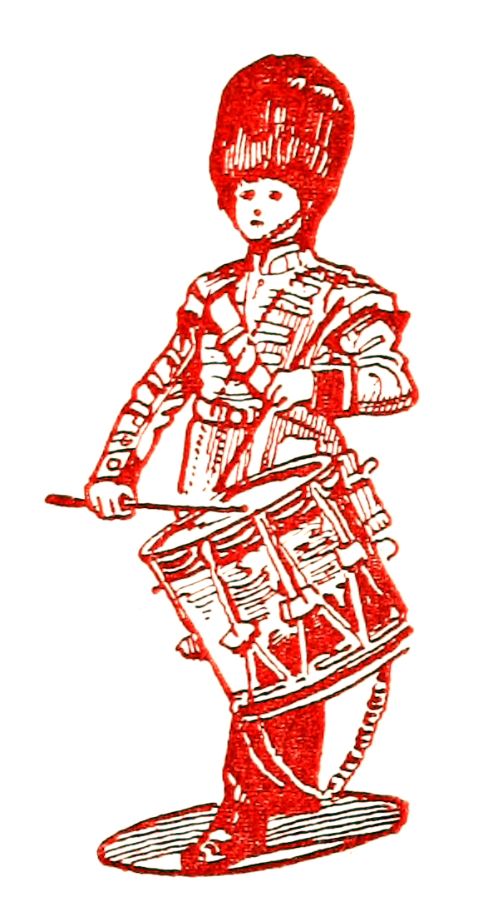

<!-- pair:en:LWF002:heading -->
## BY THE SAME AUTHOR

<!-- translation -->
## 同一作者著作

<!-- endpair -->

<!-- pair:en:LWF003:paragraph -->
Uniform with this volume

<!-- translation -->
与本书同样装帧

<!-- endpair -->

<!-- pair:en:LWF004:title -->
## FLOOR GAMES

<!-- translation -->
## 地板游戏

<!-- endpair -->

<!-- pair:en:LWF005:paragraph -->
With over 100 Illustrations from Photographs and Drawings by J. R. Sinclair.

<!-- translation -->
配有逾100幅插图，取自照片及J. R. Sinclair的绘画。

<!-- endpair -->

<!-- pair:en:LWF006:quotation -->
"This book will arrest the attention of grown-ups; it invests Floor Games with a romance and a reality they have never before possessed—will keep the young people absorbed for hours together. Mr Wells makes a world teeming with life and movement, a wholly delightful world. Parents and children alike should, and doubtless will, remember Mr Wells in their prayers. He has placed them heavily in his debt by telling them of the game of the wonderful islands, of the building of cities, of funiculars, marble towers and castles, in this book of books."—Birmingham Post.

<!-- translation -->
“这本书会吸引成年人的注意；它赋予地板游戏一种从未有过的浪漫与真实，会让年轻人连续几个小时沉浸其中。威尔斯先生创造出一个充满生命与运动的世界，一个全然令人愉快的世界。家长与孩子，都应当、而且无疑也会，在祈祷时记得威尔斯先生。在这部书中之书里，他向他们讲述奇妙岛屿的游戏，讲述城市、缆车、大理石高塔与城堡的建造，让他们实在欠了他一大笔人情。”——《伯明翰邮报》。

<!-- endpair -->

<!-- pair:en:LWF007:title -->
## LITTLE WARS

<!-- translation -->
## 小战争

<!-- endpair -->

<!-- pair:en:LWF008:subtitle -->
A GAME FOR BOYS
FROM TWELVE YEARS OF AGE TO ONE HUNDRED AND FIFTY
AND FOR THAT MORE INTELLIGENT SORT OF GIRLS WHO
LIKE BOYS’ GAMES AND BOOKS

<!-- translation -->
一种供男孩玩的游戏
年龄从十二岁到一百五十岁
也供那一类更聪明、
喜欢男孩游戏和书籍的女孩玩

<!-- endpair -->

<!-- pair:en:LWF009:subtitle -->
WITH AN APPENDIX ON KRIEGSPIEL

<!-- translation -->
附兵棋论述一篇

<!-- endpair -->

<!-- pair:en:LWF010:authors -->
BY
H. G. WELLS

<!-- translation -->
作者
H. G. Wells

<!-- endpair -->

<!-- pair:en:LWF011:paragraph -->
THE AUTHOR OF
"FLOOR GAMES"
AND SEVERAL MINOR AND INFERIOR WORKS

<!-- translation -->
《地板游戏》的作者
另著若干较次要、较逊色的作品

<!-- endpair -->

<!-- pair:en:LWF012:illustrator -->
WITH MARGINAL DRAWINGS BY
J. R. SINCLAIR

<!-- translation -->
边绘作者
J. R. Sinclair

<!-- endpair -->

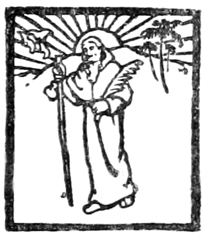

<!-- pair:en:LWF013:publication -->
LONDON
FRANK PALMER
RED LION COURT

<!-- translation -->
伦敦
Frank Palmer出版
红狮庭

<!-- endpair -->

<!-- pair:en:LWF014:copyright -->
All Rights Reserved
First Published July 1913

<!-- translation -->
版权所有
1913年7月首次出版

<!-- endpair -->

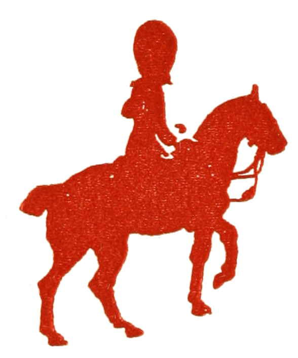

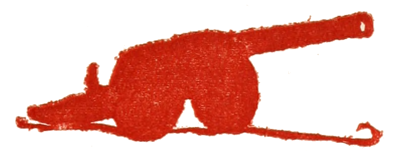

<!-- pair:en:LWF015:heading -->
## CONTENTS

<!-- translation -->
## 目录

<!-- endpair -->

<!-- pair:en:LWTOC01:contents -->
I. OF THE LEGENDARY PAST — 7

<!-- translation -->
I. 传说中的往昔 — 7

<!-- endpair -->

<!-- pair:en:LWTOC02:contents -->
II. THE BEGINNINGS OF MODERN LITTLE WARFARE — 10

<!-- translation -->
II. 现代小战争的开端 — 10

<!-- endpair -->

<!-- pair:en:LWTOC03:contents -->
III. THE RULES—

<!-- translation -->
III. 规则——

<!-- endpair -->

<!-- pair:en:LWTOC04:contents -->
The Country — 39

<!-- translation -->
地形 — 39

<!-- endpair -->

<!-- pair:en:LWTOC05:contents -->
The Move — 40

<!-- translation -->
回合 — 40

<!-- endpair -->

<!-- pair:en:LWTOC06:contents -->
Mobility of the Various Arms — 43

<!-- translation -->
各兵种的机动能力 — 43

<!-- endpair -->

<!-- pair:en:LWTOC07:contents -->
Hand-to-Hand Fighting and Capturing — 47

<!-- translation -->
近身战斗与俘虏 — 47

<!-- endpair -->

<!-- pair:en:LWTOC08:contents -->
Varieties of the Battle-Game — 55

<!-- translation -->
战斗游戏的几种类型 — 55

<!-- endpair -->

<!-- pair:en:LWTOC09:contents -->
Composition of Forces — 59

<!-- translation -->
兵力组成 — 59

<!-- endpair -->

<!-- pair:en:LWTOC10:contents -->
Size of the Soldiers — 61

<!-- translation -->
士兵的尺寸 — 61

<!-- endpair -->

<!-- pair:en:LWTOC11:contents -->
IV. THE BATTLE OF HOOK’S FARM — 63

<!-- translation -->
IV. 胡克农场之战 — 63

<!-- endpair -->

<!-- pair:en:LWTOC12:contents -->
V. EXTENSIONS AND AMPLIFICATIONS OF LITTLE WAR — 88

<!-- translation -->
V. 小战争的扩展与增补 — 88

<!-- endpair -->

<!-- pair:en:LWTOC13:contents -->
VI. ENDING WITH A SORT OF CHALLENGE — 96

<!-- translation -->
VI. 以一种挑战结束 — 96

<!-- endpair -->

<!-- pair:en:LWTOC14:contents -->
APPENDIX—LITTLE WARS AND KRIEGSPIEL — 101

<!-- translation -->
附录——小战争与兵棋 — 101

<!-- endpair -->

<!-- pair:en:LWILH:heading -->
## LIST OF FULL-PAGE ILLUSTRATIONS

<!-- translation -->
## 整页插图目录

<!-- endpair -->

<!-- pair:en:LWILF:paragraph -->
FACING PAGES

<!-- translation -->
所对页码

<!-- endpair -->

<!-- pair:en:LWIL01:contents -->
SHOWING COUNTRIES PREPARED FOR THE WAR GAME (INDOOR) — 10–11

<!-- translation -->
为战争游戏布置的地形（室内） — 10–11

<!-- endpair -->

<!-- pair:en:LWIL02:contents -->
SHOWING THE WAR GAME IN THE OPEN AIR — 18, 19, 30

<!-- translation -->
户外的战争游戏 — 18、19、30

<!-- endpair -->

<!-- pair:en:LWIL03:contents -->
THE BATTLE OF HOOK’S FARM—

<!-- translation -->
胡克农场之战——

<!-- endpair -->

<!-- pair:en:LWIL04:contents -->
I. General View of the Battlefield and Red Army — 31

<!-- translation -->
I. 战场及红军全景 — 31

<!-- endpair -->

<!-- pair:en:LWIL05:contents -->
II. A Near View of the Blue Army — 40

<!-- translation -->
II. 蓝军近景 — 40

<!-- endpair -->

<!-- pair:en:LWIL06:contents -->
III. Position of both Armies after first move — 41

<!-- translation -->
III. 双方第一回合后的位置 — 41

<!-- endpair -->

<!-- pair:en:LWIL07:contents -->
IV. The Battle developing rapidly — 52

<!-- translation -->
IV. 战斗迅速发展 — 52

<!-- endpair -->

<!-- pair:en:LWIL08:contents -->
Va. Red Cavalry charging the Blue Guns — 53

<!-- translation -->
Va. 红方骑兵冲击蓝方火炮 — 53

<!-- endpair -->

<!-- pair:en:LWIL09:contents -->
Vb. After the Cavalry Mêlée — 62

<!-- translation -->
Vb. 骑兵混战之后 — 62

<!-- endpair -->

<!-- pair:en:LWIL10:contents -->
VIa. Prisoners being led to the rear — 63

<!-- translation -->
VIa. 俘虏被押往后方 — 63

<!-- endpair -->

<!-- pair:en:LWIL11:contents -->
VIb. Position of Armies at end of Blue’s third move — 72

<!-- translation -->
VIb. 蓝方第三回合结束时双方的位置 — 72

<!-- endpair -->

<!-- pair:en:LWIL12:contents -->
VII. Red’s Left Wing attempting to join the Main Body — 73

<!-- translation -->
VII. 红方左翼企图与主力会合 — 73

<!-- endpair -->

<!-- pair:en:LWIL13:contents -->
VIII. The Red Army suffers Heavy Loss — 84

<!-- translation -->
VIII. 红军遭受重创 — 84

<!-- endpair -->

<!-- pair:en:LWIL14:contents -->
IX. Complete Victory of the Blue Army — 85

<!-- translation -->
IX. 蓝军完全获胜 — 85

<!-- endpair -->

<!-- pair:en:LW00001:heading -->
## [turn to page 7] I. Of the Legendary Past

<!-- translation -->
## [turn to page 7] I. 传说中的往昔

<!-- endpair -->

<!-- pair:en:LW00002:paragraph -->
“Little Wars” is the game of kings—for players in an inferior social position. It can be played by boys of every age from twelve to one hundred and fifty—and even later if the limbs remain sufficiently supple,—by girls of the better sort, and by a few rare and gifted women. This is to be a full History of Little Wars from its recorded and authenticated beginning until the present time, an account of how to make little warfare, and hints of the most priceless sort for the recumbent strategist. …

<!-- translation -->
《小战争》是供社会地位稍逊的人玩的王者游戏。十二岁到一百五十岁之间任何年龄的男孩都能玩——只要四肢还足够灵活，更老一点也行——较出色的女孩也能玩，还有少数罕见而天资出众的女人。这将是一部完整的《小战争》史，从有据可查、得到证实的起源，一直讲到当下；既介绍怎样打小战争，也为卧地运筹的战略家提供无比珍贵的诀窍。……

<!-- endpair -->

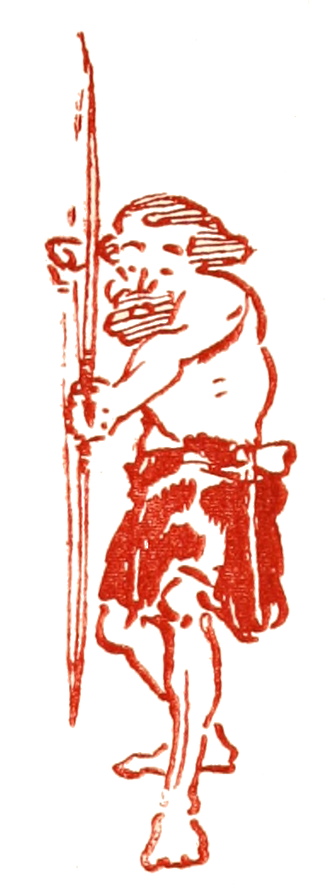

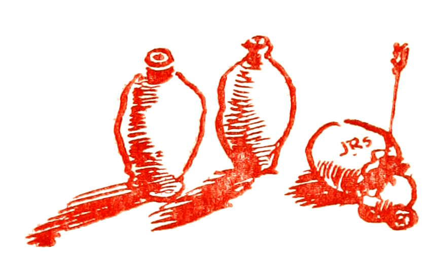

<!-- pair:en:LW00003:paragraph -->
But first let it be noted in passing [turn to page 8] that there were prehistoric “Little Wars.” This is no new thing, no crude novelty; but a thing tested by time, ancient and ripe in its essentials for all its perennial freshness—like spring. There was a Someone who fought Little Wars in the days of Queen Anne; a garden Napoleon. His game was inaccurately observed and insufficiently recorded by Laurence Sterne. It is clear that Uncle Toby and Corporal Trim were playing Little Wars on a scale and with an elaboration exceeding even the richness and beauty of the contemporary game. But the curtain is drawn back only to tantalise us. It is scarcely conceivable that anywhere now on earth the Shandean Rules remain on record. Perhaps they were never committed to paper. …

<!-- translation -->
不过，先顺便说明，[turn to page 8]史前就有过“小战争”。这不是新事物，不是什么粗陋的新奇玩意；它已经受过时间的检验，根本上古老而成熟，却又永远鲜活，正如春天。安妮女王时代，就有某个人打过小战争：一位花园里的拿破仑。劳伦斯·斯特恩对他的游戏观察得不准确，记录得也不充分。显然，托比叔叔和特里姆下士玩的小战争，规模与精细程度，甚至超过当代游戏的丰富与美观。然而，帷幕只被掀开一点，徒然吊起我们的胃口。很难想象，今天世上还有哪里保存着那套“尚迪式规则”。也许它们从来就没有落到纸上。……

<!-- endpair -->

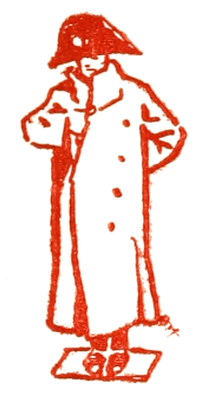

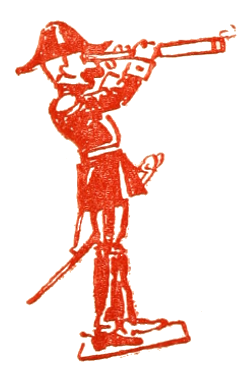

<!-- pair:en:LW00004:paragraph -->
[turn to page 9] And in all ages a certain barbaric warfare has been waged with soldiers of tin and lead and wood, with the weapons of the wild, with the catapult, the elastic circular garter, the peashooter, the rubber ball, and such-like appliances—a mere setting up and knocking down of men. Tin murder. The advance of civilisation has swept such rude contests altogether from the playroom. We know them no more. …

<!-- translation -->
[turn to page 9]而且，历朝历代都有一种野蛮战争，用锡、铅、木头做的士兵，拿原始武器作战：弹弓、有弹性的环形袜带、吹豆筒、橡皮球，以及诸如此类的器具——不过是把兵人摆好，再把它们打倒。对锡兵的谋杀。文明的进步，早已将这些粗野的较量从游戏室一扫而空。我们再也不知道这种东西了。……

<!-- endpair -->

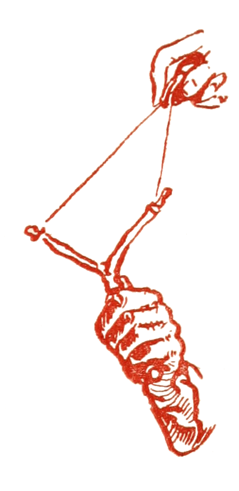

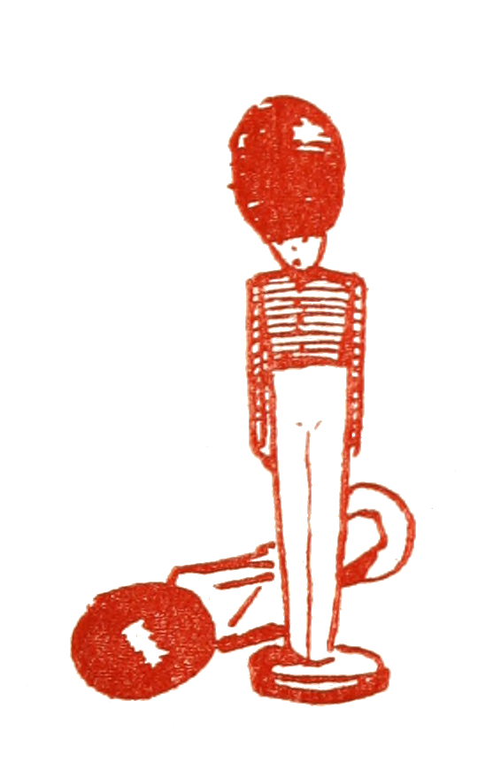

<!-- pair:en:LW00005:heading -->
## [turn to page 10] II. The Beginnings of Modern Little Warfare

<!-- translation -->
## [turn to page 10] II. 现代小战争的开端

<!-- endpair -->

<!-- pair:en:LW00006:paragraph -->
The beginning of the game of Little War, as we know it, became possible with the invention of the spring breechloader gun. This priceless gift to boyhood appeared somewhen towards the end of the last century, a gun capable of hitting a toy soldier nine times out of ten at a distance of nine yards. It has completely superseded all the spiral-spring and other makes of gun hitherto used in playroom warfare. These spring breechloaders are made in various sizes and patterns, but the one used in our game is that known in [turn to page 11] England as the four-point-seven gun. It fires a wooden cylinder about an inch long, and has a screw adjustment for elevation and depression. It is an altogether elegant weapon.

<!-- translation -->
我们所知的小战争游戏，之所以能够诞生，是因为弹簧后膛炮的发明。这份给少年时代的无价礼物，大约出现在上个世纪末：在九码距离外，它十发有九发能击中一个玩具士兵。它已经彻底取代此前游戏室战争里使用的各种螺旋弹簧炮和其他炮型。这些弹簧后膛炮有不同尺寸和式样，我们游戏所用的，是在[turn to page 11]英国称为“四点七炮”的那一种。它发射一枚大约一英寸长的木制圆柱，并用螺丝调节仰角和俯角。总之，是一件精巧优雅的武器。

<!-- endpair -->

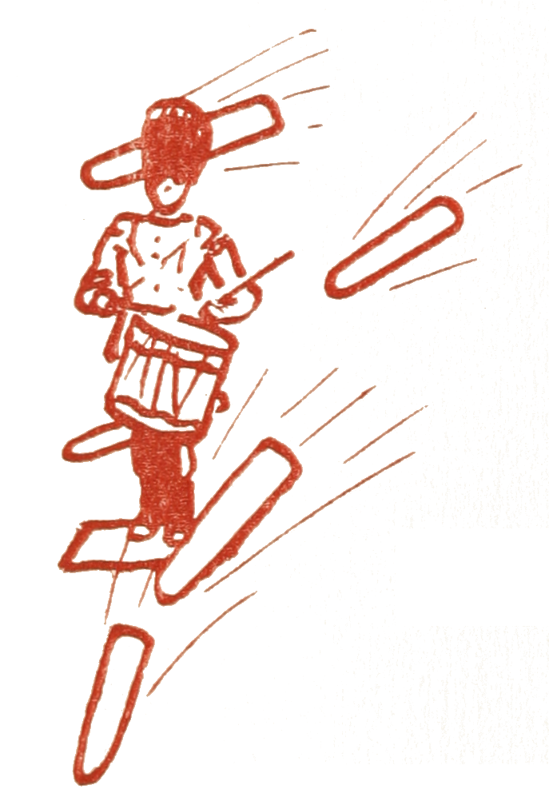

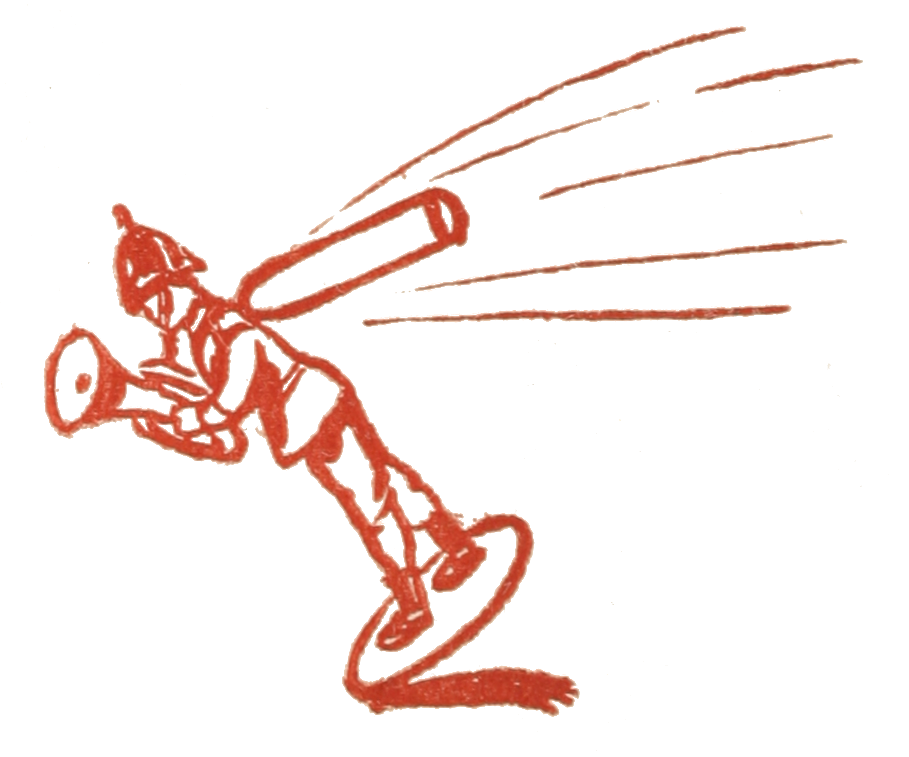

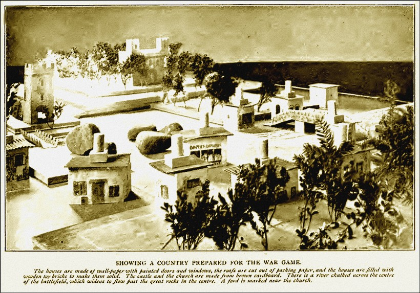

<!-- pair:en:LWP01:figure_caption -->
SHOWING A COUNTRY PREPARED FOR THE WAR GAME.

<!-- translation -->
为战争游戏布置的一片地形。

<!-- endpair -->

<!-- pair:en:LWP01N:figure_note -->
The houses are made of wall-paper with painted doors and windows, the roofs are cut out of packing paper, and the houses are filled with wooden toy bricks to make them solid. The castle and the church are made from brown cardboard. There is a river chalked across the centre of the battlefield, which widens to flow past the great rocks in the centre. A ford is marked near the church.

<!-- translation -->
房屋用墙纸制作，画上门窗；屋顶从包装纸上剪出，房屋里面填入木制玩具积木，使其结实。城堡和教堂由棕色纸板制成。用粉笔画出的一条河，横穿战场中央，流经中央巨岩处时，河面变宽。教堂附近，标有一处涉渡点。

<!-- endpair -->

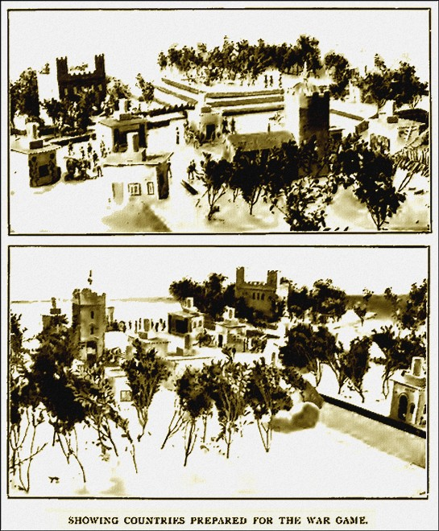

<!-- pair:en:LWP02:figure_caption -->
SHOWING COUNTRIES PREPARED FOR THE WAR GAME.

<!-- translation -->
为战争游戏布置的各种地形。

<!-- endpair -->

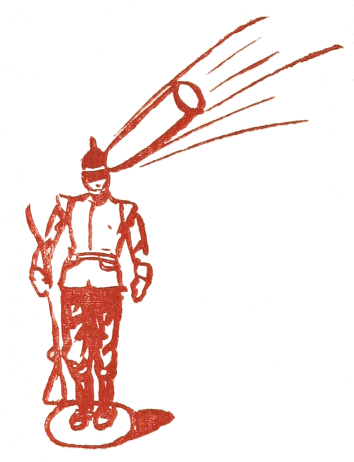

<!-- pair:en:LW00007:paragraph -->
It was with one of these guns that the beginning of our war game was made. It was at Sandgate—in England.

<!-- translation -->
我们的战争游戏，就是从这样一门炮开始的。地点在桑德盖特——英国的桑德盖特。

<!-- endpair -->

<!-- pair:en:LW00008:paragraph -->
The present writer had been lunching with a friend—let me veil his identity under the initials J. K. J.—in a room littered with the irrepressible debris of a small boy's pleasures. On a table near our own stood four or five soldiers and one of these guns. Mr J. K. J., his more urgent needs satisfied and the coffee imminent, drew a chair to this little table, sat down, examined the gun discreetly, loaded it warily, aimed, and hit his man. Thereupon he boasted of [turn to page 12] the deed, and issued challenges that were accepted with avidity. …

<!-- translation -->
当时，笔者正和一位朋友吃午饭——姑且用姓名首字母J. K. J.来遮掩他的身份——房间里散落着一个小男孩玩耍留下、怎么收拾也收拾不完的残余。在我们旁边的一张桌子上，站着四五个士兵，放着一门这样的炮。J. K. J.先生满足了更迫切的需求，咖啡也即将端上来，便拉了一把椅子到这张小桌前，坐下，审慎地检查了炮，小心地装弹，瞄准，击中了他的目标。于是，他夸耀起[turn to page 12]自己的功绩，发出挑战；挑战立即得到热烈响应。……

<!-- endpair -->

<!-- pair:en:LW00009:paragraph -->
He fired that day a shot that still echoes round the world. An affair—let us parallel the Cannonade of Valmy and call it the Cannonade of Sandgate—occurred, a shooting between opposed ranks of soldiers, a shooting not very different in spirit—but how different in results!—from the prehistoric warfare of catapult and garter. “But suppose,” said his antagonists; “suppose somehow one could move the men!” and therewith opened a new world of belligerence.

<!-- translation -->
他那天打出的那一炮，直到今天还在世界各地回响。随后发生了一场事件——不妨与瓦尔密炮战相比，称它为桑德盖特炮战——双方排成对阵的士兵向彼此射击；论精神，与史前弹弓和袜带战争没有什么不同，可结果又何其不同！“但是，假设，”他的对手说，“假设能想个办法让这些兵人移动呢！”就这样，一个好战的新世界打开了。

<!-- endpair -->

<!-- pair:en:LW00010:paragraph -->
The matter went no further with Mr J. K. J. The seed lay for a time gathering strength, and then began to germinate with another friend, Mr W. To Mr W. was broached the idea: “I [turn to page 13] believe that if one set up a few obstacles on the floor, volumes of the British Encyclopædia and so forth, to make a Country, and moved these soldiers and guns about, one could have rather a good game, a kind of kriegspiel.” …

<!-- translation -->
事情在J. K. J.先生那里没有继续发展。种子沉睡了一阵，积蓄力量，随后在另一位朋友W.先生那里开始萌芽。我向W.先生提出了这个想法：“我[turn to page 13]相信，要是在地板上放几个障碍物，比如几卷《不列颠百科全书》之类，布置成一片地形，再把这些士兵和炮移来移去，大概就能玩一种相当有趣的游戏，一种兵棋。”……

<!-- endpair -->

<!-- pair:en:LW00011:paragraph -->
Primitive attempts to realise the dream were interrupted by a great rustle and chattering of lady visitors. They regarded the objects upon the floor with the empty disdain of their sex for all imaginative things.

<!-- translation -->
最初实现这个梦想的尝试，被来访女士们一阵巨大的窸窣声和叽叽喳喳声打断了。她们以她们那个性别对一切富于想象力事物惯有的空洞鄙夷，打量着地板上的东西。

<!-- endpair -->

<!-- pair:en:LW00012:paragraph -->
But the writer had in those days a very dear friend, a man too ill for long excursions or vigorous sports [he has been dead now these six years], of a very sweet companionable disposition, a hearty jester and full of the spirit of play. To him the idea was broached more fruitfully. We got two forces of [turn to page 14] toy soldiers, set out a lumpish Encyclopædic land upon the carpet, and began to play. We arranged to move in alternate moves: first one moved all his force and then the other; an infantry-man could move one foot at each move, a cavalry-man two, a gun two, and it might fire six shots; and if a man was moved up to touch another man, then we tossed up and decided which man was dead. So we made a game, which was not a good game, but which was very amusing once or twice. The men were packed under the lee of fat volumes, while the guns, animated by a spirit of their own, banged away at any exposed head, or prowled about in search of a shot. Occasionally men came into contact, with remarkable results. Rash is the man who trusts [turn to page 15] his life to the spin of a coin. One impossible paladin slew in succession nine men and turned defeat to victory, to the extreme exasperation of the strategist who had led those victims to their doom. This inordinate factor of chance eliminated play; the individual freedom of guns turned battles into scandals of crouching concealment; there was too much cover afforded by the books and vast intervals of waiting while the players took aim. And yet there was something about it. … It was a game crying aloud for improvement.

<!-- translation -->
不过，笔者那时有一位非常亲爱的朋友。他病得很重，不能远足，也不能参加剧烈运动[如今他已经去世六年了]；他性情温厚，极好相处，爱说笑，满怀游戏精神。向他提起这个想法，就有成果得多。我们弄来两支[turn to page 14]玩具士兵部队，用百科全书在地毯上摆出一片笨重的地形，开始玩起来。我们约定轮流行动：先由一方移动他的全部兵力，再轮到另一方；每回合，步兵能走一英尺，骑兵两英尺，炮两英尺，而且炮能打六发；如果一个兵人移到与另一个兵人相接触的位置，就掷硬币决定谁死。于是，我们做成了一种游戏，虽说不是好游戏，但玩上一两次还是非常有趣的。士兵密集地挤在厚书背后，炮却像有自己的意志一样，向任何露出的脑袋砰砰开火，或者四处游荡，寻找射击机会。偶尔，兵人彼此接触，结果非同寻常。拿[turn to page 15]自己的性命赌硬币正反的人，实在鲁莽。有一位不可思议的勇士，竟一连斩杀九人，反败为胜；把那些牺牲者带上绝路的战略家，为此恼火到了极点。如此过分的偶然因素，消解了游戏；炮的自主行动，把战斗变成了蹲伏躲藏的丑剧；书本提供的掩护太多，玩家瞄准时，等待又太久。然而，它终究有点什么。……这是一种大声呼唤改进的游戏。

<!-- endpair -->

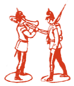

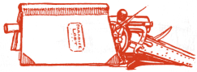

<!-- pair:en:LWG15B:figure_text -->
**Text in the original image (transcription)**

FLOOR GAMES

<!-- translation -->
**图内文字汉译**

地板游戏

<!-- endpair -->

<!-- pair:en:LW00013:paragraph -->
Improvement came almost simultaneously in several directions. First there was the development of the Country. The soldiers did not stand well on an ordinary carpet, the Encyclo[turn to page 16] pædia made clumsy cliff-like “cover,” and more particularly the room in which the game had its beginnings was subject to the invasion of callers, alien souls, trampling skirt-swishers, chatterers, creatures unfavourably impressed by the spectacle of two middle-aged men playing with “toy soldiers” on the floor, and very heated and excited about it. Overhead was the day nursery, with a wide extent of smooth cork carpet (the natural terrain of toy soldiers), a large box of bricks—such as I have described in Floor Games,—and certain large inch-thick boards.

<!-- translation -->
改进几乎同时在几个方向上出现了。首先，是地形的发展。士兵在普通地毯上站不稳，《百科[turn to page 16]全书》又构成笨拙的、悬崖般的“掩体”；尤其是，游戏诞生的那个房间，总会遭到来客侵入：异类灵魂、拖着沙沙裙摆到处踩踏的人、喋喋不休的人；他们看见两个中年男人坐在地板上玩“玩具士兵”，而且还热火朝天、兴奋不已，便心生反感。楼上是白天使用的儿童室，有大片平滑的软木地毯——玩具士兵的天然地形——有一大箱积木，就是我在《地板游戏》中介绍过的那种，还有几块一英寸厚的大木板。

<!-- endpair -->

<!-- pair:en:LWG16:figure_text -->
**Text in the original image (transcription)**

ENCYCLOP; XII

<!-- translation -->
**图内文字汉译**

百科全书（书脊缩写）；XII（12）

<!-- endpair -->

<!-- pair:en:LW00014:paragraph -->
It was an easy task for the head of the household to evict his offspring, annex these advantages, and set about planning a more realistic country. (I forget what became of the children.) [turn to page 17] The thick boards were piled up one upon another to form hills; holes were bored in them, into which twigs of various shrubs were stuck to represent trees; houses and sheds (solid and compact piles of from three to six or seven inches high, and broad in proportion) and walls were made with the bricks; ponds and swamps and rivers, with fords and so forth indicated, were chalked out on the floor, garden stones were brought in to represent great rocks, and the “Country” at least of our perfected war game was in existence. We discovered it was easy to cut out and bend and gum together paper and cardboard walls, into which our toy bricks could be packed, and on which we could paint doors and windows, creepers and rain-water pipes, and so forth, to repre[turn to page 18] sent houses, castles, and churches in a more realistic manner, and, growing skilful, we made various bridges and so forth of card. Every boy who has ever put together model villages knows how to do these things, and the attentive reader will find them edifyingly represented in our photographic illustrations.

<!-- translation -->
一家之主很容易就能把子女赶出去，兼并这些有利条件，着手规划更逼真的地形。（我忘了孩子们后来怎么样了。）[turn to page 17]厚木板一层层叠起来，形成山丘；在木板上钻孔，插入各种灌木的小枝，代表树木；用积木搭起房屋、棚舍和围墙，房屋棚舍是结实紧凑的积木堆，高三英寸到六七英寸不等，宽度也按比例；在地板上用粉笔画出池塘、沼泽和河流，标明涉渡点等等；再搬来花园里的石头，代表巨岩。至此，我们完善后的战争游戏，至少已有了它的“地形”。我们发现，用纸和纸板剪出墙壁，再弯折、粘合，里面塞进玩具积木，就能轻易造出更逼真的房屋、城堡和教堂；墙面上可以画门窗、攀缘植物、落水管等等，用以表[turn to page 18]现这些建筑。技术熟练后，我们又用卡纸做了各种桥梁之类。凡是拼搭过模型村庄的男孩，都知道怎样做这些东西；细心的读者，也能从我们的照片插图中看到颇有启发的示范。

<!-- endpair -->

<!-- pair:en:LW00015:paragraph -->
There has been little development since that time in the Country. Our illustrations show the methods of arrangement, and the reader will see how easily and readily the utmost variety of battlefields can be made. (It is merely to be remarked that a too crowded Country makes the guns ineffective and leads to a mere tree to tree and house to house scramble, and that large open spaces along the middle, or rivers without frequent fords [turn to page 19] and bridges, lead to ineffective cannonades, because of the danger of any advance. On the whole, too much cover is better than too little.) We decided that one player should plan and lay out the Country, and the other player choose from which side he would come. And to-day we play over such landscapes in a cork-carpeted schoolroom, from which the proper occupants are no longer evicted but remain to take an increasingly responsible and less and less audible and distressing share in the operations.

<!-- translation -->
自那以后，地形没有多少发展。插图显示了布置方法，读者会看到，多种多样的战场，制作起来何其容易便捷。（只须指出，地形过于拥挤，会使炮失效，战斗沦为从树到树、从房到房的混乱争夺；而中央大片开阔地，或者缺少足够涉渡点[turn to page 19]和桥梁的河流，会因任何推进都很危险，而导致毫无成效的炮战。总体而言，掩护太多，胜过太少。）我们决定，由一位玩家规划布置地形，再由另一位选择从哪一边进入。今天，我们就在一间铺着软木地毯的教室里，使用这类景观进行游戏；房间原本的主人不再被赶出去，而是留下来参加作战，承担的责任越来越大，声音却越来越小，造成的苦恼也越来越少。

<!-- endpair -->

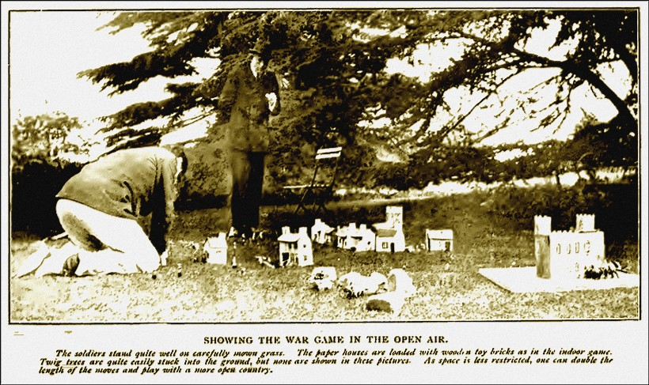

<!-- pair:en:LWP03:figure_caption -->
SHOWING THE WAR GAME IN THE OPEN AIR.

<!-- translation -->
户外的战争游戏。

<!-- endpair -->

<!-- pair:en:LWP03N:figure_note -->
The soldiers stand quite well on carefully mown grass. The paper houses are loaded with wooden toy bricks as in the indoor game. Twig trees are quite easily stuck into the ground, but none are shown in these pictures. As space is less restricted, one can double the length of the moves and play with a more open country.

<!-- translation -->
士兵在仔细修剪过的草地上，站得相当稳。和室内游戏一样，纸房子里压着木制玩具积木。枝条做的树，很容易插进地面，不过，这几张照片里并没有展示。由于空间限制较少，可以把移动距离加倍，采用更开阔的地形进行游戏。

<!-- endpair -->

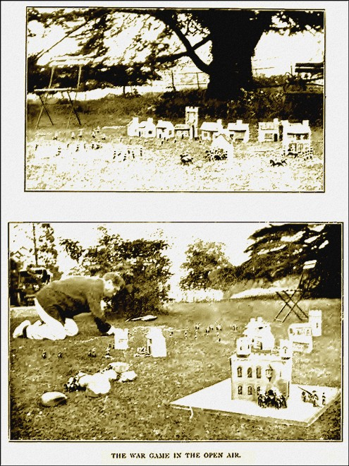

<!-- pair:en:LWP04:figure_caption -->
THE WAR GAME IN THE OPEN AIR.

<!-- translation -->
户外的战争游戏。

<!-- endpair -->

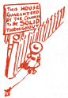

<!-- pair:en:LWG19B:figure_text -->
**Text in the original image (transcription)**

THIS HOUSE GUARANTEED BY THE COUNCIL TO BE SOLID THROUGHOUT

<!-- translation -->
**图内文字汉译**

本房屋经议会保证，内外全为实心。

<!-- endpair -->

<!-- pair:en:LW00016:paragraph -->
We found it necessary to make certain general rules. Houses and sheds must be made of solid lumps of bricks, and not hollow so that soldiers can be put inside them, because otherwise muddled situations arise. And it was clearly [turn to page 20] necessary to provide for the replacement of disturbed objects by chalking out the outlines of boards and houses upon the floor or boards upon which they stood.

<!-- translation -->
我们发现，有必要制定一些通则。房屋和棚舍必须用实心的积木堆构成，不能做成能把士兵放进去的空心房子，否则就会产生混乱局面。而且，显然[turn to page 20]还须规定：在木板和房屋所放置的地板或木板上，用粉笔描出它们的轮廓，以便把意外移位的东西放回原处。

<!-- endpair -->

<!-- pair:en:LW00017:paragraph -->
And while we thus perfected the Country, we were also eliminating all sorts of tediums, disputable possibilities, and deadlocks from the game. We decided that every man should be as brave and skilful as every other man, and that when two men of opposite sides came into contact they would inevitably kill each other. This restored strategy to its predominance over chance.

<!-- translation -->
在这样完善地形的同时，我们也从游戏中消除各种乏味、可能引起争议的情形，以及僵局。我们决定，每个士兵都应当与其他所有士兵一样勇敢、一样熟练；敌对双方的两名士兵一旦接触，就必然同归于尽。这让战略重新取得了对偶然性的支配地位。

<!-- endpair -->

<!-- pair:en:LW00018:paragraph -->
We then began to humanise that wild and fearful fowl, the gun. We decided that a gun could not be fired if there were not six—afterwards we re[turn to page 21] duced the number to four—men within six inches of it. And we ruled that a gun could not both fire and move in the same general move: it could either be fired or moved (or left alone). If there were less than six men within six inches of a gun, then we tried letting it fire as many shots as there were men, and we permitted a single man to move a gun, and move with it as far as he could go by the rules—a foot, that is, if he was an infantry-man, and two feet if he was a cavalry-man. We abolished altogether that magical freedom of an unassisted gun to move two feet. And on such rules as these we fought a number of battles. They were interesting, but not entirely satisfactory. We took no prisoners—a feature at once barbaric and unconvincing. The battles lingered on [turn to page 22] a long time, because we shot with extreme care and deliberation, and they were hard to bring to a decisive finish. The guns were altogether too predominant. They prevented attacks getting home, and they made it possible for a timid player to put all his soldiers out of sight behind hills and houses, and bang away if his opponent showed as much as the tip of a bayonet. Monsieur Bloch seemed vindicated, and Little War had become impossible. And there was something a little absurd, too, in the spectacle of a solitary drummer-boy, for example, marching off with a gun.

<!-- translation -->
随后，我们开始驯化那种野蛮而可怕的飞禽：炮。我们决定，一门炮周围六英寸内，如果没有六个士兵——后来我们把[turn to page 21]这个数目降为四个——就不能开火。我们还规定，在同一个总回合内，炮不能既开火又移动：它可以开火，或移动，或什么也不做。如果炮周围六英寸内不足六人，我们就试着让它按人数发射同样数量的炮弹；并允许一个人拖动炮，按照规则能走多远，就带着炮走多远：步兵一英尺，骑兵两英尺。我们彻底取消了炮在无人协助下还能自行移动两英尺的魔法自由。按照这些规则，我们打了好几场仗。有趣，但并不完全令人满意。我们不俘虏任何人，这一点既野蛮，又不可信。战斗延续[turn to page 22]很久，因为我们射击得极其小心、极其从容，难以打出决定性的结局。炮的优势太大。它们使进攻难以冲到跟前，也让胆小的玩家能够把全部士兵藏到山丘和房屋后面；对手只要露出一个刺刀尖，就会挨炮。布洛赫先生似乎得到了证明，小战争已经不可能进行了。而且，比如一个孤零零的鼓手小孩，拖着一门炮离开的景象，也确实有点荒唐。

<!-- endpair -->

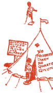

<!-- pair:en:LWG21A:figure_text -->
**Text in the original image (transcription)**

HOSPITAL CLOSED UNTIL RULES ARE ALTERED; NO PRISONERS TAKEN; NO QUARTER GIVEN

<!-- translation -->
**图内文字汉译**

医院关闭，直到规则修改为止；不收俘虏；不予饶命。

<!-- endpair -->

<!-- pair:en:LW00019:paragraph -->
But as there was nevertheless much that seemed to us extremely pretty and picturesque about the game, we set to work—and here a certain Mr M. with his brother, Captain M., hot from the [turn to page 23] Great War in South Africa, came in most helpfully—to quicken it. Manifestly the guns had to be reduced to manageable terms. We cut down the number of shots per move to four, and we required that four men should be within six inches of a gun for it to be in action at all. Without four men it could neither fire nor move—it was out of action; and if it moved, the four men had to go with it. Moreover, to put an end to that little resistant body of men behind a house, we required that after a gun had been fired it should remain, without alteration of the elevation, pointing in the direction of its last shot, and have two men placed one on either side of the end of its trail. This secured a certain exposure on the part of concealed and sheltered gunners. It was [turn to page 24] no longer possible to go on shooting out of a perfect security for ever. All this favoured the attack and led to a livelier game.

<!-- translation -->
不过，这个游戏仍有许多在我们看来极其美好、极富画意的地方，所以我们便着手加快它的节奏；这时，某位M.先生和他的兄弟M.上尉——刚从[turn to page 23]南非大战回来——给予了极大的帮助。显然，必须把炮限制在可以控制的范围内。我们将每回合的射击数削减为四发，并规定：一门炮周围六英寸以内，必须有四个士兵，才能处于可作战状态。没有四个人，它既不能开火，也不能移动：它失去了作战能力；如果炮移动，这四个人也必须同行。此外，为了解决藏在房屋后面、顽抗不退的那一小撮人，我们规定，炮开过火后，仰角不得改变，必须继续指向最后一发的射击方向；炮架尾端两侧，各须放一名士兵。这就让躲藏着、有掩护的炮手，也必须作出一定的暴露。此后，[turn to page 24]再也不能永远躲在绝对安全的位置不断射击了。所有这些，都有利于进攻，使游戏更为活跃。

<!-- endpair -->

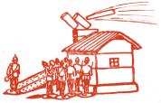

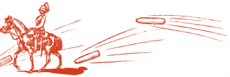

<!-- pair:en:LW00020:paragraph -->
Our next step was to abolish the tedium due to the elaborate aiming of the guns, by fixing a time limit for every move. We made this an outside limit at first, ten minutes, but afterwards we discovered that it made the game much more warlike to cut the time down to a length that would barely permit a slow-moving player to fire all his guns and move all his men. This led to small bodies of men lagging and “getting left,” to careless exposures, to rapid, less accurate shooting, and just that eventfulness one would expect in the hurry and passion of real fighting. It also made the game brisker. We have since also [turn to page 25] made a limit, sometimes of four minutes, sometimes of five minutes, to the interval for adjustment and deliberation after one move is finished and before the next move begins. This further removes the game from the chess category, and approximates it to the likeness of active service. Most of a general's decisions, once a fight has begun, must be made in such brief intervals of time. (But we leave unlimited time at the outset for the planning.)

<!-- translation -->
下一步，是给每回合规定时限，消除仔细瞄炮造成的冗长乏味。起先，我们定了一个宽松的上限：十分钟。后来却发现，把时间缩短到只能勉强让行动较慢的玩家打完所有炮、移动完全部士兵，游戏就会更像战争。于是，一小群士兵会落后、会“被丢下”，会出现疏忽造成的暴露，射击变得匆忙、较不准确；总之，就出现了人们在真实战斗的忙乱与激情中可以预料的种种变故。游戏也因此更明快。后来，我们又给[turn to page 25]一回合结束到下一回合开始之间，用于调整和思考的间隔规定了时限：有时四分钟，有时五分钟。这使游戏进一步脱离棋类范畴，更接近实际服役作战的样貌。战斗一旦开始，将军的大多数决断，就必须在这样短促的时间间隔内作出。（不过，开局时的筹划，我们不限制时间。）

<!-- endpair -->

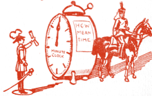

<!-- pair:en:LWG25:figure_text -->
**Text in the original image (transcription)**

MINUTE CLOCK; HGW MEAN TIME

<!-- translation -->
**图内文字汉译**

分钟钟；HGW平均时。

<!-- endpair -->

<!-- pair:en:LW00021:paragraph -->
As to our time-keeping, we catch a visitor with a stop-watch if we can, and if we cannot, we use a fair-sized clock with a second-hand: the player not moving says “Go,” and warns at the last two minutes, last minute, and last thirty seconds. But I think it would not be difficult to procure a cheap clock—[turn to page 26] because, of course, no one wants a very accurate agreement with Greenwich as to the length of a second—that would have minutes instead of hours and seconds instead of minutes, and that would ping at the end of every minute and discharge an alarm note at the end of the move. That would abolish the rather boring strain of time-keeping. One could just watch the fighting.

<!-- translation -->
至于计时，如果能抓住一位带秒表的来客，就让他负责；找不到，就用一座大小适中、带秒针的钟。不行动的玩家喊“开始”，并在还剩两分钟、一分钟、三十秒时提醒。但我想，要弄一只便宜的钟并不困难——[turn to page 26]因为，当然，谁也不需要它对一秒有多长，与格林尼治保持极其精确的一致——让表盘用分钟取代小时，用秒取代分钟；每过一分钟叮一声，回合结束时再响一次警报。那样，就能免去计时这种颇为无聊的紧张劳动，只管看战斗就行了。

<!-- endpair -->

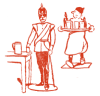

<!-- pair:en:LW00022:paragraph -->
Moreover, in our desire to bring the game to a climax, we decided that instead of a fight to a finish we would fight to some determined point, and we found very good sport in supposing that the arrival of three men of one force upon the back line of the opponent's side of the country was of such strategic importance as to determine the battle. But this form of battle we have since [turn to page 27] largely abandoned in favour of the old fight to a finish again. We found it led to one type of battle only, a massed rush at the antagonist's line, and that our arrangements of time-limits and capture and so forth had eliminated most of the concluding drag upon the game.

<!-- translation -->
此外，我们为了让游戏达到高潮，决定不再打到最后，而是打到某个预定的节点。我们发现，不妨假设：一支部队有三个人到达对手一侧地形的后边线，就具有足以决定战斗的战略重要性；这样玩颇有趣味。但这种战斗形式，后来又[turn to page 27]大体被我们放弃，重新采用原来打到最后的方式。因为它只会导向一种战斗：集结全军，猛冲对手的线；而我们关于时限、俘虏等等的安排，已经消除了游戏结尾大部分拖沓之处。

<!-- endpair -->

<!-- pair:en:LW00023:paragraph -->
Our game was now very much in its present form. We considered at various times the possibility of introducing some complication due to the bringing up of ammunition or supplies generally, and we decided that it would add little to the interest or reality of the game. Our battles are little brisk fights in which one may suppose that all the ammunition and food needed are carried by the men themselves.

<!-- translation -->
我们的游戏这时已经很接近今天的样子。我们曾数次考虑，是否加入运输弹药或一般补给造成的复杂情况；最后决定，那对游戏的趣味或逼真程度都增加不了多少。我们的战斗是些短促明快的小规模战斗，完全可以假定，所需的全部弹药和食物，都由士兵自己携带。

<!-- endpair -->

<!-- pair:en:LW00024:paragraph -->
But our latest development has been [turn to page 28] in the direction of killing hand to hand or taking prisoners. We found it necessary to distinguish between an isolated force and a force that was merely a projecting part of a larger force. We made a definition of isolation. After a considerable amount of trials we decided that a man or a detachment shall be considered to be isolated when there is less than half its number of its own side within a move of it. Now, in actual civilised warfare small detached bodies do not sell their lives dearly; a considerably larger force is able to make them prisoners without difficulty. Accordingly we decided that if a blue force, for example, has one or more men isolated, and a red force of at least double the strength of this isolated detachment moves up to [turn to page 29] contact with it, the blue men will be considered to be prisoners.

<!-- translation -->
而我们最新的发展，[turn to page 28]是在近身杀敌或俘虏方面。我们发现，必须区分孤立的部队，和只是从大部队中突出一部分的部队。因此，我们定义了“孤立”。经过相当多的试验后，我们决定：如果一个兵人或一支分队，在距其一回合行程以内，本方人数不足它自身人数的一半，就视为孤立。如今，在实际的文明战争中，脱离主力的小分队不会拼命卖出自己的性命；兵力多得多的部队，可以轻易将其俘虏。因此我们决定：例如，蓝方有一个或多个士兵孤立，而至少有这支孤立分队两倍兵力的红方部队，推进到与[turn to page 29]它接触时，这些蓝方士兵便视为俘虏。

<!-- endpair -->

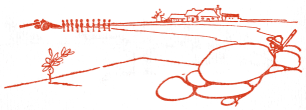

<!-- pair:en:LW00025:paragraph -->
That seemed fair; but so desperate is the courage and devotion of lead soldiers, that it came to this, that any small force that got or seemed likely to get isolated and caught by a superior force instead of waiting to be taken prisoners, dashed at its possible captors and slew them man for man. It was manifestly unreasonable to permit this. And in considering how best to prevent such inhuman heroisms, we were reminded of another frequent incident in our battles that also erred towards the incredible and vitiated our strategy. That was the charging of one or two isolated horse-men at a gun in order to disable it. Let me illustrate this by an incident. A force consisting of ten infantry and [turn to page 30] five cavalry with a gun are retreating across an exposed space, and a gun with thirty men, cavalry and infantry, in support comes out upon a crest into a position to fire within two feet of the retreating cavalry. The attacking player puts eight men within six inches of his gun and pushes the rest of his men a little forward to the right or left in pursuit of his enemy. In the real thing, the retreating horsemen would go off to cover with the gun, “hell for leather,” while the infantry would open out and retreat, firing. But see what happened in our imperfect form of Little War! The move of the retreating player began. Instead of retreating his whole force, he charged home with his mounted desperadoes, killed five of the eight men about the gun, and so by the rule [turn to page 31] silenced it, enabling the rest of his little body to get clean away to cover at the leisurely pace of one foot a move. This was not like any sort of warfare. In real life cavalry cannot pick out and kill its equivalent in cavalry while that equivalent is closely supported by other cavalry or infantry; a handful of troopers cannot gallop past well and abundantly manned guns in action, cut down the gunners and interrupt the fire. And yet for a time we found it a little difficult to frame simple rules to meet these two bad cases and prevent such scandalous possibilities. We did at last contrive to do so; we invented what we call the mêlée, and our revised rules in the event of a mêlée will be found set out upon a later page. They do really permit something like an actual [turn to page 32] result to hand-to-hand encounters. They abolish Horatius Cocles.

<!-- translation -->
这看起来很公平。然而，铅兵的勇气与献身精神实在惊人，事情就成了这样：一支小部队一旦陷入孤立，或者看来可能被优势兵力孤立并抓住，就不肯等待被俘，而会冲向可能俘虏自己的敌人，一命换一命，把他们杀掉。允许这样做，显然不合理。在考虑怎样最好地防止这种超人的英勇时，我们又想起战斗中经常发生的另一种情况，同样难以置信，也同样损害了战略：一两个孤立的骑兵，冲向一门炮，令它失去作战能力。我用一件事来说明。一支由十名步兵、[turn to page 30]五名骑兵和一门炮组成的部队，正撤过一片开阔地；对面一门炮，在三十名骑兵和步兵支援下，越过山脊，进入可以开火的位置，离撤退中的骑兵不到两英尺。进攻的玩家，把八个人放在本方炮周围六英寸以内，其余人稍稍向左或向右前进，追击敌人。若是真打，撤退的骑兵会拖着炮，拼命疾驰，逃入掩护；步兵则会散开，边打边撤。可看看我们这套不完善的小战争里发生了什么！撤退一方的回合开始了。他没有让全军后撤，而是让那些亡命骑兵冲到炮前，杀死炮旁八人中的五人，于是按规则[turn to page 31]使炮哑火，让自己那支小部队的其余人员，能以每回合一英尺的悠闲步调，从容逃入掩护。这不像任何一种战争。在现实中，骑兵不能挑出并杀死与自己人数相当的敌方骑兵，同时无视那些敌方骑兵正得到其他骑兵或步兵的密切支援；一小撮骑兵，也不可能从人员充足、运转良好的炮旁飞驰而过，砍倒炮手，打断射击。然而，我们有一段时间，确实很难制定简单规则，来处理这两种恶劣情况，防止如此荒唐的可能。最终，我们想出了办法：发明了所谓“混战”；修订后的混战规则，后文将会列出。它们确实能够让近身相遇得到某种类似[turn to page 32]实际情况的结果。它们废除了霍拉提乌斯·科克莱斯。

<!-- endpair -->

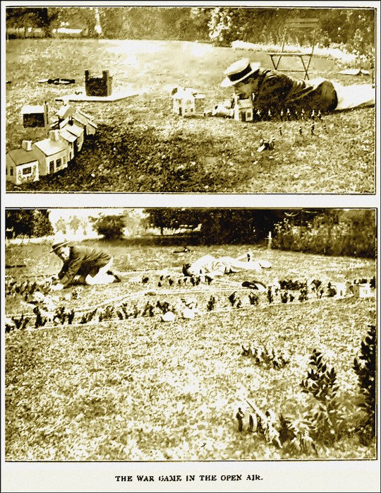

<!-- pair:en:LWP05:figure_caption -->
THE WAR GAME IN THE OPEN AIR.

<!-- translation -->
户外的战争游戏。

<!-- endpair -->

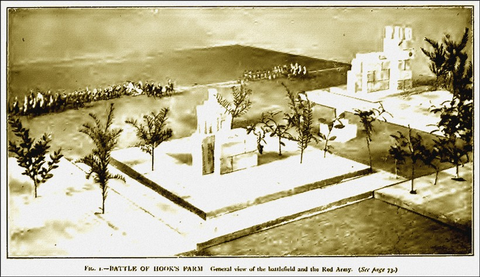

<!-- pair:en:LWP06:figure_caption -->
Fig. 1.—BATTLE OF HOOK’S FARM. General view of the battlefield and the Red Army. (See page 73.)

<!-- translation -->
图1——胡克农场之战。战场及红军全景。（见第73页。）

<!-- endpair -->

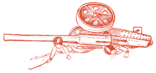

<!-- pair:en:LW00026:paragraph -->
We also found difficulties about the capturing of guns. At first we had merely provided that a gun was captured when it was out of action and four men of the opposite force were within six inches of it, but we found a number of cases for which this rule was too vague. A gun, for example, would be disabled and left with only three men within six inches; the enemy would then come up eight or ten strong within six inches on the other side, but not really reaching the gun. At the next move the original possessor of the gun would bring up half a dozen men within six inches. To whom did the gun belong? By the original wording of our rule, it might be supposed to belong to the [turn to page 33] attack which had never really touched the gun yet, and they could claim to turn it upon its original side. We had to meet a number of such cases. We met them by requiring the capturing force—or, to be precise, four men of it—actually to pass the axle of the gun before it could be taken.

<!-- translation -->
我们也在夺炮方面遇到了困难。起先，我们只规定：一门炮失去作战能力，而且敌方四个人在它六英寸以内时，它就被夺取了。但许多情况下，这条规则过于含混。例如，一门炮失去了作战能力，六英寸内只剩三个人；敌方随即有八到十人进入另一侧六英寸以内，却没有真正抵达炮的位置。下一回合，炮原本的主人，又调来六个人进入六英寸范围。这门炮归谁？按原规则的措辞，它似乎应当归属于[turn to page 33]那些连炮都还没有真正碰到的进攻者；他们可以宣称，要把它掉过头，向原来的本方开火。我们必须处理好几种这样的情况。解决办法，是要求夺炮部队——准确地说，其中四个人——必须实际越过炮轴，才能把炮夺走。

<!-- endpair -->

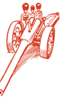

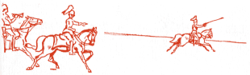

<!-- pair:en:LW00027:paragraph -->
All sorts of odd little difficulties arose too, connected with the use of the guns as a shelter from fire, and very exact rules had to be made to avoid tilting the nose and raising the breech of a gun in order to use it as cover. …

<!-- translation -->
另外，还有各种古怪的小困难，与把炮本身当作躲避火力的掩体有关；于是，必须制定十分精确的规则，防止玩家压低炮口、抬高炮膛尾部，把炮当掩护。……

<!-- endpair -->

<!-- pair:en:LW00028:paragraph -->
We still found it difficult to introduce any imitation into our game of either retreat or the surrender of men not actually taken prisoners in a mêlée. Both things were possible by the rules, but nobody did them because there was [turn to page 34] no inducement to do them. Games were apt to end obstinately with the death or capture of the last man. An inducement was needed. This we contrived by playing not for the game but for points, scoring the result of each game and counting the points towards the decision of a campaign. Our campaign was to our single game what a rubber is to a game of whist. We made the end of a war 200, 300, or 400 or more points up, according to the number of games we wanted to play, and we scored a hundred for each battle won, and in addition 1 for each infantry-man, 1½ for each cavalry-man, 10 for each gun, ½ for each man held prisoner by the enemy, and ½ for each prisoner held at the end of the game, subtracting what the antagonist scored by the same scale. [turn to page 35] Thus, when he felt the battle was hopelessly lost, he had a direct inducement to retreat any guns he could still save and surrender any men who were under the fire of the victors' guns and likely to be slaughtered, in order to minimise the score against him. And an interest was given to a skilful retreat, in which the loser not only saved points for himself but inflicted losses upon the pursuing enemy.

<!-- translation -->
我们仍然觉得，很难在游戏里引入任何类似撤退的行为，或让没有在混战中实际被俘的人员投降。这两件事按规则都允许，但谁也不做，因为[turn to page 34]没有动机让他们这样做。游戏往往顽固地延续到最后一人死亡或被俘。必须给人一个动机。我们的办法，是不再单纯争一局胜负，而是争积分；把每局结果计分，再用积分决定一场战役。战役与单局的关系，类似惠斯特牌的一组比赛与其中一局的关系。我们根据想打多少局，将一场战争的终点定为领先200、300、400或更多分；每赢一场战斗，记一百分，另外每名步兵记1分，每名骑兵记1½分，每门炮记10分，每个落在敌人手里的本方俘虏记½分，游戏结束时，每名自己掌握的俘虏也记½分，再减去对手按同样标准所得的分数。[turn to page 35]这样，一旦觉得战斗已经无可挽回地输了，玩家就有直接的动机，撤出还能保住的炮，让处在胜利者炮火之下、很可能被屠杀的人投降，以尽量减少净失分。高明的撤退也因而变得有意思：败方不仅为自己保存分数，还能让追击的敌人蒙受损失。

<!-- endpair -->

<!-- pair:en:LWG34A:figure_text -->
**Text in the original image (transcription)**

CLOSE OF PLAY—ENGLAND 250; ENEMY STILL BEHIND

<!-- translation -->
**图内文字汉译**

本局结束——英格兰250；敌人仍然落后。

<!-- endpair -->

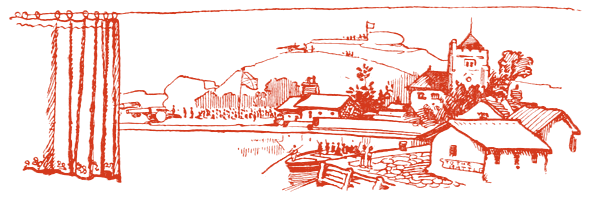

<!-- pair:en:LW00029:paragraph -->
At first we played the game from the outset, with each player's force within sight of his antagonist; then we found it possible to hang a double curtain of casement cloth from a string stretched across the middle of the field, and we drew this back only after both sides had set out their men. Without these curtains we found the first player was at a [turn to page 36] heavy disadvantage, because he displayed all his dispositions before his opponent set down his men.

<!-- translation -->
起初，我们从开局就让双方兵力彼此可见；后来发现，可以在横穿战场中部的一根绳上，挂起两片窗帘布，等双方都把士兵摆好以后再拉开。没有帘子，先摆的一方就处于[turn to page 36]很不利的地位，因为对手尚未放下自己的士兵，他已经暴露了全部部署。

<!-- endpair -->

<!-- pair:en:LW00030:paragraph -->
And at last our rules have reached stability, and we regard them now with the virtuous pride of men who have persisted in a great undertaking and arrived at precision after much tribulation. There is not a piece of constructive legislation in the world, not a solitary attempt to meet a complicated problem, that we do not now regard the more charitably for our efforts to get a right result from this apparently easy and puerile business of fighting with tin soldiers on the floor.

<!-- translation -->
终于，我们的规则稳定了。如今，我们像那些坚持完成了一项伟大事业、历尽磨难后终于达到精确的人一样，带着道德高尚的自豪看待它们。世界上无论哪一项建设性的立法，无论哪一次解决复杂问题的尝试，在我们费尽力气、要把“在地板上用锡兵打仗”这件看似轻易、孩子气的事情做好以后，都会得到我们更多的宽厚理解。

<!-- endpair -->

<!-- pair:en:LW00031:paragraph -->
And so our laws all made, battles have been fought, the mere beginnings, we feel, of vast campaigns. The game has become in a dozen aspects extra[turn to page 37] ordinarily like a small real battle. The plans are made, the Country hastily surveyed, and then the curtains are closed, and the antagonists make their opening dispositions. Then the curtains are drawn back and the hostile forces come within sight of each other; the little companies and squadrons and batteries appear hurrying to their positions, the infantry deploying into long open lines, the cavalry sheltering in reserve, or galloping with the guns to favourable advance positions. In two or three moves the guns are flickering into action, a cavalry mêlée may be in progress, the plans of the attack are more or less apparent, here are men pouring out from the shelter of a wood to secure some point of vantage, and here are troops massing among [turn to page 38] farm buildings for a vigorous attack. The combat grows hot round some vital point. Move follows move in swift succession. One realises with a sickening sense of error that one is outnumbered and hard pressed here and uselessly cut off there, that one's guns are ill-placed, that one's wings are spread too widely, and that help can come only over some deadly zone of fire.

<!-- translation -->
就这样，我们的法则全都制定完毕，战斗也一场场打过了；在我们看来，这还不过是庞大战役的开头。这游戏在十几个方面，已异乎[turn to page 37]寻常地像一场真正的小战斗。计划做好，匆匆勘察地形，随后合上帘子，对手们各自展开初始部署。再拉开帘子，敌对部队便进入彼此视野；一支支小连队、骑兵中队、炮兵连，匆忙赶往阵位：步兵展开成长长的散兵线，骑兵藏作预备队，或与炮一同疾驰，抢占有利的前进阵位。两三个回合内，炮火就开始闪动，也许骑兵混战已经展开；进攻计划已多少显露，这里有人从树林掩护中涌出，抢占要点，那里又有部队在[turn to page 38]农场建筑间集结，准备猛攻。围绕某个要害，战况转为激烈。一回合紧接一回合，迅速推进。你会带着一种因犯错而恶心的感觉发现：此处兵力不足，受到压迫；彼处却白白被切断；炮位放错了，两翼拉得过宽，援军只能穿越某片致命的火力地带，才能赶到。

<!-- endpair -->

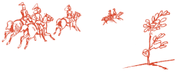

<!-- pair:en:LW00032:paragraph -->
So the fight wears on. Guns are lost or won, hills or villages stormed or held; suddenly it grows clear that the scales are tilting beyond recovery, and the loser has nothing left but to contrive how he may get to the back line and safety with the vestiges of his command. …

<!-- translation -->
战斗于是继续。炮被夺走，或被夺回；山丘和村庄被攻下，或守住。忽然，你看清天平已经倾斜，再也无法挽回；败者所剩的，只有设法带着残部退到后边线，逃到安全地带。……

<!-- endpair -->

<!-- pair:en:LW00033:paragraph -->
But let me, before I go on to tell of actual battles and campaigns, give here a summary of our essential rules.

<!-- translation -->
不过，在继续讲实际的战斗和战役之前，我先在这里归纳一下我们的基本规则。

<!-- endpair -->

<!-- pair:en:LW00034:heading -->
## [turn to page 39] III. The Rules

<!-- translation -->
## [turn to page 39] III. 规则

<!-- endpair -->

<!-- pair:en:LW00035:paragraph -->
Here, then, are the rules of the perfect battle-game as we play it in an ordinary room.

<!-- translation -->
下面，就是我们在普通房间里玩的、完善的战斗游戏的规则。

<!-- endpair -->

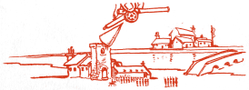

<!-- pair:en:LW00036:subheading -->
### The Country

<!-- translation -->
### 地形

<!-- endpair -->

<!-- pair:en:LW00037:paragraph -->
(1) The Country must be arranged by one player, who, failing any other agreement, shall be selected by the toss of a coin.

<!-- translation -->
（1）地形须由一名玩家布置；如无其他约定，就以掷硬币决定由谁布置。

<!-- endpair -->

<!-- pair:en:LW00038:paragraph -->
(2) The other player shall then choose which side of the field he will fight from.

<!-- translation -->
（2）然后，由另一名玩家选择从战场的哪一侧作战。

<!-- endpair -->

<!-- pair:en:LW00039:paragraph -->
(3) The Country must be disturbed as little as possible in each move: Nothing in the Country shall be moved or set aside deliberately to facilitate the [turn to page 40] firing of guns. A player must not lie across the Country so as to crush or disturb the Country if his opponent objects. Whatever is moved by accident shall be replaced after the end of the move.

<!-- translation -->
（3）每回合对地形的扰动，应尽可能少。不得为了便于[turn to page 40]开炮，而故意移动或移开地形中的任何东西。如果对手反对，玩家不得横卧在地形上，压坏或扰乱地形。任何意外移动的东西，都应在回合结束后放回原处。

<!-- endpair -->

<!-- pair:en:LW00040:subheading -->
### The Move

<!-- translation -->
### 回合

<!-- endpair -->

<!-- pair:en:LW00041:paragraph -->
(1) After the Country is made and the sides chosen, then (and not until then) the players shall toss for the first move.

<!-- translation -->
（1）地形布置好、双方选定以后，玩家才可以掷硬币，决定谁先行动；在这之前不行。

<!-- endpair -->

<!-- pair:en:LW00042:paragraph -->
(2) If there is no curtain, the player winning the toss, hereafter called the First Player, shall next arrange his men along his back line, as he chooses. Any men he may place behind or in front of his back line shall count in the subsequent move as if they touched the back line at its nearest point. The Second [turn to page 41] Player shall then do the same. But if a curtain is available both first and second player may put down their men at the same time. Both players may take unlimited time for the putting down of their men; if there is a curtain it is drawn back when they are ready, and the game then begins.

<!-- translation -->
（2）如果没有帘子，掷币获胜的玩家，以下称为先手玩家，应当接着按自己的意愿，沿本方后边线布置士兵。他放在后边线前面或后面的士兵，在随后回合里，都视为接触着后边线上距自己最近的一点。然后，后手[turn to page 41]玩家照做。如果有帘子，先后手双方则可以同时放置士兵。双方布置士兵的时间都不受限制；如有帘子，待双方准备妥当后拉开，游戏随即开始。

<!-- endpair -->

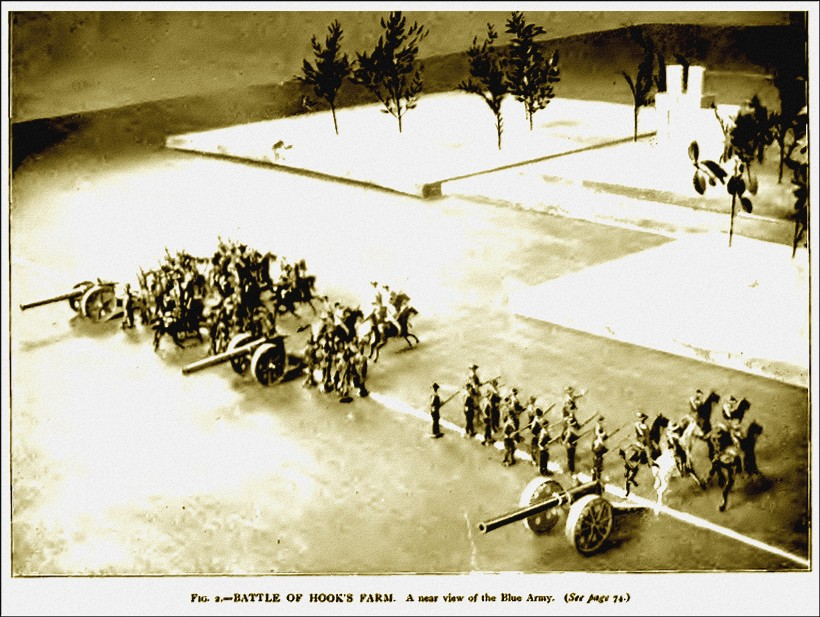

<!-- pair:en:LWP07:figure_caption -->
Fig. 2.—BATTLE OF HOOK’S FARM. A near view of the Blue Army. (See page 74.)

<!-- translation -->
图2——胡克农场之战。蓝军近景。（见第74页。）

<!-- endpair -->

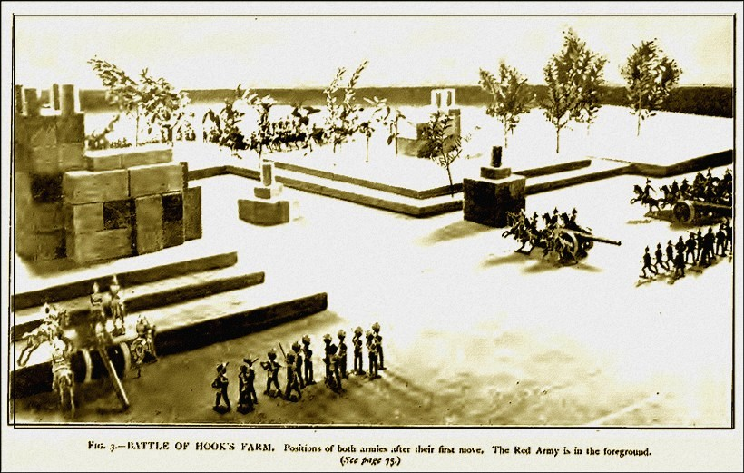

<!-- pair:en:LWP08:figure_caption -->
Fig. 3.—BATTLE OF HOOK’S FARM. Positions of both armies after their first move. The Red Army is in the foreground. (See page 75.)

<!-- translation -->
图3——胡克农场之战。双方第一回合后的位置。前景是红军。（见第75页。）

<!-- endpair -->

<!-- pair:en:LWG41:figure_text -->
**Text in the original image (transcription)**

PING

<!-- translation -->
**图内文字汉译**

叮。

<!-- endpair -->

<!-- pair:en:LW00043:paragraph -->
(3) The subsequent moves after the putting down are timed. The length of time given for each move is determined by the size of the forces engaged. About a minute should be allowed for moving 30 men and a minute for each gun. Thus for a force of 110 men and 3 guns, moved by one player, seven minutes is an ample allowance. As the battle progresses and the men are killed off, the allowance is reduced as the players may agree. The player [turn to page 42] about to move stands at attention a yard behind his back line until the timekeeper says “Go.” He then proceeds to make his move until time is up. He must instantly stop at the cry of “Time.” Warning should be given by the timekeeper two minutes, one minute, and thirty seconds before time is up. There will be an interval before the next move, during which any disturbance of the Country can be rearranged and men accidentally overturned replaced in a proper attitude. This interval must not exceed five or four minutes, as may be agreed upon.

<!-- translation -->
（3）布置完成后的各回合，都要计时。每回合给予的时间，取决于参战兵力的大小。移动30人应当给大约一分钟，每门炮另给一分钟。因此，一位玩家指挥110人、3门炮，七分钟就十分充裕。随着战斗进行、人员阵亡，可按双方约定缩短时限。即将行动的玩家，[turn to page 42]须在本方后边线后一码处立正，等计时员喊“开始”。随后，他便行动，直到时限到达；一听“时间到”，必须立刻停止。计时员应在结束前两分钟、一分钟和三十秒分别提醒。下一回合开始前，应有一段间隔，供人恢复受扰动的地形，把意外翻倒的士兵重新放正。这一间隔不得超过双方约定的五分钟或四分钟。

<!-- endpair -->

<!-- pair:en:LW00044:paragraph -->
(4) Guns must not be fired before the second move of the first player—not counting the “putting down” as a move. Thus the first player puts down, then the second player, the [turn to page 43] first player moves, then the second player, and the two forces are then supposed to come into effective range of each other and the first player may open fire if he wishes to do so.

<!-- translation -->
（4）先手玩家的第二回合以前，不得开炮；“布置士兵”不算一回合。因此，先手先布置，后手再布置；[turn to page 43]先手行动，后手再行动；这时，双方才视为进入彼此的有效射程，先手如愿意，就可以开火。

<!-- endpair -->

<!-- pair:en:LW00045:paragraph -->
(5) In making his move a player must move or fire his guns if he wants to do so, before moving his men. To this rule of “Guns First” there is to be no exception.

<!-- translation -->
（5）玩家行动时，若要移动炮或用炮射击，必须先做这些，再移动士兵。“炮先行动”这条规则，不容例外。

<!-- endpair -->

<!-- pair:en:LW00046:paragraph -->
(6) Every soldier may be moved and every gun moved or fired at each move, subject to the following rules:

<!-- translation -->
（6）每回合，每个士兵都可以移动，每门炮都可以移动或射击，但须遵守以下规则：

<!-- endpair -->

<!-- pair:en:LW00047:subheading -->
### Mobility of the Various Arms

<!-- translation -->
### 各兵种的机动能力

<!-- endpair -->

<!-- pair:en:LW00048:paragraph -->
(Each player must be provided with two pieces of string, one two feet in length and the other six inches.)

<!-- translation -->
（每位玩家必须备有两根绳子，一根长两英尺，另一根长六英寸。）

<!-- endpair -->

<!-- pair:en:LW00049:paragraph -->
(1) An infantry-man may be moved a foot or any less distance at each move.

<!-- translation -->
（1）每回合，一名步兵可以移动一英尺，或者任何小于一英尺的距离。

<!-- endpair -->

<!-- pair:en:LW00050:paragraph -->
[turn to page 44] (2) A cavalry-man may be moved two feet or any less distance at each move.

<!-- translation -->
[turn to page 44]（2）每回合，一名骑兵可以移动两英尺，或者任何小于两英尺的距离。

<!-- endpair -->

<!-- pair:en:LW00051:paragraph -->
(3) A gun is in action if there are at least four men of its own side within six inches of it. If there are not at least four men within that distance, it can neither be moved nor fired.

<!-- translation -->
（3）一门炮周围六英寸内，至少有四名本方士兵，才处于可作战状态。如果这一距离内不足四人，它既不能移动，也不能开火。

<!-- endpair -->

<!-- pair:en:LW00052:paragraph -->
(4) If a gun is in action it can either be moved or fired at each move, but not both. If it is fired, it may fire as many as four shots in each move. It may be swung round on its axis (the middle point of its wheel axle) to take aim, provided the Country about it permits; it may be elevated or depressed, and the soldiers about it may, at the discretion of the firer, be made to lie down in their places to facilitate its handling. Moreover, soldiers who have got in front of the fire of their [turn to page 45] own guns may lie down while the guns fire over them. At the end of the move the gun must be left without altering its elevation and pointing in the direction of the last shot. And after firing, two men must be placed exactly at the end of the trail of the gun, one on either side in a line directly behind the wheels. So much for firing. If the gun is moved and not fired, then at least four men who are with the gun must move up with it to its new position, and be placed within six inches of it in its new position. The gun itself must be placed trail forward and the muzzle pointing back in the direction from which it came, and so it must remain until it is swung round on its axis to fire. Obviously the distance which a gun [turn to page 46] can move will be determined by the men it is with; if there are at least four cavalry-men with it, they can take the gun two feet, but if there are fewer cavalry-men than four and the rest infantry, or no cavalry and all infantry, the gun will be movable only one foot.

<!-- translation -->
（4）处于可作战状态的炮，每回合可以移动或射击，但不能两者兼做。如果射击，每回合最多可打四发。在周围地形允许的情况下，可以绕炮的轴心，也就是轮轴中点，转动炮来瞄准；可以调整仰角和俯角；为便于操作，开炮的人还可自行决定，让炮周围的士兵在原地卧倒。此外，处于本方炮火[turn to page 45]前方的士兵，也可以卧倒，让炮弹从头顶飞过。回合结束时，炮的仰角不得改变，必须仍指向最后一发的射击方向。射击后，还必须在炮架尾端的准确位置放两名士兵，两侧各一，位于炮轮正后方的一条线上。关于射击，规定如此。如果炮移动而不射击，则伴随该炮的至少四名士兵，必须与炮一起前进到新位置，并被放在炮的新位置六英寸以内。炮本身必须炮架尾端向前，炮口向后，指向来时的方向；在下次绕轴转向开火以前，必须保持这种姿态。显然，一门炮[turn to page 46]能移动多远，取决于伴随它的士兵：如果至少有四名骑兵，他们能带着炮走两英尺；若骑兵不足四名、其余是步兵，或者完全没有骑兵、全是步兵，那么炮只能移动一英尺。

<!-- endpair -->

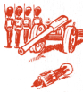

<!-- pair:en:LW00053:paragraph -->
(5) Every man must be placed fairly clear of hills, buildings, trees, guns, etc. He must not be jammed into interstices, and either player may insist upon a clear distance between any man and any gun or other object of at least one-sixteenth of an inch. Nor must men be packed in contact with men. A space of one-sixteenth of an inch should be kept between them.

<!-- translation -->
（5）每个士兵都必须与山丘、建筑、树木、炮等保持明确的空隙。不得将士兵挤塞在缝隙里；任何一位玩家，都可以要求任何士兵与任何炮或其他物体之间，至少留出十六分之一英寸的净距离。士兵也不得互相紧贴，彼此应当保持十六分之一英寸的间隔。

<!-- endpair -->

<!-- pair:en:LW00054:paragraph -->
(6) When men are knocked over by a shot they are dead, and as many men are dead as a shot knocks over or causes [turn to page 47] to fall or to lean so that they would fall if unsupported. But if a shot strikes a man but does not knock him over, he is dead, provided the shot has not already killed a man. But a shot cannot kill more than one man without knocking him over, and if it touches several without oversetting them, only the first touched is dead and the others are not incapacitated. A shot that rebounds from or glances off any object and touches a man, kills him; it kills him even if it simply rolls to his feet, subject to what has been said in the previous sentence.

<!-- translation -->
（6）被一发炮弹击倒的士兵，算作死亡。一发炮弹打倒多少人，使多少人[turn to page 47]跌落，或倾斜到失去支撑就会倒下的程度，就算杀死多少人。但是，炮弹击中一个士兵却没把他打倒，他也算死亡，条件是这一发尚未杀死过其他人。不过，一发炮弹在没有把人打倒的情况下，不能杀死一个以上的士兵；如果它碰到几个人，却没把他们掀倒，那么只有第一个被碰到的人死亡，其余人并未失去行动能力。炮弹从任何物体上弹回或擦过，再碰到士兵，也会杀死他；即使只是滚到他的脚边，也能杀死他，但须受前一句所述限制。

<!-- endpair -->

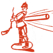

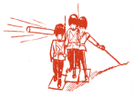

<!-- pair:en:LW00055:subheading -->
### Hand-to-Hand Fighting and Capturing

<!-- translation -->
### 近身战斗与俘虏

<!-- endpair -->

<!-- pair:en:LW00056:paragraph -->
(1) A man or a body of men which has less than half its own number of [turn to page 48] men on its own side within a move of it, is said to be isolated. But if there is at least half its number of men of its own side within a move of it, it is not isolated; it is supported.

<!-- translation -->
（1）一个士兵或一支部队，如果在距离自己一回合行程内，[turn to page 48]本方人数不足自身人数的一半，就称为“孤立”。但是，如果这一范围内的本方人数至少达到自身人数的一半，就“不孤立”，而是“有支援”。

<!-- endpair -->

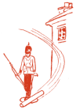

<!-- pair:en:LW00057:paragraph -->
(2) Men may be moved up into virtual contact (one-eighth of an inch or closer) with men of the opposite side. They must then be left until the end of the move.

<!-- translation -->
（2）士兵可以被移动到与敌方士兵近乎接触的位置，即相距八分之一英寸或更近。此后，必须让他们留在原处，直到回合结束。

<!-- endpair -->

<!-- pair:en:LW00058:paragraph -->
(3) At the end of the move, if there are men of the side that has just moved in contact with any men of the other side, they constitute a mêlée. All the men in contact, and any other men within six inches of the men in contact, measuring from any point of their persons, weapons, or horses, are supposed to take part in the mêlée. At the end of the move the two players [turn to page 49] examine the mêlée and dispose of the men concerned according to the following rules:—

<!-- translation -->
（3）回合结束时，如果刚刚行动的一方，有士兵与另一方的任何士兵接触，他们就构成一场“混战”。所有相互接触的士兵，以及距这些接触者六英寸以内的其他士兵，都视为参加混战；距离可从兵人的身体、武器或马匹的任何一点量起。回合结束后，双方玩家[turn to page 49]检查混战，并按以下规则处理相关士兵：

<!-- endpair -->

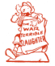

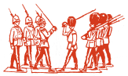

<!-- pair:en:LWG49A:figure_text -->
**Text in the original image (transcription)**

WAR; TERRIBLE SLAUGHTER

<!-- translation -->
**图内文字汉译**

战争；惨烈屠杀。

<!-- endpair -->

<!-- pair:en:LW00059:paragraph -->
Either the numbers taking part in the mêlée on each side are equal or unequal.

<!-- translation -->
参加混战的双方人数，要么相等，要么不等。

<!-- endpair -->

<!-- pair:en:LW00060:paragraph -->
(a) If they are equal, all the men on both sides are killed.

<!-- translation -->
（a）如果人数相等，双方所有参加者一律死亡。

<!-- endpair -->

<!-- pair:en:LW00061:paragraph -->
(b) If they are unequal, then the inferior force is either isolated or (measuring from the points of contact) not isolated.

<!-- translation -->
（b）如果人数不等，人数较少的一方，要么是孤立的，要么从接触点量起并不孤立。

<!-- endpair -->

<!-- pair:en:LW00062:paragraph -->
(b1) If it is isolated (see 1 above), then as many men become prisoners as the inferior force is less in numbers than the superior force, and the rest kill each a man and are killed. Thus nine against eleven have two taken prisoners, and each side seven men dead. Four of the eleven remain with two prisoners. [turn to page 50] One may put this in another way by saying that the two forces kill each other off, man for man, until one force is double the other, which is then taken prisoner. Seven men kill seven men, and then four are left with two.

<!-- translation -->
（b1）如果人数较少的一方是孤立的（见上文第1条），那么，双方人数相差多少，较少的一方就有多少人被俘；其余人员各杀死一人，同时自己也被杀死。例如，九人对十一人，九人一方有两人被俘，双方各死七人；十一人中，剩下四人，带着两名俘虏。[turn to page 50]也可以换一种说法：双方一人换一人地互相杀死，直到一方人数达到另一方两倍，后者便被俘。七个人杀死七个人，最后剩下四人对两人。

<!-- endpair -->

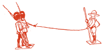

<!-- pair:en:LW00063:paragraph -->
(b2) But if the inferior force is not isolated (see 1 above), then each man of the inferior force kills a man of the superior force and is himself killed.

<!-- translation -->
（b2）但如果人数较少的一方并不孤立（见上文第1条），那么，该方每人杀死人数较多一方的一人，同时自己也被杀死。

<!-- endpair -->

<!-- pair:en:LW00064:paragraph -->
And the player who has just completed the move, the one who has charged, decides, when there is any choice, which men in the mêlée, both of his own and of his antagonist, shall die and which shall be prisoners or captors.

<!-- translation -->
如果存在选择，刚完成这一回合、也就是发起冲锋的玩家，可以决定混战中本方与敌方的哪些人死亡，哪些人成为俘虏或俘获者。

<!-- endpair -->

<!-- pair:en:LW00065:paragraph -->
All these arrangements are made after the move is over, in the interval between the moves, and the time taken [turn to page 51] for the adjustment does not count as part of the usual interval for consideration. It is extra time.

<!-- translation -->
以上一切处理，都在回合结束后、两回合之间的间隔内完成；用于这种调整[turn to page 51]的时间，不计入通常留给思考的间隔，而是额外时间。

<!-- endpair -->

<!-- pair:en:LW00066:paragraph -->
The player next moving may, if he has taken prisoners, move these prisoners. Prisoners may be sent under escort to the rear or wherever the capturer directs, and one man within six inches of any number of prisoners up to seven can escort these prisoners and go with them. Prisoners are liberated by the death of any escort there may be within six inches of them, but they may not be moved by the player of their own side until the move following that in which the escort is killed. Directly prisoners are taken they are supposed to be disarmed, and if they are liberated they cannot fight until they are rearmed. In order to be rearmed they must re[turn to page 52] turn to the back line of their own side. An escort having conducted prisoners to the back line, and so beyond the reach of liberation, may then return into the fighting line.

<!-- translation -->
接下来行动的玩家，如已抓到俘虏，可以移动这些俘虏。俘虏可以由人押送到后方，或押往俘获者指定的任何地方；一个士兵，只要在俘虏六英寸以内，就可以押送任意不超过七名俘虏，并与他们同行。如果距俘虏六英寸内的押送者被杀，俘虏就被解放；但本方玩家，要到押送者被杀的下一回合，才能移动他们。士兵一被俘，就视为已被缴械；即使获释，在重新武装以前，也不能战斗。要重新武装，就必须返[turn to page 52]回本方后边线。押送者将俘虏带到后边线，使他们脱离可能被解救的范围后，就可以回到战斗线上。

<!-- endpair -->

<!-- pair:en:LWG52:figure_text -->
**Text in the original image (transcription)**

BOOK OF RULES; POCKET EDITION

<!-- translation -->
**图内文字汉译**

规则书；袖珍版。

<!-- endpair -->

<!-- pair:en:LW00067:paragraph -->
Prisoners once made cannot fight until they have returned to their back line. It follows, therefore, that if after the adjudication of a mêlée a player moves up more men into touch with the survivors of this first mêlée, and so constitutes a second mêlée, any prisoners made in the first mêlée will not count as combatants in the second mêlée. Thus if A moves up nineteen men into a mêlée with thirteen of B's—B having only five in support,—A makes six prisoners, kills seven men, and has seven of his own killed. If, now, B can move up fourteen men into mêlée with [turn to page 53] A's victorious survivors, which he may be able to do by bringing the five into contact, and getting nine others within six inches of them, no count is made of the six of B's men who are prisoners in the hands of A. They are disarmed. B, therefore, has fourteen men in the second mêlée and A twelve, B makes two prisoners, kills ten of A's men, and has ten of his own killed. But now the six prisoners originally made by A are left without an escort, and are therefore recaptured by B. But they must go to B's back line and return before they can fight again. So, as the outcome of these two mêlées, there are six of B's men going as released prisoners to his back line whence they may return into the battle, two of A's men prisoners in the hands [turn to page 54] of B, one of B's staying with them as escort, and three of B's men still actively free for action. A, at a cost of nineteen men, has disposed of seventeen of B's men for good, and of six or seven, according to whether B keeps his prisoners in his fighting line or not, temporarily.

<!-- translation -->
士兵一旦被俘，在返回本方后边线之前，就不能战斗。因此，如果在裁定一场混战之后，某位玩家再调来人员，与第一次混战的幸存者接触，从而构成第二次混战，那么，第一次混战中的俘虏，不算第二次混战的战斗人员。例如，A调来十九人与B的十三人混战，而B只有五人支援，A就抓六个俘虏，杀七人，本方也死七人。这时，如果B能够调来十四人，与[turn to page 53]A的获胜幸存者再打一场混战——他或许可以让那五人上前接触，再把另外九人调到他们六英寸以内——则已经落在A手中、成为俘虏的B方六人，不计入兵力。他们已被缴械。因此，第二场混战中，B有十四人，A有十二人；B俘虏两人，杀死A方十人，自己也死十人。但这时，原先被A俘虏的六人，身旁已没有押送者，所以被B解救。不过，在重新战斗之前，他们必须先回B的后边线，再回来。于是，两场混战的结果如下：B有六人作为获释俘虏，前往本方后边线，此后可以返回战斗；A有两人成为B方[turn to page 54]俘虏，B有一人留下押送他们，另有三人仍可自由作战。A以十九人的代价，永久清除了B的十七人，另暂时清除了六人或七人，具体取决于B是否把俘虏留在战斗线上。

<!-- endpair -->

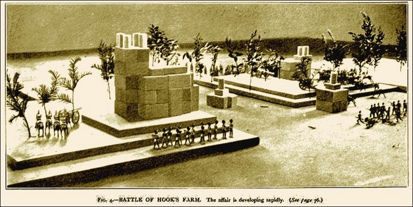

<!-- pair:en:LWP09:figure_caption -->
Fig. 4.—BATTLE OF HOOK’S FARM. The affair developing rapidly. (See page 76.)

<!-- translation -->
图4——胡克农场之战。战事迅速发展。（见第76页。）

<!-- endpair -->

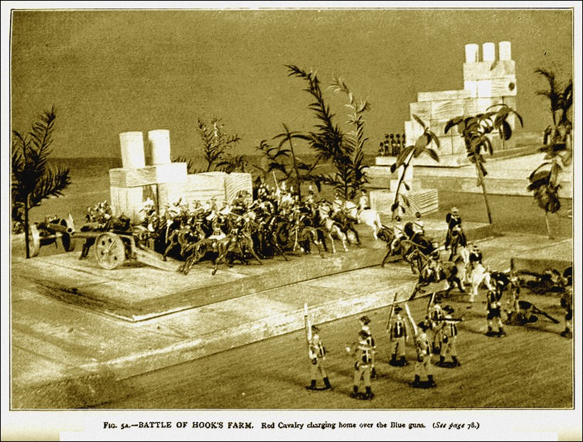

<!-- pair:en:LWP10:figure_caption -->
Fig. 5a.—BATTLE OF HOOK’S FARM. Red Cavalry charging home over the Blue guns. (See page 78.)

<!-- translation -->
图5a——胡克农场之战。红方骑兵一直冲到蓝方火炮上。（见第78页。）

<!-- endpair -->

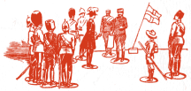

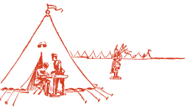

<!-- pair:en:LW00068:paragraph -->
(4) Any isolated body may hoist the white flag and surrender at any time.

<!-- translation -->
（4）任何孤立部队，都可以随时举白旗投降。

<!-- endpair -->

<!-- pair:en:LW00069:paragraph -->
(5) A gun is captured when there is no man whatever of its original side within six inches of it, and when at least four men of the antagonist side have moved up to it and have passed its wheel axis going in the direction of their attack. This latter point is important. An antagonist's gun may be out of action, and you may have a score of men coming up to it and within six inches of it, but it is not yet captured; [turn to page 55] and you may have brought up a dozen men all round the hostile gun, but if there is still one enemy just out of their reach and within six inches of the end of the trail of the gun, that gun is not captured: it is still in dispute and out of action, and you may not fire it or move it at the next move. But once a gun is fully captured, it follows all the rules of your own guns.

<!-- translation -->
（5）一门炮在以下条件下被夺取：原属一方在炮六英寸内，已一个人也没有；敌方至少四人已来到炮旁，并沿进攻方向越过炮的轮轴。后一点很重要。一门敌炮也许已经失去作战能力，你也许已有二十个人接近它，进入六英寸以内，但它尚未被夺取；[turn to page 55]即使你把十二个人带到敌炮周围，只要仍有一个敌人在他们够不到的地方，同时处于炮架尾端六英寸以内，那门炮就没有被夺取：归属仍有争议，而且无法作战；下一回合，你不能用它开火，也不能移动它。但是，炮一旦完全被夺取，就按本方炮的全部规则行动。

<!-- endpair -->

<!-- pair:en:LW00070:subheading -->
### Varieties of the Battle-Game

<!-- translation -->
### 战斗游戏的几种类型

<!-- endpair -->

<!-- pair:en:LW00071:paragraph -->
You may play various types of game.

<!-- translation -->
你可以玩不同类型的游戏。

<!-- endpair -->

<!-- pair:en:LW00072:paragraph -->
(1) One is the Fight to the Finish. You move in from any points you like on the back line and try to kill, capture, or drive over his back line the whole of the enemy's force. You play the game [turn to page 56] for points; you score 100 for the victory, and 10 for every gun you hold or are in a position to take, 1½ for every cavalry-man, 1 for every infantry-man still alive and uncaptured, ½ for every man of yours prisoner in the hands of the enemy, and ½ for every prisoner you have taken. If the battle is still undecided when both forces are reduced below fifteen men, the battle is drawn and the 100 points for victory are divided.

<!-- translation -->
（1）一种是“决战到底”。你可以从本方后边线上任何喜欢的位置进入，努力把敌军全部杀死、俘虏，或赶过敌方自己的后边线。这种游戏[turn to page 56]按积分计算：获胜得100分；每门掌握在你手中、或你处于能够夺取它的位置的炮，得10分；每名骑兵得1½分；每名仍活着、未被俘的步兵得1分；每名落在敌人手里的本方俘虏得½分；每名你抓获的俘虏，也得½分。如果双方兵力都已降到十五人以下，战斗仍未决出胜负，就算平局，胜利的100分由双方平分。

<!-- endpair -->

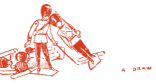

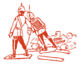

<!-- pair:en:LWG56A:figure_text -->
**Text in the original image (transcription)**

A DRAW

<!-- translation -->
**图内文字汉译**

平局

<!-- endpair -->

<!-- pair:en:LW00073:paragraph -->
Note.—This game can be fought with any sized force, but if it is fought with less than 50 a side, the minimum must be 10 a side.

<!-- translation -->
注：这种游戏可以使用任何规模的兵力，但如果每方不到50人，每方最低兵力就必须是10人。

<!-- endpair -->

<!-- pair:en:LW00074:paragraph -->
(2) The Blow at the Rear game is decided when at least three men of one force reach any point in the back line of their antagonist. He is then supposed [turn to page 57] to have suffered a strategic defeat, and he must retreat his entire force over the back line in six moves, i.e. six of his moves. Anything left on the field after six moves capitulates to the victor. Points count as in the preceding game, but this lasts a shorter time and is better adapted to a cramped country with a short back line. With a long rear line the game is simply a rush at some weak point in the first player's line by the entire cavalry brigade of the second player. Instead of making the whole back line available for the Blow at the Rear, the middle or either half may be taken.

<!-- translation -->
（2）“直击后方”游戏，在一方至少三人到达敌方后边线任意一点时，就分出胜负。此时，敌方视为[turn to page 57]遭受战略失败，必须在六回合内，也就是本方的六个回合内，将全部兵力撤过后边线。六回合后，任何还留在战场上的人员和装备，都向胜者投降。计分与前一种游戏相同；但这种玩法历时更短，更适合地形狭窄、后边线较短的场地。如果后边线很长，游戏就只是后手玩家将整个骑兵旅，向先手玩家阵线的某个薄弱点猛冲。供“直击后方”使用的后边线，也可以不是整条，而只取中央部分，或取其中任意一半。

<!-- endpair -->

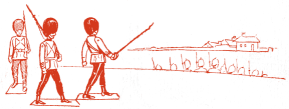

<!-- pair:en:LW00075:paragraph -->
(3) In the Defensive Game, a force, the defenders, two-thirds as strong as its antagonist, tries to prevent the latter arriving, while still a quarter of its ori[turn to page 58] ginal strength, upon the defender's back line. The Country must be made by one or both of the players before it is determined which shall be defender. The players then toss for choice of sides, and the winner of the toss becomes the defender. He puts out his force over the field on his own side, anywhere up to the distance of one move off the middle line—that is to say, he must not put any man within one move of the middle line, but he may do so anywhere on his own side of that limit,—and then the loser of the toss becomes first player, and sets out his men a move from his back line. The defender may open fire forthwith; he need not wait until after the second move of the first player, as the second player has to do.

<!-- translation -->
（3）在“防御战”中，防守方的兵力是对手的三分之二；他们试图阻止对方在仍保有原[turn to page 58]始兵力四分之一时，到达防守方的后边线。在决定谁防守之前，必须先由一位或两位玩家布置地形。然后，双方掷币选择阵营，掷币获胜者成为防守方。他可以将兵力部署在本方一侧的战场上，直到距中线一回合行程的位置；也就是说，任何士兵都不得放在距中线一回合行程以内，但在这一限制之外、本方一侧的任意位置都可以部署。然后，掷币输的一方成为先手，把士兵布置在距本方后边线一回合行程的位置。防守方可以立刻开火，无须像通常的后手玩家一样，等到先手第二回合之后。

<!-- endpair -->

<!-- pair:en:LW00076:subheading -->
### [turn to page 59] Composition of Forces

<!-- translation -->
### [turn to page 59] 兵力组成

<!-- endpair -->

<!-- pair:en:LW00077:paragraph -->
Except in the above cases, or when otherwise agreed upon, the forces engaged shall be equal in number and similar in composition. The methods of handicapping are obvious. A slight inequality (chances of war) may be arranged between equal players by leaving out 12 men on each side and tossing with a pair of dice to see how many each player shall take of these. The best arrangement and proportion of the forces is in small bodies of about 20 to 25 infantry-men and 12 to 15 cavalry to a gun. Such a force can manœuvre comfortably on a front of 4 or 5 feet. Most of our games have been played with about 80 infantry, [turn to page 60] 50 cavalry, 3 or 4 naval guns, and a field gun on either side, or with smaller proportional forces. We have played excellent games on an eighteen-foot battlefield with over two hundred men and six guns a side. A player may, of course, rearrange his forces to suit his own convenience; brigade all or most of his cavalry into a powerful striking force, or what not. But more guns proportionally lead to their being put out of action too early for want of men; a larger proportion of infantry makes the game sluggish, and more cavalry—because of the difficulty of keeping large bodies of this force under cover—leads simply to early heavy losses by gunfire and violent and disastrous charging. The composition of a force may, of course, be varied considerably. One good Fight [turn to page 61] to a Finish game we tried as follows: We made the Country, tossed for choice, and then drew curtains across the middle of the field. Each player then selected his force from the available soldiers in this way: he counted infantry as 1 each, cavalry as 1½, and a gun as 10, and, taking whatever he liked in whatever position he liked, he made up a total of 150. He could, for instance, choose 100 infantry and 5 guns, or 100 cavalry and no guns, or 60 infantry, 40 cavalry, and 3 guns. In the result, a Boer-like cavalry force of 80 with 3 guns suffered defeat at the hands of 110 infantry with 4.

<!-- translation -->
除上述情况，或另有约定外，参战双方的人数应相等，组成应相似。让子的办法显而易见。水平相同的玩家，也可以各留下12人，再掷两枚骰子，看每位玩家能从这12人中取多少，以安排一点轻微的不平等，模拟战争的偶然。最佳编组和比例，是每门炮配一个小队，约有20至25名步兵、12至15名骑兵。这样一支部队，能够在4或5英尺宽的正面上从容机动。我们的大多数游戏，每方约用80名步兵、[turn to page 60]50名骑兵、3或4门舰炮，以及一门野战炮；或者，按相同比例使用较小兵力。我们曾在十八英尺的战场上，以每方两百余人、六门炮，玩出极好的游戏。玩家当然可以按自己的便利重新编组：把全部或大部分骑兵合编为一支强大突击队，或者采取别的办法。但是，炮的比例过高，会因人员不足，而使它们过早失去作战能力；步兵比例更高，会让游戏迟缓；更多骑兵，则因为大部队骑兵难以保持隐蔽，只会导致较早遭受炮火重创，发动猛烈而灾难性的冲锋。当然，部队组成可以有相当大的变化。我们试过一种很好的“决战[turn to page 61]到底”玩法：先布置地形，掷币选边，再沿战场中线拉起帘子。接着，每位玩家用如下方法，从现有玩具士兵中选取兵力：每个步兵算1，每个骑兵算1½，一门炮算10；可以任意选择兵种，放在任何喜欢的位置，凑到总数150。例如，他可以选100名步兵、5门炮，或100名骑兵、不配炮，或60名步兵、40名骑兵、3门炮。结果，一支布尔人式的80骑兵、3门炮的部队，被110步兵、4门炮击败了。

<!-- endpair -->

<!-- pair:en:LW00078:subheading -->
### Size of the Soldiers

<!-- translation -->
### 士兵的尺寸

<!-- endpair -->

<!-- pair:en:LW00079:paragraph -->
The soldiers used should be all of one size. The best British makers [turn to page 62] have standardised sizes, and sell infantry and cavalry in exactly proportioned dimensions; the infantry being nearly two inches tall. There is a lighter, cheaper make of perhaps an inch and a half high that is also available. Foreign-made soldiers are of variable sizes.

<!-- translation -->
所用士兵，尺寸应当一致。英国最好的制造商[turn to page 62]已经统一了尺寸，出售的步兵和骑兵，比例完全相称；步兵高近两英寸。另外，也有一种更轻、更便宜、高约一英寸半的兵人可以使用。外国制造的士兵，尺寸则各不相同。

<!-- endpair -->

<!-- pair:en:LW-PLAN-CAPTION:figure_caption -->
Sketch Plan of the Battle of Hook' Farm

<!-- translation -->
胡克农场之战略图

<!-- endpair -->

<!-- pair:en:LWFIG62TEXT:figure_text -->
**Text in the original image (transcription)**

N; S; W; E; A; A; B; B; D; C; E; COTTAGE; FIRELY CHURCH; HOOKS FARM; HOUSE; THIN COVER; TREES; TREES; TREES

<!-- translation -->
**图内文字汉译**

北；南；西；东；A；A；B；B；D；C；E；小屋；Firely教堂；胡克农场；房屋；稀疏掩护；树木；树木；树木

<!-- endpair -->

<!-- pair:en:LWP11:figure_caption -->
Fig. 5b.—BATTLE OF HOOK’S FARM. After the cavalry mêlée. (See page 80.)

<!-- translation -->
图5b——胡克农场之战。骑兵混战之后。（见第80页。）

<!-- endpair -->

<!-- pair:en:LWP12:figure_caption -->
Fig. 6a.—BATTLE OF HOOK’S FARM. The three Red Cavalry prisoners are being led to the rear. (See page 80.)

<!-- translation -->
图6a——胡克农场之战。三名被俘的红方骑兵，正被押往后方。（见第80页。）

<!-- endpair -->

<!-- pair:en:LW00080:heading -->
## [turn to page 63] IV. The Battle of Hook's Farm

<!-- translation -->
## [turn to page 63] IV. 胡克农场之战

<!-- endpair -->

<!-- pair:en:LW00081:paragraph -->
And now, having given all the exact science of our war game, having told something of the development of this warfare, let me here set out the particulars of an exemplary game. And suddenly your author changes. He changes into what perhaps he might have been—under different circumstances. His inky fingers become large, manly hands, his drooping scholastic back stiffens, his elbows go out, his etiolated complexion corrugates and darkens, his moustaches increase and grow and spread, and curl up horribly; a large, [turn to page 64] red scar, a sabre cut, grows lurid over one eye. He expands—all over he expands. He clears his throat startlingly, lugs at the still growing ends of his moustache, and says, with just a faint and fading doubt in his voice as to whether he can do it, “Yas, Sir!”

<!-- translation -->
现在，我们的战争游戏的全部精确科学已经交代过，这种作战方式的发展，也说了一些；让我接着列出一局示范游戏的具体经过。突然，你的作者变了。他变成了另一种境遇下，他本可能成为的那个人。他沾着墨水的手指，变成又大又有男子气概的手；学究式的佝偻后背挺直了，双肘向外张开；原本苍白的面色，皱起来、黑下去；胡须增多、增长、扩展开，凶恶地翘起；一道大大的、[turn to page 64]红色的刀疤，在一只眼睛上方显得分外狰狞。他膨胀起来，全身都膨胀起来。他令人一惊地清了清嗓子，拉扯着还在不断生长的胡须梢；声音里，只有一丝微弱而渐渐消失的疑虑，怀疑自己能不能做得到。他说道：“是，先生！”

<!-- endpair -->

<!-- pair:en:LWG63:figure_text -->
**Text in the original image (transcription)**

MAP

<!-- translation -->
**图内文字汉译**

地图。

<!-- endpair -->

<!-- pair:en:LW00082:paragraph -->
Now for a while you listen to General H. G. W., of the Blue Army. You hear tales of victory. The photographs of the battlefields are by a woman war-correspondent, A. C. W., a daring ornament of her sex. I vanish. I vanish, but I will return. Here, then, is the story of the battle of Hook's Farm.

<!-- translation -->
现在，请暂且听蓝军H. G. W.将军讲话。你将听到胜利的故事。战场照片，是一位女战地记者A. C. W.拍摄的，她是一位大胆、为女性增光的人物。我消失了。我消失了，但会回来。下面，就是胡克农场战斗的故事。

<!-- endpair -->

<!-- pair:en:LW00083:paragraph -->
“The affair of Hook's Farm was one of those brisk little things that did so much to build up my early reputation. I did remarkably well, [turn to page 65] though perhaps it is not my function to say so. The enemy was slightly stronger, both in cavalry and infantry, than myself[*]; he had the choice of position, and opened the ball. Nevertheless I routed him. I had with me a compact little force of 3 guns, 48 infantry, and 25 horse. My instructions were to clear up the country to the east of Firely Church.

<!-- translation -->
“胡克农场一役，是那种干脆利落的小战斗，正是它们，为我早年的声誉奠定了重要基础。我干得非常出色，[turn to page 65]虽然这或许不该由我自己来说。敌方的骑兵和步兵，都比我略多一些[*]；他有选阵地之权，又先开了场。尽管如此，我还是把他打得大败。我手下是一支紧凑的小部队：3门炮，48名步兵，25名骑兵。我的命令，是肃清Firely教堂以东的地带。

<!-- endpair -->

<!-- pair:en:LWN65:note -->
[* A slight but pardonable error on the part of the gallant gentleman. The forces were exactly equal.]

<!-- translation -->
[* 这位英勇的绅士，犯了一个轻微却可以原谅的错误。双方兵力完全相等。]

<!-- endpair -->

<!-- pair:en:LW00084:paragraph -->
“We came very speedily into touch. I discovered the enemy advancing upon Hook's Farm and Firely Church, evidently with the intention of holding those two positions and giving me a warm welcome. I have by me a photograph or so of the battlefield [turn to page 66] and also a little sketch I used upon the field. They will give the intelligent reader a far better idea of the encounter than any so-called ‘fine writing’ can do.

<!-- translation -->
“我们很快就接触上了。我发现敌人正向胡克农场和Firely教堂推进，显然打算占据这两处，热烈地欢迎我。我这里留有一两张战场照片，[turn to page 66]还有一幅当时在战场上用过的略图。聪明的读者，从这些东西里，会比从任何所谓的‘华丽文笔’中，更清楚地了解这一遭遇。

<!-- endpair -->

<!-- pair:en:LW00085:paragraph -->
“The original advance of the enemy was through the open country behind Firely Church and Hook's Farm; I sighted him between the points marked A A and B B, and his force was divided into two columns, with very little cover or possibility of communication between them if once the intervening ground was under fire. I reckoned about 22 to his left and 50 or 60 to his right.[*] Evidently he meant to seize both Firely Church and Hook's Farm, get his guns into action, and pound my little force to pieces while it was still practically [turn to page 67] in the open. He could reach both these admirable positions before I could hope to get a man there. There was no effective cover whatever upon my right that would have permitted an advance up to the church, and so I decided to concentrate my whole force in a rush upon Hook's Farm, while I staved off his left with gun fire. I do not believe any strategist whatever could have bettered that scheme. My guns were at the points marked D C E, each with five horsemen, and I deployed my infantry in a line between D and E. The rest of my cavalry I ordered to advance on Hook's Farm from C. I have shown by arrows on the sketch the course I proposed for my guns. The gun E was to go straight for its assigned position, and get into action [turn to page 68] at once. C was not to risk capture or being put out of action; its exact position was to be determined by Red's rapidity in getting up to the farm, and it was to halt and get to work directly it saw any chance of effective fire.

<!-- translation -->
“敌人最初穿过Firely教堂和胡克农场后方的开阔地前进；我在标记为A A和B B的点之间发现了他。他的兵力分为两列；一旦中间地带受到火力控制，两列之间就几乎没有掩护，也很难联络。我估计，他左边约22人，右边50或60人。[*]他显然想同时夺取Firely教堂和胡克农场，把炮投入战斗，趁我的小部队还几乎完全[turn to page 67]暴露时，将它轰成碎片。他能抢在我有望把一人派到那里之前，抵达这两处极好的阵地。我的右翼完全没有足以掩护向教堂推进的有效遮蔽物，所以我决定，集中全部兵力猛扑胡克农场，同时用炮火挡住他的左翼。我不相信任何战略家，能拟出比这更好的方案。我的炮分别位于D、C、E各点，每门配五名骑兵；步兵则展开在D、E两点之间。我命令其余骑兵从C向胡克农场推进。我在略图上用箭头画出了各门炮预定的路线。E炮应直赴指定位置，立刻[turn to page 68]投入战斗。C炮不可冒着被夺取或丧失作战能力的风险前进；它的确切阵位，要看红方抵近农场的速度，一看到有效射击机会，就应停下开火。

<!-- endpair -->

<!-- pair:en:LWN66:note -->
[* Here again the gallant gentleman errs; this time he magnifies.]

<!-- translation -->
[* 这位英勇的绅士，又弄错了；这一次，他夸大了。]

<!-- endpair -->

<!-- pair:en:LWG67:figure_text -->
**Text in the original image (transcription)**

MAP; HOOKS FARM

<!-- translation -->
**图内文字汉译**

地图；胡克农场

<!-- endpair -->

<!-- pair:en:LW00086:paragraph -->
“Red had now sighted us. Throughout the affair he showed a remarkably poor stomach for gun-fire, and this was his undoing. Moreover, he was tempted by the poorness of our cover on our right to attempt to outflank and enfilade us there. Accordingly, partly to get cover from our two central guns and partly to outflank us, he sent the whole of his left wing to the left of Firely Church, where, except for the gun, it became almost a negligible quantity. The gun came out between the church and the wood into a position from [turn to page 69] which it did a considerable amount of mischief to the infantry on our right, and nearly drove our rightmost gun in upon its supports. Meanwhile, Red's two guns on his right came forward to Hook's Farm, rather badly supported by his infantry.

<!-- translation -->
“此时，红方也看见我们了。整个战斗中，他对炮火都表现出惊人的畏缩，正是这一点毁了他。此外，他看到我们右翼掩护薄弱，便受了引诱，企图从那里迂回，沿纵向扫射我军。因此，一方面为了躲开我们中央两门炮，另一方面为了迂回，他把整个左翼派到Firely教堂左边；除那门炮以外，这支兵力几乎变得无足轻重。那门炮从教堂与树林之间出来，进入一个[turn to page 69]能够重创我们右翼步兵的位置，差点把我们最右边的炮，逼回后方的支援部队当中。与此同时，红方右翼的两门炮向胡克农场前进，他的步兵给予的支援却相当糟糕。

<!-- endpair -->

<!-- pair:en:LW00087:paragraph -->
“Once they got into position there I perceived that we should be done for, and accordingly I rushed every available man forward in a vigorous counter attack, and my own two guns came lumbering up to the farmhouse corners, and got into the wedge of shelter close behind the house before his could open fire. His fire met my advance, littering the gentle grass slope with dead, and then, hot behind the storm of shell, and even as my cavalry gathered to charge his guns, he charged mine. I was amazed [turn to page 70] beyond measure at that rush, knowing his sabres to be slightly outnumbered by mine. In another moment all the level space round the farmhouse was a whirling storm of slashing cavalry, and then we found ourselves still holding on, with half a dozen prisoners, and the farmyard a perfect shambles of horses and men. The mêlée was over. His charge had failed, and, after a brief breathing-space for my shot-torn infantry to come up, I led on the counter attack. It was brilliantly successful; a hard five minutes with bayonet and sabre, and his right gun was in our hands and his central one in jeopardy.

<!-- translation -->
“我看出，一旦他们在那里占好阵位，我们就完了。因此，我让所有可用人员，在一次猛烈的反击中冲上前去；本方另外两门炮，也隆隆地挪到农舍墙角，在他的炮来得及开火以前，钻进房屋紧后方那一楔形的掩护区。他的炮火迎击我的推进，让平缓草坡上布满死者；紧接炮弹风暴，在我的骑兵正集结、准备冲击他的炮时，他却冲向了我的炮。那一冲，令我[turn to page 70]惊讶万分，因为我知道，他的马刀比我的略少。转眼间，农舍四周的平地，就成了骑兵挥刀厮杀、旋转翻腾的风暴；随后，我们发现，自己仍守住阵地，抓了六个左右的俘虏，而农场院子，已成为人马横尸的屠场。混战结束了。他的冲锋失败；我稍歇片刻，等被炮火打得七零八落的步兵跟上，就率军反击。反击极为成功：刺刀与马刀艰苦拼杀五分钟，他右翼的炮，便落入我们手中，中央那门也岌岌可危。

<!-- endpair -->

<!-- pair:en:LW00088:paragraph -->
“And now Red was seized with that most fatal disease of generals, indecision. He would neither abandon his lost gun nor adequately attack it. He sent [turn to page 71] forward a feeble little infantry attack, that we cut up with the utmost ease, taking several prisoners, made a disastrous demonstration from the church, and then fell back altogether from the gentle hill on which Hook Farm is situated to a position beside and behind an exposed cottage on the level. I at once opened out into a long crescent, with a gun at either horn, whose crossfire completely destroyed his chances of retreat from this ill-chosen last stand, and there presently we disabled his second gun. I now turned my attention to his still largely unbroken right, from which a gun had maintained a galling fire on us throughout the fight. I might still have had some stiff work getting an attack home to the church, but Red had had enough of it, and [turn to page 72] now decided to relieve me of any further exertion by a precipitate retreat. My gun to the right of Hook's Farm killed three of his flying men, but my cavalry were too badly cut up for an effective pursuit, and he got away to the extreme left of his original positions with about 6 infantry-men, 4 cavalry, and 1 gun. He went none too soon. Had he stayed, it would have been only a question of time before we shot him to pieces and finished him altogether.”

<!-- translation -->
“这时，红方染上了将军们最致命的疾病：犹豫不决。他既不放弃已经丢掉的炮，也不充分进攻它。他派出[turn to page 71]一小股软弱的步兵进攻，我们轻而易举地将其打垮，抓了几个俘虏；他又从教堂方向作了一次灾难性的佯动，随后便从胡克农场所在的缓坡上全面退却，退到平地上一间暴露的小屋旁边和后面。我立即展开为一个长长的新月形，两尖各有一门炮，交叉火力彻底断绝了他从这处选错的最后阵地撤退的可能。不久，我们就使他的第二门炮失去作战能力。随后，我把注意力转向他那仍大体完整的右翼；整场战斗中，那里的炮一直用恼人的火力袭扰我们。要把进攻推进到教堂跟前，也许还得费些力气；不过，红方已经受够了，[turn to page 72]决定仓皇撤退，免得我再费力。胡克农场右边的那门本方炮，杀死了他逃跑中的三人；但我的骑兵已被打得太惨，无法有效追击。他带着约6名步兵、4名骑兵、1门炮，逃到自己原阵地最左端。他走得并不算早。倘若留下，我们迟早会将他轰碎，彻底消灭。”

<!-- endpair -->

<!-- pair:en:LWG71:figure_text -->
**Text in the original image (transcription)**

ROSE COTTAGE

<!-- translation -->
**图内文字汉译**

玫瑰小屋。

<!-- endpair -->

<!-- pair:en:LWG72A:figure_text -->
**Text in the original image (transcription)**

MAP

<!-- translation -->
**图内文字汉译**

地图。

<!-- endpair -->

<!-- pair:en:LW00089:paragraph -->
So far, and a little vaingloriously, the general. Let me now shrug my shoulders and shake him off, and go over this battle he describes a little more exactly with the help of the photographs. The battle is a small, compact game of the Fight-to-a-Finish type, and it was arranged as simply [turn to page 73] as possible in order to permit of a full and exact explanation.

<!-- translation -->
以上，就是将军那略带虚荣的叙述。现在，让我耸耸肩，把他甩掉，借助照片，更精确地回看他描述的这场战斗。这是一局规模小而紧凑的“决战到底”游戏；为了能够作出完整、准确的说明，布置得尽可能[turn to page 73]简单。

<!-- endpair -->

<!-- pair:en:LWP13:figure_caption -->
Fig. 6b.—BATTLE OF HOOK’S FARM. Position of armies at end of Blue’s third move. (See page 81.)

<!-- translation -->
图6b——胡克农场之战。蓝方第三回合结束时双方的位置。（见第81页。）

<!-- endpair -->

<!-- pair:en:LWP14:figure_caption -->
Fig. 7.—BATTLE OF HOOK’S FARM. Showing the frantic rush of Red’s left wing across the open to join the main body. (See page 82.)

<!-- translation -->
图7——胡克农场之战。红方左翼疯狂冲过开阔地，试图与主力会合。（见第82页。）

<!-- endpair -->

<!-- pair:en:LW00090:paragraph -->
Figure 1 shows the country of the battlefield put out; on the right is the church, on the left (near the centre of the plate) is the farm. In the hollow between the two is a small outbuilding. Directly behind the farm in the line of vision is another outbuilding. This is more distinctly seen in other photographs. Behind, the chalk back line is clear. Red has won the toss, both for the choice of a side and, after making that choice, for first move, and his force is already put out upon the back line. For the sake of picturesqueness, the men are not put exactly on the line, but each will have his next move measured from that line. Red has broken his force into two, a fatal error, as we [turn to page 74] shall see, in view of the wide space of open ground between the farm and the church. He has 1 gun, 5 cavalry, and 13 infantry on his left, who are evidently to take up a strong position by the church and enfilade Blue's position; Red's right, of 2 guns, 20 cavalry, and 37 infantry aim at the seizure of the farm.

<!-- translation -->
图1显示了布置好的战场地形：右边是教堂，左边、靠近图版中央的位置，是农场。两者之间的洼地，有一间小附屋。沿视线看，在农场正后方，还有另一间附屋；它在其他照片中更清楚。后方，可以清楚看见粉笔画出的后边线。红方掷币获胜，既选了边，又在选边后赢得先手；他的兵力，已沿后边线布置。为求画面好看，兵人没有恰好放在线上，但下一回合，每人的移动距离，仍须从该线量起。红方把兵力分成两部分；考虑到农场与教堂之间大片开阔地，这将是一个致命错误，我们[turn to page 74]马上就会看到。他左翼有1门炮、5名骑兵、13名步兵，显然打算在教堂旁占据坚固阵地，纵射蓝方阵地；红方右翼的2门炮、20名骑兵和37名步兵，则以夺取农场为目标。

<!-- endpair -->

<!-- pair:en:LW00091:paragraph -->
Figure 2 is a near view of Blue's side, with his force put down. He has grasped the strategic mistake of Red, and is going to fling every man at the farm. His right, of 5 cavalry and 16 infantry, will get up as soon as possible to the woods near the centre of the field (whence the fire of their gun will be able to cut off the two portions of Red's force from each other), and then, leaving the gun there with [turn to page 75] sufficient men to serve it, the rest of this party will push on to co-operate with the main force of their comrades in the inevitable scrimmage for the farm.

<!-- translation -->
图2是蓝方一侧部署完成后的近景。他已看清红方的战略错误，准备把每个人都投入农场方向。他的右翼，即5名骑兵和16名步兵，将尽快抵达战场中央附近的树林；那里的炮火，可以切断红方两部分兵力之间的联系。随后，他会把炮和[turn to page 75]足以操作它的人留在那里，其余人员继续前进，与主力同伴协作，参加那场不可避免的农场争夺战。

<!-- endpair -->

<!-- pair:en:LW00092:paragraph -->
Figure 3 shows the fight after Red and Blue have both made their first move. It is taken from Red's side. Red has not as yet realised the danger of his position. His left gun struggles into position to the left of the church, his centre and right push for the farm. Blue's five cavalry on his left have already galloped forward into a favourable position to open fire at the next move—they are a little hidden in the picture by the church; the sixteen infantry follow hard, and his main force makes straight for the farm.

<!-- translation -->
图3显示双方各完成第一回合后的战况，照片从红方一侧拍摄。红方尚未意识到自身处境的危险。他的左炮，正吃力地进入教堂左侧阵位；中央和右翼则向农场推进。蓝方左翼的五名骑兵，已经疾驰到有利阵位，准备下一回合开炮；画面中，他们部分被教堂挡住。十六名步兵紧紧跟随，主力则直奔农场。

<!-- endpair -->

<!-- pair:en:LW00093:paragraph -->
Figure 4 shows the affair developing [turn to page 76] rapidly. Red's cavalry on his right have taken his two guns well forward into a position to sweep either side of the farm, and his left gun is now well placed to pound Blue's infantry centre. His infantry continue to press forward, but Blue, for his second move, has already opened fire from the woods with his right gun, and killed three of Red's men. His infantry have now come up to serve this gun, and the cavalry who brought it into position at the first move have now left it to them in order to gallop over to join the force attacking the farm. Undismayed by Red's guns, Blue has brought his other two guns and his men as close to the farm as they can go. His leftmost gun stares Red's in the face, and prevents any effective fire, his middle gun faces Red's middle gun. [turn to page 77] Some of his cavalry are exposed to the right of the farm, but most are completely covered now by the farm from Red's fire. Red has now to move. The nature of his position is becoming apparent to him. His right gun is ineffective, his left and his centre guns cannot kill more than seven or eight men between them; and at the next move, unless he can silence them, Blue's guns will be mowing his exposed cavalry down from the security of the farm. He is in a fix. How is he to get out of it? His cavalry are slightly outnumbered, but he decides to do as much execution as he can with his own guns, charge the Blue guns before him, and then bring up his infantry to save the situation.

<!-- translation -->
图4显示，战事正在迅速[turn to page 76]发展。红方右翼骑兵，将两门炮带到很靠前的位置，能够扫射农场两侧；左炮也已就位，足以轰击蓝方步兵中央。他的步兵继续压上，但蓝方在第二回合，已用右炮从树林里开火，杀死红方三人。蓝方步兵这时赶到，可以操作这门炮；第一回合把炮运到阵位的骑兵，便把炮交给他们，驰去加入进攻农场的部队。蓝方毫不畏惧红方炮火，把另外两门炮和人员，尽可能靠近农场。他最左边的炮，与红方的炮迎面对峙，阻止了任何有效射击；中央炮，则面对红方中央炮。[turn to page 77]有些蓝方骑兵暴露在农场右侧，但大多数人，此时已有农场完全挡住红方火力。现在轮到红方行动。他逐渐看清自己的处境：右炮不起作用，左炮和中央炮合起来，也杀不了七八人以上；下一回合，除非他能让蓝方炮哑火，否则，蓝方便会躲在农场的安全掩护里，用炮扫倒他暴露的骑兵。他陷入困境了。怎么脱身？他的骑兵略处人数劣势，但仍决定，先用自己的炮尽可能杀伤，再冲向面前的蓝方炮，随后调上步兵，挽救局面。

<!-- endpair -->

<!-- pair:en:LW00094:paragraph -->
Figure 5a shows the result of Red's [turn to page 78] move. His two effective guns have between them bowled over two cavalry and six infantry in the gap between the farm and Blue's right gun; and then, following up the effect of his gunfire, his cavalry charges home over the Blue guns. One oversight he makes, to which Blue at once calls his attention at the end of his move. Red has reckoned on twenty cavalry for his charge, forgetting that by the rules he must put two men at the tail of his middle gun. His infantry are just not able to come up for this duty, and consequently two cavalry-men have to be set there. The game then pauses while the players work out the cavalry mêlée. Red has brought up eighteen men to this; in touch or within six inches of touch there are twenty-one Blue cavalry. Red's force [turn to page 79] is isolated, for only two of his men are within a move, and to support eighteen he would have to have nine. By the rules this gives fifteen men dead on either side and three Red prisoners to Blue. By the rules also it rests with Red to indicate the survivors within the limits of the mêlée as he chooses. He takes very good care there are not four men within six inches of either Blue gun, and both these are out of action therefore for Blue's next move. Of course Red would have done far better to have charged home with thirteen men only, leaving seven in support, but he was flurried by his comparatively unsuccessful shooting—he had wanted to hit more cavalry—and by the gun-trail mistake. Moreover, he had counted his antagonist wrongly, and thought [turn to page 80] he could arrange a mêlée of twenty against twenty.

<!-- translation -->
图5a显示红方[turn to page 78]这一回合的结果。他两门有效的炮，在农场与蓝方右炮之间的空隙里，共打倒两名骑兵和六名步兵；然后，骑兵乘着炮击的效果，一直冲到蓝方炮上。他犯了一个疏忽；回合一结束，蓝方便立刻指出：红方按二十名骑兵来计划冲锋，却忘了规则要求，中央炮的炮架尾端必须留两人。他的步兵恰好来不及赶上执行这项任务，所以必须放两名骑兵在那里。随后，游戏暂停，双方计算骑兵混战的结果。红方投入十八人；直接接触、或在接触点六英寸内的蓝方骑兵，则有二十一人。红方这支部队[turn to page 79]是孤立的，因为距他们一回合行程内，只有两名本方人员；而要支援十八人，就必须有九人。按规则，双方各死十五人，蓝方俘虏三名红方人员。规则还规定，红方可以在混战范围内，按自己的选择指定幸存者。他十分小心，确保两门蓝方炮各自六英寸内，都不足四人，因此，下一回合，蓝方的这两门炮，都无法作战。当然，红方如果只用十三人冲锋，留下七人支援，会好得多；但射击不太成功——他本想打中更多骑兵——以及炮架尾端的错误，令他慌了手脚。此外，他把对手人数算错了，以为[turn to page 80]可以安排一场二十对二十的混战。

<!-- endpair -->

<!-- pair:en:LW00095:paragraph -->
Figure 5b shows the game at the same stage as 5a, immediately after the adjudication of the mêlée. The dead have been picked up, the three prisoners, by a slight deflection of the rules in the direction of the picturesque, turn their faces towards captivity, and the rest of the picture is exactly in the position of 5a.

<!-- translation -->
图5b显示的，是与5a相同阶段的游戏：混战刚刚裁定结束。死者已经拾起；稍稍偏离规则、为画面好看起见，三名俘虏已转过身，朝向被押走的方向。画面其余部分，与5a的位置完全相同。

<!-- endpair -->

<!-- pair:en:LW00096:paragraph -->
It is now Blue's turn to move, and figure 6a shows the result of his move. He fires his rightmost gun (the nose of it is just visible to the right) and kills one infantry-man and one cavalry-man (at the tail of Red's central gun), brings up his surviving eight cavalry into convenient positions for the service of his temporarily silenced guns, and [turn to page 81] hurries his infantry forward to the farm, recklessly exposing them in the thin wood between the farm and his right gun. The attentive reader will be able to trace all this in figure 6a, and he will also note the three Red cavalry prisoners going to the rear under the escort of one Khaki infantry man.

<!-- translation -->
现在轮到蓝方行动，图6a显示其行动结果。他发射最右边的炮，炮口在右侧刚好可见，杀死一名步兵和一名骑兵，后者在红方中央炮的尾架旁；他把剩下的八名骑兵，调到便于操作暂时哑火的各门炮的位置，[turn to page 81]又催促步兵前进到农场，鲁莽地让他们暴露在农场与右炮之间的稀疏树林里。细心的读者，可以在图6a中逐一追踪这些变化；还会注意到，三名被俘的红方骑兵，正由一名穿卡其色制服的步兵押往后方。

<!-- endpair -->

<!-- pair:en:LW00097:paragraph -->
Figure 6b shows exactly the same stage as figure 6a, that is to say, the end of Blue's third move. A cavalry-man lies dead at the tail of Red's middle gun, an infantry-man a little behind it. His rightmost gun is abandoned and partly masked, but not hidden, from the observer, by a tree to the side of the farmhouse.

<!-- translation -->
图6b显示的，与6a完全是同一阶段，即蓝方第三回合结束之时。一名骑兵死在红方中央炮的尾架旁，稍后方还有一名死去的步兵。红方最右边的炮已被放弃；从观察者的角度看，农舍旁的一棵树，挡住它一部分，但并未把它完全遮住。

<!-- endpair -->

<!-- pair:en:LW00098:paragraph -->
And now, what is Red to do?

<!-- translation -->
现在，红方该怎么办？

<!-- endpair -->

<!-- pair:en:LW00099:paragraph -->
The reader will probably have his own ideas, as I have mine. What Red [turn to page 82] did do in the actual game was to lose his head, and when at the end of four minutes' deliberation he had to move, he blundered desperately. He opened fire on Blue's exposed centre and killed eight men. (Their bodies litter the ground in figure 7, which gives a complete bird's-eye view of the battle.) He then sent forward and isolated six or seven men in a wild attempt to recapture his lost gun, massed his other men behind the inadequate cover of his central gun, and sent the detachment of infantry that had hitherto lurked uselessly behind the church, in a frantic and hopeless rush across the open to join them. (The one surviving cavalry-man on his right wing will be seen taking refuge behind the cottage.) There can be little question of the entire [turn to page 83] unsoundness of all these movements. Red was at a disadvantage, he had failed to capture the farm, and his business now was manifestly to save his men as much as possible, make a defensive fight of it, inflict as much damage as possible with his leftmost gun on Blue's advance, get the remnants of his right across to the church—the cottage in the centre and their own gun would have given them a certain amount of cover,—and build up a new position about that building as a pivot. With two guns right and left of the church he might conceivably have saved the rest of the fight.

<!-- translation -->
读者也许有自己的想法，我也有我的。红方在[turn to page 82]实际游戏中真正做的，却是乱了方寸；四分钟考虑结束、轮到他行动时，他犯下了严重错误。他向蓝方暴露的中央开火，杀死八人。（他们的尸体散落在图7地面上，这幅照片完整俯瞰了整个战场。）然后，他派出六七个人，使他们陷入孤立，疯狂地企图夺回丢失的炮；把其他人聚集在中央炮不足以遮护他们的掩体后；又把一直无用地躲在教堂后方的那支步兵分队派出来，疯狂而毫无希望地冲过开阔地，与他们汇合。（可以看见，他右翼唯一幸存的骑兵，正在小屋后避难。）这一切行动完全[turn to page 83]不妥当，几乎毫无疑问。红方处于劣势，没有夺下农场，显然应当尽可能保全人员，打一场防御战：用最左边的炮，尽量杀伤蓝方推进的部队；把右翼残余转移到教堂去，中间的小屋和他们自己的炮，可以提供一定掩护；再以教堂为枢纽，建立新阵地。教堂左右各放一门炮，也许还能挽回余下的战斗。

<!-- endpair -->

<!-- pair:en:LW00100:paragraph -->
That, however, is theory; let us return to fact. Figure 8 gives the disastrous consequences of Red's last move. Blue has moved, his guns have slaughtered ten of Red's wretched foot, and a [turn to page 84] rush of nine Blue cavalry and infantry mingles with Red's six surviving infantry about the disputed gun. These infantry by the definition are isolated; there are not three other Reds within a move of them. The view in this photograph also is an extensive one, and the reader will note, as a painful accessory, the sad spectacle of three Red prisoners receding to the right. The mêlée about Red's lost gun works out, of course, at three dead on each side, and three more Red prisoners.

<!-- translation -->
不过，这只是理论；让我们回到事实。图8显示了红方上回合所造成的灾难性后果。蓝方已经行动，他的炮杀死了红方十名倒霉的步兵；[turn to page 84]九名蓝方骑兵与步兵，又冲进那门归属未定的炮周围，与红方六名幸存步兵混在一起。按定义，这些步兵是孤立的：距他们一回合行程以内，没有另外三名红方人员。这张照片的视野也很开阔；读者还会注意到一个令人痛心的陪衬：三名红方俘虏，正向右方渐渐远去。围绕红方失炮的混战，结果当然是双方各死三人，再添三名红方俘虏。

<!-- endpair -->

<!-- pair:en:LW00101:paragraph -->
Henceforth the battle moves swiftly to complete the disaster of Red. Shaken and demoralised, that unfortunate general is now only for retreat. His next move, of which I have no picture, is to retreat the infantry he has so wantonly exposed back to the shelter of the church, to [turn to page 85] withdraw the wreckage of his right into the cover of the cottage, and—one last gleam of enterprise—to throw forward his left gun into a position commanding Blue's right.

<!-- translation -->
此后，战斗迅速向红方的彻底灾难发展。这位不幸的将军，受到震动，士气瓦解，一心只想退却。他的下一回合，我没有照片：他把刚才肆意暴露的步兵，撤回教堂掩护下，把[turn to page 85]右翼残部撤进小屋的掩护，并且——这是最后一线进取精神——把左炮向前推出，进入能够控制蓝方右翼的位置。

<!-- endpair -->

<!-- pair:en:LWP15:figure_caption -->
Fig. 8.—BATTLE OF HOOK’S FARM. The Red Army suffers heavy losses. (See page 83.)

<!-- translation -->
图8——胡克农场之战。红军遭受重大损失。（见第83页。）

<!-- endpair -->

<!-- pair:en:LWP16:figure_caption -->
Fig. 9.—BATTLE OF HOOK’S FARM. Complete victory of the Blue Army. (See page 85.)

<!-- translation -->
图9——胡克农场之战。蓝军完全获胜。（见第85页。）

<!-- endpair -->

<!-- pair:en:LW00102:paragraph -->
Blue then pounds Red's right with his gun to the right of the farm and kills three men. He extends his other gun to the left of the farm, right out among the trees, so as to get an effective fire next time upon the tail of Red's gun. He also moves up sufficient men to take possession of Red's lost gun. On the right Blue's gun engages Red's and kills one man. All this the reader will see clearly in figure 9, and he will also note a second batch of Red prisoners—this time they are infantry, going rearward. Figure 9 is the last picture that is needed to tell the story [turn to page 86] of the battle. Red's position is altogether hopeless. He has four men left alive by his rightmost gun, and their only chance is to attempt to save that by retreating with it. If they fire it, one or other will certainly be killed at its tail in Blue's subsequent move, and then the gun will be neither movable nor fireable. Red's left gun, with four men only, is also in extreme peril, and will be immovable and helpless if it loses another man.

<!-- translation -->
随后，蓝方用农场右侧的炮，轰击红方右翼，杀死三人。他把另一门炮，移到农场左边，深入树林，以便下一次有效射击红方炮的尾架。他还调上足够人员，接管红方丢掉的炮。在右翼，蓝方炮与红方炮交火，杀死一人。读者在图9中，会清楚看见这一切；还会注意到，第二批红方俘虏正在往后走，这次是步兵。要讲清这场[turn to page 86]战斗，图9就是最后需要的一张照片。红方处境完全绝望。最右炮旁，只有四人活着；他们唯一的机会，是拖着炮后撤，设法把它保住。如果开火，蓝方下一回合，一定会有人死在炮尾架旁；到那时，炮既不能移动，也不能射击。红方左炮同样只有四人，也处于极度危险之中；再损失一人，就会动弹不得、毫无办法。

<!-- endpair -->

<!-- pair:en:LWG86A:figure_text -->
**Text in the original image (transcription)**

HOOKS FARM

<!-- translation -->
**图内文字汉译**

胡克农场。

<!-- endpair -->

<!-- pair:en:LWG86B:figure_text -->
**Text in the original image (transcription)**

WHITE FLAG

<!-- translation -->
**图内文字汉译**

白旗。

<!-- endpair -->

<!-- pair:en:LW00103:paragraph -->
Very properly Red decided upon retreat. His second gun had to be abandoned after one move, but two of the men with it escaped over his back line. Five of the infantry behind the church escaped, and his third gun and its four cavalry got away on the extreme left-hand corner of Red's position. [turn to page 87] Blue remained on the field, completely victorious, with two captured guns and six prisoners.

<!-- translation -->
红方十分明智地决定撤退。他的第二门炮，在一回合后就不得不放弃，但炮旁两人逃过了本方后边线。教堂后面的五名步兵逃了出来；第三门炮及其四名骑兵，也从红方阵地最左端撤走。[turn to page 87]蓝方留在战场，取得完全胜利：夺炮两门，俘虏六人。

<!-- endpair -->

<!-- pair:en:LW00104:paragraph -->
There you have a scientific record of the worthy general's little affair.

<!-- translation -->
这就是那位可敬将军的小小战斗的科学记录。

<!-- endpair -->

<!-- pair:en:LW00105:heading -->
## [turn to page 88] V. Extensions and Amplifications of Little War

<!-- translation -->
## [turn to page 88] V. 小战争的扩展与增补

<!-- endpair -->

<!-- pair:en:LW00106:paragraph -->
Now that battle of Hook's Farm is, as I have explained, a simplification of the game, set out entirely to illustrate the method of playing; there is scarcely a battle that will not prove more elaborate (and eventful) than this little encounter. If a number of players and a sufficiently large room can be got, there is no reason why armies of many hundreds of soldiers should not fight over many square yards of model country. So long as each player has about a hundred men and three guns [turn to page 89] there is no need to lengthen the duration of a game on that account. But it is too laborious and confusing for a single player to handle more than that number of men.

<!-- translation -->
正如我解释过的，胡克农场之战是游戏的简化，完全为了说明玩法而安排。几乎任何一场战斗，都会比这个小遭遇更复杂，变故也更多。如果能找到一批玩家，以及足够大的房间，许多百人的军队，完全可以在许多平方码的模型地形上交战。只要每位玩家大约掌握一百人和三门炮，[turn to page 89]就无须因此延长游戏时间。但对单一玩家来说，操作超过这个数量的人员，就过于费力，也过于混乱。

<!-- endpair -->

<!-- pair:en:LW00107:paragraph -->
Moreover, on a big floor with an extensive country it is possible to begin moving with moves double or treble the length here specified, and to come down to moves of the ordinary lengths when the troops are within fifteen or twelve or ten feet of each other. To players with the time and space available I would suggest using a quite large country, beginning with treble moves, and, with the exception of a select number of cavalry scouts, keeping the soldiers in their boxes with the lids on, and moving the boxes as units. (This boxing idea is a new one, and affords a [turn to page 90] very good substitute for the curtain; I have tried it twice for games in the open air where the curtain was not available.) Neither side would, of course, know what the other had in its boxes; they might be packed regiments or a mere skeleton force. Each side would advance on the other by double or treble moves behind a screen of cavalry scouts, until a scout was within ten feet of a box on the opposite side. Then the contents of that particular box would have to be disclosed and the men stood out. Troops without any enemy within twenty feet could be returned to their boxes for facility in moving. Playing on such a scale would admit also of the introduction of the problem of provisions and supplies. Little toy Army Service [turn to page 91] waggons can be bought, and it could be ruled that troops must have one such waggon for every fifty men within at least six moves. Moreover, ammunition carts may be got, and it may be ruled that one must be within two moves of a gun before the latter can be fired. All these are complications of the War Game, and so far I have not been able to get together sufficient experienced players to play on this larger, more elaborate scale. It is only after the smaller simpler war game here described has been played a number of times, and its little dodges mastered completely, that such more warlike devices become practicable.

<!-- translation -->
此外，在地板很大、地形广阔的情况下，起初可以按这里规定距离的两倍或三倍行动；等双方距离缩短到十五、十二或十英尺，再恢复通常的移动距离。对于有时间、有场地的玩家，我建议使用相当大的地形，从三倍移动距离开始；除少数选出的骑兵侦察兵外，其余士兵都放在盖好盖子的盒子里，把盒子作为整体移动。（装盒的想法是新近提出的，能够[turn to page 90]很好地代替帘子；我已经试过两次，都是在没法挂帘子的户外游戏中。）当然，双方都不知道对手盒子里是什么：可能是满编团，也可能只是空架子部队。双方在骑兵侦察幕掩护下，以两倍或三倍移动距离相向推进；直到一名侦察兵，来到敌方某个盒子十英尺以内，那个盒子的内容才须公开，把士兵摆出来。二十英尺内没有敌人的部队，可以重新装盒，方便移动。采用这样的规模，还可以加入给养与补给问题。市面上可以买到小型玩具军需[turn to page 91]车；可以规定，每五十人，必须有一辆这样的车，位于至少六回合可达的范围内。另外，还可以买到弹药车，并规定：一门炮要开火，必须有一辆弹药车在它两回合行程以内。所有这些，都使战争游戏更复杂；迄今为止，我还未能凑齐足够多有经验的玩家，来进行这种规模更大、更为复杂的游戏。只有将这里描述的较小、较简单的战争游戏玩过多次，彻底掌握其中的小窍门以后，这些更像战争的办法，才会变得切实可行。

<!-- endpair -->

<!-- pair:en:LW00108:paragraph -->
But obviously with a team of players and an extensive country, one could have a general controlling the whole [turn to page 92] campaign, divisional commanders, batteries of guns, specialised brigades, and a quite military movement of the whole affair. I have (as several illustrations show) tried Little Wars in the open air. The toy soldiers stand quite well on closely mown grass, but the long-range gun-fire becomes a little uncertain if there is any breeze. It gives a greater freedom of movement and allows the players to lie down more comfortably when firing, to increase, and even double, the moves of the indoor game. One can mark out high roads and streams with an ordinary lawn-tennis marker, mountains and rocks of stones, and woods and forests of twigs are easily arranged. But if the game is to be left out all night and continued next day (a thing I have as yet had no [turn to page 93] time to try), the houses must be of some more solid material than paper. I would suggest painted blocks of wood. On a large lawn, a wide country-side may be easily represented. The players may begin with a game exactly like the ordinary Kriegspiel, with scouts and boxed soldiers, which will develop into such battles as are here described, as the troops come into contact. It would be easy to give the roads a real significance by permitting a move half as long again as in the open country for waggons or boxed troops along a road. There is a possibility of having a toy railway, with stations or rolling stock into which troops might be put, on such a giant war map. One would allow a move for entraining and another for detraining, requiring [turn to page 94] the troops to be massed alongside the train at the beginning and end of each journey, and the train might move at four or five times the cavalry rate. One would use open trucks and put in a specified number of men—say twelve infantry or five cavalry or half a gun per truck,—and permit an engine to draw seven or eight trucks, or move at a reduced speed with more. One could also rule that four men—the same four men—remaining on a line during two moves, could tear up a rail, and eight men in three moves replace it.

<!-- translation -->
不过，显而易见，有一组玩家和广阔地形，就可以设一名将军控制整场[turn to page 92]战役，再有师级指挥官、炮兵连、专门化的旅，整场行动也就颇有军事作战的样子。我曾在户外试过小战争，几幅插图已经显示这一点。玩具士兵，在修剪得很短的草地上站得相当稳；不过，只要有一点风，远距离炮火就稍有些不可靠。户外游戏让移动更自由，也让玩家开炮时躺得更舒服；室内游戏的移动距离，还可以增大，甚至加倍。可以用普通草地网球场划线器，标出大路和溪流；用石头堆出山和岩石，用枝条布置树林与森林，都很容易。但如果游戏要在外面放一整夜，次日继续——这件事我迄今还没有[turn to page 93]时间尝试——房屋就必须用比纸更结实的材料做。我建议用涂漆的木块。一片大草坪，很容易就能表现广阔乡野。玩家可以从与普通兵棋完全一样的游戏开始，用侦察兵和装盒士兵；随着部队相遇，再发展成这里所描述的战斗。若允许车辆或装盒部队沿道路移动时，比在野地中多走一半距离，道路便很容易获得实际意义。在这样一张巨型战争地图上，也可能设置玩具铁路、车站，以及可以装入士兵的车辆。可以规定，登车用一回合，下车再用一回合；并要求[turn to page 94]每次旅程开始和结束时，部队都必须集中在列车旁。列车移动速度，可以是骑兵的四倍或五倍。可以用敞篷货车，每节装规定数量的士兵，比如十二名步兵、五名骑兵，或半门炮；允许一台机车牵引七八节车厢，车厢更多则降低速度。还可以规定：四个人，而且必须是同样四个人，在铁路线旁停留两个回合，就能拆掉一段铁轨；八个人，用三个回合，可以把它修复。

<!-- endpair -->

<!-- pair:en:LW00109:paragraph -->
I will confess I have never yet tried over these more elaborate developments of Little Wars, partly because of the limited time at my disposal, and partly because they all demand a number of [turn to page 95] players who are well acquainted with the game on each side if they are not to last interminably. The Battle of Hook's Farm (one player a side) took a whole afternoon, and most of my battles have lasted the better part of a day.

<!-- translation -->
我得承认，这些更复杂的小战争扩展，我还从来没有实际试过；一部分因为我的时间有限，另一部分因为，如果不想让游戏没完没了，它们就需要双方各有若干名[turn to page 95]十分熟悉游戏的玩家。胡克农场之战，每方只有一人，也花了整整一个下午；我的大多数战斗，都延续了大半天。

<!-- endpair -->

<!-- pair:en:LW00110:heading -->
## [turn to page 96] VI. Ending With a Sort of Challenge

<!-- translation -->
## [turn to page 96] VI. 以一种挑战结束

<!-- endpair -->

<!-- pair:en:LW00111:paragraph -->
I could go on now and tell of battles, copiously. In the memory of the one skirmish I have given I do but taste blood. I would like to go on, to a large, thick book. It would be an agreeable task. Since I am the chief inventor and practiser (so far) of Little Wars, there has fallen to me a disproportionate share of victories. But let me not boast. For the present, I have done all that I meant to do in this matter. It is for you, dear reader, now to get a floor, a friend, some soldiers and some guns, and show by a grovel[turn to page 97] ling devotion your appreciation of this noble and beautiful gift of a limitless game that I have given you.

<!-- translation -->
现在，我本可以继续讲战斗，滔滔不绝地讲。回味刚才那场小冲突，不过让我尝到一点血腥味。我倒想继续写下去，写成一部又大又厚的书，那将是一件愉快的工作。由于迄今为止，我是小战争的主要发明者和实践者，胜利也不成比例地落在了我这一边。不过，还是不要自夸了。关于此事，我目前已把原来打算做的事情都做完了。亲爱的读者，现在轮到你去找一块地板、一位朋友、一些士兵和几门炮，用匍匐[turn to page 97]在地的虔诚，表明你对我赠予你的这份高贵、美好、无穷尽的游戏礼物的欣赏。

<!-- endpair -->

<!-- pair:en:LWG96:figure_text -->
**Text in the original image (transcription)**

LITTLE WARS

<!-- translation -->
**图内文字汉译**

小战争。

<!-- endpair -->

<!-- pair:en:LW00112:paragraph -->
And if I might for a moment trumpet! How much better is this amiable miniature than the Real Thing! Here is a homeopathic remedy for the imaginative strategist. Here is the premeditation, the thrill, the strain of accumulating victory or disaster—and no smashed nor sanguinary bodies, no shattered fine buildings nor devastated country sides, no petty cruelties, none of that awful universal boredom and embitterment, that tiresome delay or stoppage or embarrassment of every gracious, bold, sweet, and charming thing, that we who are old enough to remember a real modern war know to be the reality of belligerence. This world is [turn to page 98] for ample living; we want security and freedom; all of us in every country, except a few dull-witted, energetic bores, want to see the manhood of the world at something better than apeing the little lead toys our children buy in boxes. We want fine things made for mankind—splendid cities, open ways, more knowledge and power, and more and more and more,—and so I offer my game, for a particular as well as a general end; and let us put this prancing monarch and that silly scare-monger, and these excitable “patriots,” and those adventurers, and all the practitioners of Welt Politik, into one vast Temple of War, with cork carpets everywhere, and plenty of little trees and little houses to knock down, and cities and fortresses, and unlimited [turn to page 99] soldiers—tons, cellars-full,—and let them lead their own lives there away from us.

<!-- translation -->
容我鼓吹片刻！这友善的小模型，比真实的东西好多少啊！它给富于想象力的战略家，提供了一剂顺势疗法。在这里，有预谋，有惊险，有胜利或灾难逐渐积累的紧张；却没有破碎、流血的身体，没有被摧毁的优美建筑和遭蹂躏的乡野，没有卑小的残酷，没有那种可怕、普遍的无聊与怨毒；也没有对一切优雅、勇敢、甜美、迷人的事物，那种令人厌烦的拖延、中断或阻挠。我们这些年纪足以记得一场真正现代战争的人，都知道，那才是好战的现实。这个世界[turn to page 98]是为了让人充分生活的；我们要安全与自由。每个国家的所有人，除了少数头脑迟钝、精力旺盛的讨厌鬼，都希望看见世界上的壮年男子，做些比模仿孩子们整盒买来的小铅玩具更好的事。我们要为人类造出美好事物：辉煌的城市，通畅的道路，更多知识与力量，越来越多，越来越多。所以，我把这游戏拿出来，既为了一个具体目的，也为了一个一般目的：让我们把这个耀武扬威的君主、那个愚蠢的恐慌煽动者、这些易激动的“爱国者”、那些冒险家，还有所有世界政治的实践者，都送进一座巨大的战争神殿；里面到处铺软木地毯，有许多可供推倒的小树、小房子，还有城市、要塞，以及无穷无尽的[turn to page 99]士兵，几吨几吨、几地窖几地窖的士兵；让他们远离我们，在里面过自己的日子。

<!-- endpair -->

<!-- pair:en:LW00113:paragraph -->
My game is just as good as their game, and saner by reason of its size. Here is War, done down to rational proportions, and yet out of the way of mankind, even as our fathers turned human sacrifices into the eating of little images and symbolic mouthfuls. For my own part, I am prepared. I have nearly five hundred men, more than a score of guns, and I twirl my moustache and hurl defiance eastward from my home in Essex across the narrow seas. Not only eastward. I would conclude this little discourse with one other disconcerting and exasperating sentence for the admirers and practitioners of Big War. I have never yet met in [turn to page 100] little battle any military gentleman, any captain, major, colonel, general, or eminent commander, who did not presently get into difficulties and confusions among even the elementary rules of the Battle. You have only to play at Little Wars three or four times to realise just what a blundering thing Great War must be.

<!-- translation -->
我的游戏，和他们的游戏一样好，而且因为规模适当，更为理智。这里有战争，但已缩小到合理的比例，并且不再妨碍人类；正如我们的祖先，把人祭变成吃下小小的人像和象征性的一口食物。至于我自己，已经准备好了。我有将近五百人、二十多门炮；我捻着胡须，从埃塞克斯的家中，越过狭窄海峡，向东方发出挑战。不只是东方。我还想用另一句话，结束这篇小小议论；它会使大战的爱好者与实践者，感到不安和恼怒。迄今为止，我在[turn to page 100]小战斗中遇到的军人，无论上尉、少校、上校、将军，还是著名统帅，没有一个不在不久之后，就被战斗中哪怕最基本的规则，弄得困难重重、混乱不堪。你只须玩过三四次小战争，就能明白，真正的大战一定是何等笨拙的东西。

<!-- endpair -->

<!-- pair:en:LW00114:paragraph -->
Great War is at present, I am convinced, not only the most expensive game in the universe, but it is a game out of all proportion. Not only are the masses of men and material and suffering and inconvenience too monstrously big for reason, but—the available heads we have for it, are too small. That, I think, is the most pacific realisation conceivable, and Little War brings you to it as nothing else but Great War can do.

<!-- translation -->
我确信，当下的大战，不仅是宇宙中最昂贵的游戏，而且是一个规模完全失衡的游戏。不仅人员、物资、苦难和不便的数量，大到令人无法理喻；而且，我们手头可用来驾驭它的脑袋，又实在太小。我想，这是人能设想的最有利于和平的领悟；除了大战本身，只有小战争，能以这样的方式，把你带到这一认识。

<!-- endpair -->

<!-- pair:en:LW00115:heading -->
## [turn to page 101] APPENDIX. Little Wars and Kriegspiel

<!-- translation -->
## [turn to page 101] 附录：小战争与兵棋

<!-- endpair -->

<!-- pair:en:LW00116:paragraph -->
This little book has, I hope, been perfectly frank about its intentions. It is not a book upon Kriegspiel. It gives merely a game that may be played by two or four or six amateurish persons in an afternoon and evening with toy soldiers. But it has a very distinct relation to Kriegspiel; and since the main portion of it was written and published in a magazine, I have had quite a considerable correspondence with military people who have been interested by it, and who have shown a very friendly spirit towards it—in spite of the pacific outbreak in its concluding section. They tell me—what I already a little suspected—that Kriegspiel, as it is played by the British Army, is a very dull and unsatisfactory exercise, lacking in realism, in stir and the unexpected, obsessed by the umpire at every turn, and of very doubtful value in waking up the imagination, which should be its chief function. I am particularly indebted to Colonel Mark Sykes for advice and information in this matter. He has pointed out to me the possibility of developing Little Wars into a vivid and inspiring Kriegspiel, in which the element of the umpire would be reduced to a minimum; and it would be ungrateful to him, and a waste of an interesting opportunity, if I did not add this Appendix, pointing out how a Kriegspiel of real educational value for junior officers may be developed out of the amusing methods of Little War. If Great War is to be played at all, the better it is played the more humanely it will be done. I see no inconsistency in deploring the practice while perfecting the method. But I am a civilian, and Kriegspiel is not my proper business. I [turn to page 102] am deeply preoccupied with a novel I am writing, and so I think the best thing I can do is just to set down here all the ideas that have cropped up in my mind, in the footsteps, so to speak, of Colonel Sykes, and leave it to the military expert, if he cares to take the matter up, to reduce my scattered suggestions to a system.

<!-- translation -->
我希望，这本小书已把自己的意图交代得十分坦率。它不是一本论兵棋的书。它只是提供一种游戏，让两人、四人或六个业余爱好者，用玩具士兵，玩上一个下午加一个晚上。但它与兵棋确有十分明确的关系；自从其主体部分写出、在杂志发表后，我便与许多对此感兴趣的军界人士，有了相当多通信。他们表现出十分友好的态度，尽管本书结尾有一场和平主义的爆发。他们告诉我一些我原已有所怀疑的事：英国陆军所玩的兵棋，是一种十分枯燥、令人不满的练习，缺少真实感、活力和意外，每一步都摆脱不了裁判；它能否唤醒想象力，非常可疑，而这本应是它的主要功能。在这件事上，我特别感谢马克·赛克斯上校，给我意见和信息。他向我指出，把小战争发展成一种生动而鼓舞人的兵棋的可能；在这种兵棋中，裁判的作用会降到最低。如果我不加上这篇附录，说明如何从小战争的有趣办法中，发展出一种真正有助于初级军官教育的兵棋，既是辜负他，也浪费了一个有意思的机会。倘若大战终究要打，打得越好，就能打得越人道。我看不出，谴责这种实践，同时完善它的方法，有何矛盾。不过，我是平民，兵棋并非我的本行。我[turn to page 102]正全神贯注于一部正在写的小说，所以，我想自己能做的最好事情，就是把脑中涌出的想法全都写在这里；可以说，它们沿着赛克斯上校的足迹而来。至于把这些零散建议整理成体系，就留给有兴趣接手的军事专家吧。

<!-- endpair -->

<!-- pair:en:LW00117:paragraph -->
Now, first, it is manifest that in Little Wars there is no equivalent for rifle-fire, and that the effect of the gun-fire has no resemblance to the effect of shell. That may be altered very simply. Let the rules as to gun-fire be as they are now, but let a different projectile be used—a projectile that will drop down and stay where it falls. I find that one can buy in ironmongers' shops small brass screws of various sizes and weights, but all capable of being put in the muzzle of the 4·7 guns without slipping down the barrel. If, with such a screw in the muzzle, the gun is loaded and fired, the wooden bolt remains in the gun and the screw flies and drops and stays near where it falls—its range being determined by the size and weight of screw selected by the gunner. Let us assume this is a shell, and it is quite easy to make a rule that will give the effect of its explosion. Half, or, in the case of an odd number, one more than half, of the men within three inches of this shell are dead, and if there is a gun completely within the circle of three inches radius from the shell, it is destroyed. If it is not completely within the circle, it is disabled for two moves. A supply waggon is completely destroyed if it falls wholly or partially within the radius. But if there is a wall, house, or entrenchment between any men and the shell, they are uninjured—they do not count in the reckoning of the effect of the shell.

<!-- translation -->
首先，显而易见，小战争中没有与步枪火力相当的东西，炮火的效果，也不像炮弹爆炸的效果。这可以很简单地改变。让开炮规则维持现状，但换一种弹射物，一种落下后会停留在落点的弹射物。我发现，五金店里有各种尺寸和重量的小黄铜螺丝，都能放进四点七炮的炮口，而不滑入炮管。如果炮口里放这样一枚螺丝，再装填、开火，木弹柱会留在炮内，螺丝飞出、落下，停在落点附近；射程取决于炮手选用的螺丝尺寸与重量。假定它是一枚炮弹，就很容易制定规则，给出爆炸效果：距这枚炮弹三英寸以内的人，一半死亡；若人数为奇数，则为比半数多一人。如果一门炮完全位于以炮弹为中心、半径三英寸的圆内，它便被摧毁；如果没有完全位于圆内，就失去作战能力两个回合。补给车只要全部或部分进入这一半径，就完全被毁。但若某些人员与炮弹之间有墙、房屋或战壕，他们便不受伤害，也不计入炮弹效果的计算。

<!-- endpair -->

<!-- pair:en:LW00118:paragraph -->
I think one can get a practical imitation of the effect of rifle-fire by deciding that for every five infantry-men who are roughly in a line, and who do not move in any particular move, there may be one (ordinary) shot taken with a 4·7 gun. It may be fired from [turn to page 103] any convenient position behind the row of five men, so long as the shot passes roughly over the head of the middle man of the five.

<!-- translation -->
我认为，可以用下述办法，实际模拟步枪火力的效果：每五名大致排成一线、在某个回合没有移动的步兵，允许用四点七炮，作一次普通射击。炮可以放在[turn to page 103]这五个人后方任何合适的位置，只须让弹丸大致从五人中央那人的头顶经过。

<!-- endpair -->

<!-- pair:en:LW00119:paragraph -->
Of course, while in Little Wars there are only three or four players, in any proper Kriegspiel the game will go on over a larger area—in a drill-hall or some such place,—and each arm and service will be entrusted to a particular player. This permits all sorts of complicated imitations of reality that are impossible to our parlour and playroom Little Wars. We can consider transport, supply, ammunition, and the moral effect of cavalry impact, and of uphill and downhill movements. We can also bring in the spade and entrenchment, and give scope to the Royal Engineers. But before I write anything of Colonel Sykes' suggestions about these, let me say a word or two about Kriegspiel “country.”

<!-- translation -->
当然，小战争只有三四个玩家，任何像样的兵棋，却要在更大空间里进行，比如操练大厅之类；每个兵种与勤务部门，都交给一名专门玩家。这样就能对现实作各种复杂模仿，而这些在我们客厅和游戏室里的小战争中，是不可能的。我们可以考虑运输、补给、弹药、骑兵冲击对士气的作用，以及上坡和下坡移动；还可以加入铁锹与掘壕，让皇家工兵发挥作用。不过，在写赛克斯上校对这些问题的建议之前，先让我就兵棋的“地形”，说上一两句话。

<!-- endpair -->

<!-- pair:en:LW00120:paragraph -->
The country for Kriegspiel should be made up, I think, of heavy blocks or boxes of wood about 3 × 3 × ½ feet, and curved pieces (with a rounded outline and a chord of three feet, or shaped like right-angled triangles with an incurved hypotenuse and two straight sides of 3 feet) can easily be contrived to round off corners and salient angles. These blocks can be bored to take trees, etc., exactly as the boards in Little Wars are bored, and with them a very passable model of any particular country can be built up from a contoured Ordnance map. Houses may be made very cheaply by shaping a long piece of wood into a house-like section and sawing it up. There will always be someone who will touch up and paint and stick windows on to and generally adorn and individualise such houses, which are, of course, the stabler the heavier the wood used. The rest of the country as in Little Wars.

<!-- translation -->
我认为，兵棋地形，应由约3 × 3 × ½英尺的厚重木块或木箱构成；再很容易地制作一些弧形部件，用来磨圆角落和突出的棱角：其轮廓可以是一段弧，弦长三英尺；也可以像直角三角形，斜边向内凹，两条直边各长3英尺。可以像小战争的木板那样，在这些木块上钻孔，插树等等；参照有等高线的军用测绘地图，就能搭出任何特定地形的相当像样的模型。把一根长木料，削成房屋形的截面，再锯成一段段，就能非常便宜地做出房子。总会有人愿意，为这些房子修饰、上漆、贴窗户，装饰它们，让它们各具特色；当然，所用木料越重，房屋就越稳。其余地形，与小战争相同。

<!-- endpair -->

<!-- pair:en:LW00121:paragraph -->
Upon such a country a Kriegspiel could be played with rules upon the lines of the following sketch rules, which are the result of a discussion between Colonel Sykes and myself, and in which most of the new ideas are to be ascribed to Colonel Sykes. We proffer them, not as a finished set of rules, but as material for [turn to page 104] anyone who chooses to work over them, in the elaboration of what we believe will be a far more exciting and edifying Kriegspiel than any that exists at the present time. The game may be played by any number of players, according to the forces engaged and the size of the country available. Each side will be under the supreme command of a General, who will be represented by a cavalry soldier. The player who is General must stand at or behind his representative image and within six feet of it. His signalling will be supposed to be perfect, and he will communicate with his subordinates by shout, whisper, or note, as he thinks fit. I suggest he should be considered invulnerable, but Colonel Sykes has proposed arrangements for his disablement. He would have it that if the General falls within the zone of destruction of a shell he must go out of the room for three moves (injured); and that if he is hit by rifle-fire or captured he shall quit the game, and be succeeded by his next subordinate.

<!-- translation -->
在这样的地形上，可以采用类似以下草拟规则的办法，玩一场兵棋。这些规则，是赛克斯上校与我讨论的结果，其中大部分新想法，应归功于赛克斯上校。我们提出它们，并非把它们当作一套完成的规则，而是作为材料，供[turn to page 104]愿意进一步加工的人，发展出一种兵棋；我们相信，它会远比当下任何已有的兵棋更刺激、更有启发。根据参战兵力和可用地形大小，游戏可以由任意数量的玩家参加。每方均由一名将军最高统率，以一个骑兵兵人代表。扮演将军的玩家，必须站在代表自己的兵人所在位置，或它的后方，且与它相距不超过六英尺。他的信号传达，视为完美无误；可以按意愿，对部下大喊、低声说话或传递纸条。我建议，将军应视为不会受伤；但赛克斯上校提出了一套令他失去行动能力的安排：如果将军落入一枚炮弹的杀伤区，就必须离开房间三个回合，表示受伤；如果被步枪火力击中，或被俘，就须退出游戏，由下一级部属接任。

<!-- endpair -->

<!-- pair:en:LW00122:subheading -->
### Now as to the Moves.

<!-- translation -->
### 现在，说说移动。

<!-- endpair -->

<!-- pair:en:LW00123:paragraph -->
It is suggested that:

<!-- translation -->
建议如下：

<!-- endpair -->

<!-- pair:en:LW00124:rule -->
Infantry shall move one foot.

<!-- translation -->
步兵移动一英尺。

<!-- endpair -->

<!-- pair:en:LW00125:rule -->
Cavalry shall move three feet.

<!-- translation -->
骑兵移动三英尺。

<!-- endpair -->

<!-- pair:en:LW00126:rule -->
The above moves are increased by one half for troops in twos or fours on a road.

<!-- translation -->
以二人或四人纵队沿道路行进的部队，上述移动距离增加一半。

<!-- endpair -->

<!-- pair:en:LW00127:rule -->
Royal Engineers shall move two feet.

<!-- translation -->
皇家工兵移动两英尺。

<!-- endpair -->

<!-- pair:en:LW00128:rule -->
Royal Artillery shall move two feet.

<!-- translation -->
皇家炮兵移动两英尺。

<!-- endpair -->

<!-- pair:en:LW00129:rule -->
Transport and Supply shall move one foot on roads, half foot across country.

<!-- translation -->
运输与补给部队，在道路上移动一英尺，在野地移动半英尺。

<!-- endpair -->

<!-- pair:en:LW00130:rule -->
The General shall move six feet (per motor), three feet across country.

<!-- translation -->
将军乘汽车移动六英尺，在野地移动三英尺。

<!-- endpair -->

<!-- pair:en:LW00131:rule -->
Boats shall move one foot.

<!-- translation -->
船只移动一英尺。

<!-- endpair -->

<!-- pair:en:LW00132:rule -->
In moving uphill, one contour counts as one foot; downhill, [turn to page 105] two contours count as one foot. Where there are four contours to one foot vertical the hill is impassable for wheels unless there is a road.

<!-- translation -->
上坡移动时，越过一条等高线，算一英尺；下坡时，[turn to page 105]两条等高线算一英尺。如果每垂直上升一英尺，就有四条等高线，轮式车辆便无法通过该山坡，除非有道路。

<!-- endpair -->

<!-- pair:en:LW00133:subheading -->
### Infantry.

<!-- translation -->
### 步兵。

<!-- endpair -->

<!-- pair:en:LW00134:rule -->
To pass a fordable river = one move.

<!-- translation -->
渡过可涉渡的河流 = 一个回合。

<!-- endpair -->

<!-- pair:en:LW00135:rule -->
To change from fours to two ranks = half a move.

<!-- translation -->
由四人纵队变为两列横队 = 半个回合。

<!-- endpair -->

<!-- pair:en:LW00136:rule -->
To change from two ranks to extension = half a move.

<!-- translation -->
由两列横队展开为散兵队形 = 半个回合。

<!-- endpair -->

<!-- pair:en:LW00137:rule -->
To embark into boats = two moves for every twenty men embarked at any point.

<!-- translation -->
登船 = 在任意一点，每二十人，两个回合。

<!-- endpair -->

<!-- pair:en:LW00138:rule -->
To disembark = one move for every twenty men.

<!-- translation -->
下船 = 每二十人，一个回合。

<!-- endpair -->

<!-- pair:en:LW00139:subheading -->
### Cavalry.

<!-- translation -->
### 骑兵。

<!-- endpair -->

<!-- pair:en:LW00140:rule -->
To pass a fordable river = one move.

<!-- translation -->
渡过可涉渡的河流 = 一个回合。

<!-- endpair -->

<!-- pair:en:LW00141:rule -->
To change formation = half a move.

<!-- translation -->
改变队形 = 半个回合。

<!-- endpair -->

<!-- pair:en:LW00142:rule -->
To mount = one move.

<!-- translation -->
上马 = 一个回合。

<!-- endpair -->

<!-- pair:en:LW00143:rule -->
To dismount = one move.

<!-- translation -->
下马 = 一个回合。

<!-- endpair -->

<!-- pair:en:LW00144:subheading -->
### Artillery.

<!-- translation -->
### 炮兵。

<!-- endpair -->

<!-- pair:en:LW00145:rule -->
To unlimber guns = half a move.

<!-- translation -->
将炮从前车解脱，展开炮位 = 半个回合。

<!-- endpair -->

<!-- pair:en:LW00146:rule -->
To limber up guns = half a move.

<!-- translation -->
将炮挂接前车，准备行进 = 半个回合。

<!-- endpair -->

<!-- pair:en:LW00147:rule -->
Rivers are impassable to guns.

<!-- translation -->
炮不能通过河流。

<!-- endpair -->

<!-- pair:en:LW00148:rule -->
Neither Infantry, Cavalry, nor Artillery can Fire and Move in One Move.

<!-- translation -->
步兵、骑兵、炮兵，都不能在同一回合内，既射击又移动。

<!-- endpair -->

<!-- pair:en:LW00149:subheading -->
### Royal Engineers.

<!-- translation -->
### 皇家工兵。

<!-- endpair -->

<!-- pair:en:LW00150:rule -->
No repairs can be commenced, no destructions can be begun, during a move in which R.E. have changed position.

<!-- translation -->
皇家工兵在某回合改变了位置，该回合便不能开始任何修理或破坏。

<!-- endpair -->

<!-- pair:en:LW00151:rule -->
Rivers impassable.

<!-- translation -->
不能通过河流。

<!-- endpair -->

<!-- pair:en:LW00152:subheading -->
### Transport and Supply.

<!-- translation -->
### 运输与补给。

<!-- endpair -->

<!-- pair:en:LW00153:rule -->
No supplies or stores can be delivered during a move if T. and S. have moved.

<!-- translation -->
运输与补给部队若在某回合移动，该回合便不能交付任何补给品或物资。

<!-- endpair -->

<!-- pair:en:LW00154:rule -->
Rivers impassable.

<!-- translation -->
不能通过河流。

<!-- endpair -->

<!-- pair:en:LW00155:subheading -->
### [turn to page 106] Next as to Supply in the Field:

<!-- translation -->
### [turn to page 106] 接着，说说野战补给：

<!-- endpair -->

<!-- pair:en:LW00156:rule -->
All troops must be kept supplied with food, ammunition, and forage. The players must give up, every six moves, one packet of food per thirty men; one packet of forage per six horses; one packet of ammunition per thirty infantry which fire for six consecutive moves.

<!-- translation -->
所有部队，都必须持续获得食物、弹药和饲料供应。每六回合，玩家必须交出：每三十人一包食物；每六匹马一包饲料；每三十名连续开火六回合的步兵，一包弹药。

<!-- endpair -->

<!-- pair:en:LW00157:rule -->
These supplies, at the time when they are given up, must be within six feet of the infantry they belong to and eighteen feet of the cavalry.

<!-- translation -->
交出这些补给时，它们必须位于所属步兵六英尺以内，以及所属骑兵十八英尺以内。

<!-- endpair -->

<!-- pair:en:LW00158:rule -->
Isolated bodies of less than thirty infantry require no supplies—a body is isolated if it is more than twelve feet off another body. In calculating supplies for infantry the fractions either count as thirty if fifteen or over, or as nothing if less than fifteen. Thus forty-six infantry require two packets of food or ammunition; forty-four infantry require one packet of food.

<!-- translation -->
不足三十名步兵的孤立部队，无须补给；一支部队距另一支超过十二英尺，就算孤立。计算步兵补给时，不足一个三十人整组的余数，若为十五或更多，就算三十；若不到十五，就不计。因此，四十六名步兵，需要两包食物或弹药；四十四名步兵，只需要一包食物。

<!-- endpair -->

<!-- pair:en:LW00159:rule -->
N.B.—Supplies are not effective if enemy is between supplies and troops they belong to.

<!-- translation -->
注意：如果敌人处于补给品与其所属部队之间，补给便不生效。

<!-- endpair -->

<!-- pair:en:LW00160:rule -->
Men surrounded and besieged must be victualled at the following rate:—

<!-- translation -->
被包围、被围困的人员，须按以下比例供给：

<!-- endpair -->

<!-- pair:en:LW00161:rule -->
One packet food for every thirty men for every six moves.

<!-- translation -->
每三十人，每六回合，一包食物。

<!-- endpair -->

<!-- pair:en:LW00162:rule -->
One packet forage every six horses for every six moves.

<!-- translation -->
每六匹马，每六回合，一包饲料。

<!-- endpair -->

<!-- pair:en:LW00163:rule -->
In the event of supplies failing, horses may take the place of food, but not of course of forage; one horse to equal one packet.

<!-- translation -->
补给断绝时，马可以代替食物；当然，不能代替饲料。一匹马相当于一包食物。

<!-- endpair -->

<!-- pair:en:LW00164:rule -->
In the event of supplies failing, the following consequences ensue:—

<!-- translation -->
补给断绝时，会产生以下后果：

<!-- endpair -->

<!-- pair:en:LW00165:rule -->
Infantry without ammunition cannot fire (guns are supposed to have unlimited ammunition with them).

<!-- translation -->
步兵没有弹药，便不能射击；炮则视为自带无限弹药。

<!-- endpair -->

<!-- pair:en:LW00166:rule -->
Infantry, cavalry, R.A., and R.E. cannot move without supply—if supplies are not provided within six consecutive moves, they are out of action.

<!-- translation -->
步兵、骑兵、皇家炮兵和皇家工兵，没有补给，便不能移动；如果连续六回合都没有获得补给，就失去作战能力。

<!-- endpair -->

<!-- pair:en:LW00167:rule -->
[turn to page 107] A force surrounded must surrender four moves after eating its last horse.

<!-- translation -->
[turn to page 107] 一支被包围的部队，吃掉最后一匹马后，再过四回合，就必须投降。

<!-- endpair -->

<!-- pair:en:LW00168:subheading -->
### Now as to Destructions:

<!-- translation -->
### 现在，说说破坏：

<!-- endpair -->

<!-- pair:en:LW00169:rule -->
To destroy a railway bridge R.E. take two moves; to repair, R.E. take ten moves.

<!-- translation -->
皇家工兵破坏一座铁路桥，需要两回合；修复，需要十回合。

<!-- endpair -->

<!-- pair:en:LW00170:rule -->
To destroy a railway culvert R.E. take one move; to repair R.E. take five moves.

<!-- translation -->
皇家工兵破坏一处铁路涵洞，需要一回合；修复，需要五回合。

<!-- endpair -->

<!-- pair:en:LW00171:rule -->
To destroy a river road bridge R.E. take one move; to repair R.E. take five moves.

<!-- translation -->
皇家工兵破坏一座跨河公路桥，需要一回合；修复，需要五回合。

<!-- endpair -->

<!-- pair:en:LW00172:rule -->
A supply depot can be destroyed by one man in two moves, no matter how large (by fire).

<!-- translation -->
无论补给仓库多大，一个人都能在两回合内，以纵火将其摧毁。

<!-- endpair -->

<!-- pair:en:LW00173:rule -->
Four men can destroy the contents of six waggons in one move.

<!-- translation -->
四个人，可以在一回合内，毁掉六辆车上的物资。

<!-- endpair -->

<!-- pair:en:LW00174:rule -->
A contact mine can be placed on a road or in any place by two men in six moves; it will be exploded by the first pieces passing over it, and will destroy everything within six inches radius.[*]

<!-- translation -->
两个人，用六回合，可以在道路或任何地方放置一枚触发雷；第一批经过它的棋子，会将它引爆，半径六英寸以内的一切，都会被摧毁。[*]

<!-- endpair -->

<!-- pair:en:LW00175:subheading -->
### Next as to Constructions:

<!-- translation -->
### 接着，说说构筑：

<!-- endpair -->

<!-- pair:en:LW00176:rule -->
Entrenchments can be made by infantry in four moves.[*] They are to be strips of wood two inches high tacked to the country, or wooden bricks two inches high. Two men may make an inch of entrenchment.

<!-- translation -->
步兵可在四回合内筑起战壕。[*]战壕用两英寸高的木条，钉在地形上，或者用两英寸高的木积木表示。两个人，可以构筑一英寸长的战壕。

<!-- endpair -->

<!-- pair:en:LW00177:rule -->
Epaulements for guns may be constructed at the rate of six men to one epaulement in four moves.[*]

<!-- translation -->
六个人，四回合，可以为一门炮构筑一道炮位胸墙。[*]

<!-- endpair -->

<!-- pair:en:LWN107:note -->
[* Notice to be given to umpire of commencement of any work or the placing of a mine. In event of no umpire being available, a folded note must be put on the mantelpiece when entrenchment is commenced, and opponent asked to open it when the trench is completed or the mine exploded.]

<!-- translation -->
[* 任何工程开始，或放置地雷时，都须通知裁判。如果没有裁判，则在开始掘壕时，必须把一张折好的纸条放在壁炉架上；等战壕完工，或地雷爆炸时，再请对手打开。]

<!-- endpair -->

<!-- pair:en:LW00178:subheading -->
### Rules as to Cavalry Charging:

<!-- translation -->
### 关于骑兵冲锋的规则：

<!-- endpair -->

<!-- pair:en:LW00179:rule -->
No body of less than eight cavalry may charge, and they must charge in proper formation.

<!-- translation -->
少于八名骑兵的部队，不得冲锋；冲锋时，必须保持适当队形。

<!-- endpair -->

<!-- pair:en:LW00180:rule -->
[turn to page 108] If cavalry charges infantry in extended order:—

<!-- translation -->
[turn to page 108] 如果骑兵冲击散开队形的步兵：

<!-- endpair -->

<!-- pair:en:LW00181:rule -->
If the charge starts at a distance of more than two feet, the cavalry loses one man for every five infantry-men charged, and the infantry loses one man for each sabre charging.

<!-- translation -->
若冲锋从两英尺以外开始，每五名被冲击的步兵，使骑兵损失一人；每名冲锋的骑兵，使步兵损失一人。

<!-- endpair -->

<!-- pair:en:LW00182:rule -->
At less than two feet and more than one foot, the cavalry loses one man for every ten charged, and the infantry two men for each sabre charging.

<!-- translation -->
距离小于两英尺、大于一英尺时，每十名被冲击的步兵，使骑兵损失一人；每名冲锋的骑兵，使步兵损失两人。

<!-- endpair -->

<!-- pair:en:LW00183:rule -->
At less than one foot, the cavalry loses one man for every fifteen charged, and the infantry three men for each sabre charging.

<!-- translation -->
距离小于一英尺时，每十五名被冲击的步兵，使骑兵损失一人；每名冲锋的骑兵，使步兵损失三人。

<!-- endpair -->

<!-- pair:en:LW00184:rule -->
If cavalry charges infantry in close order, the result is reversed.

<!-- translation -->
如果骑兵冲击密集队形的步兵，结果则反过来。

<!-- endpair -->

<!-- pair:en:LW00185:rule -->
Thus at more than two feet one infantry-man kills three cavalry-men, and fifteen cavalry-men one infantry-man.

<!-- translation -->
因此，两英尺以外，一名步兵杀死三名骑兵，十五名骑兵杀死一名步兵。

<!-- endpair -->

<!-- pair:en:LW00186:rule -->
At more than one foot one infantry-man kills two cavalry, and ten cavalry one infantry.

<!-- translation -->
一英尺以外，一名步兵杀死两名骑兵，十名骑兵杀死一名步兵。

<!-- endpair -->

<!-- pair:en:LW00187:rule -->
At less than one foot one infantry-man kills one cavalry, and five cavalry one infantry.

<!-- translation -->
一英尺以内，一名步兵杀死一名骑兵，五名骑兵杀死一名步兵。

<!-- endpair -->

<!-- pair:en:LW00188:rule -->
However, infantry that have been charged in close order are immobile for the subsequent move.

<!-- translation -->
不过，以密集队形受到冲击的步兵，下一回合不能移动。

<!-- endpair -->

<!-- pair:en:LW00189:rule -->
Infantry charged in extended order must on the next move retire one foot; they can be charged again.

<!-- translation -->
以散开队形受到冲击的步兵，下一回合必须后退一英尺；他们还可以再次遭到冲击。

<!-- endpair -->

<!-- pair:en:LW00190:rule -->
If cavalry charges cavalry:—

<!-- translation -->
如果骑兵冲击骑兵：

<!-- endpair -->

<!-- pair:en:LW00191:rule -->
If cavalry is within charging distance of the enemy's cavalry at the end of the enemy's move, it must do one of three things—dismount, charge, or retire. If it remains stationary and mounted and the enemy charges, one charging sabre will kill five stationary sabres and put fifteen others three feet to the rear.

<!-- translation -->
若敌方回合结束时，本方骑兵已在敌方骑兵的冲锋距离内，就必须从三件事中选择一件：下马、冲锋或退却。如果他们不动，继续骑在马上，而敌人发动冲锋，那么每名冲锋骑兵，便能杀死五名静止骑兵，并把另外十五名逼退三英尺。

<!-- endpair -->

<!-- pair:en:LW00192:rule -->
Dismounted cavalry charged is equivalent to infantry in extended order.

<!-- translation -->
下马骑兵遭到冲击，等同于散开队形的步兵。

<!-- endpair -->

<!-- pair:en:LW00193:rule -->
[turn to page 109] If cavalry charges cavalry and the numbers are equal and the ground level, the result must be decided by the toss of a coin; the loser losing three-quarters of his men and obliged to retire, the winner losing one-quarter of his men.

<!-- translation -->
[turn to page 109] 如果骑兵冲击骑兵，双方人数相等，地面平坦，则必须掷硬币决定结果：输方损失四分之三人员，并被迫退却；赢方损失四分之一人员。

<!-- endpair -->

<!-- pair:en:LW00194:rule -->
If the numbers are unequal, the mêlée rules for Little Wars obtain if the ground is level.

<!-- translation -->
如果人数不等，地面平坦，则适用小战争的混战规则。

<!-- endpair -->

<!-- pair:en:LW00195:rule -->
If the ground slopes, the cavalry charging downhill will be multiplied according to the number of contours crossed. If it is one contour, it must be multiplied by two; two contours, multiplied by three; three contours, multiplied by four.

<!-- translation -->
如果地面有坡度，向下坡冲锋的骑兵，将按越过的等高线数量倍增。越过一条，乘二；两条，乘三；三条，乘四。

<!-- endpair -->

<!-- pair:en:LW00196:rule -->
If cavalry retires before cavalry instead of accepting a charge, it must continue to retire so long as it is pursued—the pursuers can only be arrested by fresh cavalry or by infantry or artillery fire.

<!-- translation -->
如果骑兵面对骑兵，不接受冲锋，而选择退却，只要仍被追击，就必须不断后退；追击者只能被新的骑兵，或步兵、炮兵的火力阻止。

<!-- endpair -->

<!-- pair:en:LW00197:rule -->
If driven off the field or into an unfordable river, the retreating body is destroyed.

<!-- translation -->
如果被赶出战场，或赶进不能涉渡的河流，退却部队便被消灭。

<!-- endpair -->

<!-- pair:en:LW00198:rule -->
If infantry find hostile cavalry within charging distance at the end of the enemy's move, and this infantry retires and yet is still within charging distance, it will receive double losses if in extended order if charged; and if in two ranks or in fours, will lose at three feet two men for each charging sabre; at two feet, three men for each charging sabre. The cavalry in these circumstances will lose nothing. The infantry will have to continue to retire until their tormentors have exterminated them or been driven off by someone else.

<!-- translation -->
若敌方回合结束时，步兵发现敌方骑兵已在冲锋距离以内，而步兵虽然后退，却仍处于这一距离内，那么，如果以散开队形受到冲击，就承受双倍损失；如果排成两列横队或四人纵队，则在三英尺距离，每名冲锋骑兵杀死两人；两英尺距离，每名冲锋骑兵杀死三人。在这些情况下，骑兵没有损失。步兵必须继续后退，直到这些折磨他们的敌人，将他们杀光，或被别人赶走。

<!-- endpair -->

<!-- pair:en:LW00199:rule -->
If cavalry charges artillery and is not dealt with by other forces, one gun is captured with a loss to the cavalry of four men per gun for a charge at three feet, three men at two feet, and one man at one foot.

<!-- translation -->
如果骑兵冲击炮兵，而且未被其他部队拦住，那么，每夺取一门炮，在三英尺距离发动冲锋，骑兵损失四人；两英尺，损失三人；一英尺，损失一人。

<!-- endpair -->

<!-- pair:en:LW00200:rule -->
[turn to page 110] If artillery retires before cavalry when cavalry is within charging distance, it must continue to retire so long as the cavalry pursues.

<!-- translation -->
[turn to page 110] 如果炮兵在骑兵已进入冲锋距离时，面对骑兵后撤，只要骑兵继续追击，就必须不断后撤。

<!-- endpair -->

<!-- pair:en:LW00201:paragraph -->
The introduction of toy railway trains, moving, let us say, eight feet per move, upon toy rails, needs rules as to entraining and detraining and so forth, that will be quite easily worked out upon the model of boat embarkation here given. An engine or truck within the circle of destruction of a shell will be of course destroyed.

<!-- translation -->
引入沿玩具铁轨行驶的玩具火车，比如每回合移动八英尺，就需要制定登车、下车等规则；依照这里给出的登船办法，很容易制定出来。机车或货车车厢，如果处于炮弹的杀伤圈内，当然会被摧毁。

<!-- endpair -->

<!-- pair:en:LW00202:paragraph -->
The toy soldiers used in this Kriegspiel should not be the large soldiers used in Little Wars. The British manufacturers who turn out these also make a smaller, cheaper type of man—the infantry about an inch high—which is better adapted to Kriegspiel purposes.

<!-- translation -->
这套兵棋所用的玩具士兵，不应是小战争里使用的那种大兵人。生产大兵人的英国厂商，也生产一种更小、更便宜的兵人：步兵约高一英寸，更适合兵棋用途。

<!-- endpair -->

<!-- pair:en:LW00203:paragraph -->
We hope, if these suggestions “catch on,” to induce them to manufacture a type of soldier more exactly suited to the needs of the game, including tray carriers for troops in formation and (what is at present not attainable) dismountable cavalry that will stand.

<!-- translation -->
我们希望，如果这些建议“流行起来”，就能促使他们生产一种更切合游戏需要的士兵，包括承载队列部队的托盘，以及目前还买不到的、可以下马而且能够站立的骑兵。

<!-- endpair -->

<!-- pair:en:LW00204:paragraph -->
We place this rough sketch of a Kriegspiel entirely at the disposal of any military men whose needs and opportunities enable them to work it out and make it into an exacter and more realistic game. In doing so, we think they will find it advisable to do their utmost to make the game work itself, and to keep the need for umpire's decisions at a minimum. Whenever possible, death should be by actual gun- and rifle-fire and not by computation. Things should happen, and not be decided. We would also like to insist upon the absolute need of an official upon either side, simply to watch and measure the moves taken, and to collect and check the amounts of supply and ammunition given up. This is a game like real war, played against time, and played under circumstances of considerable excitement, and it is remarkable [turn to page 111] how elastic the measurements of quite honest and honourable men can become.

<!-- translation -->
我们把这套兵棋的粗略草案，完全交由任何有需要、也有机会的军界人士使用，请他们进一步加工，做成一种更精确、更逼真的游戏。这样做时，我们认为，他们会发现，最好竭力让游戏自行运转，把需要裁判裁决的情况降到最低。只要可能，死亡就应当由实际的炮火与步枪火力造成，而不是计算出来。事情应当发生，而不是由人判定。我们还要坚持，双方各有一名工作人员，是绝对必要的；他们只负责观察、测量已采取的移动，收取并核对交出的补给与弹药数量。这游戏像真实战争一样，必须与时间赛跑，而且是在相当兴奋的情况下进行；十分诚实、体面的人，其测量尺度，[turn to page 111]竟能变得多么有弹性，实在值得注意。

<!-- endpair -->

<!-- pair:en:LW00205:paragraph -->
We believe that the nearer that Kriegspiel approaches to an actual small model of war, not only in its appearance but in its emotional and intellectual tests, the better it will serve its purpose of trial and education.

<!-- translation -->
我们相信，兵棋越接近真实战争的小型模型，不仅外观如此，而且在情感和智力考验上也如此，它就越能发挥检验与教育的作用。

<!-- endpair -->

<!-- pair:en:LWBPRINT:colophon -->
PRINTED BY NEILL AND CO., LTD., EDINBURGH.

<!-- translation -->
由爱丁堡Neill and Co., Ltd.印刷。

<!-- endpair -->
