# 简介

威尔斯把家里的地板变成海洋、群岛和两座相邻的城市。木板叠成山丘，花园里的枝条插进小孔成为树林，积木、铅制人物与发条火车组成可以不断改造的世界。书先讲材料和尺寸，再展示探索群岛、营造城镇、搭山地铁路与弹珠塔的具体玩法；照片和页边插画记录了这些布置，也延续着他对玩具商、城市生活与成人权威的调侃。

这些游戏允许布置、故事和规则一起生长。两个孩子各有自己的辖区，共享铁道，举行市长选举，也会在大人离开后拆掉商店、另建车站，让原先的安排转向新的事件。威尔斯由此讨论成品玩具的局限、材料能否反复组合，以及儿童从造世界的过程中获得怎样的想象空间。最后一节简短谈到战争游戏，把更系统的战斗规则留给另一部书。

# 正文

## 前置页

<!-- pair:en:FX00001:frontmatter -->
FLOOR GAMES

<!-- translation -->
地板游戏

<!-- endpair -->

<!-- pair:en:FX00002:source_figure -->
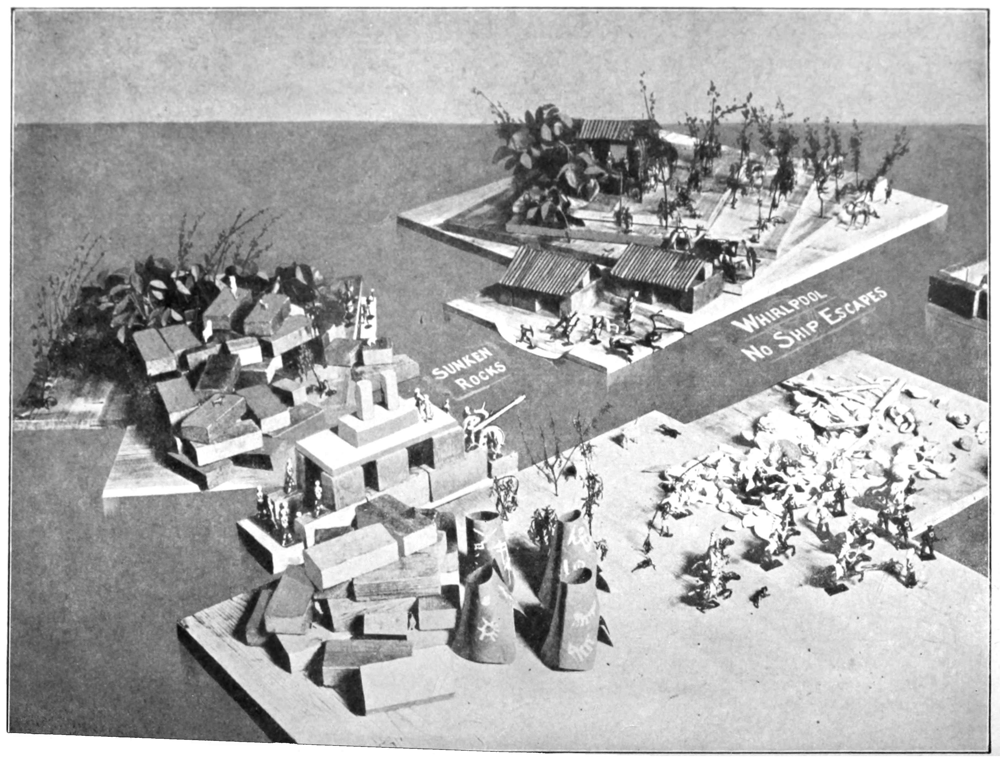

[图中文字：SUNKEN／ROCKS；WHIRLPOOL／NO SHIP ESCAPES]

<!-- translation -->
[图内译释：水下礁石；漩涡／船只无一能脱逃]

<!-- endpair -->

<!-- pair:en:FX00003:frontmatter -->
FLOOR GAMES

<!-- translation -->
地板游戏

<!-- endpair -->

<!-- pair:en:FX00004:frontmatter -->
BY

<!-- translation -->
著者

<!-- endpair -->

<!-- pair:en:FX00005:frontmatter -->
H. G. WELLS

<!-- translation -->
H. G. 威尔斯

<!-- endpair -->

<!-- pair:en:FX00006:frontmatter -->
AUTHOR OF "TONO-BUNGAY," "THE NEW MACHIAVELLI," ETC., ETC.

<!-- translation -->
《Tono-Bungay》《新马基雅维利》等书的作者

<!-- endpair -->

<!-- pair:en:FX00007:frontmatter -->
With Photographs by the Author and Marginal Drawings by J. R. Sinclair

<!-- translation -->
照片由作者拍摄，页边插画由J. R. Sinclair绘制

<!-- endpair -->

<!-- pair:en:FX00008:source_figure -->
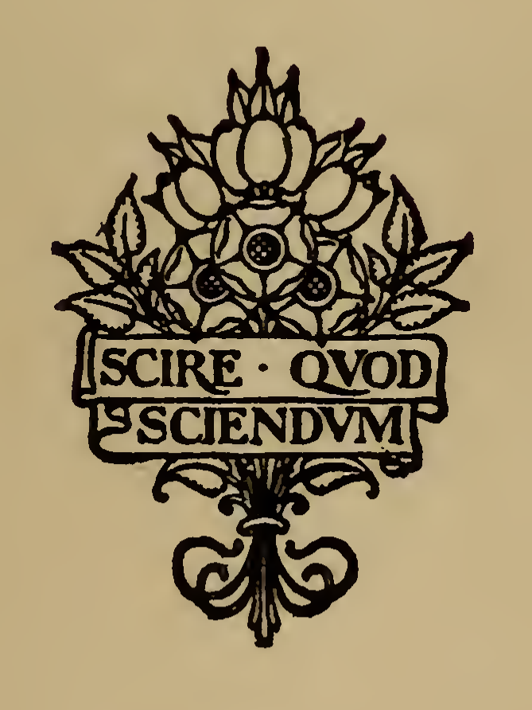

[图中文字：SCIRE · QVOD／SCIENDVM]

<!-- translation -->
[图内译释：知所当知（拉丁文格言；按原图V字形转录）]

<!-- endpair -->

<!-- pair:en:FX00009:frontmatter -->
BOSTON SMALL, MAYNARD AND COMPANY PUBLISHERS

<!-- translation -->
波士顿
Small, Maynard and Company
出版

<!-- endpair -->

<!-- pair:en:FX00010:frontmatter -->
Copyright, 1912 By Small, Maynard and Company (incorporated)

<!-- translation -->
1912年版权归Small, Maynard and Company（注册公司）所有

<!-- endpair -->

<!-- pair:en:FX00011:frontmatter -->
THE UNIVERSITY PRESS, CAMBRIDGE, U.S.A.

<!-- translation -->
University Press印刷所，美国剑桥

<!-- endpair -->

### 原书目录

<!-- pair:en:FX00012:frontmatter -->
CONTENTS

<!-- translation -->
目录

<!-- endpair -->

<!-- pair:en:FX00013:toc -->
Section　Page

I The Toys to Have 9

II The Game Of the Wonderful Islands 33

III Of the Building of Cities 51

IV Funiculars, Marble Towers, Castles and War Games, but Very Little of War Games 85

<!-- translation -->
节　页码

I　应备的玩具　9

II　奇妙群岛的游戏　33

III　论城市的建造　51

IV　缆索铁路、弹珠塔、城堡与战争游戏，不过战争游戏只谈一点点　85

<!-- endpair -->

<!-- pair:en:FX00014:source_figure -->
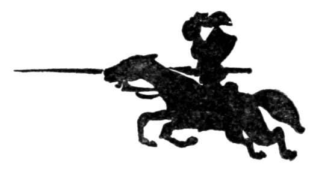

<!-- translation -->

<!-- endpair -->

### 插图目录

<!-- pair:en:FX00015:frontmatter -->
ILLUSTRATIONS

<!-- translation -->
插图

<!-- endpair -->

<!-- pair:en:FX00016:illustration_index -->
FACING PAGE

A general view of the Wonderful Islands, showing Captain F. R. W.'s ship at anchor. Frontispiece

A view showing the Island of the Temple and the invasion of the Indian territory by Captain G. P. W. 18

A close view of the temple, whose portals are guarded by grotesque plasticine monsters 30

A view showing the raid of the Negroid savages upon the white settlers of Pear Tree Island 40

A general view of Chamois City, showing the Cherry Tree Inn and the shopping quarter 50

The railway station at Blue End 62

The terraced hill on which stands the Town Hall. Behind can be seen the Zoological Gardens. 72

The School of Musketry. On the terrace the Town Guard parades in honor of the two mayors 84

<!-- translation -->
所对页码

奇妙群岛全景，F. R. W.船长的船正在停泊。　卷首插图

神庙岛一景，以及G. P. W.船长对印第安人领地的入侵。　18

神庙近景，门户由形状怪诞的橡皮泥怪兽把守。　30

黑种野蛮人袭击梨树岛白人移民的一景。　40

岩羚城全景，图中可见樱桃树旅店和商业区。　50

蓝端的火车站。　62

市政厅所在的梯状山丘，后方可见动物园。　72

射击学校。平台上，城市卫队正列队向两位市长致敬。　84

<!-- endpair -->

## 第一节　应备的玩具

<!-- pair:en:FX00017:half_title -->
Section I

<!-- translation -->
第一节

<!-- endpair -->

<!-- pair:en:FX00018:half_title -->
THE TOYS TO HAVE

<!-- translation -->
应备的玩具

<!-- endpair -->

<!-- pair:en:FX00019:source_figure -->
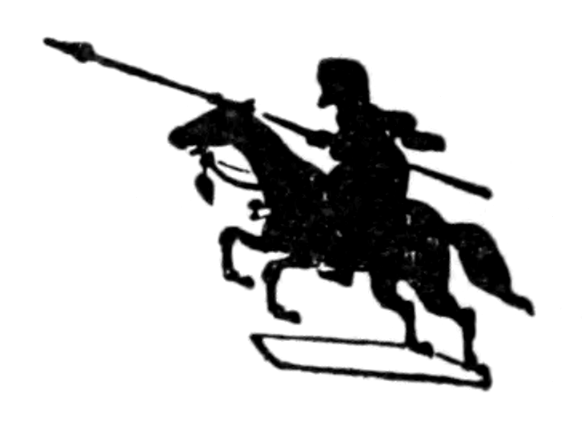

<!-- translation -->

<!-- endpair -->

<!-- pair:en:FX00020:chapter -->
[turn to page 9] THE TOYS TO HAVE

<!-- translation -->
[turn to page 9] 应备的玩具

<!-- endpair -->

<!-- pair:en:FX00021:source_figure -->
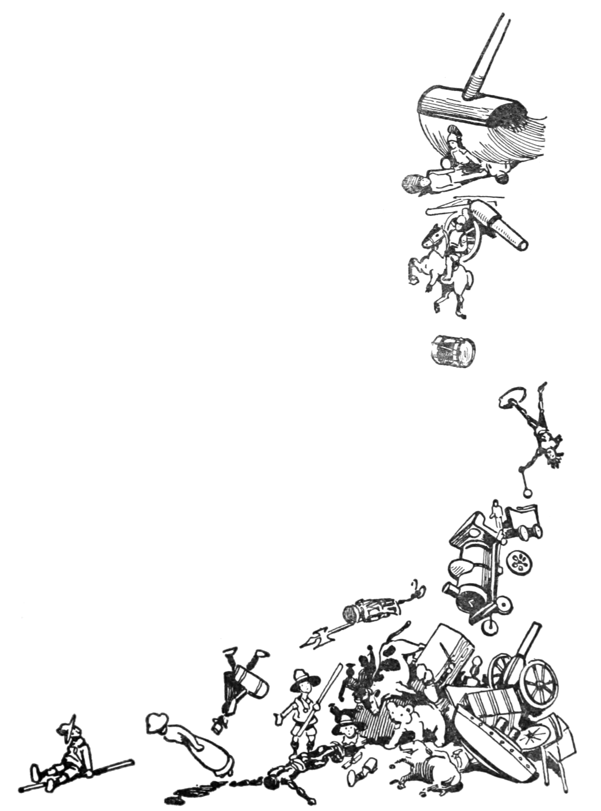

<!-- translation -->

<!-- endpair -->

<!-- pair:en:FX00022:paragraph -->
The jolliest indoor games for boys and girls demand a floor, and the home that has no floor upon which games may be played falls so far short of happiness. It must be a floor covered with linoleum or cork carpet, so that toy soldiers and such-like will stand up upon it, and of a color and surface that will take and show chalk marks; the common green-colored cork carpet without a [turn to page 10]pattern is the best of all. It must be no highway to other rooms, and well lit and airy. Occasionally, alas! it must be scrubbed—and then a truce to Floor Games. Upon such a floor may be made an infinitude of imaginative games, not only keeping boys and girls happy for days together, but building up a framework of spacious and inspiring ideas in them for after life. The men of to-morrow will gain new strength from nursery floors. I am going to tell of some of these games and what is most [turn to page 11]needed to play them; I have tried them all and a score of others like them with my sons, and all of the games here illustrated have been set out by us. I am going to tell of them here because I think what we have done will interest other fathers and mothers, and perhaps be of use to them (and to uncles and such-like tributary subspecies of humanity) in buying presents for their own and other people's children.

<!-- translation -->
男孩女孩们玩得最开心的室内游戏，都少不了一块地板；家里若没有可供游戏的地板，幸福也就大打折扣。这块地板须铺上油毡或软木地毯，让玩具兵之类的东西站得稳；它的颜色和表面，还得容得下粉笔的印迹，并使它们显现出来。最普通的绿色软木地毯，不带[turn to page 10]任何花纹，就是最好的选择。这里不能是通往其他房间的必经之路，还要光线充足、空气流通。唉，偶尔它总得擦洗一下——地板游戏便只好暂时停战。在这样的地板上，可以开展无穷无尽的想象游戏；它们不但让男孩女孩们一连几天快快乐乐，还为他们日后的生活搭起一个宽广而富于启发的观念框架。明日的人们，将从儿童房的地板上获得新的力量。我准备讲讲其中的一些游戏，以及玩这些游戏时最[turn to page 11]需要的东西。我和儿子们试过这里的每一种游戏，还试过二十来种同类游戏；本书图示的各个场景，也都由我们亲手布置。我之所以要在这里讲述，是因为我觉得，我们做过的事情会使别的父母感兴趣；当他们为自己的孩子或别人的孩子买礼物时，或许也能派上用场——对叔叔舅舅这类人类的附属亚种，也一样。

<!-- endpair -->

<!-- pair:en:FX00023:source_figure -->
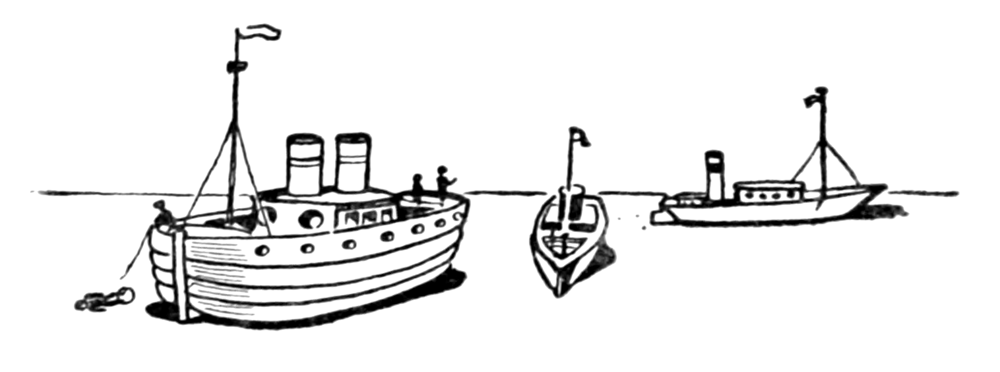

<!-- translation -->

<!-- endpair -->

<!-- pair:en:FX00024:source_figure -->
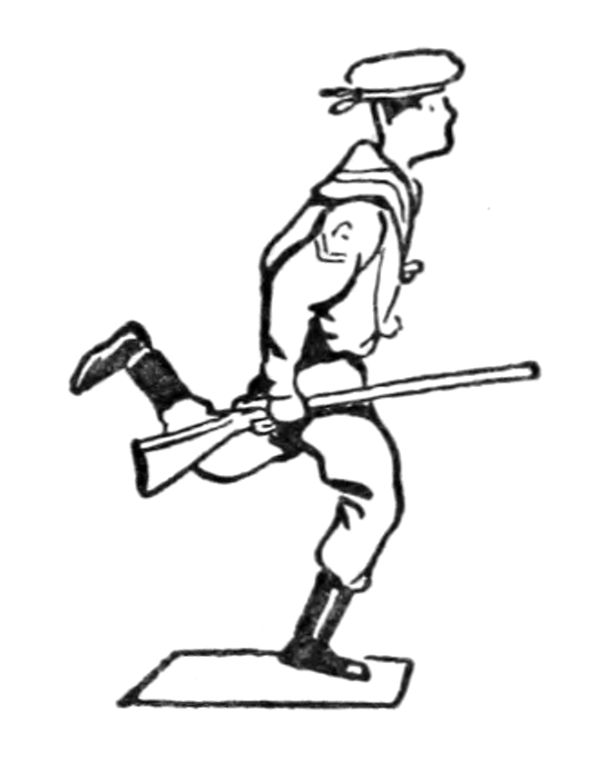

<!-- translation -->

<!-- endpair -->

<!-- pair:en:FX00026:source_figure -->
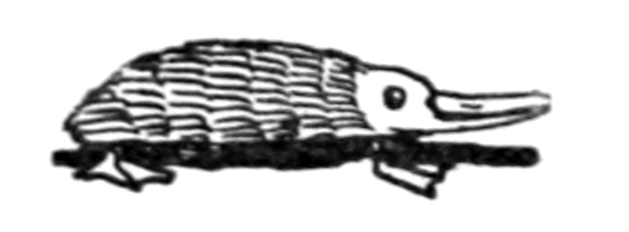

<!-- translation -->

<!-- endpair -->

<!-- pair:en:FX00027:paragraph -->
Now, the toys we play with time after time, and in a thousand permutations and combi[turn to page 12]nations, belong to four main groups. We have (1) Soldiers, and with these I class sailors, railway porters, civilians, and the lower animals generally, such as I will presently describe in greater detail; (2) Bricks; (3) Boards and Planks; and (4) a lot of Clockwork Railway Rolling-Stock and Rails. Also there are certain minor objects—tin ships, Easter eggs, and the like—of which I shall make incidental mention, that like the kiwi and the duck-billed platypus refuse to be classified.

<!-- translation -->
说起来，那些让我们一玩再玩、做出上千种排列组[turn to page 12]合的玩具，可以分成四大类。我们有：（1）玩具兵；水兵、铁路搬运工、平民，以及通常所谓的低等动物，我也都归在这一类，稍后还要说得更细些；（2）积木；（3）木板和木条；（4）一大批发条铁路的车辆和轨道。此外还有若干小东西，譬如铁皮船、复活节彩蛋之类，我会顺便提到。它们就像几维鸟和鸭嘴兽，偏偏不肯归入任何一类。

<!-- endpair -->

<!-- pair:en:FX00028:source_figure -->
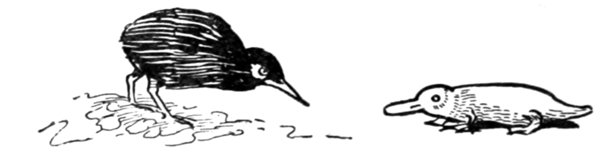

<!-- translation -->

<!-- endpair -->

<!-- pair:en:FX00029:source_figure -->
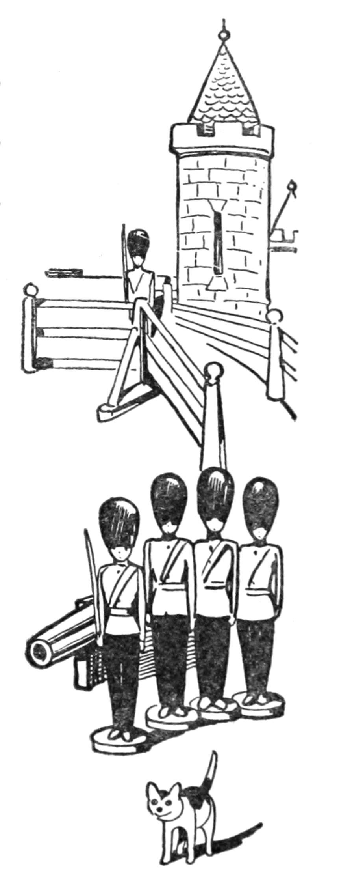

<!-- translation -->

<!-- endpair -->

<!-- pair:en:FX00030:paragraph -->
[turn to page 13] These we arrange and rearrange in various ways upon our floor, making a world of them. In doing so we have found out all sorts of pleasant facts, and also many undesirable possibilities; and very probably our experience will help a reader here and there to the former and save him from the latter.

<!-- translation -->
[turn to page 13]我们在地板上用种种办法把它们摆了又摆，组成一个世界。这样做，让我们发现了各式各样令人愉快的事情，也发现了不少不大可取的可能性。我们的经验，很可能帮助这里的一些读者享受到前者，同时免去后者的麻烦。

<!-- endpair -->

<!-- pair:en:FX00031:paragraph -->
For instance, our planks and boards, and what one can do with them, have been a great discovery. Lots of boys and girls seem to be quite without planks and boards at all, and there is no regular trade in [turn to page 14]them. The toyshops, we found, did not keep anything of the kind we wanted, and our boards, which we had to get made by a carpenter, are the basis of half the games we play. The planks and boards we have are of various sizes. We began with three of two yards by one; they were made with cross pieces like small doors; but these we found unnecessarily large, and we would not get them now after our present experience. The best thickness, we think, is an inch for the larger sizes and three-quarters [turn to page 15] and a half inch for the smaller; and the best sizes are a yard square, thirty inches square, two feet, and eighteen inches square—one or two of each, and a greater number of smaller ones, 18 × 9, 9 × 9, and 9 × 4½. With the larger ones we make islands and archipelagos on our floor while the floor is a sea, or we make a large island or a couple on the Venice pattern, or we pile the smaller on the larger to make hills when the floor is a level plain, or they roof in railway stations or serve as bridges, in such manner as I will [turn to page 16]presently illustrate. And these boards of ours pass into our next most important possession, which is our box of bricks.

<!-- translation -->
比如说，我们的木条和木板，以及用它们能够做的事情，就是一项大发现。许多男孩女孩似乎根本没有木条和木板，也似乎没有专门经营[turn to page 14]它们的生意。我们发现，玩具店里没有我们想要的这类东西。那些不得不请木匠专门做的木板，却成了我们一半游戏的根基。我们的木条和木板有各种尺寸。最初买了三块，长两码、宽一码，装着横档，活像几扇小门；后来却发现，它们大得没有必要。有了如今的经验，我们不会再买那样的板子了。我们觉得，较大的板子以一英寸厚为最好，较小的则用四分之三英寸[turn to page 15]和半英寸两种厚度；大小则以一码见方、三十英寸见方、两英尺见方和十八英寸见方为好——每种一两块，另备更多小块，尺寸为18×9、9×9、9×4½英寸。地板当海时，我们就用大木板做出岛屿和群岛；也可以照威尼斯的样子，做成一座大岛或相连的两座岛。地板当平原时，就把小板叠在大板上，造出山丘。它们还可以给火车站做屋顶，或者搭成桥梁；这些用法，我[turn to page 16]马上会配图说明。谈完木板，自然就接到我们下一件最重要的家当：一箱积木。

<!-- endpair -->

<!-- pair:en:FX00032:source_figure -->
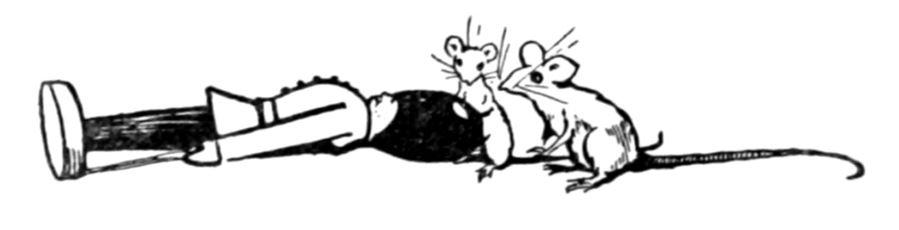

<!-- translation -->

<!-- endpair -->

<!-- pair:en:FX00033:source_figure -->
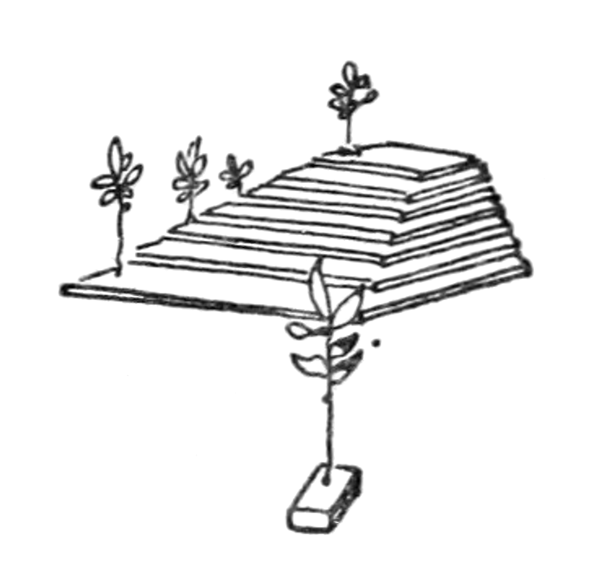

<!-- translation -->

<!-- endpair -->

<!-- pair:en:FX00035:source_figure -->
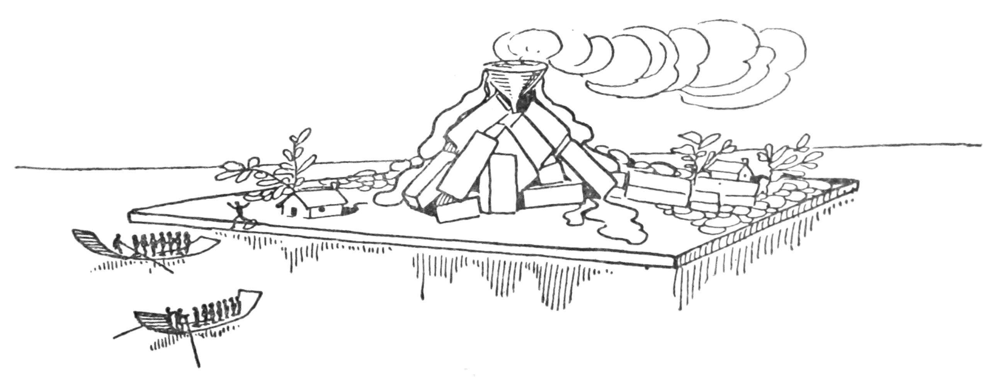

<!-- translation -->

<!-- endpair -->

<!-- pair:en:FX00037:paragraph -->
(But I was nearly forgetting to tell this, that all the thicker and larger of these boards have holes bored through them. At about every four inches is a hole, a little larger than an ordinary gimlet hole. These holes have their uses, as I will tell later, but now let me get on to the box of bricks.)

<!-- translation -->
（不过我差点忘记说，所有较厚、较大的木板上都钻了孔。大约每隔四英寸便有一孔，比普通手钻钻出的孔稍大些。这些孔自有用途，稍后我会讲到；眼下还是先接着说那箱积木。）

<!-- endpair -->

<!-- pair:en:FX00038:paragraph -->
This, again, wasn't a toyshop acquisition. It came to us by gift from two generous [turn to page 17]friends, unhappily growing up and very tall at that; and they had it from parents who were one of several families who shared in the benefit of a Good Uncle. I know nothing certainly of this man except that he was a Radford of Plymouth. I have never learned nor cared to learn of his commoner occupations, but certainly he was one of those shining and distinguished uncles that tower up at times above the common levels of humanity. At times, when we consider our derived and undeserved share of his in[turn to page 18]heritance and count the joys it gives us, we have projected half in jest and half in earnest the putting together of a little exemplary book upon the subject of such exceptional men: Celebrated Uncles, it should be called; and it should stir up all who read it to some striving at least towards the glories of the avuncular crown. What this great benefactor did was to engage a deserving unemployed carpenter through an entire winter making big boxes of wooden bricks for the almost innumerable nephews and nieces with [turn to page 19]which an appreciative circle of brothers and sisters had blessed him. There are whole bricks 4½ inches × 2¼ × 1⅛; there are half bricks 2¼ × 2¼ × 1⅛; and there are quarters—called by those previous owners (who have now ascended to, we hope but scarcely believe, a happier life near the ceiling) "piggys." You note how these sizes fit into the sizes of our boards, and of each size—we have never counted them, but we must have hundreds. We can pave a dozen square yards of floor with them.

<!-- translation -->
这同样不是从玩具店买来的。它是两位慷慨的[turn to page 17]朋友送给我们的；可惜他们已长大，个子还长得很高。他们又是从父母那里得到的，而他们父母的一家，则是蒙一位“好叔叔”施惠的几个家庭之一。关于这位先生，我只确知他是普利茅斯Radford家族的一员。我从未打听、也不在意他平日里做些什么；但他无疑属于那种光彩夺目、卓尔不群的叔叔——这样的人，偶尔会在人类的平常水准之上高高耸起。有时，我们想到辗转继承来、本不配享有的这份遗[turn to page 18]产，细数它带给我们的欢乐，便半开玩笑、半当真地筹划，要为这些非凡人物编一本可作榜样的小书，题名就叫《著名的叔叔们》。它该使每一个读到它的人，至少也努力向那顶叔辈桂冠的荣光靠近一些。这位大恩人做过的事，是雇用一名值得帮助的失业木匠，让他用整整一个冬天，为几乎数不清的侄儿侄女制作一大箱一大箱的木积木；这些孩子，正是他那一圈心怀感激的兄弟姐妹[turn to page 19]赐给他的。整块积木的尺寸是4½×2¼×1⅛英寸；半块是2¼×2¼×1⅛英寸；还有四分之一块。先前的主人把后者叫做“小猪”——那些主人如今已经长到更靠近天花板的地方，过起一种但愿更幸福的生活，虽然我们希望如此，却很难真心相信。你会发现，这些尺寸恰好与我们木板的尺寸相配。每一种我们都有好几百块吧，虽然从未真正数过。它们足以在地板上铺满十二平方码。

<!-- endpair -->

<!-- pair:en:FX00039:source_figure -->
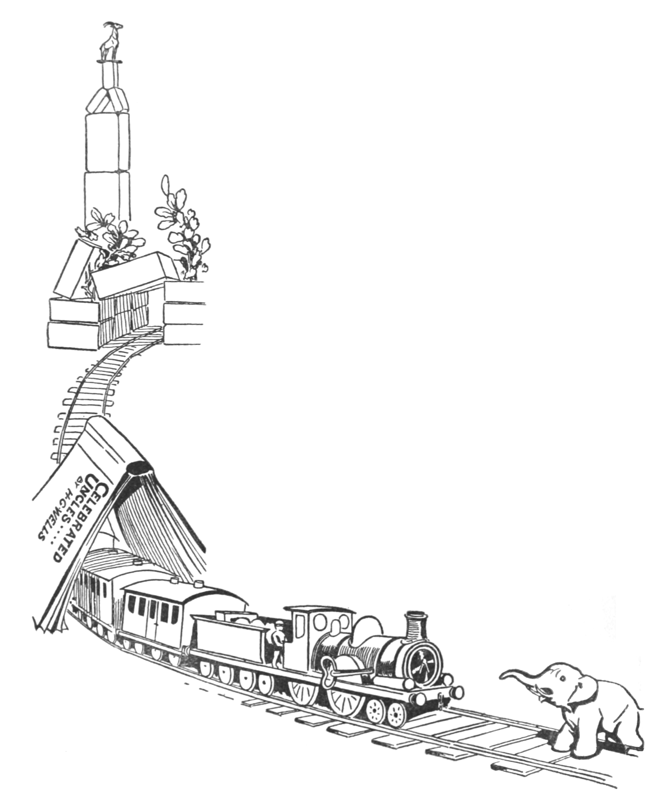

[图中文字：CELEBRATED／UNCLES · · ·／BY H. G. WELLS]

<!-- translation -->
[图内译释：《著名的叔叔们》／H. G. 威尔斯著]

<!-- endpair -->

<!-- pair:en:FX00041:source_figure -->
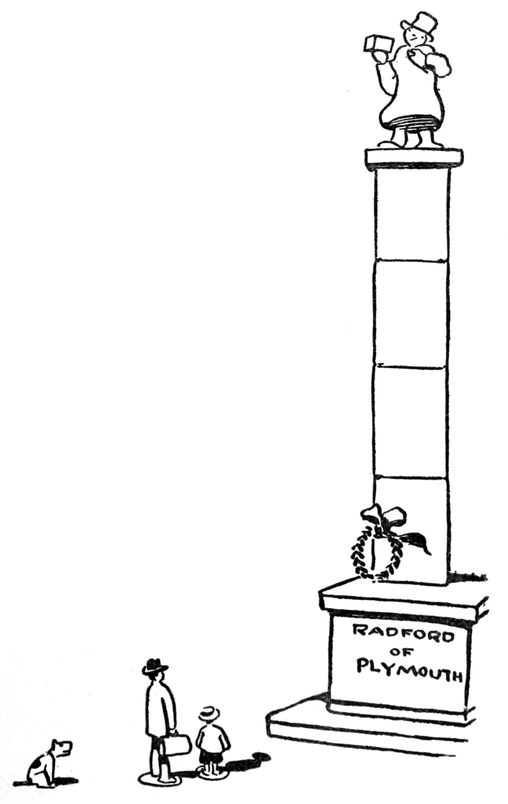

[图中文字：RADFORD／OF／PLYMOUTH]

<!-- translation -->
[图内译释：普利茅斯的Radford]

<!-- endpair -->

<!-- pair:en:FX00043:source_figure -->
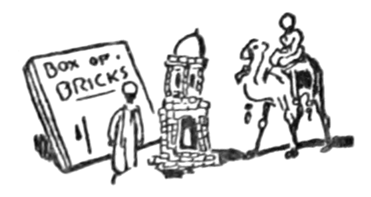

[图中文字：BOX OF／BRICKS；1/]

<!-- translation -->
[图内译释：一盒积木；一先令价码（按可见字形照录）]

<!-- endpair -->

<!-- pair:en:FX00044:source_figure -->
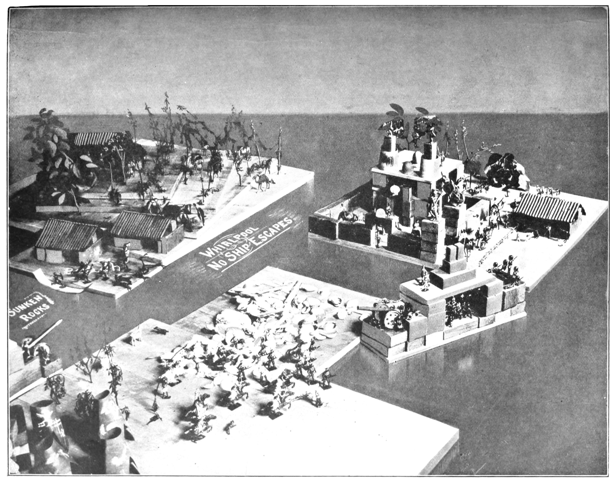

[图中文字：SUNKEN／ROCKS；WHIRLPOOL／NO SHIP ESCAPES]

<!-- translation -->
[图内译释：水下礁石；漩涡／船只无一能脱逃]

<!-- endpair -->

<!-- pair:en:FX00045:caption -->
A view showing the Island of the Temple and the invasion of the Indian territory by Captain G. P. W.

<!-- translation -->
神庙岛一景，以及G. P. W.船长对印第安人领地的入侵。

<!-- endpair -->

<!-- pair:en:FX00047:source_figure -->
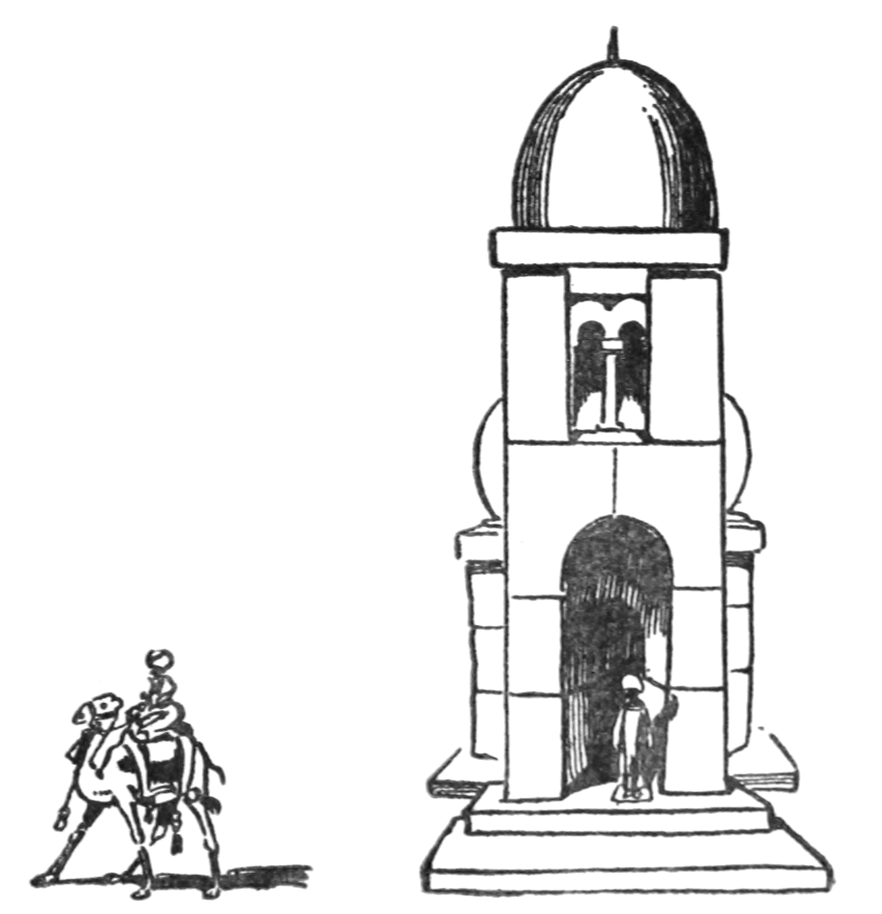

<!-- translation -->

<!-- endpair -->

<!-- pair:en:FX00048:source_figure -->
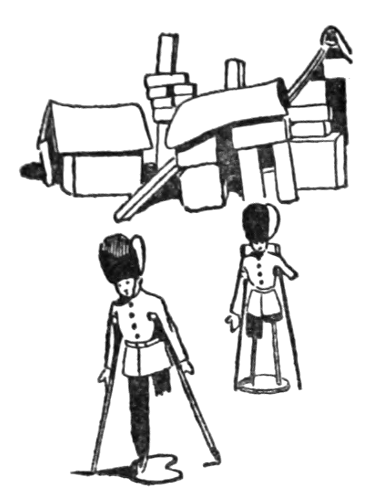

<!-- translation -->

<!-- endpair -->

<!-- pair:en:FX00049:paragraph -->
[turn to page 20] How utterly we despise the silly little bricks of the toy-shops! They are too small to make a decent home for even the poorest lead soldiers, even if there were hundreds of them, and there are never enough, never nearly enough; even if you take one at a time and lay it down and say, "This is a house," even then there are not enough. We see rich people, rich people out of motor cars, rich people beyond the dreams of avarice, going into toyshops and buying these skimpy, sickly, ridiculous pseudo-boxes [turn to page 21]of bricklets, because they do not know what to ask for, and the toyshops are just the merciless mercenary enemies of youth and happiness—so far, that is, as bricks are concerned. Their unfortunate under-parented offspring mess about with these gifts, and don't make very much of them, and put them away; and you see their consequences in after life in the weakly-conceived villas and silly suburbs that people have built all round big cities. Such poor under-nourished nurseries must needs [turn to page 22] fall back upon the Encyclopædia Britannica, and even that is becoming flexible on India paper! But our box of bricks almost satisfies. With our box of bricks we can scheme and build, all three of us, for the best part of the hour, and still have more bricks in the box.

<!-- translation -->
[turn to page 20]我们多么看不起玩具店里那些愚蠢的小积木！它们太小，就算有好几百块，也不足以给最穷的铅制玩具兵盖一所像样的房子。何况数量从来不够，远远不够；即便你一次拿一块放下，说“这算是一所房子”，它们也还是不够。我们看见有钱人，从汽车里走下来的有钱人，富得连贪心鬼都做梦也想不到的有钱人，走进玩具店，买下那些少得可怜、病恹恹、可笑得简直配不上积木箱之名的小木块盒子[turn to page 21]，只因为他们不知道该要什么。至于玩具店，就积木而言，实在是青春和幸福那毫不留情、唯利是图的敌人。他们那些可怜的、没得到父母得当照顾的孩子，拿着礼物胡乱摆弄一番，没弄出什么名堂，便收了起来。你会在日后的生活中看到这种后果：大城市四周，那些构想软弱的别墅和傻乎乎的郊区，就是人们这样造出来的。如此可怜、养料不足的儿童房，不免只好[turn to page 22]求助于《大英百科全书》；可是连它如今也用印度纸印得软绵绵了！不过，我们这箱积木已差不多令人满意。我们三个人可以一起设计、搭建上大半个钟头，箱子里还留着更多积木。

<!-- endpair -->

<!-- pair:en:FX00050:source_figure -->
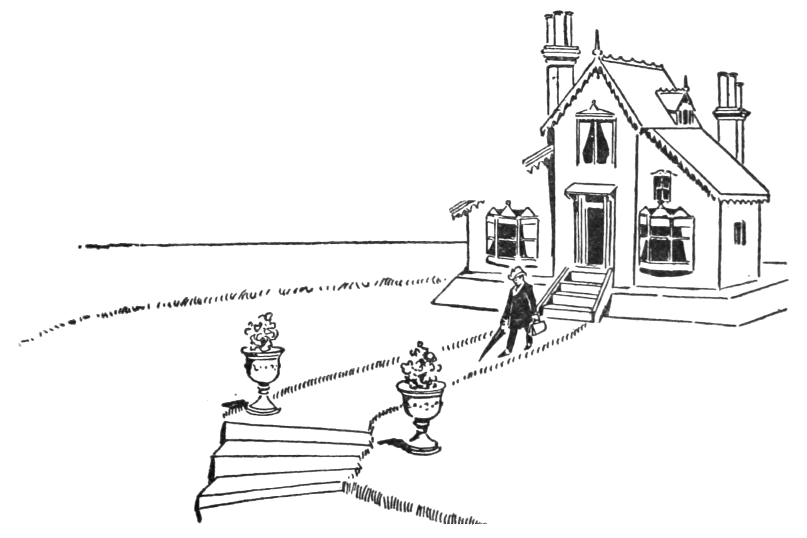

<!-- translation -->

<!-- endpair -->

<!-- pair:en:FX00051:source_figure -->
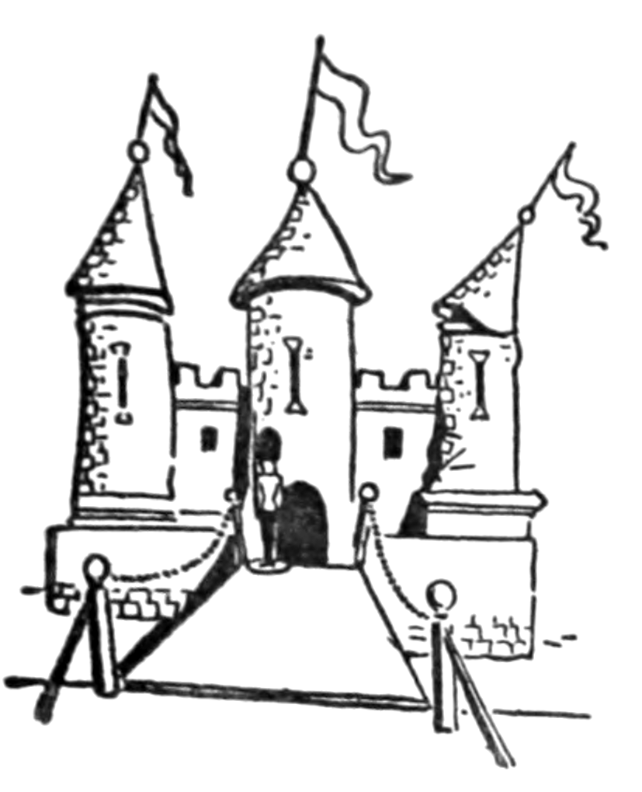

<!-- translation -->

<!-- endpair -->

<!-- pair:en:FX00053:paragraph -->
So much now for the bricks. I will tell later how we use cartridge paper and cardboard and other things to help in our building, and of the decorative use we make of plasticine. Of course, it goes without say[turn to page 23]ing that we despise those foolish, expensive, made-up wooden and pasteboard castles that are sold in shops—playing with them is like playing with somebody else's dead game in a state of rigor mortis. Let me now say a little about toy soldiers and the world to which they belong. Toy soldiers used to be flat, small creatures in my own boyhood, in comparison with the magnificent beings one can buy to-day. There has been an enormous improvement in our national physique in this respect. Now [turn to page 24] they stand nearly two inches high and look you broadly in the face, and they have the movable arms and alert intelligence of scientifically exercised men. You get five of them mounted or nine afoot in a box for a small price. We three like those of British manufacture best; other makes are of incompatible sizes, and we have a rule that saves much trouble, that all red coats belong to G. P. W., and all other colored coats to F. R. W., all gifts, bequests, and accidents notwithstanding. Also we have sailors; [turn to page 25]but, since there are no red-coated sailors, blue counts as red.

<!-- translation -->
积木先说到这里。稍后我会讲，我们怎样用厚绘图纸、纸板和其他东西辅助搭建，又怎样发挥橡皮泥的装饰作用。不言[turn to page 23]而喻，我们也瞧不起商店里出售的那些愚蠢、昂贵、事先搭好的木头或硬纸板城堡——玩那些东西，就像在玩别人已经死去、陷入尸僵的游戏。现在，再说说玩具兵和它们所属的世界吧。与今天可以买到的那些气派家伙相比，我小时候的玩具兵又扁又小。从这个角度看，我们国民的体格实在有了巨大的进步。如今[turn to page 24]它们高近两英寸，大大方方地正视着你；手臂可以活动，神气机敏，就像受过科学锻炼的人。一盒五个骑兵或九个步兵，花不多的钱便买得到。我们三个人最喜欢英国制造的；别处制造的尺寸不相配。我们还有一条省掉许多麻烦的规矩：红制服一概归G. P. W.，其他颜色的制服一概归F. R. W.，不论礼物、遗赠或偶然情况如何，都是如此。我们也有水兵；[turn to page 25]不过水兵没有穿红制服的，所以蓝色就算红色。

<!-- endpair -->

<!-- pair:en:FX00054:source_figure -->
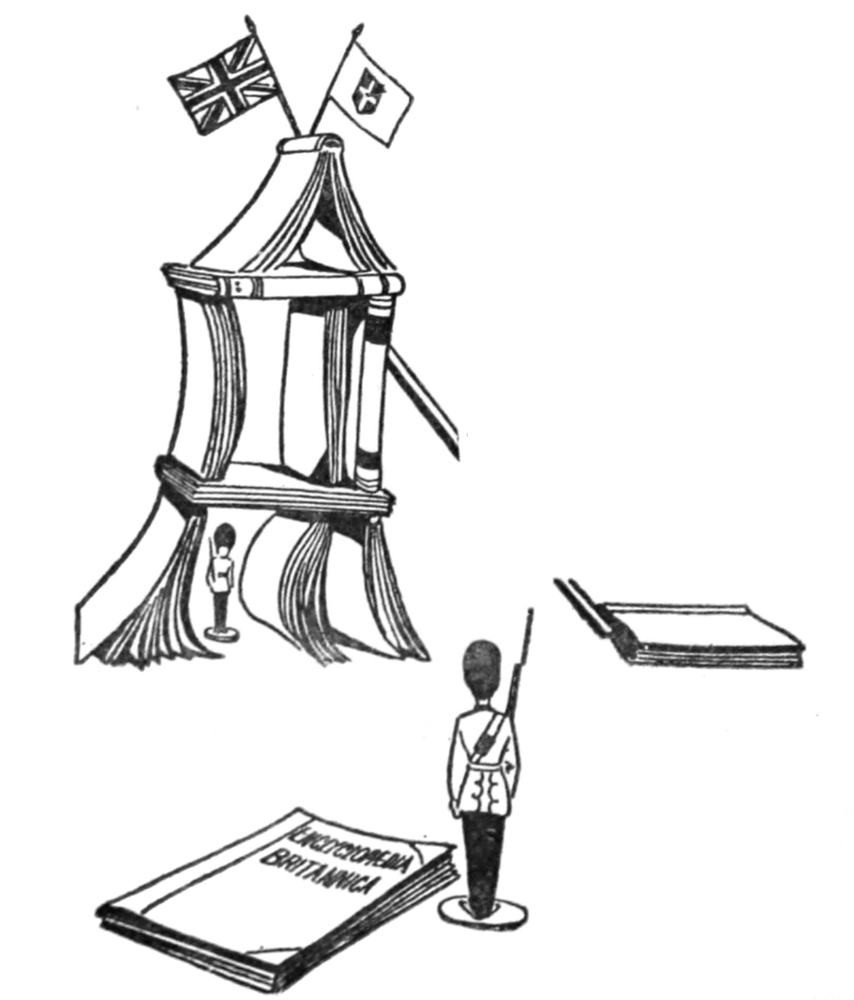

[图中文字：ENCYCLOPÆDIA／BRITANNICA]

<!-- translation -->
[图内译释：《大英百科全书》]

<!-- endpair -->

<!-- pair:en:FX00055:source_figure -->
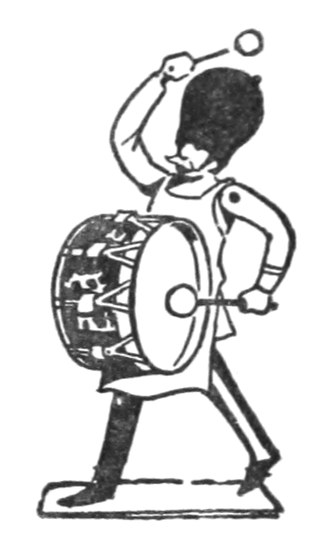

<!-- translation -->

<!-- endpair -->

<!-- pair:en:FX00057:source_figure -->
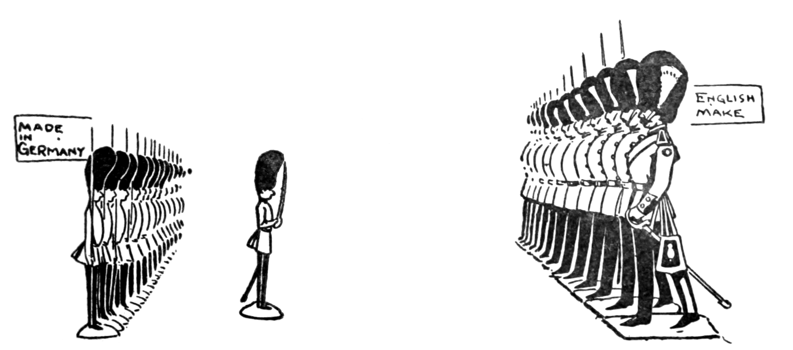

[图中文字：MADE／IN／GERMANY；ENGLISH／MAKE]

<!-- translation -->
[图内译释：德国制造；英国制造]

<!-- endpair -->

<!-- pair:en:FX00058:source_figure -->
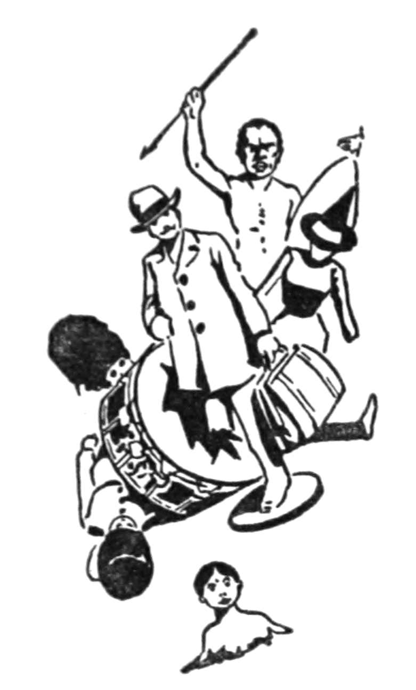

<!-- translation -->

<!-- endpair -->

<!-- pair:en:FX00060:paragraph -->
Then we have "beefeaters," [1 The warders in the Tower of London are called "beefeaters"; the origin of the term is obscure.] Indians, Zulus, for whom there are special rules. We find we can buy lead dogs, cats, lions, tigers, horses, camels, cattle, and elephants of a reasonably corresponding size, and we have also several boxes of railway porters, and some soldiers we bought in Hesse-Darmstadt that we pass off on an unsuspecting home world as policemen. But we want civilians very badly. We found a box of German [turn to page 26] civilians once in a shop, the right size but rather heavy, and running to nearly five cents apiece (which is too dear), gentlemen in tweed suits carrying bags, a top-hatted gentleman, ladies in gray and white, two children, and a dog, and so on, but we have never been able to find any more. They do not seem to be made at all—will toy manufacturers please note? I write now as if I were Consul-General in Toyland, noting new opportunities for trade. Consequent upon this dearth, our little world suffers [turn to page 27]from an exaggerated curse of militarism, and even the grocer wears epaulettes. This might please Lord Roberts and Mr. Leo Maxse, but it certainly does not please us. I wish, indeed, that we could buy boxes of tradesmen: a blue butcher, a white baker with a loaf of standard bread, a merchant or so; boxes of servants, boxes of street traffic, smart sets, and so forth. We could do with a judge and lawyers, or a box of vestrymen. It is true that we can buy Salvation Army lasses and football players, but we are [turn to page 28] cold to both of these. We have, of course, boy scouts. With such boxes of civilians we could have much more fun than with the running, marching, swashbuckling soldiery that pervades us. They drive us to reviews; and it is only emperors, kings, and very silly small boys who can take an undying interest in uniforms and reviews.

<!-- translation -->
此外，我们还有“食牛肉者”[1 伦敦塔的守卫被称为“食牛肉者”；这一称呼的由来不明。]、印第安人和祖鲁人，它们另有特别的规则。我们发现，铅制的狗、猫、狮子、老虎、马、骆驼、牛和大象，也可以买到大小大致相称的。我们还有几盒铁路搬运工，以及在黑森-达姆施塔特买的一些玩具兵；在家里这个毫无戒心的世界中，我们就把后者冒充警察。不过，我们极缺平民。有一次，我们在一家商店里找到过一盒德国[turn to page 26]平民，大小合适，只是略重，每个又要将近五美分，太贵了。有穿粗花呢衣服、提着包的先生，戴高顶礼帽的先生，穿灰衣服或白衣服的女士，两个孩子，一条狗，等等；可我们再也没找到过更多。它们似乎压根就没人生产——请玩具制造商们留意一下，好吗？我现在写着写着，仿佛成了玩具国的总领事，正在记录新的贸易机会。由于这种匮乏，我们的小世界蒙受着[turn to page 27]一种过分严重的军国主义诅咒，连杂货商都戴着肩章。罗伯茨勋爵和Leo Maxse先生也许会喜欢这一点，可我们实在不喜欢。我真希望能买到一盒盒手艺人和店主：穿蓝衣的肉贩，穿白衣、拿着一条标准面包的面包师，再有一两个商人；还有一盒盒仆人、一盒盒街头行人车辆、时髦人士，等等。来一位法官和一些律师，或者一盒教区理事，我们也用得上。确实，救世军的姑娘和足球运动员是买得到的，可我们[turn to page 28]对这两种都不感兴趣。当然，我们也有童子军。如果有这样的一盒盒平民，我们能够得到的乐趣，会比那些到处都是、跑步行军、舞刀弄枪的兵士多得多。它们逼得我们只好举行阅兵；而对制服和阅兵能够永远兴致不减的，也只有皇帝、国王，以及非常愚蠢的小男孩。

<!-- endpair -->

<!-- pair:en:FX00061:source_figure -->
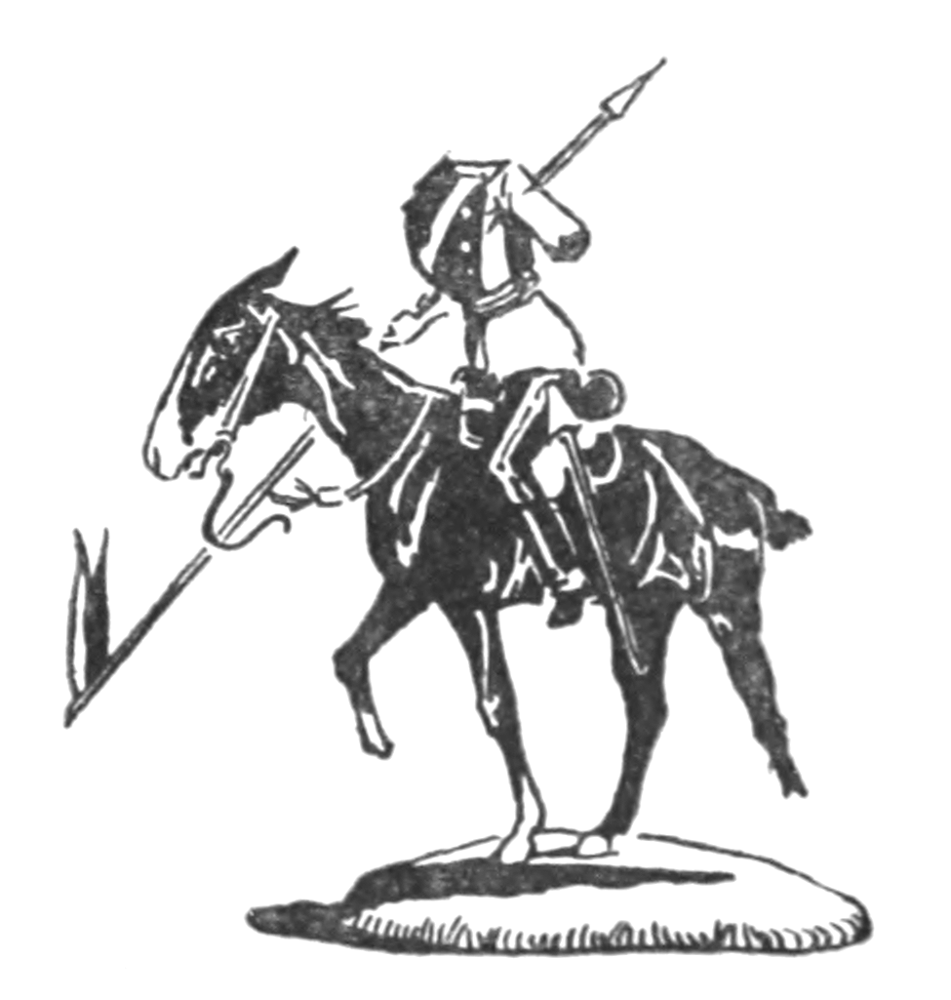

<!-- translation -->

<!-- endpair -->

<!-- pair:en:FX00062:source_figure -->
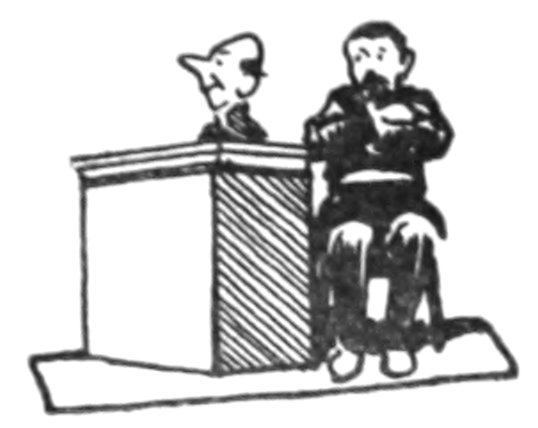

<!-- translation -->

<!-- endpair -->

<!-- pair:en:FX00064:source_figure -->
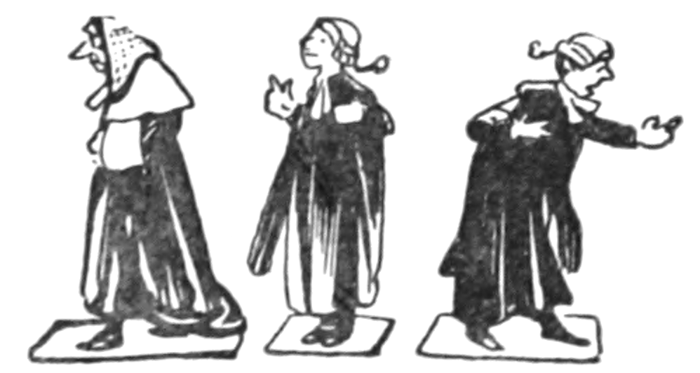

<!-- translation -->

<!-- endpair -->

<!-- pair:en:FX00066:source_figure -->
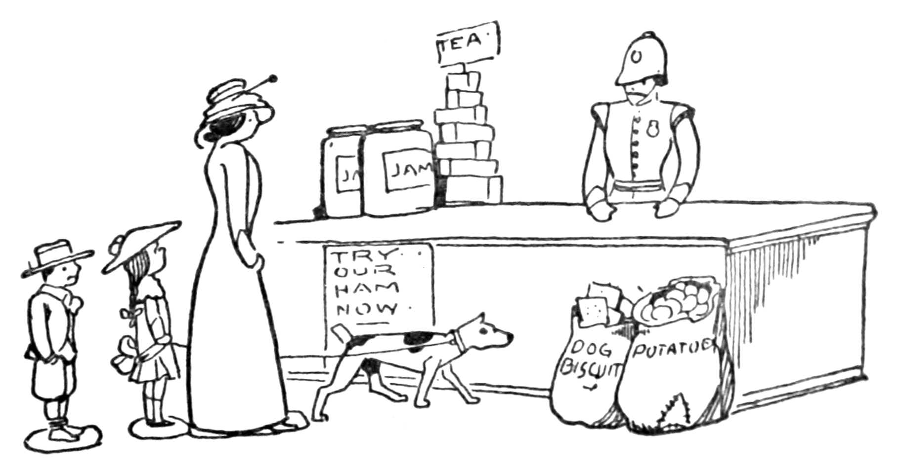

[图中文字：TEA；JAM；JA…；TRY ·／OUR／HAM／NOW ·；DOG／BISCUIT；POTATOE…]

<!-- translation -->
[图内译释：茶；果酱；另一罐标签仅局部可见，不补写遮挡字母；现在尝尝我们的火腿；狗饼干；马铃薯]

<!-- endpair -->

<!-- pair:en:FX00067:source_figure -->
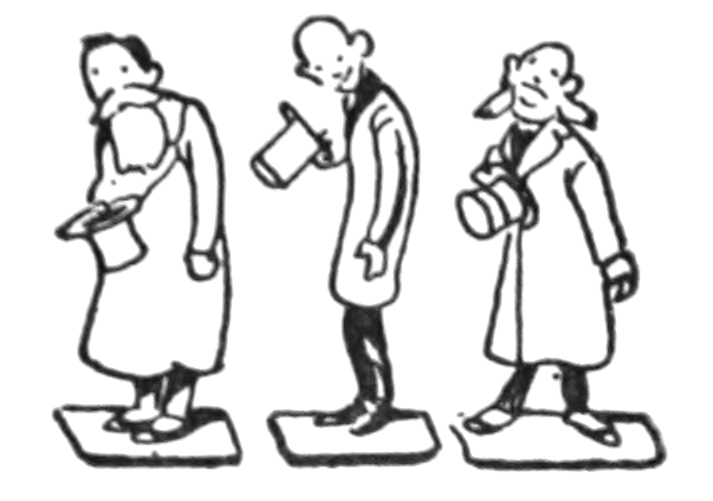

<!-- translation -->

<!-- endpair -->

<!-- pair:en:FX00069:source_figure -->
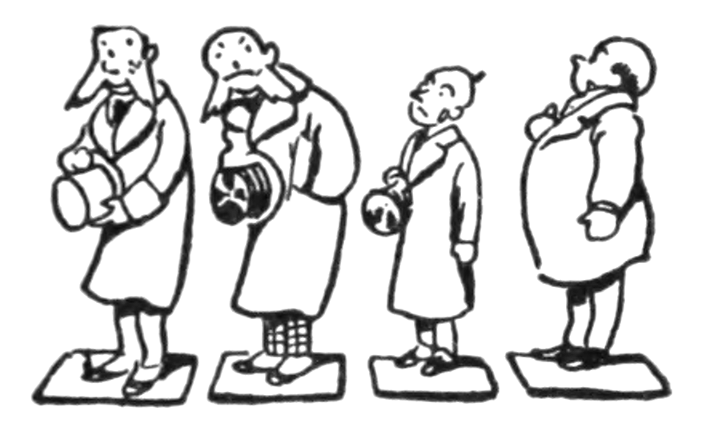

<!-- translation -->

<!-- endpair -->

<!-- pair:en:FX00070:paragraph -->
And lastly, of our railways, let me merely remark here that we have always insisted upon one uniform gauge and everything we buy fits into and [turn to page 29] develops our existing railway system. Nothing is more indicative of the wambling sort of parent and a coterie of witless, worthless uncles than a heap of railway toys of different gauges and natures in the children's playroom.

<!-- translation -->
最后，再说我们的铁路。我在这里只提醒一句：我们始终坚持统一轨距，买来的每一样东西，都要能接入[turn to page 29]我们已有的铁路系统，并使它发展。儿童游戏室里，一堆轨距不同、式样不一的铁路玩具，最能说明父母办事漫无章法，周围还围着一群没头脑、不中用的叔叔舅舅。

<!-- endpair -->

<!-- pair:en:FX00071:source_figure -->
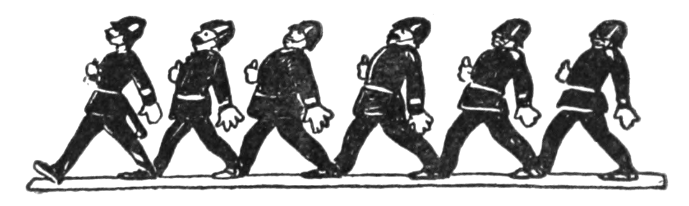

<!-- translation -->

<!-- endpair -->

<!-- pair:en:FX00072:source_figure -->
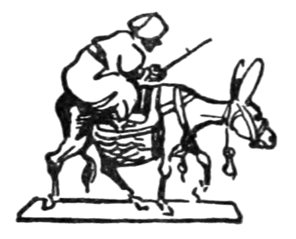

<!-- translation -->

<!-- endpair -->

<!-- pair:en:FX00073:source_figure -->
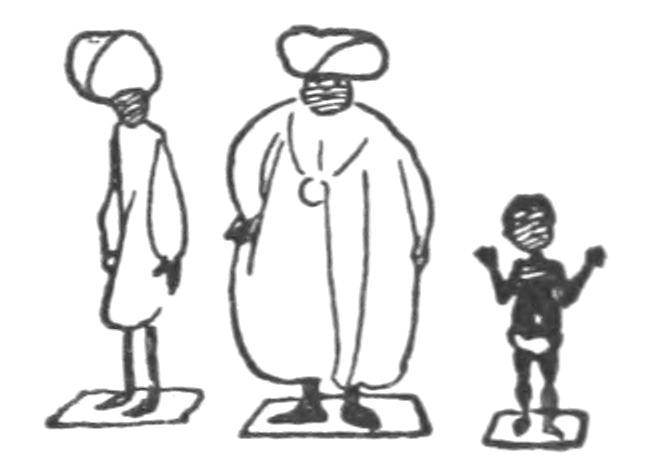

<!-- translation -->

<!-- endpair -->

<!-- pair:en:FX00075:source_figure -->
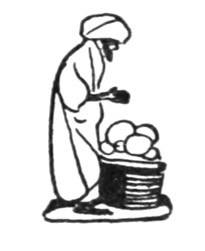

<!-- translation -->

<!-- endpair -->

<!-- pair:en:FX00076:paragraph -->
And so, having told you of the material we have, let me now tell you of one or two games (out of the innumerable many) that we have played. Of course, in this I have to be a little artificial. Actual games of the kind I am illustrating here have been played by us, [turn to page 30]many and many a time, with joy and happy invention and no thought of publication. They have gone now, those games, into that vaguely luminous and iridescent world of memories into which all love-engendering happiness must go. But we have tried our best to set them out again and recall the good points in them here.

<!-- translation -->
既然已经交代了我们手头的材料，现在就讲讲我们玩过的一两个游戏吧——它们只是无数游戏中的几个。当然，在这里，我不得不稍稍作一点人为的安排。本书图示的这类游戏，我们其实已玩过[turn to page 30]许多许多回，充满欢乐和快乐的发明，从未想到要把它们发表出来。如今那些游戏早已过去，进入了朦胧发亮、流光溢彩的记忆世界；一切唤起爱的幸福，终究都要到那里去。不过，我们还是尽力重新摆出它们，在这里追忆其中的妙处。

<!-- endpair -->

<!-- pair:en:FX00077:source_figure -->
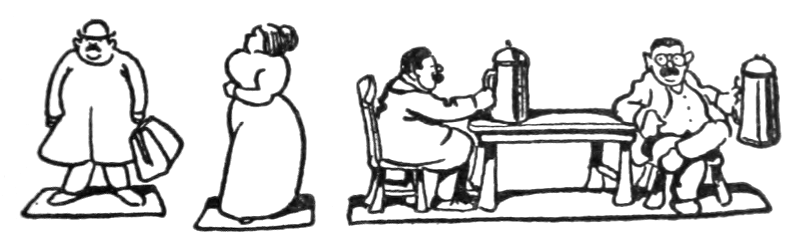

<!-- translation -->

<!-- endpair -->

<!-- pair:en:FX00079:source_figure -->
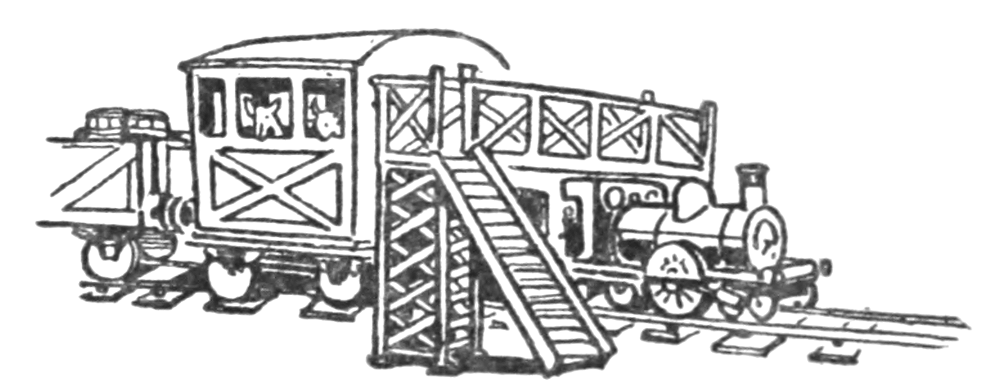

<!-- translation -->

<!-- endpair -->

<!-- pair:en:FX00080:source_figure -->
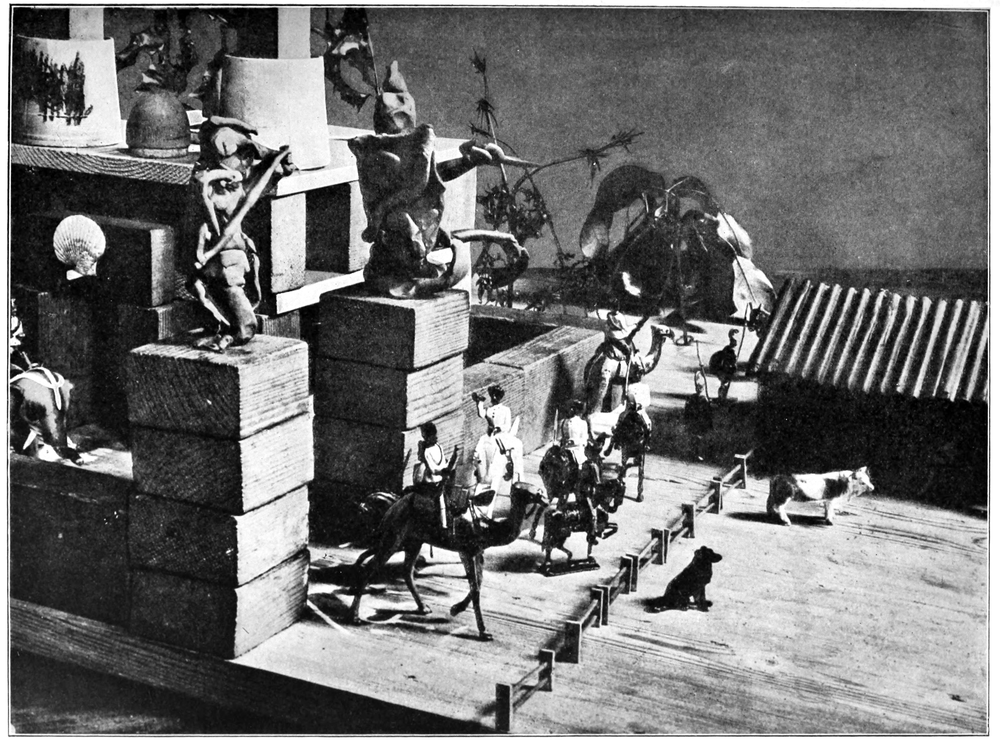

<!-- translation -->

<!-- endpair -->

<!-- pair:en:FX00081:caption -->
A close view of the temple, whose portals are guarded by grotesque plasticine monsters

<!-- translation -->
神庙近景，门户由形状怪诞的橡皮泥怪兽把守。

<!-- endpair -->

## 第二节　奇妙群岛的游戏

<!-- pair:en:FX00083:half_title -->
Section II

<!-- translation -->
第二节

<!-- endpair -->

<!-- pair:en:FX00084:half_title -->
THE GAME OF THE WONDERFUL ISLANDS

<!-- translation -->
奇妙群岛的游戏

<!-- endpair -->

<!-- pair:en:FX00085:source_figure -->
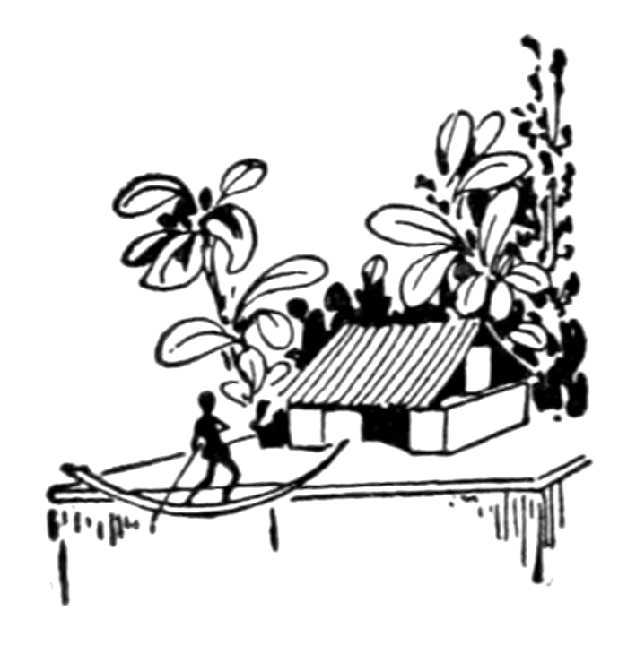

<!-- translation -->

<!-- endpair -->

<!-- pair:en:FX00086:chapter -->
[turn to page 33] THE GAME OF THE WONDERFUL ISLANDS

<!-- translation -->
[turn to page 33] 奇妙群岛的游戏

<!-- endpair -->

<!-- pair:en:FX00087:source_figure -->
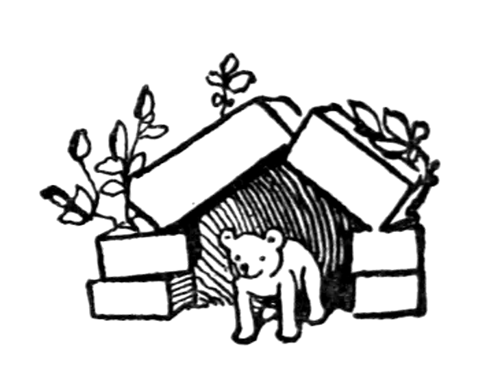

<!-- translation -->

<!-- endpair -->

<!-- pair:en:FX00088:paragraph -->
In this game the floor is the sea. Half—rather the larger half because of some instinctive right of primogeniture—is assigned to the elder of my two sons (he is, as it were, its Olympian), and the other half goes to his brother. We distribute our boards about the sea in an archipelagic manner. We then dress our islands, objecting strongly to too close a scru[turn to page 34]tiny of our proceedings until we have done. Here, in the illustration, is such an archipelago ready for its explorers, or rather on the verge of exploration. There are altogether four islands, two to the reader's right and two to the left, and the nearer ones are the more northerly; it is as many as we could get into the camera. The northern island to the right is most advanced in civilization, and is chiefly temple. That temple has a flat roof, diversified by domes made of half Easter eggs and card[turn to page 35]board cones. These are surmounted by decorative work of a flamboyant character in plasticine, designed by G. P. W. An oriental population crowds the courtyard and pours out upon the roadway. Note the grotesque plasticine monsters who guard the portals, also by G. P. W., who had a free hand with the architecture of this remarkable specimen of eastern religiosity. They are nothing, you may be sure, to the gigantic idols inside, out of the reach of the sacrilegious camera. To the right is a tropical thatched [turn to page 36]hut. The thatched roof is really that nice ribbed paper that comes round bottles—a priceless boon to these games. All that comes into the house is saved for us. The owner of the hut lounges outside the door. He is a dismounted cavalry-corps man, and he owns one cow. His fence, I may note, belonged to a little wooden farm we bought in Switzerland. Its human inhabitants are scattered; its beasts follow a precarious living as wild guinea-pigs on the islands to the south.

<!-- translation -->
在这个游戏里，地板就是大海。其中一半分给我的长子——凭着某种本能的长子继承权，这一半还要稍大些；他仿佛就是这片海域的奥林匹斯神。另一半则归他的弟弟。我们把木板分散放在海上，摆成群岛的样子。然后，各自装点自己的岛屿；没有做完以前，若有人凑得太近来细看[turn to page 34]我们的制作，我们是大不乐意的。图上就是这样一片等待探险者到来的群岛，或者说，探险正要开始。岛共有四个，读者的右手边两个、左手边两个；靠近读者的两个，位置也较偏北。照相机所能容纳的，最多就是这些岛。右侧北边那座岛的文明最为发达，主要由一座神庙构成。神庙的屋顶是平的，上面用半个复活节彩蛋和纸[turn to page 35]板圆锥做成圆顶，使它有些变化。圆顶上又装着G. P. W.设计的华丽橡皮泥装饰。东方的居民挤满庭院，又涌到道路上。请看守在门口的那些怪诞橡皮泥怪兽，也出自G. P. W.之手；这座非凡的东方宗教建筑，完全放手由他来设计。你尽可相信，与里面那些巨大的神像相比，它们还算不了什么；那些神像，在这架亵渎神圣的照相机拍不到的地方。右边是一间热带茅草[turn to page 36]屋。那茅草屋顶，其实就是包在瓶子外面、带着楞纹的好纸——对于这些游戏，它可是无价之宝。凡是进了家门的这种纸，全都替我们留着。屋主正懒洋洋地待在门外。他原是个下了马的骑兵，养着一头牛。顺带说，他的篱笆来自我们在瑞士买过的一座小木农场。农场的人类居民如今已经四散；它的动物们，则到南边的岛上，当起生活不安稳的野豚鼠来。

<!-- endpair -->

<!-- pair:en:FX00089:source_figure -->
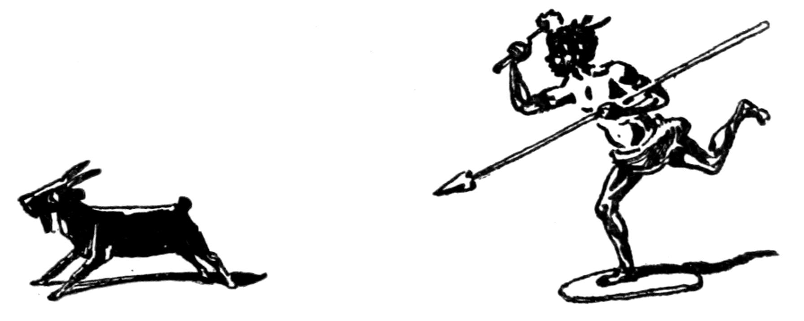

<!-- translation -->

<!-- endpair -->

<!-- pair:en:FX00090:source_figure -->
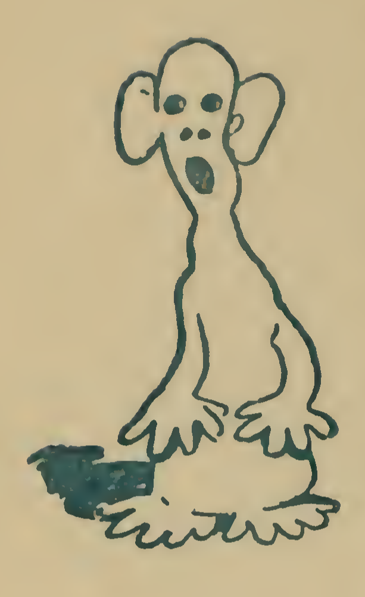

<!-- translation -->

<!-- endpair -->

<!-- pair:en:FX00092:source_figure -->
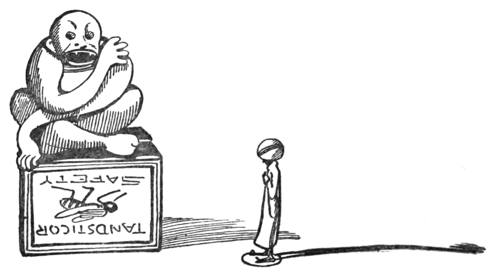

[图中文字：TANDSTICOR／SAFETY]

<!-- translation -->
[图内译释：火柴／安全]

<!-- endpair -->

<!-- pair:en:FX00094:source_figure -->
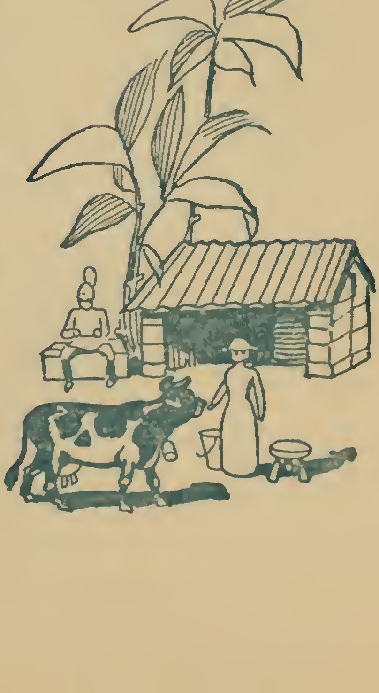

<!-- translation -->

<!-- endpair -->

<!-- pair:en:FX00096:source_figure -->
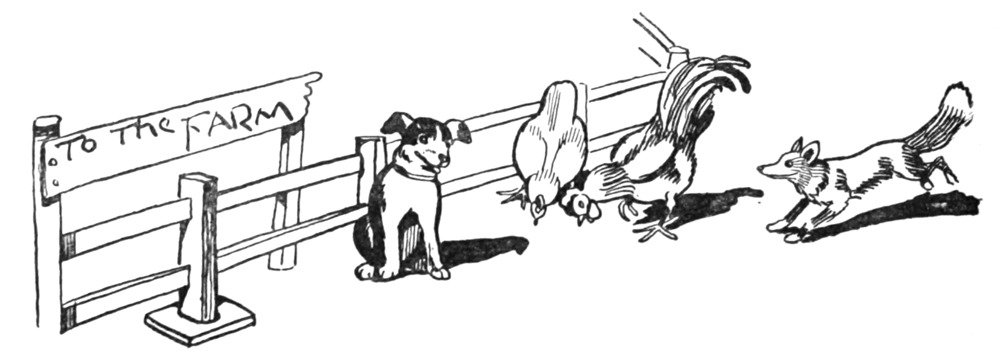

[图中文字：TO THE FARM]

<!-- translation -->
[图内译释：往农场]

<!-- endpair -->

<!-- pair:en:FX00097:paragraph -->
[turn to page 37]Your attention is particularly directed to the trees about and behind the temple, which thicken to a forest on the further island to the right. These trees we make of twigs taken from trees and bushes in the garden, and stuck into holes in our boards. Formerly we lived in a house with a little wood close by, and our forests were wonderful. Now we are restricted to our garden, and we could get nothing for this set out but jasmine and pear. Both have wilted a little, and are not nearly such spirited [turn to page 38] trees as you can make out of fir trees, for instance. It is for these woods chiefly that we have our planks perforated with little holes. No tin trees can ever be so plausible and various and jolly as these. With a good garden to draw upon one can make terrific sombre woods, and then lie down and look through them at lonely horsemen or wandering beasts.

<!-- translation -->
[turn to page 37]尤其请注意神庙四周和后面的树木：到了右侧较远的那座岛上，它们便密集成了森林。这些树，是我们从花园的树木和灌丛上取来枝条，插进木板上的孔里做成的。从前我们住的房子附近有一小片树林，那时我们的森林可真好。如今只能从自家花园取材，这次布置，能找到的也只有素馨枝和梨树枝。两种枝条都已有些萎蔫，远不如用冷杉之类的树木做出来的[turn to page 38]那样有精神。我们在木板上钻小孔，主要就是为了这些树林。任何铁皮树，都不可能像它们这样逼真、多变而有趣。有一座好花园可供取材，就能造出幽暗得惊人的树林；再趴到地板上，透过树林，去看那些孤独的骑手或四处游荡的野兽。

<!-- endpair -->

<!-- pair:en:FX00098:source_figure -->
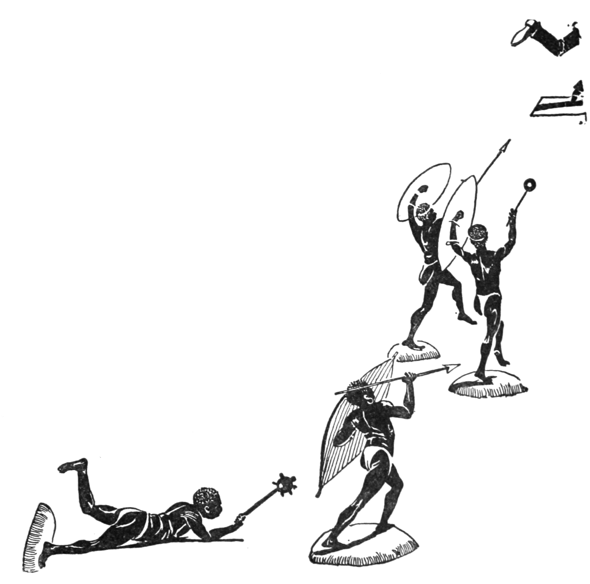

<!-- translation -->

<!-- endpair -->

<!-- pair:en:FX00099:source_figure -->
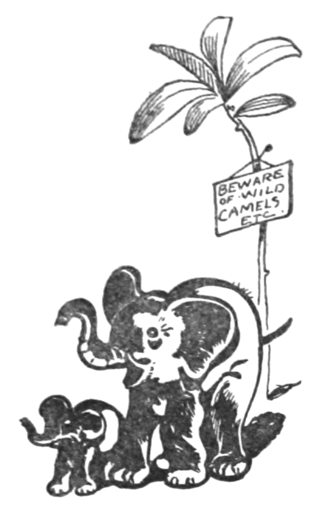

[图中文字：BEWARE／OF · WILD／CAMELS／ETC ·]

<!-- translation -->
[图内译释：当心野骆驼等（图中为玩具象，照录图中文字）]

<!-- endpair -->

<!-- pair:en:FX00101:paragraph -->
That further island on the right is a less settled country than the island of the temple. Camels, you note, run wild there; there is a sort of dwarf [turn to page 39] elephant, similar to the now extinct kind of which one finds skeletons in Malta, pigs, a red parrot, and other such creatures, of lead and wood. The pear-trees are fine. It is those which have attracted white settlers (I suppose they are), whose thatched huts are to be seen both upon the beach and inland. By the huts on the beach lie a number of pear-tree logs; but a raid of negroid savages from the adjacent island to the left is in progress, and the only settler clearly visible is the man in a rifleman's uni[turn to page 40]form running inland for help. Beyond, peeping out among the trees, are the supports he seeks.

<!-- translation -->
右侧较远的那座岛，比神庙岛更少有人定居。你看，骆驼在那里野生野长；还有一种侏儒[turn to page 39]象，像马耳他发现过骨架的那种已经灭绝的小象。此外还有猪、一只红鹦鹉，以及其他铅制或木制的同类生物。那些梨树长得很好。正是它们招来了白人移民——我想，那些人应该是白人吧——他们的茅草屋，在海滩上和内陆都看得见。海滩边的屋子旁，放着一些梨树原木；但左侧邻岛的黑种野蛮人正在发动袭击，惟一看得分明的移民，是那个穿着步枪兵制[turn to page 40]服、正往内陆奔去求援的人。他所寻找的援兵，就在更远的树林间隐约露出身影。

<!-- endpair -->

<!-- pair:en:FX00102:source_figure -->
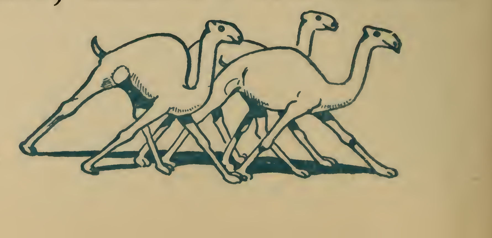

<!-- translation -->

<!-- endpair -->

<!-- pair:en:FX00103:source_figure -->
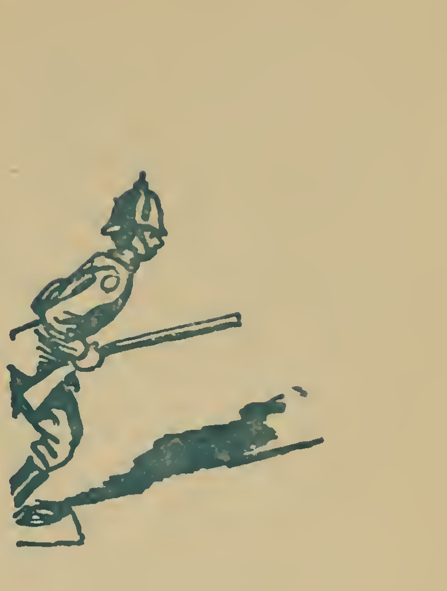

<!-- translation -->

<!-- endpair -->

<!-- pair:en:FX00105:paragraph -->
These same negroid savages are as bold as they are ferocious. They cross arms of the sea upon their rude canoes, made simply of a strip of cardboard. Their own island, the one to the south-left, is a rocky wilderness containing caves. Their chief food is the wild-goat, but in pursuit of these creatures you will also sometimes find the brown bear, who sits—he is small but perceptible to the [turn to page 41] careful student—in the mouth of his cave. Here, too, you will distinguish small guinea-pig-like creatures of wood, in happier days the inhabitants of that Swiss farm. Sunken rocks off this island are indicated by a white foam which takes the form of letters, and you will also note a whirlpool between the two islands to the right.

<!-- translation -->
这些黑种野蛮人既凶猛，又大胆。他们用简陋的独木舟横渡海汊；说是独木舟，其实不过是一条纸板。他们自己的岛，也就是左边偏南的那座，是一片有洞穴的荒凉岩地。他们的主食是野山羊；不过，追寻这些动物时，你有时也会找到棕熊。它正坐在洞口——个子虽小，仔细[turn to page 41]观察还是看得见的。在这里，你也能辨认出那些像小豚鼠的木制动物；在更幸福的往日，它们还住在那座瑞士小农场里。岛外的暗礁，用白色泡沫标出；这泡沫恰好长成字母的形状。你还会注意到，右边两个岛之间有一道旋涡。

<!-- endpair -->

<!-- pair:en:FX00106:source_figure -->
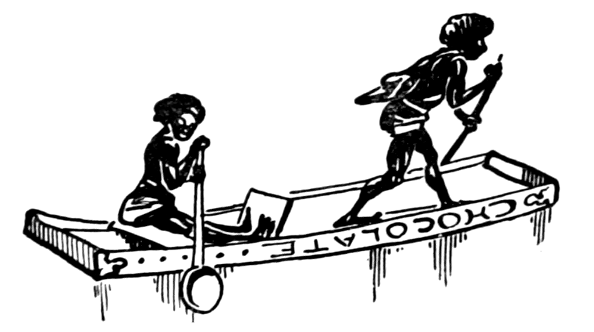

[图中文字：CHOCOLATE]

<!-- translation -->
[图内译释：巧克力]

<!-- endpair -->

<!-- pair:en:FX00107:source_figure -->

[图中文字：SUNKEN／ROCKS；WHIRLPOOL／NO SHIP ESCAPES]

<!-- translation -->
[图内译释：水下礁石；漩涡／船只无一能脱逃]

<!-- endpair -->

<!-- pair:en:FX00108:caption -->
A view showing the raid of the Negroid savages upon the white settlers of Pear Tree Island

<!-- translation -->
黑种野蛮人袭击梨树岛白人移民的一景。

<!-- endpair -->

<!-- pair:en:FX00109:source_figure -->

<!-- translation -->

<!-- endpair -->

<!-- pair:en:FX00111:paragraph -->
Finally comes the island nearest to the reader on the left. This also is wild and rocky, inhabited not by negroid blacks, but by Indians, whose tents, made by F. R. W. out of ordi[turn to page 42]nary brown paper and adorned with chalk totems of a rude and characteristic kind, pour forth their fierce and well-armed inhabitants at the intimation of an invader. The rocks on this island, let me remark, have great mineral wealth. Among them are to be found not only sheets and veins of silver paper, but great nuggets of metal, obtained by the melting down of hopelessly broken soldiers in an iron spoon. Note, too, the peculiar and romantic shell beach of this country. It is an island of exceptional interest [turn to page 43] to the geologist and scientific explorer. The Indians, you observe, have domesticated one leaden and one wooden cow.

<!-- translation -->
最后是左边最靠近读者的那座岛。这里也荒凉、多岩石，不过，住的不是黑种人，而是印第安人。他们的帐篷，是F. R. W.用普[turn to page 42]通牛皮纸做的，上面用粉笔画着粗朴而别具特色的图腾。只消传来入侵者的风声，凶悍而武装齐全的居民就会从帐篷里涌出。顺便说，这座岛的岩石蕴藏着丰富的矿产：不但能找到成片的银色箔纸和银箔矿脉，还有一大块一大块的金属矿块；它们是把损坏得无法挽救的玩具兵放在铁勺里熔化得来的。也请留意这个国家奇特而浪漫的贝壳海滩。对地质学家和科学探险者而言，这是一座格外有趣[turn to page 43]的岛。你看，印第安人已经驯养了一头铅牛和一头木牛。

<!-- endpair -->

<!-- pair:en:FX00112:source_figure -->

<!-- translation -->

<!-- endpair -->

<!-- pair:en:FX00113:source_figure -->

<!-- translation -->

<!-- endpair -->

<!-- pair:en:FX00115:source_figure -->

[图中文字：ANY PERSON／WORRYING THIS／LION WILL／BE SCALPED.]

<!-- translation -->
[图内译释：任何逗扰这只狮子的人都将被剥头皮。]

<!-- endpair -->

<!-- pair:en:FX00116:source_figure -->

<!-- translation -->

<!-- endpair -->

<!-- pair:en:FX00118:paragraph -->
This is how the game would be set out. Then we build ships and explore these islands, but in these pictures the ships are represented as already arriving. The ships are built out of our wooden bricks on flat keels made of two wooden pieces of 9 x 4½ inches, which are very convenient to push about over the floor. Captain G. P. W. is steaming into the bay between the eastern and western [turn to page 44]islands. He carries heavy guns, his ship bristles with an extremely aggressive soldiery, who appear to be blazing away for the mere love of the thing. (I suspect him of Imperialist intentions.) Captain F. R. W. is apparently at anchor between his northern and southern islands. His ship is of a slightly more pacific type. I note on his deck a lady and a gentleman (of German origin) with a bag, two of our all too rare civilians. No doubt the bag contains samples and a small conversation dictionary in [turn to page 45]the negroid dialects. (I think F. R. W. may turn out to be a Liberal.) Perhaps he will sail on and rescue the raided huts, perhaps he will land and build a jetty, and begin mining among the rocks to fill his hold with silver. Perhaps the natives will kill and eat the gentleman with the bag. All that is for Captain F. R. W. to decide.

<!-- translation -->
游戏的场景就是这样布置的。接下来，我们造船，探索这些岛屿；不过，在这些照片里，船已被摆成正在到达的样子。船用我们的木积木搭建，平底龙骨则由两块9×4½英寸的木片做成，在地板上推来推去十分方便。G. P. W.船长正驾着汽船，驶入东、西[turn to page 44]岛屿之间的海湾。他载着重炮，船上到处站着极富侵略性的兵士；他们似乎只是为了开火本身的乐趣，就不停地开火。（我怀疑他有帝国主义的企图。）F. R. W.船长则似乎正在自己的南北两岛之间停泊。他的船，属于稍稍和平一些的类型。我注意到，他的甲板上有一位女士和一位提包的先生（德国来的），是我们那些少得可怜的平民中的两位。不消说，包里装着货样和一本黑种人方言的[turn to page 45]小会话词典。（我觉得F. R. W.将来或许会成为一位自由党人。）也许他会继续航行，去解救那些遭到袭击的小屋；也许他会登陆，搭起码头，在岩石间开矿，用银子装满货舱。也许土著会杀掉并吃掉那位提包的先生。这些，全由F. R. W.船长自己决定。

<!-- endpair -->

<!-- pair:en:FX00119:source_figure -->

<!-- translation -->
[图内译释：舰上小牌字迹模糊，无法可靠辨读。]

<!-- endpair -->

<!-- pair:en:FX00121:source_figure -->

<!-- translation -->

<!-- endpair -->

<!-- pair:en:FX00122:paragraph -->
You see how the game goes on. We land and alter things, and build and rearrange, and hoist paper flags on pins, and subjugate populations, and confer all the blessings of civiliza[turn to page 46]tion upon these lands. We keep them going for days. And at last, as we begin to tire of them, comes the scrubbing brush, and we must burn our trees and dismantle our islands, and put our soldiers in the little nests of drawers, and stand the island boards up against the wall, and put everything away. Then perhaps, after a few days, we begin upon some other such game, just as we feel disposed. But it is never quite the same game, never. Another time it may be wildernesses for example, [turn to page 47] and the boards are hills, and never a drop of water is to be found except for the lakes and rivers we may mark out in chalk. But after one example others are easy, and next I will tell you of our way of making towns.

<!-- translation -->
你看，游戏就是这样进行下去的。我们登陆，改变事物，搭建，重新布置，把纸旗升上大头针，征服居民，将文[turn to page 46]明的一切福祉赐给这些土地。我们让这些活动持续好几天。最后，等我们开始玩腻了，刷地板的刷子便到来了；我们只得烧掉我们的树，拆散岛屿，把玩具兵放回一个个小抽屉，把岛屿木板靠墙竖起，将一切收好。也许过了几天，我们就又随心所欲，开始另一场同类游戏。但它从来不会是完全相同的游戏，从来不会。例如，下次也许是一片荒野，[turn to page 47]木板就是山丘；除了用粉笔画出的湖泊和河流，再也找不到一滴水。不过，有了一个例子，其他玩法便容易想出来。接着，我就讲讲我们怎样建造城镇。

<!-- endpair -->

<!-- pair:en:FX00123:source_figure -->

<!-- translation -->

<!-- endpair -->

<!-- pair:en:FX00124:source_figure -->

<!-- translation -->

<!-- endpair -->

<!-- pair:en:FX00126:source_figure -->

<!-- translation -->

<!-- endpair -->

<!-- pair:en:FX00127:source_figure -->

[图中文字：VOTES／FOR／WOM／EN；24 A／PENY]

<!-- translation -->
[图内译释：妇女选举权；一便士24个]

<!-- endpair -->

<!-- pair:en:FX00128:caption -->
Some Suggestions for Toy Makers (see page 26).

<!-- translation -->
给玩具制造商的一些建议（见第26页）。

<!-- endpair -->

## 第三节　论城市的建造

<!-- pair:en:FX00129:half_title -->
Section III

<!-- translation -->
第三节

<!-- endpair -->

<!-- pair:en:FX00130:half_title -->
OF THE BUILDING OF CITIES

<!-- translation -->
论城市的建造

<!-- endpair -->

<!-- pair:en:FX00131:source_figure -->

<!-- translation -->

<!-- endpair -->

<!-- pair:en:FX00132:source_figure -->

[图中文字：BLUE／END；WODDY’S／HAM；…／GRAPES／…；AFTERNOON／STICKSELS／HERE!!；JABZ／HAI…／COLOU…]

<!-- translation -->
[图内译释：蓝端；Woddy的火腿；……／葡萄／……（小招牌其余字难辨）；这里有下午的“STICKSELS”！！（STICKSELS按图可见拼写保留，词义未确定）；JABZ染发剂广告（字迹和纸缘有遮挡，按可辨部分）]

<!-- endpair -->

<!-- pair:en:FX00133:caption -->
A general view of Chamois City, showing the Cherry Tree Inn and the shopping quarter

<!-- translation -->
岩羚城全景，可见樱桃树旅店和商业区

<!-- endpair -->

<!-- pair:en:FX00134:chapter -->
[turn to page 51] OF THE BUILDING OF CITIES

<!-- translation -->
[turn to page 51] 论城市的建造

<!-- endpair -->

<!-- pair:en:FX00135:source_figure -->

[图中文字：BLUE END；BOUNDARY／LINE]

<!-- translation -->
[图内译释：蓝端；边界线]

<!-- endpair -->

<!-- pair:en:FX00136:paragraph -->
We always build twin cities, like London and Westminster, or Buda-Pesth, because two of us always want, both of them, to be mayors and municipal councils, and it makes for local freedom and happiness to arrange it so; but when steam railways or street railways are involved we have our rails in common, and we have an excellent law that rails must be [turn to page 52] laid down and switches kept open in such a manner that anyone feeling so disposed may send a through train from their own station back to their own station again without needless negotiation or the personal invasion of anybody else's administrative area. It is an undesirable thing to have other people bulging over one's houses, standing in one's open spaces, and, in extreme cases, knocking down and even treading on one's citizens. It leads at times to explanations that are afterwards regretted.

<!-- translation -->
我们总是建造一对双子城，像伦敦与威斯敏斯特，或布达与佩斯，因为我们中间总有两个人，个个都想当市长，又兼任整个市议会；这样安排有助于地方的自由与幸福。不过，凡是涉及蒸汽铁路或有轨电车，我们的轨道就共同使用。我们还有一条极好的法律：铺设轨道[turn to page 52]与开放道岔时，必须保证任何有此兴致的人，都能让一列直通列车从自己的车站出发，再回到自己的车站，不必进行多余的交涉，也不必亲自侵入别人管辖的区域。让别人整个身子探在自己的房屋上面，站在自己的空地上，严重时还撞倒、甚至踩着自己的市民，这都是令人不快的事。有时会因此说出一些事后懊悔的话。

<!-- endpair -->

<!-- pair:en:FX00137:source_figure -->

<!-- translation -->

<!-- endpair -->

<!-- pair:en:FX00139:source_figure -->

[图中文字：CROSS BY／BRIDGE／ONLY · · ·]

<!-- translation -->
[图内译释：只能由桥通行……]

<!-- endpair -->

<!-- pair:en:FX00140:source_figure -->

[图中文字：VOTE FOR／ME；POLLING／BOOTH]

<!-- translation -->
[图内译释：投我一票；投票站]

<!-- endpair -->

<!-- pair:en:FX00141:paragraph -->
[turn to page 53] We always have twin cities, or at the utmost stage of coalescence a city with two wards, Red End and Blue End; we mark the boundaries very carefully, and our citizens have so much local patriotism (Mr. Chesterton will learn with pleasure) that they stray but rarely over that thin little streak of white that bounds their municipal allegiance. Sometimes we have an election for mayor; it is like a census but very abusive, and Red always wins. Only citizens with two legs and at least one arm and capable of [turn to page 54]standing up may vote, and voters may poll on horseback; boy scouts and women and children do not vote, though there is a vigorous agitation to remove these disabilities. Zulus and foreign-looking persons, such as East Indian cavalry and American Indians, are also disfranchised. So are riderless horses and camels; but the elephant has never attempted to vote on any occasion, and does not seem to desire the privilege. It influences public opinion quite sufficiently as it is by nodding its head.

<!-- translation -->
[turn to page 53] 我们总有一对双子城，最多合并成一座分为红端与蓝端两区的城市。我们把界线划得十分仔细；我们的市民又有那么强的地方爱国心（切斯特顿先生听了一定高兴），很少越过那条划定他们效忠哪个市政当局的细细白线。有时我们举行市长选举；这有点像人口普查，只是充斥着谩骂，而且总是红方获胜。只有具备两条腿和至少一条胳膊、能够[turn to page 54]站立的市民才有选举权，投票人可以骑在马上投票。童子军、妇女和儿童都没有选举权，尽管争取取消这些资格限制的运动正进行得轰轰烈烈。祖鲁人，以及东印度骑兵、美洲印第安人这类外貌像外国人的人，也被剥夺了选举权。没有骑手的马和骆驼同样如此。不过，大象从未试图在任何一次选举中投票，似乎也不想获得这种特权。它只须点一点头，就已经足够影响舆论了。

<!-- endpair -->

<!-- pair:en:FX00142:source_figure -->

<!-- translation -->

<!-- endpair -->

<!-- pair:en:FX00143:source_figure -->

<!-- translation -->

<!-- endpair -->

<!-- pair:en:FX00144:paragraph -->
[turn to page 55] We have set out and I have photographed one of our cities to illustrate more clearly the amusement of the game. Red End is to the reader's right, and includes most of the hill on which the town stands, a shady zoological garden, the town hall, a railway tunnel through the hill, a museum (away in the extreme right-hand corner), a church, a rifle range, and a shop. Blue End has the railway station, four or five shops, several homes, a hotel, and a farm-house, close to the railway station. The [turn to page 56]boundary drawn by me as overlord (who also made the hills and tunnels and appointed the trees to grow) runs irregularly between the two shops nearest the cathedral, over the shoulder in front of the town hall, and between the farm and the rifle range.

<!-- translation -->
[turn to page 55] 我们布置好了一座城市，我又拍了照片，以便更清楚地说明这个游戏的乐趣。红端在读者的右手边，包括城市所在山丘的大部分、一座绿荫掩映的动物园、市政厅、一条穿山铁路隧道、一座博物馆（远在最右边的角落）、一座教堂、一处步枪靶场和一家商店。蓝端有火车站、四五家商店、几处住宅、一家旅馆，以及紧挨火车站的一座农舍。[turn to page 56]身为最高领主的我（山丘和隧道也由我建造，树木亦奉我的命令生长）划出的界线，从最靠近主教座堂的两家商店之间，越过市政厅前的山肩，再从农场和靶场之间曲曲折折地穿过。

<!-- endpair -->

<!-- pair:en:FX00145:paragraph -->
The nature of the hills I have already explained, and this time we have had no lakes or ornamental water. These are very easily made out of a piece of glass—the glass lid of a box for example—laid upon silver paper. Such water [turn to page 57] becomes very readily populated by those celluloid seals and swans and ducks that are now so common. Paper fish appear below the surface and may be peered at by the curious. But on this occasion we have nothing of the kind, nor have we made use of a green-colored tablecloth we sometimes use to drape our hills. Of course, a large part of the fun of this game lies in the witty incorporation of all sorts of extraneous objects. But the incorporation must be witty, or you may soon convert [turn to page 58]the whole thing into an incoherent muddle of half-good ideas.

<!-- translation -->
山丘是怎么回事，我已经解释过。这一回我们没有设置湖泊或观赏水景。这样的水面非常容易做，只要在银纸上铺一块玻璃——比如盒子的玻璃盖——就行。如今十分常见的赛璐珞海豹、天鹅和鸭子，很容易就使这种水面[turn to page 57]热闹起来。纸鱼在水面下游弋，好奇的人可以往里窥看。不过，这一次我们什么也没做，也没用那块有时拿来披在山上的绿色桌布。当然，这个游戏的很大一部分乐趣，在于把各色各样的外来物件巧妙地纳入其中。但这种纳入一定要巧妙，否则很快就会[turn to page 58]把整个东西弄成一团互不相干、半好不坏的点子。

<!-- endpair -->

<!-- pair:en:FX00146:source_figure -->

[图中文字：HEAR!／HEAR!]

<!-- translation -->
[图内译释：说得好！说得好！]

<!-- endpair -->

<!-- pair:en:FX00147:source_figure -->

<!-- translation -->

<!-- endpair -->

<!-- pair:en:FX00149:source_figure -->

[图中文字：IT IS DANGEROUS／TO FEED THE／DUCKS WITH／LIGHTED／MATCHES!]

<!-- translation -->
[图内译释：用点燃的火柴喂鸭子很危险！]

<!-- endpair -->

<!-- pair:en:FX00151:paragraph -->
I have taken two photographs, one to the right and one to the left of this agreeable place. I may perhaps adopt a kind of guide-book style in reviewing its principal features: I begin at the railway station. I have made a rather nearer and larger photograph of the railway station, which presents a diversified and entertaining scene to the incoming visitor. Porters (out of a box of porters) career here and there with [turn to page 59] the trucks and light baggage. Quite a number of our all-too-rare civilians parade the platform: two gentlemen, a lady, and a small but evil-looking child are particularly noticeable; and there is a wooden sailor with jointed legs, in a state of intoxication as reprehensible as it is nowadays happily rare. Two virtuous dogs regard his abandon with quiet scorn. The seat on which he sprawls is a broken piece of some toy whose nature I have long forgotten, the station clock is a similar fragment, and so is [turn to page 60] the metallic pillar which bears the name of the station. So many toys, we find, only become serviceable with a little smashing. There is an allegory in this—as Hawthorne used to write in his diary.

<!-- translation -->
我给这个宜人的地方拍了两张照片，一张拍右边，一张拍左边。介绍这里的主要特色时，我或许可以采用一种旅游指南的笔调：先从火车站说起。我另拍了一张火车站的近景大照片；初到此地的游客会看到一派丰富多彩、趣味盎然的景象。搬运工（来自一盒搬运工玩具）推着行李车、带着轻便行李四下[turn to page 59]奔走。我们那些总嫌太少的平民，也有好些正在站台上散步。其中尤其引人注目的，是两位绅士、一位女士，以及一个个头虽小、却一脸坏相的孩子。还有一个双腿带关节的木头水手，醉得不成样子；这样可耻的醉态，如今幸而已很少见了。两只品行端正的狗，安静而轻蔑地看着他这副放纵模样。他瘫坐的长椅，是某件玩具的断片，那玩具本来是什么，我早已忘记。车站的钟也是类似的残件，[turn to page 60]那根挂着站名的金属柱也一样。我们发现，好多玩具都得先砸坏一点才有用。这其中是有寓意的——霍桑从前在日记里就常这样写。

<!-- endpair -->

<!-- pair:en:FX00152:source_figure -->

[图中文字：JABZ／HAIR／TONIC；G.P.W.；TICKETS／HERE；HUM]

<!-- translation -->
[图内译释：JABZ生发水；G.P.W.；在此购票；HUM（帽带字样，不擅自展开船名）]

<!-- endpair -->

<!-- pair:en:FX00153:source_figure -->

<!-- translation -->

<!-- endpair -->

<!-- pair:en:FX00155:source_figure -->

<!-- translation -->

<!-- endpair -->

<!-- pair:en:FX00157:quotation -->
("What is he doing, the great god Pan, Down in the reeds by the river?")

<!-- translation -->
（“伟大的潘神，他在做什么，
在河边的芦苇丛里？”）

<!-- endpair -->

<!-- pair:en:FX00158:source_figure -->

<!-- translation -->

<!-- endpair -->

<!-- pair:en:FX00159:paragraph -->
The fences at the ends of the platforms are pieces of wood belonging to the game of Matador—that splendid and very educational construction game, hailing, I believe, from Hungary. There is also, I re[turn to page 61]gret to say, a blatant advertisement of Jab's "Hair Color," showing the hair. (In the photograph the hair does not come out very plainly.) This is by G. P. W., who seems marked out by destiny to be the advertisement-writer of the next generation. He spends much of his scanty leisure inventing and drawing advertisements of imaginary commodities. Oblivious to many happy, beautiful, and noble things in life, he goes about studying and imitating the literature of the billboards. He [turn to page 62]and his brother write newspapers almost entirely devoted to these annoying appeals. You will note, too, the placard at the mouth of the railway tunnel urging the existence of Jinks' Soap upon the passing traveller. The oblong object on the placard represents, no doubt, a cake of this offensive and aggressive commodity. The zoological garden flaunts a placard, "Zoo, two cents pay," and the grocer's picture of a cabbage with "Get Them" is not to be ignored. F. R. W. is more like the London County [turn to page 63]Council in this respect, and prefers bare walls.

<!-- translation -->
站台两端的围栏，是“Matador”游戏里的木制零件——那是一种出色而且非常有教育意义的建造游戏，我记得是从匈牙利来的。此外，很遗憾[turn to page 61]还得说，这里有一幅扎眼的Jab牌“染发剂”广告，上面画着头发。（照片里头发显得不太清楚。）这是G. P. W.的作品；他仿佛命中注定，要成为下一代的广告撰稿人。他把自己本已不多的闲暇，大半用来为想象中的商品编画广告。他对生活中许多快乐、美好和高尚的事物视而不见，却四处研究、模仿广告牌上的文辞。他[turn to page 62]和弟弟编的报纸，几乎全是这些恼人的招徕。你还会注意到铁路隧道口的招贴，正向过路旅客极力宣告Jinks肥皂的存在。招贴上的长方形物体，无疑代表一块这种惹人讨厌、咄咄逼人的商品。动物园招摇地挂着一块牌子：“动物园，入场付两美分。”杂货商画的一棵卷心菜，配上“快来买”的字样，也不容忽视。F. R. W.在这一点上更像伦敦郡[turn to page 63]议会，宁愿墙上光秃秃的。

<!-- endpair -->

<!-- pair:en:FX00160:source_figure -->

[图中文字：USE／BLACKING／FOR BLACK ·／BOOTS；BROWNING／FOR BROWN／BOOTS；WHIT…／F…／W…；TRY EGGS／FOR／COOKING；USE／SOAP；POLICEMAN／FOR SALE,／SLIGHTLY ·／DAMAGED／APPLY · · ·／G.P.W. · ·；GO AND SEE THE SIGHTS／AT BLUE END／TRAINS EVERY／LITTLE WHILE；A DAY AT THE／SEA SIDE／CHEAP · 1D；TRIPS OF OWING／TO THE WAR；TO THE／HOTEL；PASTE]

<!-- translation -->
[图内译释：黑靴请用黑鞋油；棕靴请用棕鞋油；下方广告被屋顶和海报遮挡，仅保留可见残字，不补全；烹饪试用鸡蛋；请用肥皂；警察玩具出售，略有损坏，洽G.P.W.……；去蓝端看风景；列车每隔一小会儿开行；海滨一日游；便宜，只需一便士；游览因战争暂停（OF为原图拼写，按off义理解）；往旅馆；浆糊]

<!-- endpair -->

<!-- pair:en:FX00162:source_figure -->

[图中文字：TO THE TRAINS]

<!-- translation -->
[图内译释：往列车处]

<!-- endpair -->

<!-- pair:en:FX00163:source_figure -->

[图中文字：BLUE／END；JABZ／HAI…／COLOU…]

<!-- translation -->
[图内译释：蓝端；JABZ染发剂广告]

<!-- endpair -->

<!-- pair:en:FX00164:caption -->
The railway station at Blue End

<!-- translation -->
蓝端的火车站

<!-- endpair -->

<!-- pair:en:FX00166:source_figure -->

<!-- translation -->

<!-- endpair -->

<!-- pair:en:FX00167:paragraph -->
"Returning from the station," as the guide-books say, and "giving one more glance" at the passengers who are waiting for the privilege of going round the circle in open cars and returning in a prostrated condition to the station again, and "observing" what admirable platforms are made by our 9 by 4½ pieces, we pass out to the left into the village street. A motor omnibus (a one-horse hospital cart in less progressive days) stands waiting for passen[turn to page 64]gers; and, on our way to the Cherry Tree Inn, we remark two nurses, one in charge of a child with a plasticine head. The landlord of the inn is a small grotesque figure of plaster; his sign is fastened on by a pin. No doubt the refreshment supplied here has an enviable reputation, to judge by the alacrity with which a number of riflemen move towards the door. The inn, by the by, like the station and some private houses, is roofed with stiff paper.

<!-- translation -->
“从车站折返”——旅游指南会这样说——“再看一眼”那些等着获准乘坐敞车绕行一圈、最后筋疲力尽地回到车站的旅客，再“留意一下”我们九英寸乘四英寸半的木板能搭出多么出色的站台，我们便向左走出去，来到村街上。一辆机动公共汽车（在从前不那么进步的日子里，它是一辆单马拉的救护车）正停着等候乘[turn to page 64]客。在前往樱桃树旅店的路上，我们看到两位保姆，其中一位看管着一个脑袋是橡皮泥做的孩子。旅店老板是个模样古怪的小石膏人，招牌用一根大头针别着。看好几名步枪兵兴冲冲地奔向店门的样子，就知道这里供应的酒食一定名声远扬。顺便说一句，这家旅店同车站及某些私宅一样，都用硬纸作屋顶。

<!-- endpair -->

<!-- pair:en:FX00168:source_figure -->

[图中文字：SCURSION ·／TRAIN]

<!-- translation -->
[图内译释：游览列车]

<!-- endpair -->

<!-- pair:en:FX00169:source_figure -->

[图中文字：INN]

<!-- translation -->
[图内译释：客栈]

<!-- endpair -->

<!-- pair:en:FX00171:paragraph -->
These stiff-paper roofs are [turn to page 65] one of our great inventions. We get thick, stiff paper and cut it to the sizes we need. After the game is over, we put these roofs inside one another and stick them into the bookshelves. The roof one folds and puts away will live to roof another day.

<!-- translation -->
这些硬纸屋顶是[turn to page 65]我们的一大发明。找来厚而硬的纸，按所需尺寸裁剪即可。游戏结束后，我们把屋顶套叠在一起，插进书架。屋顶折好、收起，留得下回再来盖屋顶。

<!-- endpair -->

<!-- pair:en:FX00172:source_figure -->

[图中文字：TRY／WODDY’S／HOME／MADE／HAMS]

<!-- translation -->
[图内译释：尝尝Woddy自制的火腿]

<!-- endpair -->

<!-- pair:en:FX00173:source_figure -->

[图中文字：JOKIL CO／SHOPMEN；BUY／OUR／GRAPES／BEWARE／OF／SUBSTIT／UTES；TEA；DON’T／LOSE／HEART／BUY／OUR／CABBA／GES]

<!-- translation -->
[图内译释：JOKIL公司商人；购买我们的葡萄；谨防冒牌货；茶；不要灰心；购买我们的卷心菜]

<!-- endpair -->

<!-- pair:en:FX00175:paragraph -->
Proceeding on our way past the Cherry Tree, and resisting the cosy invitation of its portals, we come to the shopping quarter of the town. The stock in the windows is made by hand out of plasticine. We note the meat and hams of "Mr. [turn to page 66]Woddy," the cabbages and carrots of "Tod & Brothers," the general activities of the "Jokil Co." shopmen. It is de rigueur with our shop assistants that they should wear white helmets. In the street, boy scouts go to and fro, a wagon clatters by; most of the adult population is about its business, and a red-coated band plays along the roadway. Contrast this animated scene with the mysteries of sea and forest, rock and whirlpool, in our previous game. Further on is the big church or cathedral.

<!-- translation -->
我们继续赶路，经过樱桃树旅店，抵住门口那温馨的邀约，便来到城里的商业区。橱窗里的货品都是用橡皮泥手工捏成的。我们看到“[turn to page 66]Woddy先生”店里的肉和火腿、“Tod兄弟”店里的卷心菜和胡萝卜，以及“Jokil公司”店员们的各项忙碌。我们的店员一律须戴白色头盔。街上，童子军来来往往，一辆货车辘辘驶过；大多数成年居民都在忙自己的事，一支穿红外套的乐队沿街演奏。把这生气勃勃的景象，同前一个游戏里大海与森林、岩石与旋涡的神秘景象对照一下吧。再往前就是大教堂，或说主教座堂。

<!-- endpair -->

<!-- pair:en:FX00176:source_figure -->

[图中文字：SILENCE；KEEP TO THE RIGHT；THE REST／OF THIS／ANIMAL／IS NOW／EXTINCT；DO NOT TOUCH；DO NOT TOUCH；ANTIENT／POT]

<!-- translation -->
[图内译释：肃静；靠右行；这只动物的其余部分现已灭绝；请勿触摸（台座正面）；请勿触摸（台座侧面）；古代陶罐]

<!-- endpair -->

<!-- pair:en:FX00177:paragraph -->
[turn to page 67]It is built in an extremely debased Gothic style; it reminds us most of a church we once surveyed during a brief visit to Rotterdam on our way up the Rhine. A solitary boy scout, mindful of the views of Lord Haldane, enters its high portal. Passing the cathedral, we continue to the museum. This museum is no empty boast; it contains mineral specimens, shells—such great shells as were found on the beaches of our previous game,—the Titanic skulls of extinct rabbits and cats, and other such won[turn to page 68]ders. The slender curious may lie down on the floor and peep in at the windows.

<!-- translation -->
[turn to page 67]它采用一种退化得极厉害的哥特式风格，让我们最先想到的，是有一回沿莱茵河溯流而上、短暂停留鹿特丹时看过的一座教堂。一个落单的童子军，牢记Haldane勋爵的主张，走进那高高的门洞。经过主教座堂，我们继续前往博物馆。这座博物馆可不是空口吹嘘：里面有矿物标本、贝壳——就是前一个游戏的海滩上找到的那些巨型贝壳——还有已经灭绝的兔子和猫那硕大无比的头骨，以及诸如此类的奇[turn to page 68]物。身材纤细的好奇者，可以趴在地板上从窗口往里看。

<!-- endpair -->

<!-- pair:en:FX00178:source_figure -->

[图中文字：THE／PLASTICINORUS ·；DO·NOT·TOUCH DO·NOT…]

<!-- translation -->
[图内译释：橡皮泥兽（图中戏拟名称PLASTICINORUS）；勿触摸；勿……（句子沿台座延伸）]

<!-- endpair -->

<!-- pair:en:FX00180:source_figure -->

<!-- translation -->

<!-- endpair -->

<!-- pair:en:FX00181:paragraph -->
"We now," says the guidebook, "retrace our steps to the shops, and then, turning to the left, ascend under the trees up the terraced hill on which stands the Town Hall. This magnificent building is surmounted by a colossal statue of a chamois, the work of a Wengen artist; it is in two stories, with a battlemented roof, and a crypt (entrance to right of steps) used for the incarceration of offenders. It is occupied by [turn to page 69]the town guard, who wear 'beefeater' costumes of ancient origin."

<!-- translation -->
“现在，”旅游指南说，“我们原路返回商店，再向左转，沿着树下的小路，登上市政厅所在的梯状山丘。这座宏伟建筑的顶端，矗立着一尊巨大的岩羚像，是文根一位艺术家的作品。建筑共两层，屋顶设有雉堞，另有一间用来关押犯人的地下室（入口在台阶右侧）。驻守这里的[turn to page 69]城市卫队，身穿古老的‘食牛肉者’式服装。”

<!-- endpair -->

<!-- pair:en:FX00182:source_figure -->

[图中文字：BLUE END／MINERAL]

<!-- translation -->
[图内译释：蓝端矿物（展品标牌）]

<!-- endpair -->

<!-- pair:en:FX00184:paragraph -->
Note the red parrot perched on the battlements; it lives tame in the zoölogical gardens, and is of the same species as one we formerly observed in our archipelago. Note, too, the brisk cat-and-dog encounter below. Steps descend in wide flights down the hillside into Blue End. The two couchant lions on either side of the steps are in plasticine, and were executed by that versatile artist, who is also mayor of Red End, [turn to page 70]G. P. W. He is present. Our photographer has hit upon a happy moment in the history of this town, and a conversation of the two mayors is going on upon the terrace before the palace. F. R. W., mayor of Blue End, stands on the steps in the costume of an admiral; G. P. W. is on horseback (his habits are equestrian) on the terrace. The town guard parades in their honor, and up the hill a number of blue-clad musicians (a little hidden by trees) ride on gray horses towards them.

<!-- translation -->
留意那只栖在雉堞上的红鹦鹉：它养熟在动物园里，和我们先前在群岛上见过的那只属于同一种类。也留意一下下方那场热闹的猫狗交锋。宽阔的台阶一层层顺着山坡通往蓝端。台阶两侧的两只卧狮，用橡皮泥做成，出自那位多才多艺、同时兼任红端市长的艺术家[turn to page 70]G. P. W.之手。他本人也在场。我们的摄影师捕捉到了这座城市历史上的一个愉快时刻，两位市长正在宫殿前的平台上交谈。蓝端市长F. R. W.身穿海军将领的服装，站在台阶上；G. P. W.骑马立在平台上（他素来有骑马的习惯）。城市卫队正为他们列队致敬，山坡上一队穿蓝衣的乐手（稍稍被树遮住）骑着灰马向他们走来。

<!-- endpair -->

<!-- pair:en:FX00185:source_figure -->

[图中文字：TOWN／HALL]

<!-- translation -->
[图内译释：市政厅]

<!-- endpair -->

<!-- pair:en:FX00187:source_figure -->

[图中文字：THE／ZOO；1ᴰ；PAY；PUSH]

<!-- translation -->
[图内译释：动物园；一便士；付款；推]

<!-- endpair -->

<!-- pair:en:FX00188:paragraph -->
[turn to page 71]Passing in front of the town hall, and turning to the right, we approach the zoölogical gardens. Here we pass two of our civilians: a gentleman in black, a lady, and a large boy scout, presumably their son. We enter the gardens, which are protected by a bearded janitor, and remark at once a band of three performing dogs, who are, as the guide-book would say, "discoursing sweet music." In neither ward of the city does there seem to be the slightest restraint upon the use of musical instruments.

<!-- translation -->
[turn to page 71]从市政厅前经过，再向右拐，我们来到动物园附近。在这里，我们从两位平民身旁走过：一位黑衣绅士、一位女士，还有一个大个头童子军，想必是他们的儿子。我们进入由一名蓄着胡须的门房守卫的园子，立刻发现一个由三只会表演的狗组成的乐队，正用旅游指南的话来说，“奏出甜美的音乐”。城里两个区，似乎都丝毫不限制乐器的使用。

<!-- endpair -->

<!-- pair:en:FX00189:source_figure -->

<!-- translation -->

<!-- endpair -->

<!-- pair:en:FX00190:source_figure -->

<!-- translation -->

<!-- endpair -->

<!-- pair:en:FX00191:paragraph -->
[turn to page 72] It is no place for neurotic people.

<!-- translation -->
[turn to page 72]这里可不是神经衰弱的人待的地方。

<!-- endpair -->

<!-- pair:en:FX00192:paragraph -->
The gardens contain the inevitable elephants, camels (which we breed, and which are therefore in considerable numbers), a sitting bear, brought from last game's caves, goats from the same region, tamed and now running loose in the gardens, dwarf elephants, wooden nondescripts, and other rare creatures. The keepers wear a uniform not unlike that of railway guards and porters. We wander through the gardens, return, descend the hill by the [turn to page 73]school of musketry, where soldiers are to be seen shooting at the butts, pass through the paddock of the old farm, and so return to the railway station, extremely gratified by all we have seen, and almost equally divided in our minds between the merits and attractiveness of either ward. A clockwork train comes clattering into the station, we take our places, somebody hoots or whistles for the engine (which can't), the signal is knocked over in the excitement of the moment, the train starts, and we "wave a long, regretful [turn to page 74]farewell to the salubrious cheerfulness of Chamois City." . . .

<!-- translation -->
园里少不了大象，还有骆驼（我们自己繁殖，因此数目相当可观）、一头从上个游戏的洞穴里带来的坐熊、几只来自同一地方的山羊——如今已经驯服，在园里自由跑动——还有侏儒象、说不上名目的木头动物，以及其他珍奇生物。饲养员的制服，同列车乘务员和搬运工的服装颇为相像。我们在园里漫步，然后折返，沿着[turn to page 73]射击学校旁的路下山，可以看见士兵们正在向靶垛射击；再穿过老农场的围场，回到火车站。眼前的一切让我们心满意足，两个区各有长处、各有魅力，几乎难分高下。一列发条火车哐当哐当地进站了，我们各就各位，有人替机车鸣笛或吹哨（因为它自己不会）；一时兴奋，信号机被碰倒了，火车开动，我们“久久挥手，依依不舍地[turn to page 74]告别岩羚城健康宜人的欢快气氛”。……

<!-- endpair -->

<!-- pair:en:FX00193:source_figure -->

<!-- translation -->

<!-- endpair -->

<!-- pair:en:FX00194:source_figure -->

[图中文字：BLUE／END；…W.R.]

<!-- translation -->
[图内译释：蓝端；货车侧面铁路缩写，首部字母不清，不展开机构名]

<!-- endpair -->

<!-- pair:en:FX00195:caption -->
The terraced hill on which stands the Town Hall. Behind can be seen the Zoölogical Gardens

<!-- translation -->
市政厅所在的梯状山丘，后方可见动物园

<!-- endpair -->

<!-- pair:en:FX00197:source_figure -->

<!-- translation -->

<!-- endpair -->

<!-- pair:en:FX00199:paragraph -->
You see now how we set out and the spirit in which we set out our towns. It demands but the slightest exercise of the imagination to devise a hundred additions and variations of the scheme. You can make picture-galleries—great fun for small boys who can draw; you can make factories; you can plan out flower-gardens—which appeals very strongly to intelligent little girls; your town hall may become a fortified castle; or you may put the whole [turn to page 75] town on boards and make a Venice of it, with ships and boats upon its canals, and bridges across them. We used to have some very serviceable ships of cardboard, with flat bottoms; and then we used to have a harbor, and the ships used to sail away to distant rooms, and even into the garden, and return with the most remarkable cargoes, loads of nasturtium-stem logs, for example. We had sacks then, made of glove-fingers, and several toy cranes. I suppose we could find most of these again [turn to page 76] if we hunted for them. Once, with this game fresh in our minds, we went to see the docks, which struck us as just our old harbor game magnified.

<!-- translation -->
现在你已经看到，我们如何布置城镇，又怀着怎样的兴致来布置。只须稍稍发挥想象力，就能给这个方案想出上百种增添和变化。你可以造画廊——这对会画画的小男孩尤其有趣；可以造工厂；可以规划花园——这对聪明的小女孩尤其有吸引力；市政厅可以变成设防的城堡；或者，把整座[turn to page 75]城镇放到木板上，让它成为一座威尼斯，运河上有船，河道上架着桥。我们过去有些平底硬纸板船，很是好用；那时也有一座港口，船从那里出航，驶向遥远的房间，甚至花园，再载着稀奇古怪的货物回来，比如一船船旱金莲茎秆做的原木。我们那时还用手套的指头做了麻袋，并且有几架玩具起重机。我想，只要找一找，大部分东西[turn to page 76]应该还能找到。有一回，脑子里还留着这个游戏的鲜明印象，我们去参观码头，觉得那不过是把我们从前的港口游戏放大了。

<!-- endpair -->

<!-- pair:en:FX00200:source_figure -->

[图中文字：TRY · OUR · WEEK-END／XCURSION／BEST AND · GOES／FARTHEST；MIDNIGHT EXPRESS；BER；EGGS；GPW；FRW；HGW]

<!-- translation -->
[图内译释：试试我们的周末游览：最好，走得最远；午夜快车；BER；鸡蛋；GPW；FRW；HGW]

<!-- endpair -->

<!-- pair:en:FX00201:source_figure -->

<!-- translation -->

<!-- endpair -->

<!-- pair:en:FX00203:source_figure -->

[图中文字：DOGS／MUST BE／ON LEAD；SILENCE；PICTURES／FOR SALE／2ᴰ EACH；CAT；DUKE；…OTHER／AND CHIL…；THE／STORM；MONARCH／OF THE／GLEN；DERBY；CHARITY；BABY；PORTRAIT]

<!-- translation -->
[图内译释：犬只必须牵引；肃静；绘画出售，每幅二便士；猫（画名）；公爵（画名）；……／与孩子……（题名被前景人物遮挡，不补不可见字）；暴风雨（画名）；山谷之王（画名）；德比赛马（画名）；慈善（画名）；婴儿（画名）；肖像（画名）]

<!-- endpair -->

<!-- pair:en:FX00204:source_figure -->

<!-- translation -->

<!-- endpair -->

<!-- pair:en:FX00206:paragraph -->
"I say, Daddy," said one of us in a quiet corner, wistfully, as one who speaks knowingly against the probabilities of the case, and yet with a faint, thin hope, "couldn't we play just for a little with these sacks . . . until somebody comes?"

<!-- translation -->
“我说，爸爸，”我们中的一个在僻静角落里满怀向往地说；他明知事情大概不会有指望，却仍抱着一丝微弱的希望，“这些麻袋，能不能让我们就玩一小会儿……等有人来再说？”

<!-- endpair -->

<!-- pair:en:FX00207:paragraph -->
Of course the setting-out of the city is half the game. Then you devise incidents. As I [turn to page 77] wanted to photograph the particular set-out for the purpose of illustrating this account, I took a larger share in the arrangement than I usually do-It was necessary to get everything into the picture, to ensure a light background that would throw up some of the trees, prevent too much overlapping, and things like that. When the photographing was over, matters became more normal. I left the schoolroom, and when I returned I found that the group of riflemen which had been converging on the public-[turn to page 78]house had been sharply recalled to duty, and were trotting in a disciplined, cheerless way towards the railway station. The elephant had escaped from the zoo into the Blue Ward, and was being marched along by a military patrol. The originally scattered boy scouts were being paraded. G. P. W. had demolished the shop of the Jokil Company, and was building a Red End station near the bend. The stock of the Jokil Company had passed into the hands of the adjacent storekeepers. Then the town hall ceremonies [turn to page 79]came to an end and the guard marched off. Then G. P. W. demolished the rifle-range, and ran a small branch of the urban railway uphill to the town hall door, and on into the zoological gardens. This was only the beginning of a period of enterprise in transit, a small railway boom. A number of halts of simple construction sprang up. There was much making of railway tickets, of a size that enabled passengers to stick their heads through the middle and wear them as a Mexican does his blanket. Then a battery [turn to page 80] of artillery turned up in the High Street and there was talk of fortifications. Suppose wild Indians were to turn up across the plains to the left and attack the town! Fate still has toy drawers untouched. . . .

<!-- translation -->
当然，布置城市只是游戏的一半。接下来还要想出各种事件。因为我[turn to page 77]想把这一次的布置拍下来，给这篇说明配图，所以在安排上比平时多插了些手。必须让所有东西都进入镜头，保证背景足够明亮，能够衬出某些树木，避免过多遮挡，诸如此类。照片拍完，一切又比较正常了。我离开教室，再回来时，发现那队原本正向酒[turn to page 78]馆聚拢的步枪兵，已经被严令召回执勤，正纪律严明、垂头丧气地小跑着去火车站。大象从动物园逃进蓝区，正由一队巡逻士兵押送着。原先散在各处的童子军也列起了队。G. P. W.拆掉了Jokil公司的商店，正在铁道转弯处附近建一座红端车站。Jokil公司的存货，已落入邻近店主手中。接着，市政厅的典礼[turn to page 79]结束了，卫队开走。随后，G. P. W.又拆掉靶场，让市内铁路的一条小支线沿山坡铺到市政厅门前，再一直伸进动物园。这只是一段交通事业兴盛期的开端，是一次小小的铁路热潮。几个构造简单的停靠站冒了出来。大家忙着制作车票，票大到足以让乘客把头从中间穿过去，像墨西哥人披毯子那样套在身上。接着，一连[turn to page 80]炮兵出现在大街上，大家又议论起了修筑工事的事。要是野蛮的印第安人从左边的平原那头冒出来，攻打这座城镇，可怎么办！命运手里还有尚未打开的玩具抽屉呢。……

<!-- endpair -->

<!-- pair:en:FX00208:source_figure -->

<!-- translation -->

<!-- endpair -->

<!-- pair:en:FX00209:source_figure -->

<!-- translation -->

<!-- endpair -->

<!-- pair:en:FX00211:source_figure -->

<!-- translation -->

<!-- endpair -->

<!-- pair:en:FX00213:source_figure -->

<!-- translation -->

<!-- endpair -->

<!-- pair:en:FX00215:source_figure -->

<!-- translation -->

<!-- endpair -->

<!-- pair:en:FX00216:source_figure -->

[图中文字：TICKET；1ᴰ；OFFICERS／FREE／PASS]

<!-- translation -->
[图内译释：票；一便士；军官免费通行证]

<!-- endpair -->

<!-- pair:en:FX00218:paragraph -->
So things will go on till putting-away night on Friday. Then we shall pick up the roofs and shove them away among the books, return the clockwork engines very carefully to their boxes, for engines are fragile things, stow the soldiers and civilians and animals in their nests of drawers, burn [turn to page 81]the trees again—this time they are sweet-bay; and all the joys and sorrows and rivalries and successes of Blue End and Red End will pass, and follow Carthage and Nineveh, the empire of Aztec and Roman, the arts of Etruria and the palaces of Crete, and the plannings and contrivings of innumerable myriads of children, into the limbo of games exhausted . . . it may be, leaving some profit, in thoughts widened, in strengthened apprehensions; it may be, leaving nothing but a memory that dies.

<!-- translation -->
事情就会这样发展下去，直到星期五晚上收拾玩具的时候。那时，我们会拿起屋顶，塞到书本之间，把发条机车小心翼翼地放回盒子——机车可是脆弱的东西——再把士兵、平民和动物放回它们那一层层的抽屉窝里，又一次烧掉[turn to page 81]树木——这一回用的是月桂树。于是，蓝端和红端的一切欢乐、悲伤、竞争与成功，都将消逝，追随迦太基与尼尼微、阿兹特克与罗马的帝国、伊特鲁里亚的艺术与克里特的宫殿，以及无数亿万儿童的筹划与巧思，一同进入那些已玩尽兴致的游戏的幽冥……或许留下某些收获：思路更开阔，理解力更强；也或许，除了一段终将消散的记忆，什么都没有留下。

<!-- endpair -->

<!-- pair:en:FX00219:source_figure -->

[图中文字：SOLDIERS／TICKET／HALF／PRICE；TICKET]

<!-- translation -->
[图内译释：士兵半价票；票]

<!-- endpair -->

<!-- pair:en:FX00221:source_figure -->

<!-- translation -->

<!-- endpair -->

## 第四节　缆索铁路、弹珠塔、城堡与战争游戏

<!-- pair:en:FX00222:half_title -->
Section IV

<!-- translation -->
第四节

<!-- endpair -->

<!-- pair:en:FX00223:half_title -->
FUNICULARS, MARBLE TOWERS, CASTLES AND WAR GAMES, BUT VERY LITTLE OF WAR GAMES

<!-- translation -->
缆索铁路、弹珠塔、城堡与战争游戏，不过战争游戏只谈一点点

<!-- endpair -->

<!-- pair:en:FX00227:source_figure -->

<!-- translation -->

<!-- endpair -->

<!-- pair:en:FX00228:source_figure -->

[图中文字：JINKS／J.S.／SOAP]

<!-- translation -->
[图内译释：JINKS肥皂；J.S.为标牌内缩写]

<!-- endpair -->

<!-- pair:en:FX00229:caption -->
The School of Musketry. On the terrace the Town Guard parades in honor of the two mayors

<!-- translation -->
射击学校。平台上，城市卫队正列队向两位市长致敬

<!-- endpair -->

<!-- pair:en:FX00230:chapter -->
[turn to page 85] FUNICULARS, MARBLE TOWERS, CASTLES AND WAR GAMES, BUT VERY LITTLE OF WAR GAMES

<!-- translation -->
[turn to page 85] 缆索铁路、弹珠塔、城堡与战争游戏，不过战争游戏只谈一点点

<!-- endpair -->

<!-- pair:en:FX00233:source_figure -->

[图中文字：TO THE／FUNICULAR；PAY HER…]

<!-- translation -->
[图内译释：往缆索铁路；在此付款（末字绕柱被挡，只录可见部分）]

<!-- endpair -->

<!-- pair:en:FX00234:paragraph -->
I have now given two general types of floor game; but these are only just two samples of delightful and imagination-stirring variations that can be contrived out of the toys I have described. I will now glance rather more shortly at some other very good uses of the floor, the boards, the bricks, [turn to page 86]the soldiers, and the railway system—that pentagram for exorcising the evil spirit of dulness from the lives of little boys and girls. And first, there is a kind of lark we call Funiculars. There are times when islands cease somehow to dazzle, and towns and cities are too orderly and uneventful and cramped for us, and we want something—something to whizz. Then we say: "Let us make a funicular. Let us make a funicular more than we have ever done. Let us make one to reach up to the table."

<!-- translation -->
我已经介绍了两种基本的地板游戏；但利用前面那些玩具，可以想出许多令人愉快、激发想象的变化，这不过是其中两个例子。现在，我要稍微简略一些，再谈谈地板、木板、积木、[turn to page 86]士兵和铁路系统的其他几种妙用——这五样东西，便是驱逐小男孩和小女孩生活中无聊恶魔的五芒星。首先，有一种嬉戏，我们叫它“缆索铁路”。有些时候，不知怎么，岛屿不再让人眼花缭乱，城镇对我们来说又太规矩、太平静、太局促了；我们想要点什么——什么能嗖嗖飞驰的东西。于是我们说：“来造一条缆索铁路吧。造一条比以前所有的都更了不起的。造一条能一直通到桌上的吧。”

<!-- endpair -->

<!-- pair:en:FX00235:source_figure -->

[图中文字：LECTRIC ·；THE／FUNICULAR／CONSTRUCT-／ION／CO LTD；£5／WHO／STICKS／BILLS／HERE]

<!-- translation -->
[图内译释：“电车”（本书对发条车的称呼）；缆索铁路建设有限公司；在此张贴广告者〔罚〕5英镑（“罚”为语义解释，原图未写fine）]

<!-- endpair -->

<!-- pair:en:FX00236:paragraph -->
[turn to page 87]We dispute whether it isn't a mountain railway we are after. The bare name is refreshing; it takes us back to that unforgettable time when we all went to Wengen, winding in and out and up and up the mountain side—from slush, to such snow and sunlight as we had never seen before. And we make a mountain railway. So far, we have never got it up to the table, but some day we will. Then we will have a station there on the flat, and another station on the floor, with shunts and sidings to each.

<!-- translation -->
[turn to page 87]我们争论，自己想造的会不会其实是一条山地铁路。光是这个名字就叫人精神一振，让我们回到全家去文根的那段难忘时光：沿山腰蜿蜒进出，不断向上、再向上，从泥泞的雪水，一路来到从未见过的那般白雪与阳光之中。于是，我们造一条山地铁路。到目前为止，还没能让它通到桌上，不过总有一天会做到的。到时候，在上面那块平地上设一座车站，地板上再设一座，两座都配上调车线和侧线。

<!-- endpair -->

<!-- pair:en:FX00237:source_figure -->

<!-- translation -->

<!-- endpair -->

<!-- pair:en:FX00238:paragraph -->
[turn to page 88]The peculiar joy of the mountain railway is that, if it is properly made, a loaded car—not a toy engine; it is too rough a game for delicate, respectable engines—will career from top to bottom of the system, and go this way and that as your cunningly-arranged switches determine; and afterwards—and this is a wonderful and distinctive discovery—you can send it back by 'lectric.

<!-- translation -->
[turn to page 88]山地铁路特有的乐趣在于，只要造得合适，一辆装满东西的车——不能用玩具机车；这玩法太粗野，不适合精细而体面的机车——就能从整个系统的最高处冲到最低处，随着你巧妙安排的道岔，忽而向这边，忽而向那边。然后——这是个奇妙而独特的发现——你可以用“电车”把它送回去。

<!-- endpair -->

<!-- pair:en:FX00239:paragraph -->
What is a 'lectric? You may well ask. 'Lectrics were invented almost by accident, by one of us, to whom also the [turn to page 89]name is due. It came out of an accident to a toy engine; a toy engine that seemed done for, and that was yet full of life.

<!-- translation -->
什么是“电车”？你大可以这样问。“电车”几乎是一次意外的发明，发明者是我们中的一个，[turn to page 89]名字也出自他。这事起于一辆玩具机车的意外：那辆机车看起来已经报废了，却仍充满活力。

<!-- endpair -->

<!-- pair:en:FX00240:source_figure -->

<!-- translation -->

<!-- endpair -->

<!-- pair:en:FX00242:paragraph -->
You know, perhaps, what a toy engine is like. It has the general appearance of a railway engine; funnels, buffers, cab, and so forth. All these are very elegant things, no doubt; but they do not make for lightness, they do not facilitate hill-climbing. Now, sometimes an engine gets its clockwork out of order, and then it is over and done for; but sometimes [turn to page 90] it is merely the outer semblance that is injured—the funnel bent, the body twisted. You remove the things and, behold! you have bare clock-work on wheels, an apparatus of almost malignant energy, soul without body, a kind of metallic rage. This it was that our junior member instantly knew for a 'lectric, and loved from the moment of its stripping.

<!-- translation -->
你也许知道，玩具机车是什么样子。它大体上有一辆火车头的模样：烟囱、缓冲器、驾驶室，等等。这些东西无疑都很雅致，但并不能减轻重量，也不利于爬坡。有时，机车的发条出了故障，那就彻底完了；但有时[turn to page 90]受损的只是外表——烟囱弯了，车身歪了。把这些东西卸掉，瞧！你就得到一套装在轮子上的裸露发条机构，一部精力充沛得近乎凶恶的装置，一个没有肉身的灵魂，一团金属的狂怒。我们最年幼的成员立刻认定，这就是“电车”，而且从它被剥去外壳的那一刻起就爱上了它。

<!-- endpair -->

<!-- pair:en:FX00243:source_figure -->

<!-- translation -->

<!-- endpair -->

<!-- pair:en:FX00244:source_figure -->

<!-- translation -->

<!-- endpair -->

<!-- pair:en:FX00246:paragraph -->
(I have, by the by, known a very serviceable little road 'lectric made out of a clock-work mouse.)

<!-- translation -->
（顺便说一句，我还知道，有人用一只发条老鼠做成过一辆很好用的小型公路“电车”。）

<!-- endpair -->

<!-- pair:en:FX00247:paragraph -->
Well, when we have got [turn to page 91]chairs and boxes and bricks, and graded our line skilfully and well, easing the descent, and being very careful of the joining at the bends for fear that the descending trucks and cars will jump the rails, we send down first an empty truck, then trucks loaded with bricks and lead soldiers, and then the 'lectric; and then afterwards the sturdy 'lectric shoves up the trucks again to the top, with a kind of savagery of purpose and a whizz that is extremely gratifying to us. We make switches in these lines; we [turn to page 92] make them have level-crossings, at which collisions are always being just averted; the lines go over and under each other, and in and out of tunnels. . . .

<!-- translation -->
好，等我们找来了[turn to page 91]椅子、箱子和积木，巧妙妥当地调好了线路坡度，使下坡平缓一些，又仔细处理好弯道接缝，以免下行的货车和车厢脱轨，就先放一辆空货车下去，再放装满积木和铅制士兵的货车，最后放“电车”。随后，结实的“电车”又把货车一路推回顶端，带着一股近乎凶猛的执着，嗖嗖作响，让我们心满意足。我们在线路上设置道岔；[turn to page 92]设置平交道口，碰撞总是在千钧一发时得以避免；线路彼此上下交越，又从隧道里钻进钻出。……

<!-- endpair -->

<!-- pair:en:FX00248:source_figure -->

<!-- translation -->

<!-- endpair -->

<!-- pair:en:FX00250:source_figure -->

<!-- translation -->

<!-- endpair -->

<!-- pair:en:FX00251:source_figure -->

<!-- translation -->

<!-- endpair -->

<!-- pair:en:FX00253:paragraph -->
The marble tower, again, is a great building, on which we devise devious slanting ways down which marbles run. I do not know why it is amusing to make a marble run down a long intricate path, and dollop down steps, and come almost but not quite to a stop, and rush out of dark places and across little bridges of card: it is, and we often do it.

<!-- translation -->
弹珠塔则是一座大建筑，我们在上面安排曲折的斜坡通道，让弹珠沿路滚下。我不知道，为什么让一颗弹珠滚过一条漫长复杂的路径，咚咚地跌下台阶，差一点停住却又没有停住，从暗处冲出来，再越过小小的纸板桥，会这么有趣；但它就是有趣，我们也常常这样玩。

<!-- endpair -->

<!-- pair:en:FX00254:paragraph -->
[turn to page 93]Castles are done with bricks and cardboard turrets and a portcullis of card, and draw-bridge and moats; they are a mere special sort of city-building, done because we have a box of men in armor. We could reconstruct all sorts of historical periods if the toy-soldier makers would provide us with people. But at present, as I have already complained, they make scarcely anything but contemporary fighting men. And of the war game I must either write volumes or nothing. For the present let it be noth[turn to page 94]ing. Some day, perhaps, I will write a great book about the war game and tell of battles and campaigns and strategy and tactics. But this time I set out merely to tell of the ordinary joys of playing with the floor, and to gird improvingly and usefully at toymakers. So much, I think, I have done. If one parent or one uncle buys the wiselier for me, I shall not altogether have lived in vain.

<!-- translation -->
[turn to page 93]城堡用积木来搭，配上硬纸板角楼、纸板升降闸门，还有吊桥和护城河；这不过是一种特别的造城游戏，之所以这样造，是因为我们有一盒披甲武士。只要玩具士兵制造商肯供应人物，各个历史时期我们都能重建。可正如我已经抱怨过的，他们眼下除了当代军人，几乎什么也不做。至于战争游戏，我要么写上好几大卷，要么一个字也不写。眼下就一字不[turn to page 94]写吧。或许有一天，我会写一本谈战争游戏的大书，讲述战斗、战役、战略和战术。但这一次，我原本只想讲讲在地板上玩耍的寻常乐趣，顺带给玩具制造商一些有益、促人改进的讥评。我想，这些我已经做到了。只要有一位父亲、母亲或叔伯，因为读了我的话而更明智地买玩具，我这一辈子就不算全然白活。

<!-- endpair -->

<!-- pair:en:FX00255:source_figure -->

<!-- translation -->

<!-- endpair -->

<!-- pair:en:FX00257:source_figure -->

<!-- translation -->

<!-- endpair -->
