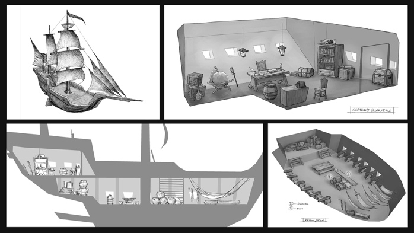
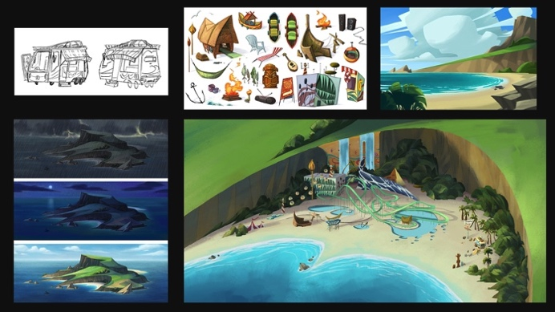
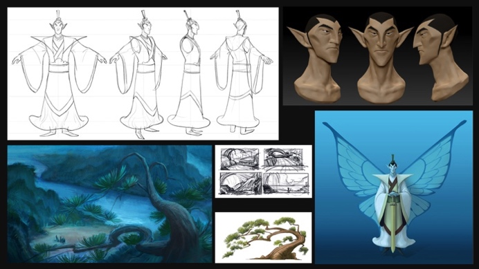

# 简介

在虚拟现实里，观众可能正看着船的另一头，错过舱房里决定剧情的那一刻。汉内斯·拉尔用《ShakesVR》说明怎样保留故事线，又让观众自由观察。他给船上同一件事安排可见、可听的几种线索，在关键处用进入舱房触发情节，并以2019年里斯本27名体验者的试验说明实际效果。

# 正文

<!-- pair:en:SVR0001:frontmatter-->
[turn to page 302]http://dx.doi.org/10.14236/ewic/EVA2020.55

<!-- translation -->
[turn to page 302]DOI：10.14236/ewic/EVA2020.55
<!-- endpair -->

<!-- pair:en:SVR0002:title-->
ShakesVR: Redefining narrative strategies for linear storytelling in a fully immersive environment

<!-- translation -->
ShakesVR：在全沉浸环境中重新界定线性故事的叙事策略
<!-- endpair -->

<!-- pair:en:SVR0003:frontmatter-->
Hannes Rall Nanyang Technological University Singapore 81 Nanyang Drive, 637458 Singapore rall@ntu.edu.sg

<!-- translation -->
汉内斯·拉尔（Hannes Rall）
新加坡南洋理工大学
81 Nanyang Drive, 637458 Singapore
rall@ntu.edu.sg
<!-- endpair -->

<!-- pair:en:SVR0004:abstract-->
The author posits that the author-driven approach of storytelling, resulting in a linear narrative, remains a valid approach for VR. Therefore, the paper investigates the question how a traditional storyline can be told in VR, while simultaneously addressing the specific issues that arise from the audience becoming part of the story. For instance, how might the actions of the viewer (who in traditional film would have passively consumed the story) affect the way in which the story is being experienced? In a fully immersive environment, the user can freely choose where to look and this can affect the experience of the story. How can we avoid that he/she misses essential parts of a linear storyline? Our research project therefore investigated how VR can accommodate the needs of traditional narrative forms. In this essay the author will demonstrate how the integration of interactive elements and audio-visual storytelling strategies can actually support the understanding of a linear narrative in a fully immersive environment.

<!-- translation -->
本文认为，在虚拟现实中，由作者推进故事、形成线性叙事，依然是一条可行的路。因此，本文考察怎样在虚拟现实里讲一条传统故事线，同时处理观众成为故事一部分后出现的具体问题。例如，相较于传统电影中被动接受故事的观众，虚拟现实观众的行动会怎样改变他体验故事的方式？在全沉浸环境里，用户可以自由选择看哪里，这会影响故事体验。如何避免用户错过线性故事的重要部分？我们的研究项目因此考察虚拟现实怎样满足传统叙事形式的需要。本文将说明，在全沉浸环境中，把交互要素和视听叙事策略结合起来，怎样帮助用户理解线性叙事。
<!-- endpair -->

<!-- pair:en:SVR0005:keywords-->
Shakespeare. Virtual cultural heritage. Digital animation. VR. Immersive environment.

<!-- translation -->
莎士比亚。虚拟文化遗产。数字动画。虚拟现实。沉浸环境。
<!-- endpair -->

<!-- pair:en:SVR0006:chapter-->
1. INTRODUCTION

<!-- translation -->
1　引言
<!-- endpair -->

<!-- pair:en:SVR0007:paragraph-->
Over the last three years (2017–2020) the interdisciplinary research project From Print to Digital: Re-Defining Narrativity for Interactive Digital Media, was funded by the Ministry of Education in Singapore (Tier 2 grant). It explored a Shakespeare adaptation for storytelling in immersive environments (VR). This investigation was carried out in close collaboration with the Shakespeare Institute in Stratford-upon-Avon, namely its Director, Prof. Michael Dobson.

<!-- translation -->
过去三年（2017—2020），跨学科研究项目“从印刷到数字：重新界定交互数字媒介的叙事性”获得新加坡教育部第二类研究资助。项目探索将莎士比亚剧作改编为沉浸环境（虚拟现实）中的故事。这项研究与埃文河畔斯特拉特福的莎士比亚研究所密切合作，合作者尤以所长迈克尔·多布森教授为主。
<!-- endpair -->

<!-- pair:en:SVR0008:paragraph-->
Our research method built from initial scholarly research towards the completion of a practical component that served as an experiment to test our theories. Three major Shakespeare plays (Macbeth, The Tempest; A Midsummer Night’s Dream) were adapted as abridged versions for animated VR, completed in January 2020. Three different worlds were created that corresponded with the respective plays. The user may discover these worlds through a narrative that connects plays and worlds. In this paper, it is proposed that the author-driven approach of storytelling, resulting in a linear narrative, remains a valid approach for VR. Therefore, this paper investigates the question how a traditional storyline can be told in VR, while simultaneously addressing the specific issues that arise from the audience becoming part of the story. For instance, how might the actions of the viewer (who in traditional film would have passively consumed the story) affect the way in which the story is being experienced? In a fully immersive environment, the user can freely choose where to look and this can affect the experience of the story.

<!-- translation -->
研究方法从最初的学术研究出发，最终完成一个实践项目，作为检验理论的实验。《麦克白》《暴风雨》和《仲夏夜之梦》三部莎士比亚重要剧作，都以节编版改编为虚拟现实动画，2020年1月完成。三个不同的世界分别对应三部剧，用户能顺着把作品和世界连在一起的故事发现它们。本文认为，由作者推进故事而形成的线性叙事，在虚拟现实中依然可行。本文由此考察怎样在虚拟现实中讲述传统故事，同时处理观众成为故事的一部分之后产生的具体问题。例如，传统电影观众往往被动接受故事，那么，当观众可以行动时，会怎样体验这个故事？在全沉浸环境中，用户可以自由选择朝哪里看，这会影响故事的体验。
<!-- endpair -->

<!-- pair:en:SVR0009:paragraph-->
However, the question arises of how can we avoid the audience missing essential parts of a linear storyline. Our research project therefore investigated how VR can accommodate the needs of traditional narrative forms. In this essay the author will demonstrate how the integration of interactive elements and audio-visual storytelling strategies can actually support the understanding of a linear narrative in a fully immersive environment.

<!-- translation -->
随之而来的问题是，怎样让观众尽量不漏过线性故事的关键部分？我们的研究项目因此考察虚拟现实怎样容纳传统叙事形式的需要。本文将说明，在全沉浸环境中，如何通过结合交互要素和视听叙事策略，帮助用户理解一个线性故事。
<!-- endpair -->

<!-- pair:en:SVR0010:paragraph-->
To address the first question, one might ask why the author aimed to use traditional (linear) storytelling within a fully immersive world. Would this environment not naturally lead itself more towards a non-linear approach that would allow the user to drive the narrative? This would obviously have the advantage that the user is in full control of the story and his attention would be naturally directed where it is supposed to be (by and large, whereas limitations in practice might apply). In [turn to page 303]other words: why not simply adapt a more 'gamified' approach instead of 'sticking' with seemingly outdated narrative concepts as established in traditional filmmaking? Yet, there are strong arguments for an author-driven approach that still favours a traditional sequence of events. Moreover, the paper will also address the question how cultural heritage such as Shakespeare’s classical literary canon can be adapted adequately for virtual media. It will unpack the connection between scholarly analysis of source material, the writing of the abridged adaptations, and the development of the corresponding visual adaptation strategies.

<!-- translation -->
要回答第一个问题，或许得先问，为什么作者想在全沉浸的世界里使用传统的线性叙事？这种环境不是自然而然更适合非线性的做法，让用户推动叙事吗？这样显然有个好处，故事全由用户掌控，用户的注意力也自然会去到该去的地方（大体如此，实际中仍会有限制）。[turn to page 303]换句话说，为什么不干脆采用更游戏化的做法，还要“固守”传统电影制作中看起来已经过时的叙事观念？不过，按传统顺序安排事件、由作者推动故事，有充分的理由。本文还要探讨，如何把莎士比亚的经典文学等文化遗产妥善改编到虚拟媒介，具体解释原作的学术分析、节编本的写作、相应视觉改编策略的开发之间的联系。
<!-- endpair -->

<!-- pair:en:SVR0011:chapter-->
2. WHY A LINEAR NARRATIVE IN A FULLY IMMERSIVE ENVIRONMENT?

<!-- translation -->
2　为什么要在全沉浸环境中采用线性叙事？
<!-- endpair -->

<!-- pair:en:SVR0012:paragraph-->
A wide variety of professional and academic sources attest to the fact that audiences are still interested to experience a story that emerges from an author-driven vision. This is an opinion that is shared throughout state-of-the-art studios in VR and digital animation. Oculus Story Studio was a VR production company led by creative director Saschka Unseld and technical director Max Planck. It was founded in 2014 but had to close after three creatively successful productions in 2017. Rall (2019) notes that:

<!-- translation -->
各类业内和学术材料都表明，观众对于体验出自作者构想的故事依然有兴趣。处在虚拟现实和数字动画前沿的工作室普遍持类似看法。Oculus Story Studio是一家虚拟现实制作公司，由创意总监萨施卡·温塞尔德和技术总监马克斯·普朗克带领。它于2014年创办，制作了三部在创意上成功的作品后，于2017年不得不关停。拉尔（2019）指出：
<!-- endpair -->

<!-- pair:en:SVR0013:quotation-->
> Since their first foray into VR they have been among the most frequently quoted and prominently discussed artists in the field, as a high number of related online publications attests to.

<!-- translation -->
> 自从首次涉足虚拟现实，他们就一直是这一领域被引用得最频繁、讨论得最多的一批艺术家。网上数量众多的相关出版物就能证明这一点。
<!-- endpair -->

<!-- pair:en:SVR0014:paragraph-->
Thill (2015) also quotes Planck accordingly:

<!-- translation -->
蒂尔（2015）也援引普朗克的话：
<!-- endpair -->

<!-- pair:en:SVR0015:quotation-->
> The reason we currently love film is that we can identify with the director’s taste and vision. That’s what you’re buying into.

<!-- translation -->
> 我们现在之所以喜欢电影，是因为我们能认同导演的品味和看法。你买票来看的是这个。
<!-- endpair -->

<!-- pair:en:SVR0016:paragraph-->
The point being made here is that there is a fundamental audience (or user) interest in the authorial expression of an artist, instead of 'merely' driving or even inventing the story him/herself.

<!-- translation -->
这里的意思是，观众（或用户）对艺术家表达自己的构想有一种基本的兴趣。他们的兴趣并不只是亲自推动故事，甚至自己编故事。
<!-- endpair -->

<!-- pair:en:SVR0017:paragraph-->
This can be demonstrated by the fact that (apart from in the games world) linear storytelling has prevailed as the pre-dominant choice for narrative method. Movies in theatrical distribution and VOD distribution rely almost completely on linear storytelling, interactive narratives never made it beyond the odd experiment in commercial distribution. The same can be said for TV and home video. But why should such considerations bear any significance towards the fully immersive medium of VR? Should not all such experiences be using a fully gamified, non/linear narrative?

<!-- translation -->
这可以从一个事实看出来：游戏领域之外，线性叙事始终是占主导地位的选择。院线和点播发行中的电影几乎全靠线性叙事。交互叙事在商业发行时，总只是偶尔尝试。电视和家庭影像也如此。不过，这些观察为什么会对全沉浸的虚拟现实媒介有意义？这类体验不都应该采用完全游戏化的非／线性叙事吗？
<!-- endpair -->

<!-- pair:en:SVR0018:paragraph-->
When referring to storytelling in VR, Pixar animation cofounder Ed Catmull (as quoted by Dredge 2015) states that:

<!-- translation -->
谈起虚拟现实中的讲故事，皮克斯动画联合创始人埃德·卡特穆尔曾说（转引自 Dredge 2015）：
<!-- endpair -->

<!-- pair:en:SVR0019:quotation-->
> Linear narrative is an artfully directed telling of a story, where the lighting and the sound is all for a very clear purpose. You’re not just wandering around in the world... The fact that you’ve changed the technology, and people are excited about it, doesn’t change the underlying difficulty of the compelling narrative story.

<!-- translation -->
> 线性叙事是经过精心导演的讲故事，光线和声音都有很明确的用途。你可不是只在一个世界里闲逛……即使你改变了技术，人们也为之兴奋，这件事仍未改变讲好一个引人入胜的故事所固有的难度。
<!-- endpair -->

<!-- pair:en:SVR0020:paragraph-->
A good case in point for this theory is the fact that the long-time world-leading studio for VR-productions, Google Spotlight Stories (2011–2019), relied heavily on linear storytelling as is evidenced by several of their productions. These were also released as traditional theatrical releases, most prominently the Oscar-nominated Pearl (2016) and Age of Sail (2018):

<!-- translation -->
一个很能说明这种观点的例子，是长期在虚拟现实制作领域居世界前列的 Google Spotlight Stories（2011—2019）。它的几部作品大幅采用线性叙事，并且也作传统院线发行，尤其有获奥斯卡提名的《Pearl》（2016）和《Age of Sail》（2018）：
<!-- endpair -->

<!-- pair:en:SVR0021:quotation-->
> Age of Sail had its world premiere at the Venice Film Festival and had an Academy-qualifying run in Los Angeles earlier this year. Now the film will be available in multiple formats. The theatrical version of Age of Sail is available on the Google Spotlight Stories YouTube Channel and the 360-degree mobile version is available via Google Play and iTunes. VR versions are available on Steam and Viveport (Flores 2018).

<!-- translation -->
> 《Age of Sail》在威尼斯电影节全球首映，并在当年较早时候于洛杉矶进行了符合奥斯卡资格的放映。现在影片将以几种格式提供。院线版可在 Google Spotlight Stories 的 YouTube 频道观看，360度手机版可通过 Google Play 和 iTunes 获取。虚拟现实版可在 Steam 和 Viveport 获取（Flores 2018）。
<!-- endpair -->

<!-- pair:en:SVR0022:paragraph-->
However, if the case for the lasting validity of traditional storytelling in VR can be theorised, how can it be implemented in practice? It is easier said than done. The challenge of directing the viewer’s attention to the story in VR remains. Weber (2016) eloquently summarises this point:

<!-- translation -->
不过，既然虚拟现实中传统叙事继续有效在理论上说得通，实践中该怎么做？说起来容易，做起来难。在虚拟现实中把观众的注意力引向故事，依旧是个挑战。韦伯（2016）扼要说明了这一点：
<!-- endpair -->

<!-- pair:en:SVR0023:quotation-->
> It’s a lot like film, only it puts the audience inside your story. With it, you can create entire worlds for your audience but none of the original rules of cinema apply. How do you create your art when all of your tools have changed?

<!-- translation -->
> 它很像电影，只是把观众放进了你的故事里。你能为观众创造完整的世界，却不能套用电影的任何旧规则。你的工具全都变了，要怎样进行艺术创作？
<!-- endpair -->

<!-- pair:en:SVR0024:paragraph-->
The next section will explore how this problem was addressed in the project ShakesVR.

<!-- translation -->
下一节将探讨 ShakesVR 怎样处理这一问题。
<!-- endpair -->

<!-- pair:en:SVR0025:chapter-->
3. STRATEGIES FOR DIRECTING ATTENTION IN VR TOWARDS THE NARRATIVE

<!-- translation -->
3　虚拟现实中将注意力引向叙事的策略
<!-- endpair -->

<!-- pair:en:SVR0026:paragraph-->
For a start, it will be useful to reintroduce the major practical problem for delivering a linear narrative in VR. If the user is free to look wherever he/she chooses at any given point in time, how can it be avoided that they miss any crucial part of storytelling? To use an example: If story-relevant action takes place in location A of the VR-world, but the users choose to look at point B instead, they might not be able to understand the story anymore. ShakesVR was facing precisely this problem, because an interconnected story is told that unfolds largely on a continuous timeline, with only few [turn to page 304]instances where interactivity allows the user to specifically trigger events.

<!-- translation -->
先回到在虚拟现实中呈现线性叙事时最主要的实践问题。如果用户在任一时刻都能想往哪里看就往哪里看，怎样避免他们错过讲故事的任何关键部分？例如，关乎故事的动作发生在虚拟世界的A处，用户却盯着B处，之后可能就无法理解故事。ShakesVR面临的正是这个问题。它讲的是一个相互连贯的故事，基本沿着一条连续的时间线展开，[turn to page 304]只有很少的情况允许用户通过互动专门触发事件。
<!-- endpair -->

<!-- pair:en:SVR0027:subheading-->
3.1 Solutions through multi-modal story-delivery

<!-- translation -->
3.1　通过多模态呈现故事
<!-- endpair -->

<!-- pair:en:SVR0028:paragraph-->
The solution our team chose to opt was to address this challenge by offering the story through a multi-modal approach. But what does that mean in practice? Simply put, it means that it is possible to follow and understand the story through multiple mediations and locations. If an event is represented through audio and video, there is a high likeliness that the user can at least here it, if not see it. A concrete example from our project can demonstrate this aptly. In our version of Macbeth, the original story is transposed to the setting of a 19th century British naval vessel. King Duncan has become Captain Duncan, Macbeth his first officer, Macduff is another officer (third in command). A central story point is that the MacDuff is washed overboard by a gigantic wave.

<!-- translation -->
我们的团队选择以多模态方式提供故事来处理这个挑战。实际意味着什么？简而言之，用户可通过不同媒介途径、在不同地点跟上并理解故事。如果一个事件同时借声音与画面表现，用户即使没看见，也很可能至少听得到。项目里的一个例子正能说明这一点。在我们改编的《麦克白》中，原故事被移到了19世纪的英国海军舰船上。邓肯国王成为邓肯舰长，麦克白是大副，麦克德夫是另一位军官，指挥顺位排第三。故事的一个关键情节，是麦克德夫被巨浪打落船外。
<!-- endpair -->

<!-- pair:en:SVR0029:source_figure-->
Figure 1: The different locations of the ship where the story of Macbeth unfolds. Visual development from ShakesVR, Hannes Rall.

Figure labels: CAPTAIN’S QUARTERS; BELOW DECK.

<!-- translation -->
图1　《麦克白》的故事在船上的不同地点展开。《ShakesVR》视觉开发图，汉内斯·拉尔绘制。

图中可辨手写标签：舰长舱房；甲板下舱室。
<!-- endpair -->

<!-- pair:en:SVR0030:paragraph-->
At the Annual Conference of the Society for Animation Studies in Lisbon 2019, ShakesVR was tested by a total of 27 participants of the conference who were allowed to spend as much time as they needed to experience the story in full. In the case of the aforementioned story-point, all users were able to 'get it'. Even if they did not see the event, they heard the sound of the wave washing Macduff overboard and his subsequent scream. Subsequently the VR world changed entirely to a beach where all the users saw a shipwrecked Macduff lying. The combination of video and audio with multi-location-based information made it virtually impossible for the audience to miss out on this crucial story point.

<!-- translation -->
在2019年里斯本的动画研究学会年会上，会议共有27名参与者测试了 ShakesVR。他们可以花需要的时间体验完整故事。每个人都理解了刚才讲的情节。即使没亲眼看见，他们也听到了巨浪将麦克德夫打下船的声音，和他接下来的尖叫。随后虚拟世界完全切换到一片海滩，所有人都看到遇难的麦克德夫躺在那里。结合视听和基于不同地点的信息，观众几乎不可能漏掉这个关键情节。
<!-- endpair -->

<!-- pair:en:SVR0031:paragraph-->
Another strategy to enable better story-communication in a fully immersive environment is to offer the narrative content simultaneously in multiple locations. When in our story Captain Duncan is murdered in his cabin by the mutineer Macbeth, the user does not have to be there to learn of the gruesome deed. Even if he is still below deck, he will hear the (muffled) sound of the murder, and see blood dripping from the ceiling. This provides two different locations, and two different ways to audio-visually experience the same story. But what will happen, if the user is actually on the upper deck, but does not choose not to walk into the cabin where the murder takes place?

<!-- translation -->
另一种在全沉浸环境中更好地传达故事的策略，是在多个地方同时提供同一叙事内容。在我们的故事里，邓肯舰长在舱房中遭叛变的麦克白杀害。用户不必在场，也能知道这件残酷的事。即使他还在甲板下，也能听见（闷住的）谋杀声，看到血从顶上滴下。这样就有两个不同的位置、两种以视听体验同一件事的方式。不过，用户若在上层甲板却没有走入发生谋杀的舱房，会怎样呢？
<!-- endpair -->

<!-- pair:en:SVR0032:subheading-->
3.2 Interactive elements to direct attention

<!-- translation -->
3.2　用交互要素引导注意力
<!-- endpair -->

<!-- pair:en:SVR0033:paragraph-->
Paradoxical as it may seem, interactivity offers the solution here to help the understanding of the linear storytelling. By defining a localised threshold (the entrance to the cabin), the murder itself will only take place if the user actually enters the captain’s cabin.

<!-- translation -->
这听起来或许自相矛盾，交互正好能解决这个问题，帮助用户理解线性故事。可以指定一个局部的阈限，也就是舱房入口，只有用户真的走进舰长舱房，谋杀本身才会发生。
<!-- endpair -->

<!-- pair:en:SVR0034:paragraph-->
To achieve a satisfactory delivery of the narrative as a whole, the coding must accommodate all the above-mentioned solutions accordingly:

<!-- translation -->
要把故事作为整体妥善呈现，代码必须兼顾上述方案：
<!-- endpair -->

<!-- pair:en:SVR0035:list_item-->
- In case the user remains under the deck, the murder must unfold on a fixed timeline, and must be experienceable in any location below deck (which is not really a problem, as this is one big open space).

<!-- translation -->
- 如果用户留在甲板下，谋杀必须沿固定时间线发生，且在甲板下的任一处都能体验到。这其实不难，因为下面是同一片开放空间。
<!-- endpair -->

<!-- pair:en:SVR0036:list_item-->
- If the user decides to move upstairs, the coding must implement the threshold-solution to make sure the murder only unfolds when the user enters into the cabin.

<!-- translation -->
- 如果用户决定上楼，代码必须实现阈限方案，保证只在用户进入舱房时才发生谋杀。
<!-- endpair -->

<!-- pair:en:SVR0037:paragraph-->
By combining all of these methods, our tests in Lisbon 2019 attested to a successful delivery of the narrative content even in (primarily) linear story mode. As such it can provide the narrative thread that connects the three fundamentally different worlds that were created to represent the three different plays: Macbeth, The Tempest and A Midsummer Night’s Dream. After the previous examination of the underlying storytelling mechanics, the following investigation will probe into the connection with the source-material: the original Shakespeare-texts. This will address the initial question of how cultural heritage such as Shakespeare’s classical literary canon can be adapted adequately for virtual media.

<!-- translation -->
2019年里斯本的测试表明，综合这些方法，即使主要采用线性讲述，叙事内容仍能成功传达。这就可以让一条叙事线索联结三个根本不同的世界，分别代表《麦克白》《暴风雨》和《仲夏夜之梦》三部剧。此前考察了故事讲述背后的机制，下面将探究它们与源材料，也就是莎士比亚剧作原文的联系。这会回答最初的问题，怎样把莎士比亚经典作品等文化遗产妥善改编到虚拟媒介。
<!-- endpair -->

<!-- pair:en:SVR0038:chapter-->
4. THREE WORLDS FOR VR: MASHING UP THREE SHAKESPEARE-PLAYS

<!-- translation -->
4　三个虚拟现实世界：混编三部莎士比亚剧作
<!-- endpair -->

<!-- pair:en:SVR0039:paragraph-->
Preceding the actual production of the VR experience, the research team benefitted from the input of one of its major collaborators: Prof. Michael Dobson, the Director of the Shakespeare Institute in Stratford-upon-Avon (Shakespeare’s birth and death place). A 2-hour interview with Prof. Dobson in Stratford, December 2016, provided the actual starting point for the concept of the VR-adaptation. As one of the world’s leading Shakespeare scholars Dobson was able to offer advice and [turn to page 305]encouragement towards our approach to 'mash-up' three major Shakespeare-plays in a fully immersive environment

<!-- translation -->
虚拟现实体验实际开始制作前，研究团队得到了主要合作者之一迈克尔·多布森教授的意见。他是埃文河畔斯特拉特福莎士比亚研究所所长，莎士比亚就是在那里出生并去世的。2016年12月，在斯特拉特福与多布森教授进行了一次两小时的访谈，由此开始形成虚拟现实改编的构想。作为世界上一流的莎士比亚学者，多布森能为我们提供意见，[turn to page 305]并鼓励我们在全沉浸环境中混编三部莎士比亚主要剧作。
<!-- endpair -->

<!-- pair:en:SVR0040:source_figure-->
Figure 2: The beach setting for The Tempest. Visual development from ShakesVR, Hannes Rall.

<!-- translation -->
图2　《暴风雨》的海滩场景。《ShakesVR》视觉开发图，汉内斯·拉尔绘制。
<!-- endpair -->

<!-- pair:en:SVR0041:paragraph-->
The plays were selected according to the advice of Prof. Dobson (2016) based on their capacity for VR and their potential for worldbuilding. All three of the chosen plays include supernatural elements in their storytelling, a quality that distinguishes them for an adaptation in animated VR. Animation has particularly strong capabilities for the depiction of the supernatural. Digital-Shakespeare expert Dr. Erin Sullivan (2016) and renowned animation scholar John Canemaker (2017) similarly attest to the supernatural elements in specific Shakespeare plays, as strong candidates for portrayal through animation in general, especially VR.

<!-- translation -->
我们依据多布森教授（2016）的建议选择剧作，考虑各剧是否适合虚拟现实，以及它们在构造世界上的潜力。三部入选剧作的故事都含有超自然因素，这尤其适合改编成虚拟现实动画。动画在描绘超自然方面能力很强。数字莎士比亚研究者艾琳·沙利文（2016）和著名动画研究者约翰·凯恩梅克（2017）也认为，莎士比亚某些作品里的超自然要素很适合用动画表现，尤其适合虚拟现实。
<!-- endpair -->

<!-- pair:en:SVR0042:paragraph-->
Each play also offers rich opportunities for creating fully immersive environments in VR. Besides the naval setting for Macbeth, which was already introduced, two more VR worlds were created for the two other plays. A sunny island that resembles a late 60s Southern California beach-setting is provided for The Tempest. Also, a magical Chinese forest was created for A Midsummer Night’s Dream, which quotes different periods of Chinese art history to achieve a quality of timelessness (Figures 2–3).

<!-- translation -->
每部剧都给虚拟现实中的全沉浸环境创造提供了许多机会。除了前面谈到的《麦克白》海军背景，我们还给另外两剧分别制作了虚拟世界。《暴风雨》设在一座阳光明媚的小岛，像20世纪60年代末南加利福尼亚的海滩。《仲夏夜之梦》则置于一片神奇的中国森林，借用中国艺术史上不同时代的元素，获得一种不属于特定时代的感觉（图2—3）。
<!-- endpair -->

<!-- pair:en:SVR0043:source_figure-->
Figure 3: The magic forest for A Midsummer Night’s Dream. Visual development from ShakesVR, Hannes Rall.

<!-- translation -->
图3　《仲夏夜之梦》的魔法森林。《ShakesVR》视觉开发图，汉内斯·拉尔绘制。
<!-- endpair -->

<!-- pair:en:SVR0044:paragraph-->
The motivation for such complexity and diversity in the worldbuilding was chosen very deliberately. In doing so our team intend to represent the universality of Shakespeare beyond temporal and cultural borders. Moreover, the 'mash-up' of the chosen stories also allows an overview of the classical canon. In a nutshell, historical plays, comedies and tragedies are all represented and connected through our approach. Mixing story-elements of all three categories provides a microcosmic insight into Shakespeare’s narrative macrocosm, where dramatic and the comedic co-exist, often in the same play. In the final section, the consequences for implementing these ideas through the storytelling approaches will be discussed.

<!-- translation -->
构建如此复杂多样的世界，是有意为之。团队希望据此表现莎士比亚超越时间和文化边界的普遍性。另外，混编所选故事，也让人一览经典作品的面貌。简言之，这一方法同时呈现历史剧、喜剧和悲剧，并将它们连在一起。将三类剧作的故事因素混合，便能从小范围了解莎士比亚的整个叙事世界。在那里，戏剧性和喜剧性共存，往往共处于同一部戏剧里。最后一节将讨论，用我们的叙事办法实现这些想法会带来什么结果。
<!-- endpair -->

<!-- pair:en:SVR0045:chapter-->
5. SUMMARY: WORLD-DISCOVERY AND LINEAR STORYTELLING RECONCILED

<!-- translation -->
5　总结：协调世界探索和线性叙事
<!-- endpair -->

<!-- pair:en:SVR0046:paragraph-->
As explained previously, the representation of the diversity and richness of Shakespeare’s canon through three very different worlds was considered important for this project. At the same time, linear narrative brings these worlds together and gives an idea of the multiplicity of tonal approaches (historic, comedic, tragic). The narrative adaptation-concept for ShakesVR therefore provides the possibility for the users to fully discover the richness of all three worlds, but also enables them to understand the story at all times.

<!-- translation -->
如上所述，借三个差别很大的世界展现莎士比亚经典作品的丰富性和多样性，对这个项目很重要。与此同时，线性叙事把这些世界结合到一起，让人领会不同的基调，包括历史剧、喜剧与悲剧的基调。因此，《ShakesVR》的叙事改编构想既让用户充分发现三个世界的丰富之处，也使他们始终能理解故事。
<!-- endpair -->

<!-- pair:en:SVR0047:paragraph-->
To resolve this seeming dichotomy, the research team developed a toolset that sought to make this possible. As has been demonstrated, this was mainly achieved through a multi-modal and multi-local approach that communicates story independently from the virtual location of the user. Looking forward, the research term intends to apply further perception-studies that will help to refine the initial elements of the toolset and work towards further sophistication for linear and non-linear VR-narratives. In doing the aim of this project is to make a relevant contribution towards the existing body of scholarship that engages with storytelling in VR.

<!-- translation -->
为了化解这组看似矛盾的要求，团队开发了一套工具，让两者有可能共存。如上所示，主要靠采用多模态、多地点的方法，让故事的传达不取决于用户在虚拟世界的哪个位置。接下来，团队打算做进一步的感知研究，以改进这套工具的初始部分，继续完善线性和非线性的虚拟现实叙事。项目希望由此对现有虚拟现实叙事研究有所贡献。
<!-- endpair -->

<!-- pair:en:SVR0048:chapter-->
6. REFERENCES

<!-- translation -->
6　参考文献
<!-- endpair -->

<!-- pair:en:SVR0049:reference-->
Canemaker, J. (2017) Interview with H. Rall. Unpublished. NYU Tisch School of the Arts, New York City.

<!-- translation -->
J. Canemaker（2017），H. Rall访谈。未发表。纽约大学蒂施艺术学院，纽约。
<!-- endpair -->

<!-- pair:en:SVR0050:reference-->
Dobson, M. (2016) Interview with H. Rall. Unpublished. Shakespeare Institute. Stratford-upon-Avon.

<!-- translation -->
M. Dobson（2016），H. Rall访谈。未发表。莎士比亚研究所，埃文河畔斯特拉特福。
<!-- endpair -->

<!-- pair:en:SVR0051:reference-->
[turn to page 306]Dredge, S. (2015) Pixar co-founder warns virtual-reality moviemakers: “It’s not storytelling.” www.theguardian.com/technology/2015/dec/03/pixar-virtual-reality-storytelling-ed-catmull (retrieved 22 March 2020).

<!-- translation -->
[turn to page 306]S. Dredge（2015），〈皮克斯联合创始人告诫虚拟现实电影制作者：“这不是在讲故事。”〉，《卫报》。https://www.theguardian.com/technology/2015/dec/03/pixar-virtual-reality-storytelling-ed-catmull（2020年3月22日查阅）。
<!-- endpair -->

<!-- pair:en:SVR0052:reference-->
Flores, T. (2018) Google Spotlight Stories Releases Animated Short ‘Age of Sail’ on Multiple Platforms. Variety.com. https://variety.com/2018/film/news/google-spotlight-stories-age-of-sail-1203028811/ (retrieved 22 March 2020).

<!-- translation -->
T. Flores（2018），〈Google Spotlight Stories在多个平台发布动画短片《Age of Sail》〉，Variety.com。https://variety.com/2018/film/news/google-spotlight-stories-age-of-sail-1203028811/（2020年3月22日查阅）。
<!-- endpair -->

<!-- pair:en:SVR0053:reference-->
Rall, H., Reinhuber, E. and Weber, W. (2019) Redefining Storytelling: Towards Narrative Solutions for Animation in VR. In: CONFIA-Conference for Illustration and Animation, Esposende, Portugal, June 14–15, 206. IPCA, Esposende, Portugal.

<!-- translation -->
H. Rall、E. Reinhuber、W. Weber（2019），〈重新界定故事讲述：虚拟现实动画叙事方案〉，载插画与动画会议（CONFIA），葡萄牙埃斯波森迪，6月14—15日，206（原文如此）。IPCA，葡萄牙埃斯波森迪。
<!-- endpair -->

<!-- pair:en:SVR0054:reference-->
Sullivan, E. (2016) Interview with Hannes Rall. Unpublished. Shakespeare Institute, Stratford-upon-Avon.

<!-- translation -->
E. Sullivan（2016），Hannes Rall访谈。未发表。莎士比亚研究所，埃文河畔斯特拉特福。
<!-- endpair -->

<!-- pair:en:SVR0055:reference-->
Thill, S. (2019) We Want to Inspire the Virtual Reality ‘Citizen Kane’. https://www.cartoonbrew.com/interactive/oculus-td-max-planck-we-want-to-inspire-virtual-reality-citizen-kane-116769.html (retrieved 22 March 2020).

<!-- translation -->
S. Thill（2019），〈我们想启发虚拟现实的《公民凯恩》〉。https://www.cartoonbrew.com/interactive/oculus-td-max-planck-we-want-to-inspire-virtual-reality-citizen-kane-116769.html（2020年3月22日查阅）。
<!-- endpair -->

## 署名与许可

Hans-Martin Rall 汉斯－马丁·拉尔。原作采用 [CC BY 4.0](https://creativecommons.org/licenses/by/4.0/)。此处为转录、汉译及阅读排版。 [查看原出版来源](https://www.scienceopen.com/hosted-document?doi=10.14236%2Fewic%2FEVA2020.55)
