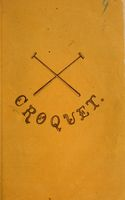
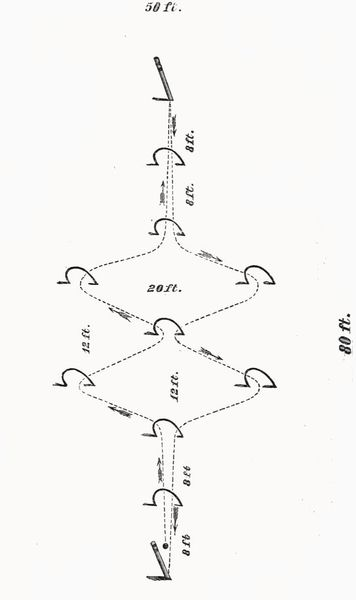
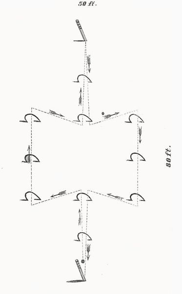

# 简介

一记击球何时延长回合，碰到别人的球又在什么条件下取得击送权？这本1865年的槌球小册子从41项术语开始，说明场地、器具与行进次序，再用52条规则和一连串判例处理争议：球停在球门下算不算通过，同一击同时取得两个进展如何选择，谁有权要求撤销一次误打，完成全程的游击球又保留哪些特殊权利。两幅场地图分别展示四球与八球布局，末章把规则判断落实为九条入门策略。

作者署名“纽波特槌球俱乐部的一位会员”，序末签“J.”。他把规则写成可以逐条适用的条文，又专门解释例外、证据和裁定权；最后提醒玩家严格执行规则，同时宽厚处理有争议的事实。这使它既是一份历史玩法说明，也是一份观察游戏怎样靠术语、权限和共同判断成立的原始材料。书末附有当时出版社的少年儿童读物广告及书评引文。

# 正文

## 前置页

<!-- pair:en:CQ0001:heading-->
CROQUET

<!-- translation -->
槌球
<!-- endpair -->

<!-- pair:en:CQ0002:heading-->
AS PLAYED BY

<!-- translation -->
玩法依据
<!-- endpair -->

<!-- pair:en:CQ0003:heading-->
THE NEWPORT CROQUET CLUB

<!-- translation -->
纽波特槌球俱乐部
<!-- endpair -->

<!-- pair:en:CQ0004:heading-->
BY

<!-- translation -->
作者
<!-- endpair -->

<!-- pair:en:CQ0005:heading-->
ONE OF THE MEMBERS.

<!-- translation -->
本会一位会员。
<!-- endpair -->

<!-- pair:en:CQ0006:figure_text-->
CROQUET

<!-- translation -->
槌球
<!-- endpair -->

<!-- pair:en:CQ0007:epigraph-->
Sic Indus animo debet aliquando dari  
Ad cogitandum melior ut redeat tibi.

<!-- translation -->
精神也应不时得到游乐，  
以便更为清明地回到思考。
<!-- endpair -->

<!-- pair:en:CQ0008:epigraph_attribution-->
Phœd., Lib. iii, Fab. 4.

<!-- translation -->
Phœd.，第三卷，寓言第四则。
<!-- endpair -->

<!-- pair:en:CQ0009:heading-->
NEW YORK:

<!-- translation -->
纽约：
<!-- endpair -->

<!-- pair:en:CQ0010:heading-->
SHELDON & COMPANY,

<!-- translation -->
Sheldon & Company，
<!-- endpair -->

<!-- pair:en:CQ0011:heading-->
498 & 500 BROADWAY.

<!-- translation -->
百老汇大街 498 及 500 号。
<!-- endpair -->

<!-- pair:en:CQ0012:heading-->
1865.

<!-- translation -->
1865 年。
<!-- endpair -->

<!-- pair:en:CQ0013:copyright-->
Entered, according to Act of Congress, in the year 1865, by
SHELDON & CO.,
In the Clerk's Office of the District Court for the Southern District
of New York.

<!-- translation -->
1865 年，Sheldon & Co.
依国会法案，在纽约南区联邦地区法院书记官办公室
登记版权。
<!-- endpair -->

<!-- pair:en:CQ0014:production_credits-->
Stereotyped by  
Smith & McDougal,  
84 Beekman-st. | Printed by  
C.S. Westcott & Co.,  
79 John-st.

<!-- translation -->
铅版制作  
Smith & McDougal，  
比克曼街 84 号。 | 印刷  
C.S. Westcott & Co.，  
约翰街 79 号。
<!-- endpair -->

<!-- pair:en:CQ0015:heading-->
## [turn to page iii] PREFACE

<!-- translation -->
## [turn to page iii] 序
<!-- endpair -->

<!-- pair:en:CQ0016:paragraph-->
The increasing popularity of Croquet, and the deficiencies of the existing manuals of the game, have encouraged me to give this little book to the public. The treatise of Captain Mayne Reid, to which the introduction of croquet in this country is mainly due, is deficient in system and arrangement, and affords no intelligible determination to many of the cases I have instanced in illustration of the rules of the game. The manuals published in this country are still more faulty. The rules afford no solution to half of the ambiguous cases that arise in ordinary play; and some are guilty of the strange error of allowing the "Roquet Croquet" to every ball—a liberty totally at variance with the fundamental principles of the game, and which in the hands of strong players would prolong the contest indefinitely, make[turn to page iv] victory depend upon a single chance hit, and reduce the opportunities for generalship and combination to a minimum. I have dwelt at some length upon the "right of declining," and the "theory of double points;" principles which, though hinted at by Captain Reid, are left rather obscure in his book. Players will find that this power of economizing privileges adds greatly to the interest of the game, and renders many a cunning plot and counter-plot necessary.

<!-- translation -->
槌球日益流行，现有游戏手册又存在种种不足，因此我决定将这本小书公诸于世。Mayne Reid 上尉的论著，对于槌球传入我国居功至伟，却缺少系统和条理；我为说明游戏规则列举的许多案例，在他的书中也找不到明白的裁断。本国出版的手册，缺点更多。日常游戏中出现的疑难情形，至少有一半无法从这些规则中得到解决；有些手册甚至犯了一个奇怪错误，准许所有球使用“无足击送”。这种自由完全违背游戏的基本原则，落到高手手中，会使比赛无限拖延，使[turn to page iv] 胜负取决于一次偶然命中，把运筹与配合的机会压到最低。我用了相当篇幅讨论“放弃的权利”和“一击双得分的理论”；Reid 上尉虽曾提到这些原则，在书中却讲得相当含糊。玩家会发现，节省特权的这种能力，大大增加了游戏的趣味，也使巧妙布局及其反制成为必要。
<!-- endpair -->

<!-- pair:en:CQ0017:paragraph-->
The origin of this game is unknown. No man invented whist or chess, and croquet like them seems to have been evolved by some process of nature, as a crystal forms or a flower grows—perfect, in accordance with eternal laws. There is in all these games a certain theory which furnishes interpretations for all cases that arise in actual play. The rules are grouped about a central principle. The mimic battles have a unity, and are homogeneous in all their parts. If the rules are indefinite or contradictory the game loses its distinctive character. If the rules are accurate and rigidly enforced, croquet is a game of the highest interest. I am informed by a scientific billiard player that though croquet is inferior to billiards in afford[turn to page v]ing opportunities for delicate manipulation and manual dexterity, that it far excels that elegant game in the field it opens for the exercise of the higher qualities of combination and foresight. Whist exercises the memory and the power of calculating probabilities; chess the imagination and the faculty of abstract reasoning; but croquet, though it taxes these mental qualities less, combines them with the delights of out-door exercise and social enjoyment, fresh air and friendship—two things which are of all others most effective in promoting happiness. Those who have been in the habit of regarding croquet as a game for children may, perhaps, smile at my enthusiasm; but let them procure a perfect ground, balls and mallets, play half a dozen four-ball games in strict accordance with the rules, and when they can claim to have mastered the game, they will acknowledge themselves converts.

<!-- translation -->
这项游戏的起源无人知晓。惠斯特牌和国际象棋都不是由某一个人发明的；槌球也仿佛像它们一样，经由某种自然过程演化而成，如晶体凝结、花朵生长，依照永恒法则，完美地形成。所有这些游戏都各有一种理论，可为实际游戏中出现的一切情形提供解释。规则围绕一个核心原则组织起来。这些模拟战斗具有统一性，所有部分相互协调。如果规则含糊或自相矛盾，游戏就失去其独特性质。如果规则准确并得到严格执行，槌球便极富趣味。一位精通台球的球手告诉我，槌球虽然在提[turn to page v] 供精细操控和手上技巧的机会方面不及台球，在为配合与预见这些更高能力提供施展空间方面，却远远胜过那项优雅的游戏。惠斯特牌锻炼记忆与计算概率的能力；国际象棋锻炼想象与抽象推理能力；槌球对这些心智能力的要求虽较低，却把它们与户外运动、社交的乐趣结合起来，带来新鲜空气与友谊——这两样东西，比其他事物更能增进幸福。习惯把槌球当作儿童游戏的人，也许会笑我热情过头；但只要他们备好上佳的场地、球和球槌，严格依照规则，打上半打四球比赛，等到能够声称掌握这项游戏时，就会承认自己已经信服。
<!-- endpair -->

<!-- pair:en:CQ0018:paragraph-->
I have adopted the plan of giving first definitions, then rules, then cases adjudged under the rules; as the common law consists of the definitions of legal terms, the statement of legal maxims or principles, and the reports of litigated causes. The laws are in substance those adopted by the "Newport Croquet Club," and[turn to page vi] many of the cases given actually occurred in play, and were settled in full bench after long and animated discussion. I think the laws will not conflict with those of Captain Reid, while I hope that they will be found more full and accurate, and of more exact application. I cannot flatter myself that I have provided for every possible ambiguous case; still, I hope that I have indicated the solution to most of the questions that are likely to arise in the course of a game.

<!-- translation -->
我采用的编排方式，是先给出定义，再列规则，最后列出依据规则裁决的案例；正如普通法由法律术语的定义、法律格言或原则的陈述，以及争讼案件的报告构成。这些规则实质上就是“纽波特槌球俱乐部”采用的规则；而且[turn to page vi] 所列许多案例确实发生在比赛中，经过长时间而热烈的讨论，由全体在场裁议者共同裁定。我想，这些规则不会与 Reid 上尉的规则冲突，也希望它们更完整、更准确，应用起来更为精确。我不敢自夸已为一切可能的疑难情形作出规定，但仍希望，游戏过程中可能出现的多数问题，我都已指明解决之道。
<!-- endpair -->

<!-- pair:en:CQ0019:paragraph-->
I shall be very happy to receive suggestions from any lovers of the game who may discover errors or imperfections; for why should not croquet as well as chess have its literature.

<!-- translation -->
若有喜爱这项游戏的人发现错误或缺漏，我非常乐于收到建议；槌球为什么不能像国际象棋一样，也拥有自己的文献呢？
<!-- endpair -->

<!-- pair:en:CQ0020:signature-->
"J.",

<!-- translation -->
“J.”，
<!-- endpair -->

<!-- pair:en:CQ0021:date_line-->
Newport, R.I., July 7th, 1865.
[turn to page vii]

<!-- translation -->
罗得岛州纽波特，1865 年 7 月 7 日。
[turn to page vii]
<!-- endpair -->

<!-- pair:en:CQ0022:heading-->
## CONTENTS

<!-- translation -->
## 目录
<!-- endpair -->

<!-- pair:en:CQ0023:contents-->
|  |  |
| --- | --- |
| CHAPTER I | page |
| Definitions of Technical Terms | 9 |
| CHAPTER II | |
| Description of the Ground and Implements | 15 |
| CHAPTER III | |
| Directions for Playing the Game | 22 |
| CHAPTER IV | |
| The Rules of the Game | 29 |
| CHAPTER V | |
| Hints to Beginners | 51 |

<!-- translation -->
|  |  |
| --- | --- |
| 第一章 | 页码 |
| 技术术语的定义 | 9 |
| 第二章 | |
| 场地与器具说明 | 15 |
| 第三章 | |
| 游戏玩法说明 | 22 |
| 第四章 | |
| 游戏规则 | 29 |
| 第五章 | |
| 给初学者的提示 | 51 |
<!-- endpair -->

<!-- pair:en:CQ0024:heading-->
## CHAPTER I

<!-- translation -->
## 第一章
<!-- endpair -->

<!-- pair:en:CQ0025:heading-->
### DEFINITIONS

<!-- translation -->
### 定义
<!-- endpair -->

<!-- pair:en:CQ0026:definition-->
Arena.—The space included by the boundaries of the croquet ground, within which a ball driven out of it is entitled to be placed.

<!-- translation -->
场内区域（Arena）——槌球场边界所围成的空间。被击出这一区域的球，有权移回其中放置。
<!-- endpair -->

<!-- pair:en:CQ0027:definition-->
Blow.—The stroke of the mallet. A blow opposed to a push.

<!-- translation -->
击打（Blow）——球槌的一次击球；与推球相区别。
<!-- endpair -->

<!-- pair:en:CQ0028:definition-->
Booby.—A ball that fails to run the first bridge.

<!-- translation -->
未过门球（Booby）——未能通过第一道球门的球。
<!-- endpair -->

<!-- pair:en:CQ0029:definition-->
Bridged Ball.—A ball that has run the first bridge.

<!-- translation -->
已过门球（Bridged Ball）——已通过第一道球门的球。
<!-- endpair -->

<!-- pair:en:CQ0030:definition-->
Central Bridges.—Those in a line between the stakes.

<!-- translation -->
中线球门（Central Bridges）——位于两桩之间同一直线上的球门。
<!-- endpair -->

<!-- pair:en:CQ0031:definition-->
Chiefs.—The leaders of the sides, who strike for the first choice.

<!-- translation -->
领队（Chiefs）——双方的带队者，通过击球争取先选权。
<!-- endpair -->

<!-- pair:en:CQ0032:definition-->
Concussion.—The displacement of a ball by another ball.

<!-- translation -->
碰撞移位（Concussion）——一个球被另一个球碰撞而发生移位。
<!-- endpair -->

<!-- pair:en:CQ0033:definition-->
Croquet.—The title of the game. A privilege gained by making "roquet." It consists in placing the playing ball in contact with the roqueted ball, and on any side of it; holding it[turn to page 10] there with the foot, and striking it with the mallet, by which means the other is driven in any required direction.

<!-- translation -->
槌球；贴球击送（Croquet）——游戏的名称；也是通过“有效撞球”取得的一项特权。其做法是：把本方正在打的球放到被撞球旁，使两球接触，可以选择其任意一侧；用脚把本球[turn to page 10] 压在原位，再以球槌击打本球，从而把另一球送往所需方向。
<!-- endpair -->

<!-- pair:en:CQ0034:definition-->
Croqueterie.—The implements of the game—namely, balls, mallets, stakes and bridges.

<!-- translation -->
槌球器具（Croqueterie）——游戏所用的器具，即球、球槌、球桩和球门。
<!-- endpair -->

<!-- pair:en:CQ0035:definition-->
Dead Ball.—A rover struck against the starting stake, and thereby struck out of the game.

<!-- translation -->
死球（Dead Ball）——游走球撞到起点桩，从而退出游戏的球。
<!-- endpair -->

<!-- pair:en:CQ0036:definition-->
Double Point.—Two points made on the same blow.

<!-- translation -->
一击双得分（Double Point）——同一次击打取得两个得分。
<!-- endpair -->

<!-- pair:en:CQ0037:definition-->
Enemy.—A player on the opposite side.

<!-- translation -->
敌方（Enemy）——对方阵营的一名玩家。
<!-- endpair -->

<!-- pair:en:CQ0038:definition-->
Flank Bridges.—Those on the right and left of a line between the stakes.

<!-- translation -->
侧翼球门（Flank Bridges）——位于两桩连线左右两侧的球门。
<!-- endpair -->

<!-- pair:en:CQ0039:definition-->
Flinch.—When in executing the "croquet" the playing ball escapes from under the foot, it is said to "flinch."

<!-- translation -->
脱脚（Flinch）——执行“贴球击送”时，本球从脚下逸出，便称为“脱脚”。
<!-- endpair -->

<!-- pair:en:CQ0040:definition-->
Front of a Bridge.—That side from which a ball must proceed in running it; the side toward the starting stake for the first half round; the side towards the turning stake for the last half round.

<!-- translation -->
球门的迎面侧（Front of a Bridge）——球过门时必须从这一侧进入；前半程是朝向起点桩的一侧，后半程则是朝向折返桩的一侧。
<!-- endpair -->

<!-- pair:en:CQ0041:definition-->
Friends.—Players on the same side.

<!-- translation -->
同伴（Friends）——同一方的玩家。
<!-- endpair -->

<!-- pair:en:CQ0042:definition-->
Grand Round.—The grand round consists in running all the bridges, (the central ones in both directions,) and tolling the turning stake, in proper order; after completing which the ball becomes a rover.[turn to page 11]

<!-- translation -->
全程（Grand Round）——按规定顺序通过全部球门（中线球门须从两个方向分别通过），并撞到折返桩。完成全程后，该球成为游走球。[turn to page 11]
<!-- endpair -->

<!-- pair:en:CQ0043:definition-->
Half Round.—The first half round includes running the central bridges and those on the left flank, and is to be made before tolling the stake; the second half round includes the central bridges and those on the left flank which are to be run in the reverse order between tolling and striking out.

<!-- translation -->
半程（Half Round）——前半程包括通过中线球门及左侧翼球门，须在撞折返桩之前完成；后半程包括中线球门及左侧翼球门，须在撞折返桩之后、撞桩退场之前，按相反顺序通过。
<!-- endpair -->

<!-- pair:en:CQ0044:definition-->
Misplay.—Playing out of proper tour; playing the ball of another player, or continuing the tour after failing to make a point.

<!-- translation -->
错打（Misplay）——不按应有回合出手；打了别人的球；或未能得分后仍继续本回合。
<!-- endpair -->

<!-- pair:en:CQ0045:definition-->
Oblique Bridge.—A bridge accidentally out of perpendicular, either to the horizon or to the line joining the stakes.

<!-- translation -->
偏斜球门（Oblique Bridge）——因意外而偏离垂直方向的球门；这里既指不再垂直于水平面，也指不再垂直于两桩连线。
<!-- endpair -->

<!-- pair:en:CQ0046:definition-->
Overrunning a Bridge.—A ball overruns its proper bridge when, in attempting to run it, it passes it on one side.

<!-- translation -->
偏越球门（Overrunning a Bridge）——尝试通过应过球门时，从其一侧越过，称为偏越球门。
<!-- endpair -->

<!-- pair:en:CQ0047:definition-->
Placing a Ball.—Bringing it within the arena when driven out of it, or removing a ball from a fixed obstacle.

<!-- translation -->
放置球（Placing a Ball）——把被击出场内区域的球移回其中，或把球从固定障碍物旁移开。
<!-- endpair -->

<!-- pair:en:CQ0048:definition-->
Point.—A blow by which a step on the round or a roquet is made, thereby entitling the player to continuance of tour—that is, to another blow.

<!-- translation -->
得分（Point）——一次完成行程步骤或有效撞球的击打，使玩家有权继续本回合，也就是再击一次。
<!-- endpair -->

<!-- pair:en:CQ0049:definition-->
Position.—A ball is in position when it is in front of its proper bridge, with a reasonable probability of running it on the next blow. The position is good or bad according to the ease or difficulty of the run.[turn to page 12]

<!-- translation -->
进门位置（Position）——球处在应过球门的迎面侧，而且下一击有合理机会过门，便算处于进门位置。位置的好坏，取决于过门的难易程度。[turn to page 12]
<!-- endpair -->

<!-- pair:en:CQ0050:definition-->
Proper Bridge.—The next "step on the round," the making of which constitutes a point.

<!-- translation -->
应过球门（Proper Bridge）——行程中下一项应完成的步骤；完成它便构成一次得分。
<!-- endpair -->

<!-- pair:en:CQ0051:definition-->
Push.—Shoving the ball with the mallet, allowed on some croquet-grounds instead of a blow.

<!-- translation -->
推球（Push）——用球槌推送球；有些槌球场准许用这种方式代替击打。
<!-- endpair -->

<!-- pair:en:CQ0052:definition-->
Re-roquet.—After roquetting a ball to roquet it again during the same tour, a right acquired only by making a step on the round.

<!-- translation -->
再撞（Re-roquet）——对某球作过有效撞球后，在同一回合中再次对它作有效撞球；只有完成一项行程步骤，才能取得这一权利。
<!-- endpair -->

<!-- pair:en:CQ0053:definition-->
Ricochet.—Two or more roquets made on the same blow.

<!-- translation -->
连撞（Ricochet）——同一次击打取得两次或更多次有效撞球。
<!-- endpair -->

<!-- pair:en:CQ0054:definition-->
Roquet.—The contact of the playing ball with another ball under such circumstances as to constitute a point; that is, provided both balls are bridged balls at the time of contact, and roquet has not been made on the same ball before in the same tour since the right to re-roquet has been acquired.

<!-- translation -->
有效撞球（Roquet）——本球与另一球接触，且符合构成得分的条件：两球在接触时都必须已过第一门；自取得再撞权以来，本球尚未在同一回合中对该球作过有效撞球。
<!-- endpair -->

<!-- pair:en:CQ0055:definition-->
Roquet-Croquet; Croquet sans pied.—The privilege of the rover. It differs from croquet in that the playing ball is not held with the foot, so that when struck it follows the croquetted ball or diverges in another direction.

<!-- translation -->
无足击送（Roquet-Croquet；Croquet sans pied）——游走球的特权。它与贴球击送的区别，在于不用脚压住本球；因而击打时，本球会跟随被击送的球，或向另一方向分开。
<!-- endpair -->

<!-- pair:en:CQ0056:definition-->
Rover.—A ball that has made the grand round, but not struck out.

<!-- translation -->
游走球（Rover）——已经完成全程，却尚未撞桩退场的球。
<!-- endpair -->

<!-- pair:en:CQ0057:definition-->
Running a Bridge.—Passing through the proper bridge from the front, or completing[turn to page 13] such passage, one of the steps on the round, a "point," if made by a blow of the mallet.

<!-- translation -->
过门（Running a Bridge）——从迎面侧通过应过球门，或完成[turn to page 13] 这一穿越过程。这是行程中的一项步骤；如果由球槌击打完成，就构成“得分”。
<!-- endpair -->

<!-- pair:en:CQ0058:definition-->
Side.—One of the two parties of players, of which the members play alternately.

<!-- translation -->
一方（Side）——玩家分成的两个阵营之一；两方成员交替出手。
<!-- endpair -->

<!-- pair:en:CQ0059:definition-->
Spot.—A point between the starting stake and the first bridge, one mallet's length from the former; from which the play commences.

<!-- translation -->
开球点（Spot）——起点桩与第一道球门之间，距起点桩一槌长的位置；游戏由此开始。
<!-- endpair -->

<!-- pair:en:CQ0060:definition-->
Starting Stake.—That near which the play commences, and the striking of which by a rover puts it out.

<!-- translation -->
起点桩（Starting Stake）——游戏从其附近开始；游走球撞到它，便退出游戏。
<!-- endpair -->

<!-- pair:en:CQ0061:definition-->
Step on the Round.—Running the proper bridge, or tolling the stake at the proper time, which advances a ball on the grand round, and gives the right to re-roquet.

<!-- translation -->
行程步骤（Step on the Round）——通过应过球门，或在适当时机撞折返桩；它推进球的全程，并赋予再撞权。
<!-- endpair -->

<!-- pair:en:CQ0062:definition-->
Striking for First Choice.—The usual method of deciding the first choice, in making up the sides and the first play. Each chief places a ball under the arch of the first bridge and plays at the stake. The ball lying nearest the stake entitles the chief playing it to the first choice of friends and the option of the first or second play.

<!-- translation -->
击球争先选权（Striking for First Choice）——组队和决定谁先开球时，通常用这一方式决定先选权。双方领队各把一个球放在第一道球门拱下，朝球桩击球。谁的球最后离桩最近，谁就有权先选同伴，并可选择第一或第二个出手。
<!-- endpair -->

<!-- pair:en:CQ0063:definition-->
Striking Out.—Hitting the starting stake when a rover, putting a ball out, and if the last of the side constituting the victory.

<!-- translation -->
撞桩退场（Striking Out）——游走球击中起点桩，使该球退出游戏；如果它是本方最后一球，也就意味着本方获胜。
<!-- endpair -->

<!-- pair:en:CQ0064:definition-->
Tolling the Stake.—Hitting the turning stake at the proper time; one of the steps on the grand round.[turn to page 14]

<!-- translation -->
撞折返桩（Tolling the Stake）——在适当时机击中折返桩；这是全程中的一项步骤。[turn to page 14]
<!-- endpair -->

<!-- pair:en:CQ0065:definition-->
Tour of Play.—The tour of a player or right to play, following the order of the colors on the stake, and continuing as long as he makes a point.

<!-- translation -->
击球回合（Tour of Play）——玩家的回合或击球权，按照球桩上的颜色顺序轮转；只要继续得分，这一回合就继续。
<!-- endpair -->

<!-- pair:en:CQ0066:definition-->
Turning Stake.—The stake to be tolled, opposite to the starting stake.[turn to page 15]

<!-- translation -->
折返桩（Turning Stake）——须撞到的球桩，位于起点桩对面。[turn to page 15]
<!-- endpair -->

<!-- pair:en:CQ0067:heading-->
## CHAPTER II

<!-- translation -->
## 第二章
<!-- endpair -->

<!-- pair:en:CQ0068:heading-->
### THE GROUND AND CROQUETERIE

<!-- translation -->
### 场地与槌球器具
<!-- endpair -->

<!-- pair:en:CQ0069:paragraph-->
The most important requisite for a croquet ground is smoothness of surface. Very good sport may be had on a ground slightly inclined; indeed a little practice will enable the players to make allowance for the inclination, so as to play with as much accuracy as if the surface were horizontal. But if the turf presents small inequalities, the direction and force of the stroke can never be accurately estimated. If the stroke is gentle, the ball may fall short or be turned aside. If the stroke is forcible, the ball will bound along the ground, and may jump entirely over another ball which it was intended to roquet. A croquet ground can always be brought to the requisite degree of smoothness by having the surface beaten with a spade after a rain; or, better still, thoroughly rammed with a paver's mallet. Rolling is not so effec[turn to page 16]tive, unless the ground is very soft or the roller very heavy. The size and shape of the ground is a matter of much less importance. The boundaries within which a ball can be placed should be traced or agreed upon; still better permanently defined by a ditch or slight embankment; and should, if possible, form a parallelogram of eighty feet by fifty. The turf within them should be kept as short as possible. The best arrangement of bridges for the four-ball game is that given in Figure I. For the six or eight-ball game Figure II. is preferable. A ball meets with two kinds of obstructions in making the "grand round"—it is obliged to pass through all the bridges, and again it may be croquetted and driven out of its course by an enemy. In the six or eight ball game, the dangers being much increased, it is well to diminish the difficulties, or the contest may be tediously protracted. This is accomplished by removing the central bridge and straightening the course. The channel is less tortuous, but "roving" privateers, clothed with "belligerent rights," are more frequently met, and the risks and excitement of the passage are equalized in both cases.

<!-- translation -->
槌球场最重要的条件，是地面平整。略有坡度的场地也能玩得很好；实际上，只须稍加练习，玩家就能把坡度计入判断，使击球像在水平地面上一样准确。但若草皮有细小起伏，就永远无法准确估计击球方向和力度。轻击时，球可能停得过近，或偏向一旁；重击时，球会在地上跳动，甚至从本来想有效撞击的另一个球上方整个跃过。雨后用铁锹拍打地面，总能使槌球场达到所需的平整程度；更好的办法，是用铺路工的夯槌彻底夯实。除非地面很软或压辊很重，滚压并不那么有[turn to page 16] 效。场地的大小与形状，重要性低得多。应把球可以移回放置的区域边界划出，或预先约定；更好的是用浅沟或低土埂永久标定。条件许可时，应划成长八十英尺、宽五十英尺的平行四边形。区内草皮应尽可能剪短。四球比赛最好的球门布局见图一；六球或八球比赛则以图二为宜。球完成“全程”时，会遇到两类阻碍：一是必须通过全部球门，二是可能被敌方贴球击送而偏离路线。六球或八球比赛中的危险大增，宜适当降低困难，否则比赛可能拖得令人厌烦。办法是移去中央球门，使路线更直。航道虽然少了曲折，享有“交战权”的“游走”私掠船却更常出现；两种玩法中，通行的风险与刺激因此得以平衡。
<!-- endpair -->

[turn to page 17]

<!-- pair:en:CQ0070:figure_caption-->
No. I. Four Ball Arrangement.

<!-- translation -->
图一　四球布局。
<!-- endpair -->

<!-- pair:en:CQ0071:figure_text-->
50 ft.  
80 ft.  
20 ft.  
12 ft.  
12 ft.  
8 ft.  
8 ft.  
8 ft.  
8 ft.

<!-- translation -->
50 英尺  
80 英尺  
20 英尺  
12 英尺  
12 英尺  
8 英尺  
8 英尺  
8 英尺  
8 英尺
<!-- endpair -->

[turn to page 18]

<!-- pair:en:CQ0072:figure_caption-->
No. II. Eight Ball Arrangement.

<!-- translation -->
图二　八球布局。
<!-- endpair -->

<!-- pair:en:CQ0073:figure_text-->
50 ft.  
80 ft.

<!-- translation -->
50 英尺  
80 英尺
<!-- endpair -->

<!-- pair:en:CQ0074:paragraph-->
In the diagrams the dotted lines indicate the[turn to page 19] order in which the bridges are to be run, and show the course of a ball making the "grand round."

<!-- translation -->
图中的虚线表明[turn to page 19] 各道球门应通过的顺序，展示一个球完成“全程”的路线。
<!-- endpair -->

<!-- pair:en:CQ0075:paragraph-->
The balls should be perfect spheres, about three inches in diameter, the size depending upon the weight of the wood from which they are made. Maple or beech is a very good material, but the best are made from the buttonwood or American sycamore. They should be boiled in linseed oil to give them the requisite weight and firmness. If boiled too long, however, they will become too heavy. Six ounces is about the proper weight, and a light ball is infinitely preferable to a heavy one for accurate play at long distances. Eight balls constitute a full set. They must be painted different colors, as the individuality of each ball is an important element in the game. As there is no necessity for the exercise of great strength in croquet, a set of balls made from seasoned wood and prepared as I have described ought to last a generation.

<!-- translation -->
球应当是直径约三英寸的正球体，具体大小取决于所用木材的重量。枫木或山毛榉都是很好的材料，但最好的球以美洲悬铃木制成。应放入亚麻籽油中煮过，使球具有所需的重量和坚实程度；但若煮得太久，又会过重。约六盎司是合适重量；长距离准确击球时，轻球远胜重球。八个球构成一整套。各球须涂不同颜色，因为每个球的独立身份是游戏的重要因素。槌球并不需要使很大的力气，因此，以充分干燥的木材制球，再按我所述方式处理，一套球理应能用上一代人的时间。
<!-- endpair -->

<!-- pair:en:CQ0076:paragraph-->
A variety of mallets should be provided, as different players prefer different sizes. One of the surest hitters I have ever known uses a mallet about fourteen inches long with a heavy head. The wood of the apple tree is the best[turn to page 20] material for the heads, and straight-grained ash for the handles. The standard handle is thirty-two inches long, one inch in diameter at the upper end, and five-eighths of an inch at the lower, tapering gradually. The head should be a cylinder about two inches in diameter and four inches long. It is best to make the faces square; for if they are convex, it renders it necessary to strike the ball exactly with the centre of the mallet head to insure an accurate stroke.

<!-- translation -->
应备有多种球槌，因为不同玩家偏好不同大小。我认识的一位击球极准的球手，使用一把长约十四英寸、槌头很重的球槌。制作槌头最好的[turn to page 20] 材料是苹果木，槌柄则宜用纹理直的白蜡木。标准槌柄长三十二英寸，上端直径一英寸，下端直径八分之五英寸，逐渐收细。槌头应为直径约两英寸、长四英寸的圆柱体。击球端面最好做成平正的；若端面凸起，要击得准确，就必须以槌头端面的正中心击中球。
<!-- endpair -->

<!-- pair:en:CQ0077:paragraph-->
The stakes should be about two feet long, and one and one-half inches in diameter. At least one of them should have rings painted on it corresponding to the colors of the balls. This is merely to aid in recollecting the order of play.

<!-- translation -->
球桩应长约两英尺、直径一又二分之一英寸。至少一根桩上应画有与各球颜色相应的色环。这只是为了帮助记住出手顺序。
<!-- endpair -->

<!-- pair:en:CQ0078:paragraph-->
Nine bridges are required in the four-ball arrangement, ten in the other. Firkin hoops, or hickory withs, about as large as the ramrod of a rifle, will answer the purpose very well. If soaked a day or two they can easily be bent into the required shape. The best, however, are made of three-eighths round iron. The span of the bridges should be rather less than three times the diameter of a ball. Eight inches is enough. If the ground is small so as[turn to page 21] to necessitate placing the bridges closer than in the standard arrangement, the span should be narrowed, and "vice versa," on the principle that too much difficulty protracts the game, too little renders it devoid of interest. The height and form of the arch is immaterial, but the pier or side of the bridge should be straight for at least three inches from the ground, and the centre of the arch from seven to nine inches high. The bridges should be driven firmly into the ground, in a plane perpendicular to the horizon and to the line joining the stakes. An inspection of the diagrams will furnish all needful information as to position.[turn to page 22]

<!-- translation -->
四球布局需要九道球门，另一种布局需要十道。桶箍，或粗细约如步枪通条的山核桃木条，都很合用；浸泡一两天后，就能轻易弯成所需形状。不过，最好的球门用直径八分之三英寸的圆铁条制成。球门跨度应略小于球直径的三倍，八英寸已经足够。如果场地较小，以[turn to page 21] 致球门间距不得不小于标准布局，就应缩小跨度；反之亦然。原则是：太难会拖长游戏，太容易又使游戏失去趣味。拱门的高度与形状无关紧要，但两侧门柱从地面起至少三英寸应保持笔直，拱顶中央高七至九英寸。球门须牢固插入地中，其所在平面应垂直于水平面，也垂直于两桩连线。查看示意图，就能得到位置方面所需的一切信息。[turn to page 22]
<!-- endpair -->

<!-- pair:en:CQ0079:heading-->
## CHAPTER III

<!-- translation -->
## 第三章
<!-- endpair -->

<!-- pair:en:CQ0080:heading-->
### MANNER OF PLAYING THE GAME

<!-- translation -->
### 游戏玩法
<!-- endpair -->

<!-- pair:en:CQ0081:paragraph-->
The game of croquet may be played by any number of players up to eight. If eight enter the game, each player must be provided with a mallet, and each will play one ball. If a less number of persons play, eight balls may still be used, one or more of the players playing two balls. In all cases there should be two sides, or parties, each of course having the same number of balls; and the balls, whether played by the same or different persons, having their turns always in the same prescribed order. An eight-ball or even a six-ball game is apt to be tedious, and skilful players invariably give the preference to the four-ball game, which may therefore be considered croquet par eminence. With more than four balls the element of chance enters too largely, and the combinations become too intricate, to be foreseen with any degree of certainty. The true[turn to page 23] lover of croquet will no more be tempted into an eight-ball game than a scientific chess-player will indulge in that abnormal monstrosity "four-handed chess." Played with two balls only, the game degenerates into a mere race. The four-ball game with two players is preferred by many, though lacking the sociality which is one of the charms of croquet. As the rules are the same in all cases, I shall hereafter, for convenience of illustration, take it for granted that there are four balls and four players. If the sides are not otherwise made up, two of the players are selected as chiefs. They strike for the first choice, (see definition); the one who wins it chooses a friend, then the other, and so on till the sides are made up. The winning chief plays first if he chooses, or, if not, the other chief leads, and the winning chief plays second; then one of the friends of the first player, and so on, the members of the two sides playing alternately. The first player uses the ball the color of which is highest on the stake, and the next takes the color immediately below. It is usual to have the rings on the stake alternately some light and dark color, so that the light colors form one side and the dark the other. After[turn to page 24] leading, the function of the chief ceases, except in match games, when he is allowed to direct the play of his side. At the commencement of the game the first player places his ball upon the spot, and strikes it with his mallet in the direction of the first bridge. If it run the bridge—that is, pass completely through it, he has the right to another blow; if not it is called a booby, and he must wait till the others have played and his turn comes round again. Suppose, however, that he has run the first bridge, and on his second blow runs the second bridge, he thus takes another step on the "grand round," or makes another point, which entitles him to still another blow. As it is generally impossible to run the third bridge on the third blow, he now tries to get "position" for his ball in front of the third bridge; but as he does not make a point on this last blow, he is not entitled to continuance of tour. He therefore stops, and the first player of the other side begins by placing his ball upon the spot and attempting to run the first bridge. If he runs it he has a little more latitude in his play, for he may now make a point in two ways—either by hitting the other ball, provided it is not a booby, or running his next bridge. Suppose[turn to page 25] he chooses to play for the second bridge, and, having run it, plays at the other ball already in position for the third bridge. If he succeeds in hitting it, he is said to have roqueted it, and having thus made a point, may play again and attempt the third bridge. But he has still another privilege; he may take his ball up, place it by the side of the other ball, and croquet it; after which he proceeds to play his ball from the position in which he placed it, having retained it there by his foot during the croquet. He will probably be in position for the third bridge. If he runs it his tour still continues, and he may play for the next bridge, or roquet the other ball again, which he may previously have croqueted, into the proper position. His tour continues till he fails to make a point, when the next player on the other side begins. After running the first bridge, he acquires, of course, the right of roqueting the other two balls. If he roquets an enemy's ball, he croquets it, if he wishes, into a disadvantageous position. If he roquets a friend, he croquets his ball into better position, or perhaps through its proper bridge. This will constitute a step on the grand round for the friend's ball, and will advance it as much[turn to page 26] as if it were driven through the bridge by the mallet of its proper player. After roqueting a ball, however, a player cannot roquet the same ball again until his own ball has made a step on the grand round. He may drive his own ball against it, and perhaps displace it by the concussion; but the hit does not constitute a roquet, does not entitle to croquet, or to continuance of tour. After making a step on the grand round, however, all his privileges are revived. After all the players have had their tours in the order of the colors on the stake, the first player takes his second tour, and so on. At the beginning of each new tour the grand round is taken up again, and the ball may make a point by making the "proper step on the round"—that is, the one next in order to that last made—whether made by a stroke of the mallet, by "concussion," or by croquet. Or it may make a point by roqueting any of the other balls. In the last case it may play again, either from the spot to which it has rolled or from the side of the roqueted ball; or it may croquet it and then play, attempting the proper step on the round, or roqueting another ball. If it has roqueted all the balls, it can make a point only by running its bridge, or tolling the[turn to page 27] stake, whichever may be the proper step; after which, as said before, all its privileges are renewed.

<!-- translation -->
槌球可由不超过八人的任意人数参与。八人参赛时，每人必须有一把球槌，各打一球。人数较少时，仍可使用八球，由一名或多名玩家各打两球。无论何种情况，都应分成两方，每方球数当然相同；各球无论由同一人还是不同人操控，都始终按同一规定顺序轮流出手。八球乃至六球比赛都容易冗长，熟练玩家一贯更喜欢四球玩法，因此四球可视为最典型的槌球。超过四球，偶然因素就过多，各种配合也复杂得无法作出较可靠的预见。真正[turn to page 23] 热爱槌球的人，不会被八球玩法吸引，正如精通国际象棋的人不会沉迷那种畸形怪物“四人国际象棋”。只用两球，游戏又退化成单纯的竞速。许多人喜欢两人各打两球的四球玩法，尽管它少了槌球的一项魅力：社交。各种玩法规则相同，为便于举例，下文都假定有四球、四名玩家。如果双方尚未以其他方式分好，就选两人作领队。他们击球争先选权（见定义）；获胜者先选一名同伴，然后另一方选择，如此继续，直到组队完成。赢得先选权的领队若愿意，便先开球；否则由另一领队先打，赢得先选权者第二个打。然后轮到先打者的一名同伴，如此类推，双方成员交替出手。先打者使用球桩上最上方色环对应的球，下一人取紧接其下的颜色。桩上色环通常深浅交替，因此浅色球组成一方，深色球组成另一方。领队完成开[turn to page 24] 球后，其职能便终止；但正式对抗赛例外，领队可以指导本方的打法。游戏开始，第一名玩家把球放在开球点上，朝第一门方向击球。如果过门，即完全通过该门，他便有权再击一次；如果未过，就称为未过门球，必须等其他人都打过，自己的回合再次到来。假设他已通过第一门，第二击又通过第二门，便又完成一项“全程”步骤，即又得一分，有权继续再击。第三击通常不可能通过第三门，因此他会尝试把球放到第三门前的“进门位置”；但最后这一击没有得分，所以无权继续本回合。他于是停下，由另一方的第一名玩家把球放到开球点上，尝试通过第一门。如果通过，他就有更多选择，因为这时有两种得分方式：击中另一球——前提是对方不是未过门球——或通过自己的下一门。假设[turn to page 25] 他选择通过第二门，过门后，再朝已经处于第三门进门位置的另一球击打。如果成功击中，便称为作了有效撞球；既然得分，就可以再击，尝试通过第三门。但他还有另一项特权：可以拿起本球，放在另一球旁，执行贴球击送；随后从放置本球的位置继续打，因为击送时已用脚把球留在原地。他这时很可能已处于第三门的进门位置。如果过门，回合仍继续，可以朝下一门打，或再次有效撞击那只球；此前也许已经把它贴球击送到了合适的位置。只要未能得分，回合才告结束，接着由另一方的下一名玩家开始。通过第一门后，他当然取得有效撞击另外两球的权利。如果撞的是敌球，只要愿意，就可把它击送到不利位置；如果撞的是同伴的球，就把它击送到更好的位置，甚至送过其应过球门。这为同伴的球完成了一项全程步骤，其行程进展[turn to page 26] 与由该球自己的玩家用槌击打过门完全相同。不过，有效撞击某球之后，必须先让本球完成一项全程步骤，才能在同一回合中再次有效撞击同一球。仍可把本球击向它，也许通过碰撞使它移位；但这次接触不构成有效撞球，不赋予贴球击送权，也不能据以继续回合。一旦完成一项全程步骤，所有这些特权又都恢复。全部玩家按照球桩颜色顺序完成各自回合后，第一个玩家开始第二回合，如此类推。每个新回合开始时，继续此前的全程；球可以完成“应做的行程步骤”而得分，即按顺序完成上一项之后的下一项，无论上一项是由球槌击打、碰撞还是贴球击送完成的。也可以通过有效撞击其他任何一球得分。后一种情况下，可以从本球滚停的位置继续打，或从被撞球旁继续；也可以先贴球击送，再击球尝试完成应做的行程步骤，或有效撞击另一球。如果所有球都已撞过，就只能通过应过球门、或撞折返[turn to page 27] 桩来得分，取决于哪一项是应做的步骤；完成后，如前所述，一切特权便又恢复。
<!-- endpair -->

<!-- pair:en:CQ0082:paragraph-->
Thus the game continues until one of the balls completes the grand round, as explained in the diagrams. The last step is running the first bridge in the reverse direction. The player making this takes up his ball, unless he has been so unfortunate as to strike out on the same blow; and places it on the spot whence he continues his tour as a rover, namely, that of croqueting without the foot, or roquet-croqueting after making a roquet. By this means he not only drives off the roqueted ball but follows it with his own, or forces them in divergent directions. If he is skillful, he may leave his own ball near one of the other balls, which he may then proceed to roquet, and succeeding in this, to croquet, or to roquet-croquet, whichever may be most advantageous. As he has no bridges to run he can never re-roquet, and hence after he has roqueted and croqueted all the other balls his tour terminates at the next blow.

<!-- translation -->
游戏如此继续，直到某球完成图示的全程。最后一步，是反向通过第一门。完成这一步的玩家，应拿起球，放到开球点上，从那里以游走球身份继续本回合；除非倒霉到在同一击中已经撞桩退场。游走球的特权，就是完成有效撞球后，可以不用脚进行击送，亦即无足击送。这样，它不仅把被撞球送走，本球也能跟随，或把两球送向不同方向。球手若熟练，可以把本球留在另一球附近，接着尝试有效撞击它；成功后，再按哪种方式更有利，选择贴球击送或无足击送。由于已无球门要过，游走球永远不能取得再撞权；因此，对其他所有球都作过有效撞球并击送之后，再打一击，本回合便告结束。
<!-- endpair -->

<!-- pair:en:CQ0083:paragraph-->
As soon as a rover touches the starting stake it becomes a dead ball and must be removed from the field. It makes no difference whether[turn to page 28] it strike out by its own act, or is struck out by its partner, or by one of the enemy. The latter catastrophe will be of frequent occurrence unless perpetually guarded against, for the partner or partners are thereby left to fight against superior numbers. When all the balls of a side succeed in striking the stake the game is over, and the side has won the victory.

<!-- translation -->
游走球一接触起点桩，就成为死球，必须移出场地。它是[turn to page 28] 自己撞桩退场，还是被同伴或敌方撞出，都没有区别。如果不时刻防备，后一种灾难就会经常发生，使剩下的同伴不得不以少敌多。当一方所有球都成功击中球桩时，游戏结束，该方获胜。
<!-- endpair -->

<!-- pair:en:CQ0084:paragraph-->
With this brief outline of the game, the reader is referred for details to the chapter on the rules.[turn to page 29]

<!-- translation -->
以上只是游戏梗概；细节请读者参看规则一章。[turn to page 29]
<!-- endpair -->

<!-- pair:en:CQ0085:heading-->
## CHAPTER IV

<!-- translation -->
## 第四章
<!-- endpair -->

<!-- pair:en:CQ0086:heading-->
### THE RULES

<!-- translation -->
### 规则
<!-- endpair -->

<!-- pair:en:CQ0087:rule-->
1. Each ball must first be placed upon the spot and played from thence.

<!-- translation -->
1. 每个球最初都必须放在开球点上，从那里打出。
<!-- endpair -->

<!-- pair:en:CQ0088:rule_explanation-->
A booby does not return to the spot, but continues to play as a booby, without the right to roquet or be roquetted until it is bridged. Hence a booby has but one blow unless that blow bridge it. It may hit another ball and be hit, but the contact never constitutes a point.

<!-- translation -->
未过门球不回到开球点，而是继续以未过门球身份打；在通过第一门以前，既无权有效撞击他球，也不能成为他球有效撞球的对象。因此，未过门球每回合只有一击，除非这一击使它过门。它可以击中其他球，也可以被击中，但这种接触绝不构成得分。
<!-- endpair -->

<!-- pair:en:CQ0089:rule-->
2. The mallet must be used with one hand, and the stroke must be a blow.

<!-- translation -->
2. 球槌必须单手使用，而且出手必须是击打。
<!-- endpair -->

<!-- pair:en:CQ0090:rule_explanation-->
With balls and mallets of the standard size, there is no necessity for using both hands. It is difficult to draw the precise line between a legitimate blow and a push. In every blow the mallet follows the ball a little, for it takes a small interval of time for the momentum of the mallet to transfer itself to the ball; but in the push a new impulse is given to the ball every[turn to page 30] instant, and this may act unfairly; for instance, a ball is to be roqueted at a distance of six inches or a foot. If the playing ball is pushed until it reach the other ball, the latter is virtually moved by the mallet as much as in the roquet-croquet, instead of being moved by concussion merely. This would be inconsistent with the theory of the game. Again, a ball is in contact with the pier of its proper bridge so that it cannot run it by a blow. If a push be allowed, it might be pushed into position, and then pushed through by slightly changing the direction of the mallet. It would thus be played in a curved line. It may be objected to this rule that the vicinity of the stake or the piers of a bridge may render a blow impossible; but a little attention will obviate the necessity of playing in constrained positions.

<!-- translation -->
使用标准大小的球与球槌，没有必要双手持槌。合法击打与推球之间，很难划出精确界线。每次击打，球槌都会稍稍跟随球一段，因为球槌的动量传给球，需要很短的一段时间；但推球时，球在每[turn to page 30] 一瞬间都受到新的推动力，可能因此产生不公平效果。例如，要有效撞击六英寸或一英尺外的一球，如果一直推着本球，直到它碰到另一球，后者实际上就像在无足击送中一样受到球槌推动，而不只是因碰撞而移动。这与游戏的理论不符。再如，本球正贴着应过球门的门柱，无法以击打过门。如果准许推球，就能先把它推到进门位置，再略改球槌方向，将它推过球门；球便能沿曲线被操纵。有人可能反对，认为球靠近球桩或门柱时，击打也许根本不可能；但只要稍加留意，就可避免不得不从受限位置击球。
<!-- endpair -->

<!-- pair:en:CQ0091:rule-->
3. The stroke is delivered when an audible sound is made or the ball moved.

<!-- translation -->
3. 只要发出可听见的声响，或使球移动，便算已经出手。
<!-- endpair -->

<!-- pair:en:CQ0092:rule_explanation-->
The habit of giving the ball a little preparatory tap should be avoided. It is allowed to strike the pier of a bridge or the stake with the view of moving the ball by concussion; but if the ball do not move the blow is complete, and the error in judgment cannot be rectified.

<!-- translation -->
应避免先轻轻敲球一下作准备的习惯。准许击打球门门柱或球桩，意图凭碰撞使球移动；但即使球未动，这一击也已完成，不能再补救自己的判断错误。
<!-- endpair -->

<!-- pair:en:CQ0093:rule-->
4. The tour of a ball continues as long as it makes a point, and terminates with the first blow on which no point is made.[turn to page 31]

<!-- translation -->
4. 只要球继续得分，它的回合就继续；第一记未能得分的击打，使该回合结束。[turn to page 31]
<!-- endpair -->

<!-- pair:en:CQ0094:rule-->
5. To make a point a ball must either make a step on the grand round or roquet another ball.

<!-- translation -->
5. 球要得分，必须完成全程中的一项步骤，或有效撞击另一球。
<!-- endpair -->

<!-- pair:en:CQ0095:rule_explanation-->
Croquet is not considered a point, because it is not a play of the player's own ball but a privilege, after which the tour is continued by virtue of the roquet.

<!-- translation -->
贴球击送不算得分，因为它并非对玩家本球的一次普通击球，而是一项特权；执行后，回合依据此前的有效撞球而继续。
<!-- endpair -->

<!-- pair:en:CQ0096:rule-->
6. Each ball before striking out must make every step on the grand round in the prescribed order, either directly by a blow of the mallet, or indirectly by concussion or croquet.

<!-- translation -->
6. 每个球在撞桩退场之前，都必须依规定顺序完成全程的每一项步骤；既可由球槌直接击打完成，也可通过碰撞或贴球击送间接完成。
<!-- endpair -->

<!-- pair:en:CQ0097:rule_explanation-->
"Directly by a blow of the mallet"—that is, during the ball's own tour, whether proceeding from the mallet immediately, or by rebound from a fixed object or the person of an enemy. "Indirectly," not during its own tour, when moved by another ball or accidentally.

<!-- translation -->
“由球槌直接击打”，是指在该球自己的回合内，无论球直接受球槌推动，还是从固定物体或敌方玩家身上反弹。“间接”则指在自己的回合之外，被另一球推动，或因意外而移动。
<!-- endpair -->

<!-- pair:en:CQ0098:rule-->
7. Making the proper step on the round, but no other, constitutes a point, or entitles to continuance of tour.

<!-- translation -->
7. 只有完成应做的行程步骤，才构成得分或有权继续回合；其他步骤都不构成得分。
<!-- endpair -->

<!-- pair:en:CQ0099:rule_explanation-->
A step made indirectly is no point either for the playing ball or the other, though the latter is advanced on its round.

<!-- translation -->
间接完成的步骤，对正在打的球和另一球都不算得分，尽管另一球的行程确实得到了推进。
<!-- endpair -->

<!-- pair:en:CQ0100:rule-->
8. The bridges must be run from the front—that is, from the side towards the starting stake for the first half-round, and from the other side for the second half-round.[turn to page 32]

<!-- translation -->
8. 球门必须从迎面侧通过：前半程从朝向起点桩的一侧进入，后半程则从另一侧进入。[turn to page 32]
<!-- endpair -->

<!-- pair:en:CQ0101:rule-->
9. A bridge is not run unless the ball pass completely through it.

<!-- translation -->
9. 只有整个球完全穿过球门，才算过门。
<!-- endpair -->

<!-- pair:en:CQ0102:rule_explanation-->
To decide this in a doubtful case, place the mallet handle against the piers in front; if any part of the ball project beyond the plane of the bridge it will become evident. The ball is then said to rest under the arch of the bridge.

<!-- translation -->
有疑问时，可把槌柄从迎面侧靠在两根门柱上；若球有任何部分突出于球门所在平面，就能看出来。此时称球停在球门拱下。
<!-- endpair -->

<!-- pair:en:CQ0103:rule-->
10. A ball resting under the arch of a bridge and having come from the front makes no point, but is in position to run the bridge.

<!-- translation -->
10. 从迎面侧进入、停在球门拱下的球，不算得分，但已处于通过该门的进门位置。
<!-- endpair -->

<!-- pair:en:CQ0104:rule_explanation-->
The run may now be completed by concussion, or, if the ball remain till next tour, by a blow of the mallet.

<!-- translation -->
此后可以通过碰撞完成过门；如果球一直留到下一回合，也可用球槌击打完成。
<!-- endpair -->

<!-- pair:en:CQ0105:rule-->
11. A ball resting under the arch of a bridge, and having come from the reverse side, is not in position to run it.

<!-- translation -->
11. 从背面一侧进入、停在球门拱下的球，不算处于通过该门的进门位置。
<!-- endpair -->

<!-- pair:en:CQ0106:rule_explanation-->
To decide a doubtful case, place the mallet handle against the piers on the reverse side.

<!-- translation -->
有疑问时，把槌柄从背面一侧靠在两根门柱上，即可判断。
<!-- endpair -->

<!-- pair:en:CQ0107:case-->
Case.—A ball was in position under the arch of a bridge but is driven back, and afterwards gains the same position from the reverse side. Is it in position, since it once reached that point from the front? No. The run of the bridge must be continuous, though not necessarily at one blow.[turn to page 33]

<!-- translation -->
判例——一球原先在门拱下处于进门位置，后来被击退，又从背面一侧回到同一位置。既然它曾从迎面侧到达此处，现在是否仍算处于进门位置？不算。过门过程必须连续，虽然未必由同一次击打完成。[turn to page 33]
<!-- endpair -->

<!-- pair:en:CQ0108:rule-->
12. If a ball pass completely through a bridge and rebound or roll back, the run remains good.

<!-- translation -->
12. 球若完全过门，随后反弹或滚回，过门仍然有效。
<!-- endpair -->

<!-- pair:en:CQ0109:rule-->
13. If a ball pass completely through a bridge in the reverse direction, and rebound or roll back under the arch, it is in position.

<!-- translation -->
13. 球若反向完全穿过球门，然后反弹或滚回拱下，就算处于进门位置。
<!-- endpair -->

<!-- pair:en:CQ0110:rule-->
14. If a bridge be oblique any player may adjust it, unless a ball be under the arch.

<!-- translation -->
14. 如果球门偏斜，任何玩家都可以调整，除非有球停在拱下。
<!-- endpair -->

<!-- pair:en:CQ0111:rule_explanation-->
That is, it must first be decided whether the ball has run the bridge or is in position.

<!-- translation -->
也就是说，必须先判定球是否已经过门，或是否处于进门位置。
<!-- endpair -->

<!-- pair:en:CQ0112:rule-->
15. The stake may be tolled from any direction and by the slightest perceptible touch.

<!-- translation -->
15. 可以从任何方向撞折返桩；只要是能辨察的最轻微接触，也算撞到。
<!-- endpair -->

<!-- pair:en:CQ0113:rule_explanation-->
An audible sound will be evidence of the tolling; but when it is so near that the sound cannot be distinguished from that of the mallet, it must be seen to change its direction.

<!-- translation -->
听见响声，可以证明球已触桩；但球离桩很近，触桩声与槌击声分不清时，就必须看见球改变方向。
<!-- endpair -->

<!-- pair:en:CQ0114:rule-->
16. A ball roquets another when it comes in contact with it from a blow of the mallet; provided both balls are bridged at the time of contact, and the playing ball has not roqueted the other ball before during the same tour since making a step on the round.

<!-- translation -->
16. 本球因球槌击打而接触另一球，就构成对该球的有效撞球，条件是：接触时，两球都已通过第一门；而且自完成一项行程步骤之后，本球尚未在同一回合中对该球作过有效撞球。
<!-- endpair -->

<!-- pair:en:CQ0115:case-->
Case.—A booby hits a booby and both pass through the first bridge; can it croquet? No. It is not a roquet unless they remain in contact after passing through the bridge. It must roquet again.[turn to page 34]

<!-- translation -->
判例——一个未过门球击中另一个未过门球，两球都通过第一门；它能否贴球击送？不能。除非两球过门后仍保持接触，否则不构成有效撞球，必须重新有效撞击一次。[turn to page 34]
<!-- endpair -->

<!-- pair:en:CQ0116:rule-->
17. A ball already in contact with another ball does not roquet unless it move it perceptibly.

<!-- translation -->
17. 已经与另一球接触的球，必须使另一球发生可辨察的移动，才构成有效撞球。
<!-- endpair -->

<!-- pair:en:CQ0117:rule_explanation-->
To do this it must, of course, play in a direction less than ninety degrees from a line joining the centres of the balls.

<!-- translation -->
要做到这一点，击球方向与两球球心连线的夹角，当然必须小于九十度。
<!-- endpair -->

<!-- pair:en:CQ0118:rule-->
18. A ball can acquire the right to re-roquet—that is, to roquet the same ball again during the same tour—only by making a step on the round.

<!-- translation -->
18. 球只有完成一项行程步骤，才能取得再撞权，即在同一回合内再次有效撞击同一球的权利。
<!-- endpair -->

<!-- pair:en:CQ0119:rule_explanation-->
A ball may hit another ball twice or more during the same tour, and between two consecutive bridges, or between the bridge and the turning stake, and move it, each time by concussion; but only one (not necessarily the first) contact is a valid roquet.

<!-- translation -->
在同一回合中、两道连续球门之间，或球门与折返桩之间，一球可以两次乃至多次击中另一球，每次都通过碰撞使它移动；但只有一次接触算作有效撞球，而且未必是第一次。
<!-- endpair -->

<!-- pair:en:CQ0120:rule-->
19. A roquet, but no hit which does not fulfil all the conditions of a roquet, constitutes a point, and entitles to continuance of tour.

<!-- translation -->
19. 有效撞球构成得分，并赋予继续回合的权利；不具备有效撞球全部条件的接触，都不算得分。
<!-- endpair -->

<!-- pair:en:CQ0121:rule-->
20. A roquet, but no other hit, entitles to the privileges of croquet.

<!-- translation -->
20. 只有有效撞球才赋予贴球击送的特权；其他接触都不能。
<!-- endpair -->

<!-- pair:en:CQ0122:rule-->
21. The croquet may be declined, and the tour continued from the spot to which the player's ball has rolled, or from the side of the roqueted ball.

<!-- translation -->
21. 可以放弃贴球击送，从本球滚停的位置，或从被有效撞击的球旁，继续本回合。
<!-- endpair -->

<!-- pair:en:CQ0123:rule_explanation-->
The privilege of the croquet thus consists of two parts. First, the option between the final position of the playing ball and a new position in contact with the roqueted ball, and on any[turn to page 35] side of it. Second, the croquet proper. The second only, or both parts of this privilege may be declined; but this must be distinguished from "declining roquet" afterward mentioned.

<!-- translation -->
因此，贴球击送特权包含两部分。第一，可以选择让本球留在最后停下的位置，或把它移到与被撞球接触的新位置，放在其任[turn to page 35] 意一侧。第二，是贴球击送本身。可以只放弃第二部分，也可以两部分都放弃；但必须与下文所说的“放弃有效撞球”区分。
<!-- endpair -->

<!-- pair:en:CQ0124:case-->
Case.—A ball not a rover having roqueted another ball, is placed in contact with it, and, without using the foot, the player drives them both in any direction, as in roquet-croquet. Is this allowed? Yes. The croquet was declined and the stroke was a common blow; but the other ball, being merely moved by concussion, (since it was previously roqueted,) the tour cannot be continued unless a point was made at the same time.

<!-- translation -->
判例——一只尚未成为游走球的球，有效撞击另一球后，被放到与它接触的位置；玩家不用脚，同时把两球打向任意方向，像无足击送那样。这是否允许？允许。玩家放弃了贴球击送，这一击是普通击打；但另一球此前已被有效撞击过，此时只是因碰撞而移动，所以除非这一击同时取得其他得分，否则本回合不能继续。
<!-- endpair -->

<!-- pair:en:CQ0125:rule-->
22. If after a roquet the playing ball be taken up or moved from its place, it must continue its tour from the side of the roqueted ball.

<!-- translation -->
22. 有效撞球之后，如果本球被拿起或挪离原处，就必须从被撞球旁继续本回合。
<!-- endpair -->

<!-- pair:en:CQ0126:case-->
Case.—A ball roquets another ball, driving the latter by concussion through the playing ball's proper bridge; remaining, however, in position to run the bridge. The player begins to move the ball, but on second thought concludes to run the bridge. Can he claim to have moved it by accident? No, even if it was not taken up from the ground; for it may be presumed that it was done with the intention to croquet. Whether he croquet or not he must[turn to page 36] take position by the side of the other, and has lost his opportunity to run the bridge. So, too, if he takes position under the arch of the bridge he is not in position to run it, for the space over which the ball is carried is no part of its course.

<!-- translation -->
判例——一球有效撞击另一球，使后者因碰撞穿过本球的应过球门；本球却仍留在可以过门的位置。玩家开始挪动本球，随后改变主意，决定过门。他能否声称这是意外挪动？不能，即使球尚未被提离地面，也不行，因为可以推定挪球是为了贴球击送。不管是否执行击送，他都必须[turn to page 36] 在另一球旁就位，已经失去这次过门机会。同样，把球放到门拱下执行击送，也不算处于进门位置；因为球被拿着移过的空间，不属于它的行进路线。
<!-- endpair -->

<!-- pair:en:CQ0127:rule-->
23. The croquet must be executed before continuance of tour.

<!-- translation -->
23. 必须先执行贴球击送，才能继续本回合。
<!-- endpair -->

<!-- pair:en:CQ0128:case-->
Case.—A ball roquets another and on the same blow runs its bridge; the croquet is then executed. Does the run hold good. Yes, at the player's option. Case.—Under the same circumstances the playing ball is taken to the side of the roqueted ball. Can it re-roquet it on the ground that it has run a bridge since the roquet? No. The right to re-roquet must be acquired after croqueting or moving the playing ball. But the playing ball might have re-roqueted from its final position, declining the first croquet.

<!-- translation -->
判例——一球在同一击中，先有效撞击另一球，又通过本球的球门；随后执行贴球击送。过门还算有效吗？算，由玩家自行选择。判例——同样情况下，本球被拿到被撞球旁。能否以有效撞球之后已过一道球门为由，再撞同一球？不能。再撞权必须在执行贴球击送或挪动本球之后取得。但玩家本来可以放弃第一次贴球击送，从本球最后停下的位置，再撞那一球。
<!-- endpair -->

<!-- pair:en:CQ0129:rule-->
24. The croquet is completed when the mallet makes a perceptible blow against the croqueting ball; but if the mallet altogether miss it, the blow may be repeated.

<!-- translation -->
24. 只要球槌对执行击送的本球作出可辨察的击打，贴球击送便算完成；但若球槌完全没有碰到本球，就可以重击。
<!-- endpair -->

<!-- pair:en:CQ0130:rule_explanation-->
The blow is perceptible if an audible sound is made, whether the croqueted ball move or not.[turn to page 37]

<!-- translation -->
只要发出了听得见的响声，便属可辨察的击打，无论被击送的另一球是否移动。[turn to page 37]
<!-- endpair -->

<!-- pair:en:CQ0131:case-->
Case.—A player in croqueting claims to have hit his foot; the croqueted ball, however, has moved from its place. Can he restore it and repeat the blow? No. The claim should not be allowed, for it is impossible to tell in such cases whether the ball was hit or only the foot. If it be necessary to get the other ball out of the way, he must drive it by concussion with his own.

<!-- translation -->
判例——玩家在贴球击送时，声称自己打中了脚，但被击送球已经离开原位。他能否把球放回，再击一次？不能。不应准许这一主张，因为此类情况下无法判断究竟打中了球，还是只打中了脚。如果必须把另一球从路线上移走，他就只能用本球通过碰撞把它打走。
<!-- endpair -->

<!-- pair:en:CQ0132:rule-->
25. If the player's ball flinch in executing the croquet he forfeits the remainder of his tour, and no point made by a flinching ball is valid.

<!-- translation -->
25. 贴球击送时，本球若脱脚，玩家就丧失该回合余下的击球权；脱脚球取得的任何得分都无效。
<!-- endpair -->

<!-- pair:en:CQ0133:case-->
Case.—A flinching ball rests under the arch of its proper bridge, having come from the front. Is it in position? No. If the complete run is illegal, the partial run is also, as in the case of moving a ball to croquet.

<!-- translation -->
判例——脱脚球从迎面侧进入，停在应过球门的拱下。它算处于进门位置吗？不算。既然完整过门都不合法，部分过门也不合法；与把球挪去贴球击送的情形相同。
<!-- endpair -->

<!-- pair:en:CQ0134:rule-->
26. If a ball be driven out of the arena, it must be brought within it, and placed one foot from the boundary at the nearest point.

<!-- translation -->
26. 球被击出场内区域时，必须移回区域内，在离边界最近的地方，距边界一英尺处放置。
<!-- endpair -->

<!-- pair:en:CQ0135:rule_explanation-->
This rule is on the supposition that the arena is of the standard dimensions or something near it. If from the imperfections of the ground the boundaries at any place approach too near the stakes or bridges, this rule must be modified so that a ball shall not materially alter its position with reference to the bridges,[turn to page 38] stakes, or other balls. Under the same limitations it may be removed one foot from a tree or other obstacle. The ball should be placed immediately.

<!-- translation -->
这条规则以场内区域具有标准或接近标准尺寸为前提。如果由于场地不完善，有些地方的边界太靠近球桩或球门，就必须调整这条规则，使球相对于球门、[turn to page 38] 球桩或其他球的位置，不发生实质改变。在同样限制下，也可把球从树或其他障碍物旁移开一英尺。应当立即放置球。
<!-- endpair -->

<!-- pair:en:CQ0136:case-->
Case.—A's ball is played against a tree. If B roquet it he cannot croquet it, or play his ball afterwards to advantage. Can he compel A to place his ball? Yes; but not so that B's position after the roquet shall be improved. If this were not so ruled, an obstacle would often be made a refuge. Cases of this kind often arise on imperfect grounds. They must be settled like cases in equity; as fairly as possible for each side, and so that neither can take advantage of technicalities.

<!-- translation -->
判例——A 的球打到一棵树旁。B 若有效撞击它，就既不能贴球击送，也无法在随后有利地打本球。他能否要求 A 放置其球？可以，但不能因此改善 B 在有效撞球后的位置。若不这样裁定，障碍物便常会变成避难所。这类情形在不完善的场地经常出现，必须像衡平法案件一样处理，尽可能公平照顾双方，使任何一方都不能利用技术细节取巧。
<!-- endpair -->

<!-- pair:en:CQ0137:rule-->
27. If a player misplay, and the enemy challenge him before allowing the play of another ball, they have the option of replacing the misplaying ball and any which may have been moved in their former positions, or allowing any or all of them to remain in the positions to which they have rolled. And no point made by a misplaying ball, if properly challenged, is valid, except at their option.

<!-- translation -->
27. 玩家错打时，如果敌方在允许另一球出手之前提出异议，敌方可以选择把错打球及任何被移动的球放回原位，也可以允许其中任意球或全部球留在滚停的位置。对于被及时提出异议的错打球，它取得的任何得分，除非敌方选择认可，否则均无效。
<!-- endpair -->

<!-- pair:en:CQ0138:rule_explanation-->
The option belongs to the enemy of the players and not of the ball. If the challenge be made as soon as possible, though another[turn to page 39] ball is played at the same time, the requirements of the rule are satisfied.

<!-- translation -->
选择权属于错打玩家的敌方，而不是所打那只球的敌方。只要已尽早提出异议，即使另一[turn to page 39] 球恰好同时出手，也满足本规则要求。
<!-- endpair -->

<!-- pair:en:CQ0139:case-->
Case.—A misplaying ball runs a bridge after croqueting its partner through his proper bridge. The enemy challenge and elect to leave both balls in their final position. Can they compel them to renew their bridges? The ball of the misplayer must re-run its bridge; but any other ball has made the step unless it is restored to its former position. The latter is regarded as accidentally displaced, and follows the rule provided for that case. If the misplay consist of illegal continuance of tour, of course the penalty does not extend to the correct play which preceded it.

<!-- translation -->
判例——一只错打球先把同伴的球贴球击送过其应过球门，随后本球也过了一门。敌方提出异议，选择让两球都留在最终位置。能否强迫两球重新过门？错打球必须重新过门；其他球则已经完成该步骤，除非被放回原位。后者被视为意外移位，适用为这种情形制定的规则。如果错打仅在于不合法地继续回合，处罚当然不追溯到此前合法的击球。
<!-- endpair -->

<!-- pair:en:CQ0140:rule-->
28. If a player misplay, whether with his own or another ball, he forfeits his next tour.

<!-- translation -->
28. 玩家错打时，无论打的是本球还是他球，都丧失自己的下一回合。
<!-- endpair -->

<!-- pair:en:CQ0141:rule_explanation-->
When a misplay is detected the play is stopped, and the damages under the preceding rules taken, and the player who should have played takes his tour, and so on, omitting the misplayer's next tour. Thus if A play in his partner C's tour, the order will be C, D, B, C, etc. If A play without right to continuance of tour, the order will be B, C, D, B, C, etc.

<!-- translation -->
发现错打，应立即停下，依前述规则处理造成的损害，由本来应该出手的玩家开始回合，如此继续，并跳过错打者的下一回合。例如 A 在同伴 C 的回合出手，接下来的顺序应为 C、D、B、C，等等。如果 A 在无权继续回合时继续击球，接下来的顺序便为 B、C、D、B、C，等等。
<!-- endpair -->

<!-- pair:en:CQ0142:rule-->
29. If a misplay is not challenged until the play of another ball has commenced, the play stands, but the misplayer loses his first tour after the discovery.[turn to page 40]

<!-- translation -->
29. 如果到另一球已开始出手后，才对错打提出异议，已发生的击球照算，但错打者丧失被发现后的第一个回合。[turn to page 40]
<!-- endpair -->

<!-- pair:en:CQ0143:case-->
Case.—D plays after A and is challenged, but shows that A misplayed in his partner's tour. Has D misplayed? No. He played in his proper tour. C has lost his tour through neglect, and A has anticipated a tour, while the other side has lost the right to exact the penalty for A's misplay, the order of play is B, A, D, B, C, etc.

<!-- translation -->
判例——D 在 A 之后出手，遭到异议，但指出 A 是在其同伴的回合中错打。D 是否也错打？没有；D 是在自己的正确回合出手。C 因疏忽丧失一个回合，A 则提前用了一个回合；另一方也已失去要求处罚 A 错打的权利。接下来的出手顺序为 B、A、D、B、C，等等。
<!-- endpair -->

<!-- pair:en:CQ0144:case-->
Case.—While B is playing it is discovered that A misplayed. Is B's play correct? Yes. B naturally plays after A. B finishes his play, and the order of play is B, A, B, C, D, B, etc. Here A's tour is merely transposed, and B gains an extra tour, so that in both cases the misplaying side loses one tour. If a player misplays in the tour of an enemy and is not challenged in time, the misplayer and the neglectful party will each lose a tour. Thus if D omit his tour the order will be C, A, B, C, D, B, etc. If A play without right to continuance of tour, so as in effect to take two tours, and it is discovered after B begins to play, A merely anticipates his next turn, and the order is A, A, B, C, D, B, etc.[turn to page 41]

<!-- translation -->
判例——B 击球过程中，才发现 A 曾错打。B 的击球是否正确？正确，B 自然在 A 之后出手。B 完成击球后，顺序为 B、A、B、C、D、B，等等。这里 A 的回合只是被调换位置，B 则多得一个回合，所以两种情形中，错打的一方都损失一个回合。如果有人在敌方回合错打，却未及时受到异议，那么错打者和疏忽的一方，各损失一个回合。例如 D 漏打自己的回合，顺序便为 C、A、B、C、D、B，等等。如果 A 在没有继续回合权利的情况下出手，实际上占用了两个回合，直到 B 开始击球后才被发现，那么 A 只是预用了下一回合，顺序为 A、A、B、C、D、B，等等。[turn to page 41]
<!-- endpair -->

<!-- pair:en:CQ0145:rule-->
30. If a misplay has taken place so that the balls are playing in a wrong order, but the original misplayer cannot be discovered, the playing ball must finish its tour and the right order be taken up.

<!-- translation -->
30. 如果发生过错打，以致各球按错误顺序出手，但无法找出最初的错打者，则正在打的球应完成本回合，随后恢复正确顺序。
<!-- endpair -->

<!-- pair:en:CQ0146:rule_explanation-->
A case of frequent occurrence in the four-ball game. The sides are still playing alternately, but in an inverted order, A, D, C, B. A misplay has evidently been made, but none of the subsequent players can be convicted, because each has followed his partner after the proper interval; hence no penalty can be exacted on either side. If two partners are playing in succession, the last always misplays; and, if detected before the next play, must suffer the full penalty, and any previous player in the same circumstances loses his next turn.

<!-- translation -->
这在四球比赛中经常发生。双方仍交替出手，但次序颠倒，成为 A、D、C、B。显然曾有人错打，但后续任何玩家都无法被判定有错，因为每人都是在同伴之后，间隔了正确的轮次才出手；因此双方都不能被处以处罚。如果同伴两人接连出手，后打者总是错打；若在下一次出手前被发现，必须承受全部处罚；此前有同样情形的玩家，则各失去自己的下一回合。
<!-- endpair -->

<!-- pair:en:CQ0147:rule-->
31. If a ball be played before the preceding ball has finished or abandoned its tour, the enemy have the option of replacing the ball to take its tour after the other has finished, or letting the play stand as the player's next tour.

<!-- translation -->
31. 如果前一球尚未完成或放弃回合，后一球便出手，敌方可以选择把该球放回，等前一球打完后再开始它的回合；也可以让这次击球照算，作为该玩家的下一回合。
<!-- endpair -->

<!-- pair:en:CQ0148:rule_explanation-->
This case is excluded from the definition of misplay, and the penalty exacted is less. As will be seen by the next rule, the ball prematurely played will have had but one blow. If it was a good one the enemy will have the ball[turn to page 42] replaced; if a poor one they will let it stand; and if an easy point has been made, the player loses the rest of his tour, as in misplay, except that if a step on the round is made it is valid.

<!-- translation -->
这种情形不包括在错打的定义内，处罚也较轻。由下一条可知，提前出手的球，此时只会已打过一击。如果那一击打得好，敌方就会要求[turn to page 42] 放回；如果打得不好，则让它照算。如果那一击轻易得分，玩家也像错打一律失去该回合余下的击球权；区别只在于：如果完成了一项行程步骤，该步骤有效。
<!-- endpair -->

<!-- pair:en:CQ0149:rule-->
32. A player abandons his tour if he allows the next player to make two blows before challenging him, or make use of words or actions implying that he has finished his tour.

<!-- translation -->
32. 玩家若在下一人已击两次之后才提出异议，或以言语、行动表示本回合已经结束，就算放弃本回合。
<!-- endpair -->

<!-- pair:en:CQ0150:rule_explanation-->
As calling the name of a player or color of the ball. Of course it is implied that a tour abandoned cannot be resumed.

<!-- translation -->
例如叫出下一名玩家的姓名，或其球的颜色。这里当然也意味着，已经放弃的回合不能恢复。
<!-- endpair -->

<!-- pair:en:CQ0151:case-->
Case.—A seems to abandon his tour, B begins to play, and C reminds A of his right to continuance of tour. Has A abandoned his tour? Yes, if he had not intended to play until he was reminded, or acted so as to convey such an impression.

<!-- translation -->
判例——A 看起来放弃了本回合，B 开始击球，C 却提醒 A 仍有权继续。A 是否已经放弃？如果在受到提醒之前，他本来不准备再击，或其举动使人产生这种印象，就算放弃。
<!-- endpair -->

<!-- pair:en:CQ0152:rule-->
33. A ball accidentally displaced may be replaced, or allowed to remain, at the option of the enemy of the player who caused the accident.

<!-- translation -->
33. 球意外移位时，造成意外的玩家之敌方，有权选择把球放回，或让它留在现处。
<!-- endpair -->

<!-- pair:en:CQ0153:rule_explanation-->
A ball moved under the foot in croqueting, but not flinching, is accidentally displaced.

<!-- translation -->
贴球击送时，球在脚下挪动，却没有脱脚，算作意外移位。
<!-- endpair -->

<!-- pair:en:CQ0154:rule-->
34. If a ball accidentally displaced make a step on the round, the step is valid unless the ball be replaced.

<!-- translation -->
34. 意外移位的球若完成一项行程步骤，除非将球放回，否则该步骤有效。
<!-- endpair -->

<!-- pair:en:CQ0155:rule_explanation-->
In the same case the position is good if it pass under the arch of a bridge from the front.[turn to page 43]

<!-- translation -->
同样情况下，若球从迎面侧进入门拱下，也算处于进门位置。[turn to page 43]
<!-- endpair -->

<!-- pair:en:CQ0156:rule-->
35. If a ball in motion be interrupted by one of the players, it may rest at the point of interruption, or be carried to the most distant part of the arena in the direction in which it was moving, at the option of the enemy of the player causing the interruption.

<!-- translation -->
35. 如果有玩家拦住正在运动的球，造成阻拦者的敌方，可以选择让球停在受阻处，或沿其原运动方向，把球移至场内区域的最远处。
<!-- endpair -->

<!-- pair:en:CQ0157:rule_explanation-->
If a croqueted ball is interrupted, the croquet may be repeated.

<!-- translation -->
如果被拦住的是正被贴球击送的球，可以重新执行击送。
<!-- endpair -->

<!-- pair:en:CQ0158:rule-->
36. A player may decline any point made by himself, and play precisely as if the point had not been made.

<!-- translation -->
36. 玩家可以放弃自己取得的任何得分，此后完全按照该得分未曾发生的情况继续打。
<!-- endpair -->

<!-- pair:en:CQ0159:rule_explanation-->
Of course if no other point is made on the same blow the tour is finished. The application of the principle is connected with double points. If a single roquet is declined, the effect is the same as if the croquet and continuance of tour were declined; but if a step on the round is declined, it remains the proper step and must be made again, and the tour ceases. If the player wishes to adopt this course he must signify that he declines the run or toll, or he will be presumed to have declined continuance of tour merely. Striking out is not a point, and of course cannot be declined.

<!-- translation -->
当然，如果同一击没有取得其他得分，回合就结束了。这一原则的运用，与一击双得分有关。放弃单独一次有效撞球，效果等同于同时放弃贴球击送和继续回合；但如果放弃的是行程步骤，该步骤便仍是应做的步骤，必须重做，回合也随之结束。如果玩家要这样处理，就必须明确表示，自己放弃认定此次过门或撞折返桩；否则会被推定，只是放弃继续本回合。撞桩退场不是得分，当然也不能放弃。
<!-- endpair -->

<!-- pair:en:CQ0160:case-->
Case.—A ball passes through its bridge and recoils under the arch. Can the player decline the run, leaving the ball in position? No. If[turn to page 44] it ran the bridge, it passes under the arch in the wrong direction in recoiling. So also if the bridge declined is the second of two consecutive ones run, or a single blow—a case more likely to occur, as continuance of tour is then retained by virtue of the first run.

<!-- translation -->
判例——球通过自己的球门，又退回拱下。玩家能否放弃认定过门，同时把球留作处于进门位置？不能。因为[turn to page 44] 如果它曾经完整过门，退回拱下时，就是从错误方向进入。同样的道理，也适用于被放弃的球门是连续通过的两门中的第二门，或由单次击打完成的情况；后一种情形更可能出现，因为此时仍可凭第一门的通过而保留继续回合的权利。
<!-- endpair -->

<!-- pair:en:CQ0161:rule-->
37. If a player decline one of two points made on the same blow, he may continue his tour by virtue of the other.

<!-- translation -->
37. 玩家若放弃同一击取得的两个得分之一，可以凭另一得分继续本回合。
<!-- endpair -->

<!-- pair:en:CQ0162:rule_explanation-->
He should signify which one he intends to decline; and unless he does so, either by words or by the course of play, he may be presumed not to have declined either.

<!-- translation -->
应当表明自己准备放弃哪一个。如果既未以言语表明，也未通过后续打法表明，就可推定两个都未放弃。
<!-- endpair -->

<!-- pair:en:CQ0163:rule-->
38. A step on the round made and declined must be made again, and when made constitutes a point.

<!-- translation -->
38. 已完成又被放弃的行程步骤，必须重做；重做时，仍构成得分。
<!-- endpair -->

<!-- pair:en:CQ0164:rule_explanation-->
For instance, a ball makes roquet upon another ball, and accidentally glances through its own bridge. If it should be in position after croqueting, it may prefer to decline the run and make it again. It must be remembered that it is not in position if placed under the arch to croquet, and that the roquet must have been legitimate at the time of contact, otherwise the run is the only point made, for the right to re-roquet cannot be antedated.

<!-- translation -->
例如，一球有效撞击另一球，又意外擦过自己的球门。如果贴球击送后仍处于进门位置，玩家也许宁愿放弃认定此次过门，重新通过一次。必须记住：如果是为贴球击送而把球放到门拱下，就不算处于进门位置；而有效撞球也必须在接触发生时就合法，否则唯一的得分只有过门，因为不能把后来取得的再撞权追溯到此前。
<!-- endpair -->

<!-- pair:en:CQ0165:case-->
Case.—A ball makes roquet and runs a bridge[turn to page 45] at the same shot. After croqueting, he attempts to run the bridge and fails. Can he adopt the previous run? No. The attempt to run the bridge shows that he elected to decline the bridge. If he wishes to play in the direction of the bridge without declining he should signify his election, and then an accidental run will not constitute a point. If he plays in another direction, the bridge is not declined unless he so signify. He has the option at the time, but must make his choice at once; and if he says nothing before he plays, he is committed to that alternative which his play seems naturally to indicate.

<!-- translation -->
判例——一球在同一次击球中有效撞球并通过一门。[turn to page 45] 贴球击送后，他尝试重新过门，却失败了。能否改为接受先前那次过门？不能。尝试过门本身，就表明他选择放弃了先前的过门。如果想朝球门方向打，却不放弃原来的过门，就应表明自己的选择；这样，意外再次过门也不构成得分。如果朝别的方向打，除非明确声明，否则不算放弃原来的过门。他当时有选择权，但必须立即选择；如果出手前什么也没说，就受其打法自然显露出的那种选择约束。
<!-- endpair -->

<!-- pair:en:CQ0166:rule-->
39. A step on the round made by a ball through concussion, croquet, or roquet-croquet from another ball, cannot be declined, and the next step becomes proper.

<!-- translation -->
39. 一球因另一球的碰撞、贴球击送或无足击送而完成行程步骤，不能放弃认定；接下来的一项便成为应做步骤。
<!-- endpair -->

<!-- pair:en:CQ0167:rule-->
40. A step on the round made by flinch, accident, or misplay, is valid or not at the option of the enemy of the party in fault, who must make their decision at once.

<!-- translation -->
40. 因脱脚、意外或错打而完成的行程步骤，是否有效，由有过失一方的敌方选择；必须立即作出决定。
<!-- endpair -->

<!-- pair:en:CQ0168:rule_explanation-->
In case of accident or displace through a misplaying ball, it depends upon whether the ball is left or replaced. In case of the misplayer's ball, or a flinching ball, the option is with the enemy. In the cases of Rule 39 there[turn to page 46] is no option, and in Rule 36 it rests with the player himself.

<!-- translation -->
在意外或被错打球撞移的情形中，取决于球被留在现处，还是放回。在错打者本球或脱脚球的情形中，选择权属于敌方。第 39 条所述情形[turn to page 46] 没有选择权，第 36 条则由玩家自己选择。
<!-- endpair -->

<!-- pair:en:CQ0169:rule-->
41. If a ball makes two successive steps on the round with one blow of the mallet, and does not decline the latter, it may take ground up to a standard mallet's length before continuing its tour.

<!-- translation -->
41. 一球若在球槌的一次击打中，连续完成两项行程步骤，而且不放弃后一项，就可以在继续回合之前，挪位不超过一把标准球槌的长度。
<!-- endpair -->

<!-- pair:en:CQ0170:rule_explanation-->
The first step cannot be declined from the nature of the case; the second may, but then there is no ground for the premium. The second point will be declined if it is possible to make very good position for the second bridge by roquet, or to glance off from the stake to advantage. If the mallet's length allows a ball to take ground on the reverse side of its proper bridge this will not count as a run, nor will the ball be in position if placed under the arch. Up to a mallet's length of course includes everything less.

<!-- translation -->
依此种情形本身的性质，第一项步骤不能放弃；第二项可以，但放弃后就没有取得这项奖励的依据。如果可以通过有效撞球，为第二门取得极好的进门位置，或能从球桩旁有利地擦离，玩家就会放弃第二个得分。如果一槌长足以把球挪到应过球门的背面，这种挪位不算过门；把球放到拱下，也不算处于进门位置。“不超过一槌长”，当然也包括一切比它更短的距离。
<!-- endpair -->

<!-- pair:en:CQ0171:rule-->
42. A step on the round is not declined if it be made the ground for continuance of tour, re-roquet, or taking ground under the last two rules, and in such case it cannot be made again.

<!-- translation -->
42. 如果玩家以某项行程步骤作为继续回合、取得再撞权，或按前两条规则挪位的依据，就不算放弃该步骤；这种情况下，也不能重新完成它。
<!-- endpair -->

<!-- pair:en:CQ0172:case-->
Case.—A having already roqueted B's ball, can he decline the run? If he does the hit is no roquet, and no point has been made.

<!-- translation -->
判例——A 已经有效撞过 B 的球，他能否放弃认定此次过门？如果放弃，这次击中就不算有效撞球，也就没有取得任何得分。
<!-- endpair -->

<!-- pair:en:CQ0173:case-->
Case.—A runs a bridge and roquets a ball. The two balls rest in such relative positions[turn to page 47] that A can roquet the same ball back through the bridge. Can he, after doing this, re-run the bridge? Not on that tour; for if he continues his tour, the second hit must have been a roquet; the roquet on the first blow must have been declined; therefore the bridge could not have been declined. Or, if the bridge was declined, the first hit was a roquet and the second no point; therefore his tour is at an end.

<!-- translation -->
判例——A 通过一门，并有效撞击一球。两球停下时的相对位置，[turn to page 47] 使 A 可以再次有效撞击同一球，反向穿回该门。这样做以后，他能否重新通过该门？在本回合内不行。因为如果回合能够继续，第二次击中就必须是有效撞球；第一击中的有效撞球就必定已被放弃认定；因此过门不可能也已被放弃。反过来，如果放弃的是过门，那么第一次击中是有效撞球，第二次却不构成得分，回合便已结束。
<!-- endpair -->

<!-- pair:en:CQ0174:rule-->
43. A roquet made and declined may be made again during the same tour, although the right to re-roquet has not been acquired, and when so made it constitutes a point.

<!-- translation -->
43. 一次已经完成又被放弃认定的有效撞球，可以在同一回合内重新作出，即使尚未取得再撞权；重新作出时，仍构成得分。
<!-- endpair -->

<!-- pair:en:CQ0175:rule_explanation-->
The first hit was not a roquet if really declined. (See Rule 45.) A ball may be hit and moved by concussion before a roquet as well as after one. Thus if a step on the round and a roquet be made on the same blow, the player may at once croquet the roqueted ball, or roquet it again immediately or after other roquets. Not croqueting the ball is evidence enough of having declined, as there could never be any advantage in declining the croquet and not the roquet, if it can properly be declined.

<!-- translation -->
如果确实放弃认定，第一次击中就不算有效撞球（见第 45 条）。球在有效撞球之前和之后，都可能被击中，并因碰撞移位。因此，如果同一击完成一项行程步骤，又作了一次有效撞球，玩家可以立即对被撞球执行贴球击送；也可以立即再次有效撞击它，或先有效撞击其他球，再回头撞它。不执行贴球击送，已足以证明放弃了认定，因为如果有效撞球确实可以被放弃，就绝不会有只放弃贴球击送、却保留有效撞球的好处。
<!-- endpair -->

<!-- pair:en:CQ0176:rule-->
44. A ball making ricochet—that is, roqueting[turn to page 48] several balls on the same blow—may croquet them all in the order of the roquets.

<!-- translation -->
44. 一球完成连撞，即在同一击中有效撞击[turn to page 48] 数个球，可以依有效撞击发生的顺序，对它们全部执行贴球击送。
<!-- endpair -->

<!-- pair:en:CQ0177:rule_explanation-->
Any one of the roquets may be declined and made again after croqueting the other balls in their proper order. Not croqueting is sufficient evidence of declining; but if none are croqueted, and the ball is not moved to the side of any one, the player must declare which he means to decline. As soon as a step on the round is made, it no longer makes any difference whether a roquet was declined or not.

<!-- translation -->
可以放弃其中任何一次有效撞球，先按规定顺序对其他球贴球击送，随后再作出那次有效撞球。不贴球击送，已足以证明放弃认定；但若所有球都不击送，而且本球也未挪到其中任何一球旁，玩家就必须声明准备放弃哪一次。只要完成一项行程步骤，之前某次有效撞球是否曾被放弃，便再无区别。
<!-- endpair -->

<!-- pair:en:CQ0178:case-->
Case.—A ball makes roquet on two balls simultaneously. Can it croquet them both? Yes, and the player should have the option of either order.

<!-- translation -->
判例——一球同时有效撞击两球。能否对两球都贴球击送？可以，而且玩家应有权任选先后顺序。
<!-- endpair -->

<!-- pair:en:CQ0179:rule-->
45. A roquet is not declined if it is made the ground for continuance of tour, croquet, or playing from the side of the roqueted ball; and in such case the same ball cannot be roqueted again during the same tour until the right to re-roquet has been acquired.

<!-- translation -->
45. 如果有效撞球被用作继续回合、贴球击送或从被撞球旁出手的依据，就不算放弃认定；这种情况下，在取得再撞权之前，不能于同一回合内再次有效撞击同一球。
<!-- endpair -->

<!-- pair:en:CQ0180:rule-->
46. A ball running the last bridge by a direct blow of the mallet must be carried to the spot and played from thence as a rover, unless it strike out on the same blow.

<!-- translation -->
46. 一球由球槌直接击打而通过最后一道球门，必须拿到开球点上，从那里以游走球身份打出；除非它已在同一击中撞桩退场。
<!-- endpair -->

<!-- pair:en:CQ0181:rule_explanation-->
The ball in this last case passes over the spot, and thus of itself complies with the con[turn to page 49]dition and becomes a rover, after which it may strike out. Hence, also, if it does strike out, the bridge cannot be declined so as to save the ball.

<!-- translation -->
后一种情况下，球会经过开球点，因而自行满足这一条[turn to page 49] 件并成为游走球，随后即可撞桩退场。也因此，如果它确实撞桩退场，就不能靠放弃认定过门来挽救这只球。
<!-- endpair -->

<!-- pair:en:CQ0182:case-->
Case.—A ball runs the last bridge and roquets a ball on the same blow. Can it croquet? Not unless the bridge is declined, otherwise it must be placed on the spot immediately.

<!-- translation -->
判例——一球在同一击中通过最后一门，并有效撞击另一球。能否贴球击送？除非放弃认定过门，否则不能；因为不放弃过门，就必须立即把本球放到开球点上。
<!-- endpair -->

<!-- pair:en:CQ0183:rule-->
47. A ball running the last bridge otherwise than by a direct blow of the mallet becomes a rover, but must be played from its final position like any other ball.

<!-- translation -->
47. 一球不是由球槌直接击打，而以其他方式通过最后一门，也成为游走球；但它必须像其他球一样，从最后停下的位置打。
<!-- endpair -->

<!-- pair:en:CQ0184:rule-->
48. A rover having no bridges to run can never re-roquet.

<!-- translation -->
48. 游走球已经没有球门要过，所以永远不能取得再撞权。
<!-- endpair -->

<!-- pair:en:CQ0185:rule_explanation-->
A rover can make no more points than the number of balls in the game, and can have but one more blow.

<!-- translation -->
游走球能取得的得分数，不超过本局球的总数；此后只能再打一击。
<!-- endpair -->

<!-- pair:en:CQ0186:rule-->
49. A rover, but no other ball, may roquet-croquet a roqueted ball instead of croqueting it.

<!-- translation -->
49. 只有游走球，才可以对已被有效撞击的球执行无足击送，以代替贴球击送；其他球都不可以。
<!-- endpair -->

<!-- pair:en:CQ0187:rule_explanation-->
If the player, however, elect to use the foot, and his ball flinch, he must suffer the penalty. If in flinching the rover strike the starting stake, he is out if the enemy so decide.

<!-- translation -->
不过，如果玩家选择用脚压球，本球又脱脚，就必须承受处罚。如果游走球在脱脚后撞到起点桩，只要敌方如此决定，它就退场。
<!-- endpair -->

<!-- pair:en:CQ0188:rule-->
50. If a rover in roquet-croqueting hit another ball, it may accept or decline the roquet.

<!-- translation -->
50. 游走球在无足击送中击中另一球，可以接受或放弃认定这次有效撞球。
<!-- endpair -->

<!-- pair:en:CQ0189:rule_explanation-->
It is entitled to another blow after roquet-croquet at any rate; therefore the roquet is not necessary to give continuance of tour.[turn to page 50]

<!-- translation -->
不管怎样，完成无足击送后，它都有权再击一次；因此，不需要凭这次有效撞球来取得继续回合权。[turn to page 50]
<!-- endpair -->

<!-- pair:en:CQ0190:rule-->
51. A rover fails to roquet-croquet if the other ball is not moved, and the tour terminates unless another ball is roqueted on the same blow.

<!-- translation -->
51. 游走球执行无足击送，若未使另一球移动，就算无足击送失败；除非在同一击中有效撞击了别的球，否则本回合结束。
<!-- endpair -->

<!-- pair:en:CQ0191:rule_explanation-->
The blow not being a roquet-croquet, a point must be made to entitle to continuance of tour. A roquet-croquet is precisely like a roquet when the balls are in contact. (See Rule 17 and remarks.)

<!-- translation -->
这一击既然不算无足击送，就必须取得一次得分，才有权继续回合。两球本来接触时，无足击送的性质与有效撞球完全相同（见第 17 条及其解释）。
<!-- endpair -->

<!-- pair:en:CQ0192:rule-->
52. A rover is struck out whenever it touches the starting stake, except when in case of accident or misplay the enemy of the party in fault decide otherwise.[turn to page 51]

<!-- translation -->
52. 游走球一旦接触起点桩，就应退场；但在意外或错打情况下，有过失一方的敌方作出相反决定时例外。[turn to page 51]
<!-- endpair -->

<!-- pair:en:CQ0193:heading-->
## CHAPTER V

<!-- translation -->
## 第五章
<!-- endpair -->

<!-- pair:en:CQ0194:heading-->
### HINTS TO BEGINNERS

<!-- translation -->
### 给初学者的提示
<!-- endpair -->

<!-- pair:en:CQ0195:hint-->
1. Leave your ball as far from your enemy and as near your friend as possible.

<!-- translation -->
1. 尽量把本球留在远离敌球、靠近同伴球的地方。
<!-- endpair -->

<!-- pair:en:CQ0196:hint-->
2. If you are in advance, help your friend; if you are behind, call upon him to help you.

<!-- translation -->
2. 如果你行程领先，帮助同伴；如果落后，请他来帮助你。
<!-- endpair -->

<!-- pair:en:CQ0197:hint-->
3. Recollect that position directly under the arch of your proper bridge enables you to command all the field in front of it. You can run the bridge and leave your own ball near any other you wish to croquet, as the run gives you another shot. It is many times advantageous to decline making any stroke from such position, and wait until you see an opportunity to do execution among the enemy.

<!-- translation -->
3. 记住，在应过球门的拱下直接占据进门位置，便能控制门前整个场地。你可以通过该门，再把本球留在任何你想贴球击送的球旁，因为过门给了你又一次击球机会。许多时候，从这个位置暂不击球，等到有机会重创敌方再行动，反而更有利。
<!-- endpair -->

<!-- pair:en:CQ0198:hint-->
4. Take pains and exercise judgment on every stroke.

<!-- translation -->
4. 每一击都要用心，并作出判断。
<!-- endpair -->

<!-- pair:en:CQ0199:hint-->
5. If you are a rover, leave yourself close to your friend. He can then croquet you towards[turn to page 52] the enemy who played last, whom you can afterwards demolish with impunity.

<!-- translation -->
5. 如果你是游走球，就留在同伴球附近。他随后可以把你贴球击送到[turn to page 52] 最后出手的敌球旁，你接着便能安然无虞地摧毁它。
<!-- endpair -->

<!-- pair:en:CQ0200:hint-->
6. Play strictly according to rule; apply the laws rigidly, but be liberal in settling disputed questions of fact.

<!-- translation -->
6. 严格遵守规则；执行规则要严，但裁定有争议的事实问题时，要宽厚。
<!-- endpair -->

<!-- pair:en:CQ0201:hint-->
7. Do not attempt difficult shots except in desperate circumstances.

<!-- translation -->
7. 除非形势绝望，不要尝试高难度击球。
<!-- endpair -->

<!-- pair:en:CQ0202:hint-->
8. If the enemy have a rover, make every effort to put it out. One of you can then watch the remaining enemy while the other finishes the round. Your partner then relieves the guard while you make your bridges. The most desperate games can often be thus redeemed.

<!-- translation -->
8. 敌方若有游走球，应竭尽全力使它退场。这样，你们一人可以盯住剩下的敌球，另一人完成全程；然后同伴接替看守，你再通过自己的各道球门。最绝望的局面，往往也能这样挽回。
<!-- endpair -->

<!-- pair:en:CQ0203:hint-->
9. Never despair because you are behind. The game is never out till it is played out.[turn to page 53]

<!-- translation -->
9. 不要因为落后而绝望。没有打到最后，游戏就不算结束。[turn to page 53]
<!-- endpair -->

## 书后广告

<!-- pair:en:CQ0204:paragraph-->
Books Published by Sheldon & Company

<!-- translation -->
Sheldon & Company 出版书目
<!-- endpair -->

<!-- pair:en:CQ0205:heading-->
### NEW JUVENILE BOOKS,

<!-- translation -->
### 新出少年儿童读物，
<!-- endpair -->

<!-- pair:en:CQ0206:paragraph-->
To be ready early in the coming Fall.

<!-- translation -->
将于即将到来的秋季初期备妥。
<!-- endpair -->

<!-- pair:en:CQ0207:heading-->
### A NEW SERIES BY AUNT FANNY,

<!-- translation -->
### Aunt Fanny 的新丛书，
<!-- endpair -->

<!-- pair:en:CQ0208:paragraph-->
Author of "Nightcap," "Mitten," and "Pet Books."

<!-- translation -->
作者曾著《睡帽》《连指手套》和《宠爱丛书》。
<!-- endpair -->

<!-- pair:en:CQ0209:heading-->
### THE POP-GUN STORIES.

<!-- translation -->
### 《玩具枪故事》。
<!-- endpair -->

<!-- pair:en:CQ0210:paragraph-->
In 6 vols. 16mo., beautifully illustrated.

<!-- translation -->
全六卷，十六开（16mo），配有精美插图。
<!-- endpair -->

<!-- pair:en:CQ0211:paragraph-->
I.—POP-GUNS.
II.—ONE BIG POP-GUN.
III.—ALL SORTS OF POP-GUNS.
IV.—FUNNY POP-GUNS.
V.—GRASSHOPPER POP-GUNS.
VI.—POST-OFFICE POP-GUNS.

<!-- translation -->
第一卷——《玩具枪》。
第二卷——《一把大玩具枪》。
第三卷——《各式各样的玩具枪》。
第四卷——《滑稽玩具枪》。
第五卷——《蚱蜢玩具枪》。
第六卷——《邮局玩具枪》。
<!-- endpair -->

<!-- pair:en:CQ0212:paragraph-->
Aunt Fanny is one of the most successful writers for children in this country, as is attested by the very wide sale her previous books have had, and we feel sure that the mere announcement of this new series will attract the attention of her host of admirers.

<!-- translation -->
Aunt Fanny 是我国最成功的儿童读物作者之一；以往作品的广泛销路，就是证明。我们相信，仅仅公布这一新丛书的消息，就能引起她大批爱好者的注意。
<!-- endpair -->

<!-- pair:en:CQ0213:heading-->
### A NEW SERIES BY T.S. ARTHUR,

<!-- translation -->
### T.S. Arthur 的新丛书，
<!-- endpair -->

<!-- pair:en:CQ0214:paragraph-->
Author of "Household Library," and "Arthur's Juvenile Library."

<!-- translation -->
作者曾著《家庭文库》和《Arthur 少年儿童文库》。
<!-- endpair -->

<!-- pair:en:CQ0215:heading-->
### HOME STORIES.

<!-- translation -->
### 《家庭故事》。
<!-- endpair -->

<!-- pair:en:CQ0216:paragraph-->
3 vols., 16mo., fully illustrated.

<!-- translation -->
全三卷，十六开（16mo），插图完备。
<!-- endpair -->

<!-- pair:en:CQ0217:heading-->
### LIST OF VOLUMES.

<!-- translation -->
### 分卷书目。
<!-- endpair -->

<!-- pair:en:CQ0218:paragraph-->
HIDDEN WINGS.
SOWING THE WIND.
SUNSHINE AT HOME.

<!-- translation -->
《隐藏的翅膀》。
《播下风》。
《家中的阳光》。
<!-- endpair -->

<!-- pair:en:CQ0219:paragraph-->
The name of this Author is a sufficient Guarantee of the excellence of the Series.
[turn to page 54]

<!-- translation -->
这位作者的名字，已足以保证本丛书的优良品质。
[turn to page 54]
<!-- endpair -->

<!-- pair:en:CQ0220:heading-->
### ROLLO'S TOUR IN EUROPE.

<!-- translation -->
### 《Rollo 欧洲游记》。
<!-- endpair -->

<!-- pair:en:CQ0221:heading-->
### BY JACOB ABBOTT,

<!-- translation -->
### Jacob Abbott 著，
<!-- endpair -->

<!-- pair:en:CQ0222:paragraph-->
Author of the "Rollo Books," "Florence Stories," "American
Histories," &c., &c.

<!-- translation -->
作者曾著《Rollo 丛书》《Florence 故事》《美国历史》等等。
<!-- endpair -->

<!-- pair:en:CQ0223:paragraph-->
ORDER OF THE VOLUMES.

ROLLO ON THE ATLANTIC.
ROLLO IN PARIS.
ROLLO IN SWITZERLAND.
ROLLO IN LONDON.
ROLLO ON THE RHINE.
ROLLO IN SCOTLAND.
ROLLO IN GENEVA.
ROLLO IN HOLLAND.
ROLLO IN NAPLES.
ROLLO IN ROME.

Each volume fully illustrated.

Price per vol., 90 cents.

<!-- translation -->
各卷次序。

《Rollo 在大西洋》。
《Rollo 在巴黎》。
《Rollo 在瑞士》。
《Rollo 在伦敦》。
《Rollo 在莱茵河》。
《Rollo 在苏格兰》。
《Rollo 在日内瓦》。
《Rollo 在荷兰》。
《Rollo 在那不勒斯》。
《Rollo 在罗马》。

各卷均配有完备插图。

每卷定价 90 美分。
<!-- endpair -->

<!-- pair:en:CQ0224:paragraph-->
Mr. Abbott is the most successful writer of books for the young in this, or perhaps, any other country. "Rollo's Tour in Europe," is by far the greatest success of any of Mr. Abbott's works.

<!-- translation -->
Abbott 先生是我国、或许也是所有国家中最成功的少年读物作家。《Rollo 欧洲游记》远远超过他的其他所有作品，是其最大的成功。
<!-- endpair -->

<!-- pair:en:CQ0225:advertisement_attribution-->
From the New York Observer.

<!-- translation -->
摘自《纽约观察家报》。
<!-- endpair -->

<!-- pair:en:CQ0226:advertisement_quotation-->
"Mr. Abbott is known to be a pure, successful and useful writer for the young and old. He is also the most popular Author of juvenile books now living." [turn to page 55]

<!-- translation -->
“Abbott 先生是著名的、品格纯正且成功的作家，他的作品对老少读者都很有益。他也是当今在世最受欢迎的少年儿童读物作家。”[turn to page 55]
<!-- endpair -->

<!-- pair:en:CQ0227:heading-->
### PETER PARLEY'S OWN STORY.

<!-- translation -->
### 《Peter Parley 自述》。
<!-- endpair -->

<!-- pair:en:CQ0228:advertisement_attribution-->
From the Personal Narrative of the late Samuel G. Goodrich (Peter Parley).

<!-- translation -->
选自已故 Samuel G. Goodrich（Peter Parley）的个人叙述。
<!-- endpair -->

<!-- pair:en:CQ0229:paragraph-->
1 vol. 16mo, illustrated, price $1.25.

<!-- translation -->
一卷，十六开（16mo），附插图，定价 1.25 美元。
<!-- endpair -->

<!-- pair:en:CQ0230:heading-->
### CHILDREN'S SAYINGS; OR, EARLY LIFE AT HOME.

<!-- translation -->
### 《童言》； 或《家中的早年生活》。
<!-- endpair -->

<!-- pair:en:CQ0231:paragraph-->
By Caroline Hadley. With Illustrations, by Walter Crane.

<!-- translation -->
Caroline Hadley 著，Walter Crane 绘插图。
<!-- endpair -->

<!-- pair:en:CQ0232:paragraph-->
1 vol. square 16mo, price 90 cents.

<!-- translation -->
一卷，方形十六开（16mo），定价 90 美分。
<!-- endpair -->

<!-- pair:en:CQ0233:heading-->
### STORIES OF OLD. OLD TESTAMENT SERIES.

<!-- translation -->
### 《古时故事》。 《旧约》系列。
<!-- endpair -->

<!-- pair:en:CQ0234:paragraph-->
By Caroline Hadley.

<!-- translation -->
Caroline Hadley 著。
<!-- endpair -->

<!-- pair:en:CQ0235:paragraph-->
1 vol. 12mo, Illustrated, price $1.25.

<!-- translation -->
一卷，十二开（12mo），附插图，定价 1.25 美元。
<!-- endpair -->

<!-- pair:en:CQ0236:heading-->
### STORIES OF OLD. NEW TESTAMENT SERIES.

<!-- translation -->
### 《古时故事》。 《新约》系列。
<!-- endpair -->

<!-- pair:en:CQ0237:paragraph-->
By Caroline Hadley.

<!-- translation -->
Caroline Hadley 著。
<!-- endpair -->

<!-- pair:en:CQ0238:paragraph-->
1 vol. 12mo, Illustrated, price $1.25.

<!-- translation -->
一卷，十二开（12mo），附插图，定价 1.25 美元。
<!-- endpair -->

<!-- pair:en:CQ0239:heading-->
### ROSE MORTON'S JOURNAL.

<!-- translation -->
### 《Rose Morton 日记》。
<!-- endpair -->

<!-- pair:en:CQ0240:paragraph-->
A series of volumes containing Rose Morton's Journal for the several months of the year.

<!-- translation -->
本套丛书收录 Rose Morton 一年中各个月份的日记。
<!-- endpair -->

<!-- pair:en:CQ0241:paragraph-->
Each volume Illustrated, 18mo, 45 cents.

<!-- translation -->
各卷附插图，十八开（18mo），定价 45 美分。
<!-- endpair -->

<!-- pair:en:CQ0242:paragraph-->
There are now ready,

<!-- translation -->
现已有以下各卷：
<!-- endpair -->

<!-- pair:en:CQ0243:paragraph-->
ROSE MORTON'S JOURNAL FOR JANUARY.
ROSE MORTON'S JOURNAL FOR FEBRUARY.
ROSE MORTON'S JOURNAL FOR MARCH.
ROSE MORTON'S JOURNAL FOR APRIL.
ROSE MORTON'S JOURNAL FOR MAY.
[turn to page 56]

<!-- translation -->
《Rose Morton 一月日记》。
《Rose Morton 二月日记》。
《Rose Morton 三月日记》。
《Rose Morton 四月日记》。
《Rose Morton 五月日记》。
[turn to page 56]
<!-- endpair -->

<!-- pair:en:CQ0244:heading-->
### ABBOTT'S AMERICAN HISTORY.

<!-- translation -->
### 《Abbott 美国史》。
<!-- endpair -->

<!-- pair:en:CQ0245:paragraph-->
A Series of American Histories for Youth, by Jacob Abbott.

<!-- translation -->
Jacob Abbott 为少年撰写的美国历史丛书。
<!-- endpair -->

<!-- pair:en:CQ0246:paragraph-->
To be completed in Eight Volumes, 18mo, price 1 dollar each.
Each volume complete in itself.

<!-- translation -->
计划全八卷，十八开（18mo），每卷定价一美元。
各卷自成一体。
<!-- endpair -->

<!-- pair:en:CQ0247:paragraph-->
Each volume will be illustrated with numerous Maps and Engravings, from original designs, by F.O.C. Darley, J.R. Chapin, G. Perkins, Charles Parsons, H.W. Herrick, E.F. Beaulieu, H.L. Stephens, and others.

<!-- translation -->
各卷均将附有大量地图与版画插图，由 F.O.C. Darley、J.R. Chapin、G. Perkins、Charles Parsons、H.W. Herrick、E.F. Beaulieu、H.L. Stephens 等人依原创设计制作。
<!-- endpair -->

<!-- pair:en:CQ0248:paragraph-->
This Series, by the well-known author of the "Rollo Books," "Rollo's Tour in Europe," "Harper's Series of European Histories," "The Florence Stories," &c., will consist of the following volumes:

<!-- translation -->
本丛书作者曾著《Rollo 丛书》《Rollo 欧洲游记》《Harper 欧洲历史丛书》《Florence 故事》等知名作品；此次丛书包括下列各卷：
<!-- endpair -->

<!-- pair:en:CQ0249:paragraph-->
1. Aboriginal America. (Now ready.)
2. Discovery of America. (Now ready.)
3. Southern Colonies. (Now ready.)
4. The Northern Colonies. (Now ready.)
5. Wars of the Colonies. (Now ready.)
6. The Revolt of the Colonies. (Ready in Sept.)
7. Revolution. (Ready in November.)
8. Washington.

<!-- translation -->
1. 《原住民时代的美洲》。（现已出版。）
2. 《美洲的发现》。（现已出版。）
3. 《南部殖民地》。（现已出版。）
4. 《北部殖民地》。（现已出版。）
5. 《殖民地的战争》。（现已出版。）
6. 《殖民地的反抗》。（九月出版。）
7. 《革命》。（十一月出版。）
8. 《Washington》。
<!-- endpair -->

<!-- pair:en:CQ0250:paragraph-->
NOTICES OF THE INITIAL VOLUME.

<!-- translation -->
第一卷评论。
<!-- endpair -->

<!-- pair:en:CQ0251:advertisement_attribution-->
From the Boston Traveller.

"The most excellent publication of the kind ever undertaken."

<!-- translation -->
摘自《波士顿旅行者报》。

“这是同类出版尝试中最出色的一种。”
<!-- endpair -->

<!-- pair:en:CQ0252:advertisement_attribution-->
From the Boston Advertiser.

"The illustrations are well designed and executed."

<!-- translation -->
摘自《波士顿广告报》。

“插图设计与制作都很精良。”
<!-- endpair -->

<!-- pair:en:CQ0253:advertisement_attribution-->
From the Boston Post.
"One of the most useful of the many good and popular books of which Mr. Abbott is the author."

<!-- translation -->
摘自《波士顿邮报》。
“Abbott 先生著有许多优秀而受欢迎的书，这一本是其中最有用的之一。”
<!-- endpair -->

<!-- pair:en:CQ0254:advertisement_attribution-->
From the Philadelphia North American.

<!-- translation -->
摘自《费城北美人报》。
<!-- endpair -->

<!-- pair:en:CQ0255:advertisement_quotation-->
"It is indeed a very vivid and comprehensive presentation of the physical aspect and aboriginal life visible on this continent, before the discovery by white men."

<!-- translation -->
“它确实十分生动、全面地呈现了白人发现这片大陆以前，此地可见的自然面貌与原住民生活。”
<!-- endpair -->

<!-- pair:en:CQ0256:advertisement_attribution-->
From the Troy Whig.

<!-- translation -->
摘自《特洛伊辉格报》。
<!-- endpair -->

<!-- pair:en:CQ0257:advertisement_quotation-->
"Mr Abbot's stories have for years been the delight of thousands."

<!-- translation -->
“Abbot 先生的故事，多年来一直使数以千计的读者感到快乐。”
<!-- endpair -->

<!-- pair:en:CQ0258:heading-->
### [turn to page 57] PETER PARLEY'S OWN STORY.

<!-- translation -->
### [turn to page 57] 《Peter Parley 自述》。
<!-- endpair -->

<!-- pair:en:CQ0259:advertisement_attribution-->
From the Personal Narrative of the late Samuel G. Goodrich (Peter Parley).

<!-- translation -->
选自已故 Samuel G. Goodrich（Peter Parley）的个人叙述。
<!-- endpair -->

<!-- pair:en:CQ0260:paragraph-->
1 vol. 16mo, illustrated, price $1.25.

<!-- translation -->
一卷，十六开（16mo），附插图，定价 1.25 美元。
<!-- endpair -->

<!-- pair:en:CQ0261:heading-->
### CHILDREN'S SAYINGS; OR, EARLY LIFE AT HOME.

<!-- translation -->
### 《童言》； 或《家中的早年生活》。
<!-- endpair -->

<!-- pair:en:CQ0262:paragraph-->
By Caroline Hadley. With Illustrations, by Walter Crane.

<!-- translation -->
Caroline Hadley 著，Walter Crane 绘插图。
<!-- endpair -->

<!-- pair:en:CQ0263:paragraph-->
1 vol. square 16mo, price 90 cents.

<!-- translation -->
一卷，方形十六开（16mo），定价 90 美分。
<!-- endpair -->

<!-- pair:en:CQ0264:heading-->
### STORIES OF OLD. OLD TESTAMENT SERIES.

<!-- translation -->
### 《古时故事》。 《旧约》系列。
<!-- endpair -->

<!-- pair:en:CQ0265:paragraph-->
By Caroline Hadley.

<!-- translation -->
Caroline Hadley 著。
<!-- endpair -->

<!-- pair:en:CQ0266:paragraph-->
1 vol. 12mo, Illustrated, price $1.25.

<!-- translation -->
一卷，十二开（12mo），附插图，定价 1.25 美元。
<!-- endpair -->

<!-- pair:en:CQ0267:heading-->
### STORIES OF OLD. NEW TESTAMENT SERIES.

<!-- translation -->
### 《古时故事》。 《新约》系列。
<!-- endpair -->

<!-- pair:en:CQ0268:paragraph-->
By Caroline Hadley.

<!-- translation -->
Caroline Hadley 著。
<!-- endpair -->

<!-- pair:en:CQ0269:paragraph-->
1 vol. 12mo, Illustrated, price $1.25.

<!-- translation -->
一卷，十二开（12mo），附插图，定价 1.25 美元。
<!-- endpair -->

<!-- pair:en:CQ0270:heading-->
### ROSE MORTON'S JOURNAL.

<!-- translation -->
### 《Rose Morton 日记》。
<!-- endpair -->

<!-- pair:en:CQ0271:paragraph-->
A series of volumes containing Rose Morton's Journal for the several months of the year.

<!-- translation -->
本套丛书收录 Rose Morton 一年中各个月份的日记。
<!-- endpair -->

<!-- pair:en:CQ0272:paragraph-->
Each volume Illustrated, 18mo, 45 cents.

<!-- translation -->
各卷附插图，十八开（18mo），定价 45 美分。
<!-- endpair -->

<!-- pair:en:CQ0273:paragraph-->
There are now ready,

<!-- translation -->
现已有以下各卷：
<!-- endpair -->

<!-- pair:en:CQ0274:paragraph-->
ROSE MORTON'S JOURNAL FOR JANUARY.
ROSE MORTON'S JOURNAL FOR FEBRUARY.
ROSE MORTON'S JOURNAL FOR MARCH.
ROSE MORTON'S JOURNAL FOR APRIL.
ROSE MORTON'S JOURNAL FOR MAY.
[turn to page 58]

<!-- translation -->
《Rose Morton 一月日记》。
《Rose Morton 二月日记》。
《Rose Morton 三月日记》。
《Rose Morton 四月日记》。
《Rose Morton 五月日记》。
[turn to page 58]
<!-- endpair -->

<!-- pair:en:CQ0275:heading-->
### THE ROLLO STORY BOOKS.

<!-- translation -->
### 《Rollo 故事书》。
<!-- endpair -->

<!-- pair:en:CQ0276:paragraph-->
By Jacob Abbott.

<!-- translation -->
Jacob Abbott 著。
<!-- endpair -->

<!-- pair:en:CQ0277:table-->
|  |  |
| --- | --- |
| Trouble on the Mountain, | Georgie, |
| Causey Building, | Rollo in the Woods, |
| Apple Gathering, | Rollo's Garden, |
| The Two Wheelbarrows, | The Steeple Trap, |
| Blueberrying, | Labor Lost, |
| The Freshet, | Lucy's Visit. |

<!-- translation -->
|  |  |
| --- | --- |
| 《山上的麻烦》， | 《Georgie》， |
| 《筑堤道》， | 《Rollo 在树林里》， |
| 《摘苹果》， | 《Rollo 的花园》， |
| 《两辆独轮车》， | 《尖塔陷阱》， |
| 《采蓝莓》， | 《徒劳》， |
| 《洪水》， | 《Lucy 来访》。 |
<!-- endpair -->

<!-- pair:en:CQ0278:paragraph-->
12 vols. 18mo. Cloth. Illustrated. Price, per set, $4.50

<!-- translation -->
全十二卷，十八开（18mo），布面装订，附插图。每套定价 4.50 美元。
<!-- endpair -->

<!-- pair:en:CQ0279:heading-->
### THE FLORENCE STORIES.

<!-- translation -->
### 《Florence 故事》。
<!-- endpair -->

<!-- pair:en:CQ0280:paragraph-->
By Jacob Abbott.

<!-- translation -->
Jacob Abbott 著。
<!-- endpair -->

<!-- pair:en:CQ0281:paragraph-->
Vol. 1.—Florence and John. 18mo. Cloth. Illustrated.
Vol. 2.—Grimkie. 18mo. Cloth. Illustrated.
Vol. 3.—The Isle of Wight. 18mo. Cloth. Illustrated.
Vol. 4.—The Orkney Islands. 18mo. Cloth. Illustrated.
Vol. 5.—The English Channel. 18mo. Cloth. Illustrated.
Vol. 6.—Florence's Return. 18mo. Cloth. Illustrated.

<!-- translation -->
第一卷——《Florence 与 John》。十八开（18mo），布面装订，附插图。
第二卷——《Grimkie》。十八开（18mo），布面装订，附插图。
第三卷——《怀特岛》。十八开（18mo），布面装订，附插图。
第四卷——《奥克尼群岛》。十八开（18mo），布面装订，附插图。
第五卷——《英吉利海峡》。十八开（18mo），布面装订，附插图。
第六卷——《Florence 归来》。十八开（18mo），布面装订，附插图。
<!-- endpair -->

<!-- pair:en:CQ0282:paragraph-->
Price of each volume $1.00.

<!-- translation -->
每卷定价 1.00 美元。
<!-- endpair -->

<!-- pair:en:CQ0283:advertisement_attribution-->
From the Boston Journal.

<!-- translation -->
摘自《波士顿日报》。
<!-- endpair -->

<!-- pair:en:CQ0284:advertisement_quotation-->
"Mr. Abbott is always an entertaining writer for the young, and this story seems to us to contain more that is really suggestive and instructive than other of his recent productions. Florence and John are children who pursue their studies at home, under the care of their mother, and in the progress of the tale many useful hints are given in regard to home instruction. The main educational idea which runs through all Mr. Abbott's works, that of developing the capacities of children so as to make them self-reliant, is conspicuous in this."

<!-- translation -->
“Abbott 先生的作品一向能为少年带来乐趣；在我们看来，这个故事比他近来其他作品包含更多富于启发和教益的内容。Florence 和 John 是两个在母亲照料下居家学习的孩子，随着故事推进，书中给出了许多有关家庭教育的有用提示。贯穿 Abbott 先生全部作品的主要教育理念——发展儿童的能力，使他们能够自立——在此书中尤为突出。”
<!-- endpair -->

<!-- pair:en:CQ0285:advertisement_attribution-->
From the New York Observer.

<!-- translation -->
摘自《纽约观察家报》。
<!-- endpair -->

<!-- pair:en:CQ0286:advertisement_quotation-->
"Mr. Abbott is known to be a pure, successful and useful writer for the young and old. He is also the most popular author of juvenile books now living."

<!-- translation -->
“Abbott 先生是著名的、品格纯正且成功的作家，他的作品对老少读者都很有益。他也是当今在世最受欢迎的少年儿童读物作家。”
<!-- endpair -->

<!-- pair:en:CQ0287:advertisement_attribution-->
From the Boston Traveller.

<!-- translation -->
摘自《波士顿旅行者报》。
<!-- endpair -->

<!-- pair:en:CQ0288:advertisement_quotation-->
"No writer of children's books, not even the renowned Peter Parley has ever been so successful as Abbott."[turn to page 59]

<!-- translation -->
“没有哪位儿童读物作者，连声名卓著的 Peter Parley 也算在内，曾像 Abbott 一样成功。”[turn to page 59]
<!-- endpair -->

<!-- pair:en:CQ0289:heading-->
### THE OAKLAND STORIES.

<!-- translation -->
### 《Oakland 故事》。
<!-- endpair -->

<!-- pair:en:CQ0290:paragraph-->
By George B. Taylor.

<!-- translation -->
George B. Taylor 著。
<!-- endpair -->

<!-- pair:en:CQ0291:paragraph-->
Vol. 1.—Kenny. 18mo. Cloth. Illustrated.
Vol. 2.—Cousin Guy. 18mo. Cloth. Illustrated.
Vol. 3.—Claiborne. 18mo. Cloth. Illustrated.

<!-- translation -->
第一卷——《Kenny》。十八开（18mo），布面装订，附插图。
第二卷——《堂表亲 Guy》。十八开（18mo），布面装订，附插图。
第三卷——《Claiborne》。十八开（18mo），布面装订，附插图。
<!-- endpair -->

<!-- pair:en:CQ0292:paragraph-->
Price of each volume 90 cents.

<!-- translation -->
每卷定价 90 美分。
<!-- endpair -->

<!-- pair:en:CQ0293:advertisement_attribution-->
From the Troy Whig.

<!-- translation -->
摘自《特洛伊辉格报》。
<!-- endpair -->

<!-- pair:en:CQ0294:advertisement_quotation-->
"The writer, although by no means an imitator of Jacob Abbott, shows a good deal of talent in the same field."

<!-- translation -->
“作者绝不是在模仿 Jacob Abbott，却在同一领域表现出相当的才华。”
<!-- endpair -->

<!-- pair:en:CQ0295:advertisement_attribution-->
From the Boston Journal.

<!-- translation -->
摘自《波士顿日报》。
<!-- endpair -->

<!-- pair:en:CQ0296:advertisement_quotation-->
"While in general this story resembles Mr. Abbott's, it is superior to some of that author's later works. It is marked by his best characteristics—the easy, natural dialogue, wholesome, moral and religious tone, and simple explanatory style, without being tiresome in repetition. It describes home scenes and suggests home amusements."

<!-- translation -->
“这个故事总体上虽与 Abbott 先生的作品相似，却胜过他后期的一些作品。它体现了他最出色的特点——轻松自然的对话、健康的道德与宗教基调，以及朴素的解释性风格，而没有令人厌烦的重复。它描写家庭场景，也提供家庭娱乐的建议。”
<!-- endpair -->

<!-- pair:en:CQ0297:heading-->
### THE ROLLO BOOKS.

<!-- translation -->
### 《Rollo 丛书》。
<!-- endpair -->

<!-- pair:en:CQ0298:paragraph-->
By Jacob Abbott.

<!-- translation -->
Jacob Abbott 著。
<!-- endpair -->

<!-- pair:en:CQ0299:table-->
|  |  |
| --- | --- |
| Rollo Learning to Talk, | Rollo's Museum, |
| Rollo Learning to Read, | Rollo's Travels, |
| Rollo at Work, | Rollo's Correspondence, |
| Rollo at Play, | Rollo's Philosophy, Water, |
| Rollo at School, | Rollo's Philosophy, Air, |
| Rollo's Vacation, | Rollo's Philosophy, Fire, |
| Rollo's Experiments, | Rollo's Philosophy, Sky. |

<!-- translation -->
|  |  |
| --- | --- |
| 《Rollo 学说话》， | 《Rollo 的博物馆》， |
| 《Rollo 学认字》， | 《Rollo 的旅行》， |
| 《Rollo 工作》， | 《Rollo 的通信》， |
| 《Rollo 玩耍》， | 《Rollo 的哲学：水》， |
| 《Rollo 上学》， | 《Rollo 的哲学：空气》， |
| 《Rollo 的假期》， | 《Rollo 的哲学：火》， |
| 《Rollo 的实验》， | 《Rollo 的哲学：天空》。 |
<!-- endpair -->

<!-- pair:en:CQ0300:paragraph-->
14 vols. Illustrated, uniform style. 16mo. Cloth, each 80 cents

<!-- translation -->
全十四卷，附插图，统一装帧。十六开（16mo），布面装订，每卷 80 美分。
<!-- endpair -->

<!-- pair:en:CQ0301:paragraph-->
14 vols., uniform style. 18mo., cheap edition " each 60 cents[turn to page 60]

<!-- translation -->
全十四卷，统一装帧。十八开（18mo），廉价版，布面装订，每卷 60 美分。[turn to page 60]
<!-- endpair -->

<!-- pair:en:CQ0302:heading-->
### THE BRIGHTHOPE SERIES.

<!-- translation -->
### 《Brighthope 丛书》。
<!-- endpair -->

<!-- pair:en:CQ0303:paragraph-->
By J.T. Trowbridge.

<!-- translation -->
J.T. Trowbridge 著。
<!-- endpair -->

<!-- pair:en:CQ0304:paragraph-->
The Old Battle Ground,
Father Brighthope,
Hearts and Faces,
Iron Thorpe,
Burr Cliff.

<!-- translation -->
《旧战场》，
《Brighthope 长者》，
《心灵与面孔》，
《Iron Thorpe》，
《Burr Cliff》。
<!-- endpair -->

<!-- pair:en:CQ0305:paragraph-->
5 vols. 18mo. in cloth, gilt back, uniform. Price $4 00

<!-- translation -->
全五卷，十八开（18mo），布面装订，书脊烫金，装帧统一。定价 4.00 美元。
<!-- endpair -->

<!-- pair:en:CQ0306:advertisement_attribution-->
From the Boston Transcript.

<!-- translation -->
摘自《波士顿纪事报》。
<!-- endpair -->

<!-- pair:en:CQ0307:advertisement_quotation-->
"Mr. Trowbridge has never written anything that was not popular, and each new work has added to his fame. He has a wonderful faculty as a portrayer of New England characteristics, and New England scenes."

<!-- translation -->
“Trowbridge 先生写的作品，没有一本不受欢迎；每一部新作都增添了他的声誉。他在刻画新英格兰特性、描绘新英格兰风光方面，具有非凡的才能。”
<!-- endpair -->

<!-- pair:en:CQ0308:advertisement_attribution-->
From the Salem Register.

<!-- translation -->
摘自《塞勒姆纪事报》。
<!-- endpair -->

<!-- pair:en:CQ0309:advertisement_quotation-->
"Mr. Trowbridge will find many welcomers to the field of authorship as often as he chooses to enter it, and to leave as pleasant a record behind him as the story of "Father Brighthope." The "Old Battle Ground" is worthy of his reputation as one of the very best portrayers of New England character and describers of New England scenes."

<!-- translation -->
“只要 Trowbridge 先生愿意进入创作领域，总会有许多人欢迎他，并希望他留下像《Brighthope 长者》那样令人愉快的作品。《旧战场》无愧于他的声誉：他是描绘新英格兰人物特性与新英格兰场景的最佳作家之一。”
<!-- endpair -->

<!-- pair:en:CQ0310:heading-->
### THE GELDART SERIES.

<!-- translation -->
### 《Geldart 丛书》。
<!-- endpair -->

<!-- pair:en:CQ0311:paragraph-->
By Mrs. Thomas Geldart.

<!-- translation -->
Thomas Geldart 夫人著。
<!-- endpair -->

<!-- pair:en:CQ0312:paragraph-->
6 vols. 16mo. Illustrated by John Gilbert.

<!-- translation -->
全六卷，十六开（16mo），John Gilbert 绘插图。
<!-- endpair -->

<!-- pair:en:CQ0313:paragraph-->
Price of each 60 cents.

<!-- translation -->
每卷定价 60 美分。
<!-- endpair -->

<!-- pair:en:CQ0314:paragraph-->
Daily Thoughts for a Child,
Truth is Everything,
Sunday Morning Thoughts,
Sunday Evening Thoughts,
Emilie the Peacemaker,
Stories of Scotland.

<!-- translation -->
《给孩子的每日思考》，
《真实就是一切》，
《星期日早晨的思考》，
《星期日傍晚的思考》，
《调解者 Emilie》，
《苏格兰故事》。
<!-- endpair -->

<!-- pair:en:CQ0315:advertisement_attribution-->
From the Boston Register.

<!-- translation -->
摘自《波士顿纪事报》。
<!-- endpair -->

<!-- pair:en:CQ0316:advertisement_quotation-->
"These charming volumes are the much admired Geldart Series of books for the young, which have established a very enviable reputation in England for their wholesome moral tendency. They are beautifully printed 16mo volumes, with gilt backs, and are sold at 50 cents each. There are five volumes in the series, and they will form a very choice addition to a youth's library."

<!-- translation -->
“这些迷人的书，就是广受赞赏的 Geldart 少年丛书。它们凭健康的道德倾向，在英国建立了令人羡慕的声誉。这些十六开（16mo）书印制精美，书脊烫金，每卷售价 50 美分。全套共有五卷，将为少年的藏书增添一批十分精良的读物。”
<!-- endpair -->

<!-- pair:en:CQ0317:advertisement_attribution-->
From the Worcester Palladium.

<!-- translation -->
摘自《伍斯特守护神报》（Worcester Palladium）。
<!-- endpair -->

<!-- pair:en:CQ0318:advertisement_quotation-->
"What children read they often long retain; therefore it is desirable that their books should be of a high moral tone. In this respect Mrs. Geldart has few equals as an author, and we hope that her works will be found in every child's library."

<!-- translation -->
“儿童读过的东西，往往会长久留在记忆中；因此，他们的书应当具有高尚的道德格调。在这方面，很少有作者能与 Geldart 夫人匹敌；我们希望她的作品能出现在每个孩子的藏书中。”
<!-- endpair -->
